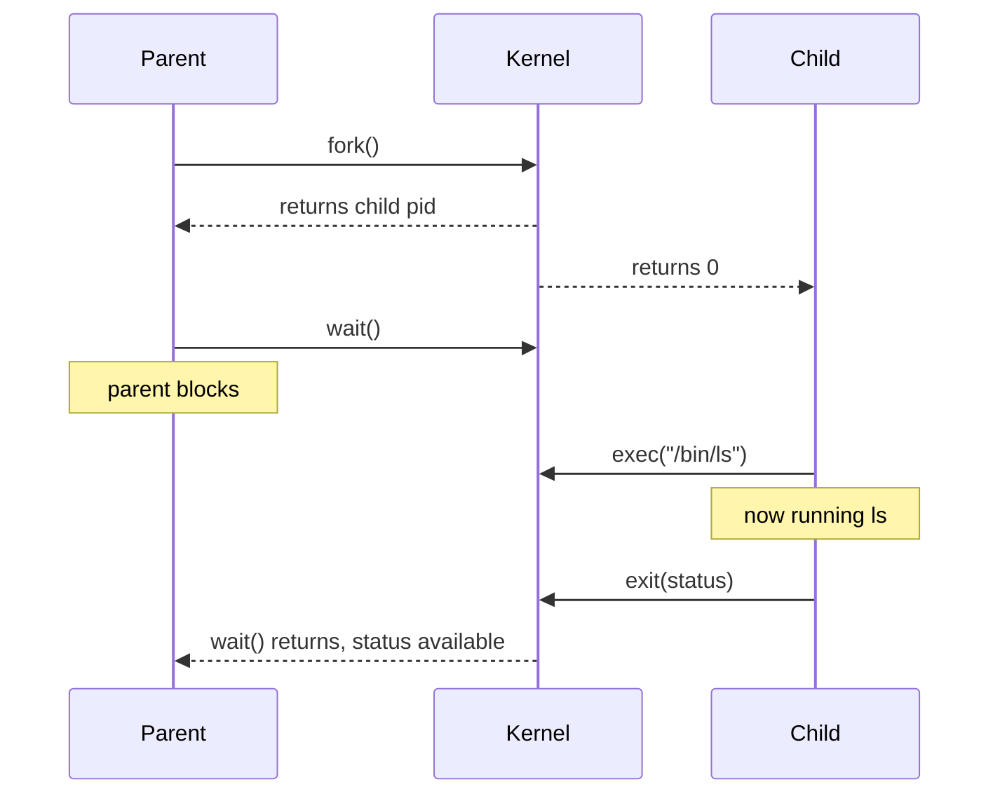
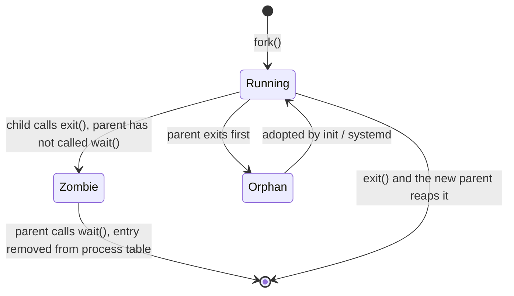
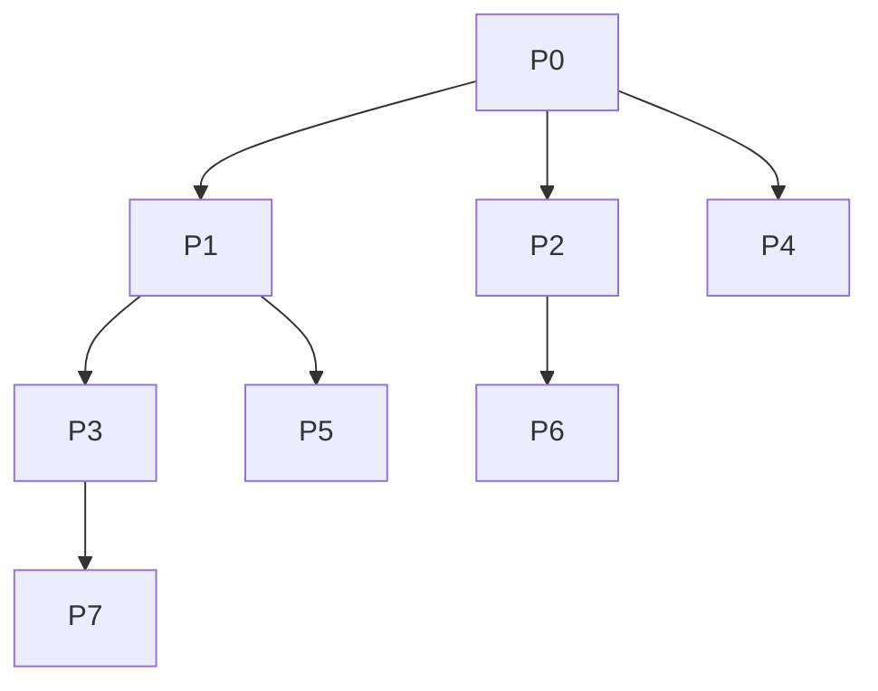
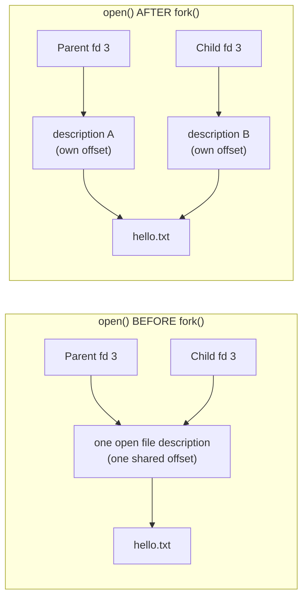

**Notes based off of:** Processes: Operations on Processes (lecture slides, based on _Operating System Concepts_ by Silberschatz, Galvin, and Gagne)

## Overview

A running program is a **process**, and the OS needs a way to bring processes into existence and remove them again. This note covers the two core operations:

- **Process creation**: how a process spawns another one (`fork()`, `exec()`, `wait()`).
- **Process termination**: how a process ends (`exit()`, `kill()`, cascading termination, zombies and orphans).

It finishes with worked examples that show what `fork()` actually does to memory, output ordering, and open files.

## Process Creation

### The process tree

- A **parent** process creates **child** processes, which can create their own children. This forms a **tree of processes**.
- Every process is identified by a **process identifier (pid)**, an integer the OS uses to manage it.
- On a typical Linux system the root of the tree is `systemd` (older systems: `init`), pid 1. It is the "system and service manager" and is the ancestor of every user process (login shells, `sshd`, your terminal, and so on).

You can see this tree yourself with `pstree` or `ps -ef --forest`.

### Design choices when creating a process

When a parent creates a child, the OS has to decide two things.

**Resource sharing** (CPU time, memory, files, I/O devices):

- Parent and children share **all** resources
- Parent and children share **some** resources
- Parent and child share **no** resources

**Execution**:

- Parent and children execute **concurrently**
- Parent **waits** until some or all of its children terminate

UNIX's answer: the child gets a _copy_ of the parent's resources (see `fork()` below), and the parent usually either keeps running or calls `wait()`.

### Limits on process creation

The OS can refuse to create new processes when it hits hardware or software limits:

- **Memory exhaustion (RAM)**: every process needs memory for its code, stack, heap, and kernel bookkeeping.
- **Resource table caps**: the OS keeps fixed-size internal tables (file descriptors, handles, **process control blocks**). If a table fills up, no new process can be initialized.

Applied: a **fork bomb** (`while(1) fork();`) exploits exactly this. It exhausts the process table so no one else can start anything. Per-user limits (`ulimit -u`) exist to defend against it.

### Address space of the child

After creation, the child's address space is initially a **duplicate of the parent's**. Then, optionally, the child has a **new program loaded** into it (that is what `exec()` is for).


> Real kernels don't physically copy everything at `fork()`. They use **copy-on-write (COW)**: parent and child share the same physical pages, marked read-only, and a page is only copied when one of them writes to it. This makes `fork()` cheap, which matters because the usual next step is `exec()`, which throws the copy away anyway. The _behaviour_ is as if everything was copied, which is the mental model to use.

### The UNIX trio: fork, exec, wait

|Call|What it does|
|---|---|
|`fork()`|Creates a new process that is a duplicate of the caller|
|`exec()` family|Replaces the calling process's memory image with a new program|
|`wait()`|Parent blocks until a child terminates, and collects its exit status|



This split (create first, load a program second) is a deliberate UNIX design: between `fork()` and `exec()` the child can rearrange its own file descriptors, which is how shells implement redirection (`>`, `|`).

### Example: fork + exec + wait (Fig. 3.9)

```c
#include <sys/types.h>
#include <stdio.h>
#include <unistd.h>

int main()
{
    pid_t pid;

    /* fork a child process */
    pid = fork();

    if (pid < 0) {               /* error occurred */
        fprintf(stderr, "Fork Failed");
        return 1;
    }
    else if (pid == 0) {         /* child process */
        execlp("/bin/ls", "ls", NULL);
    }
    else {                       /* parent process */
        /* parent will wait for the child to complete */
        wait(NULL);
        printf("Child Complete");
    }
    return 0;
}
```

Reading the three branches:

- `pid < 0`: `fork()` failed (e.g. process table full). No child exists.
- `pid == 0`: we are the **child**. It immediately replaces itself with `ls`.
- `pid > 0`: we are the **parent**, and `pid` is the child's pid. It waits, then prints.

Notes from the slide:

- `exec` **wipes the memory** of the current process and loads a new program.
- `execlp` is a C library function (a wrapper around the `execve` system call) that replaces the process image. The `p` means it searches `PATH`, the `l` means arguments are passed as a **list**.

## Process Termination

### Normal termination

1. The process executes its last statement (or returns from `main`).
2. It asks the OS to delete it using the `exit()` system call.
3. Status data is returned from child to parent (collected via `wait()`).
4. The OS **deallocates** the process's resources (memory, open files, I/O buffers).

### Other reasons for termination

A parent may terminate a child using `kill()` (technically it sends a signal, `SIGKILL` being the unstoppable one). Typical reasons:

- The child has **exceeded its allocated resources**.
- The task assigned to the child is **no longer required**.
- The **parent is terminating** and the OS does not allow the child to continue without it.

### Cascading termination

Some OSes do not let a child exist if its parent has terminated. In that case:

- If a process terminates, **all** its children, grandchildren, and so on are terminated too.
- This is **initiated by the OS**.

The parent can wait for a child to finish with `wait()`, which returns the terminated child's pid and fills in status information:

```c
pid = wait(&status);
```

> Linux itself doesn't cascade by default. Orphans get adopted (see below). Cascading is the model in some other systems, and it is what happens to processes tied to a terminal session when you close it (they receive a hangup signal).

### Zombie and orphan processes



**Zombie**: the child has terminated, but the parent has **not (yet) called `wait()`**.

- The child's return status and pid must stay in the **process table** so the data can be handed to the parent later.
- Once `wait()` is called, the entry is cleared ("reaped").
- A zombie uses no CPU or memory, only a process table slot. A parent that never reaps its children will slowly leak slots (visible as `Z` / `<defunct>` in `ps`).

**Orphan**: the **parent terminates without calling `wait()`**.

- The orphan is **adopted** by `init`, `systemd`, or another designated process.
- That adopter **calls `wait()` periodically**, so orphans do not become permanent zombies.

### `wait()` vs `waitpid()`

```c
pid = wait(&status);
/* is shorthand for: */
pid = waitpid(-1, &status, 0);
```

- `waitpid(-1, ...)` means "wait for **any** child".
- `waitpid(pid, ...)` waits for one **specific** child.
- The last argument takes options, e.g. `WNOHANG` to return immediately instead of blocking.

## Examples

### Reading the manual (`man` sections)

For any system or library call, consult the man page. The same name can exist in several sections, so specify one when needed:

|Section|Contents|
|---|---|
|1|Executable programs or shell commands|
|2|System calls (functions provided by the kernel)|
|3|Library calls (functions within program libraries)|

```
$ man wait      # the wait command built into bash
$ man 2 wait    # the wait system call
```

### What `fork()` does

- `fork()` creates a **child process that is a duplicate of the parent**.
- The child inherits the parent's state: same program instructions, same variable values, **same position in the code** (it resumes right after the `fork()` call).
- Parent and child have **separate copies** of that state, stored in separate locations in memory.
- **Important:** updating a variable in the child does **not** update it in the parent, and vice versa.

### Return values of `fork()`

|Outcome|Parent receives|Child receives|
|---|---|---|
|Success|the **child's pid** (> 0)|**0**|
|Failure|**-1** (no child created)|(no child exists)|

- `pid_t` is the data type for process identifiers (under the hood, a signed integer).
- `pid_t getpid()` returns the pid of the calling process.
- `pid_t getppid()` returns the pid of the parent.
- `getpid()` and `getppid()` **always succeed**.

The return value is the _only_ way the two copies can tell which one they are, since otherwise they are executing identical code.

### `fork()` example with pids

Suppose the parent has pid 700 and the child gets pid 701.

```c
int main()
{
    pid_t i, j, pid;
    pid = fork();

    if (pid < 0)                      // unsuccessful
        printf("Fork unsuccessful");
    if (pid > 0)                      // parent
    {
        i = getpid();
        printf("\n I am parent with PID %d", i);
    }
    if (pid == 0)                     // child
    {
        i = getpid();
        j = getppid();
        printf("\n I am a child with PID %d and my parent's PID is %d.", i, j);
    }
}
```

||Parent (pid 700)|Child (pid 701)|
|---|---|---|
|`pid` after `fork()`|701|0|
|`i`|700|701|
|`j`|(unused)|700|

### Nondeterministic output (interleaving)

```c
int main()
{
    pid_t pid;
    int i;
    pid = fork();

    if (pid > 0)  // parent
    {
        for (i = 0; i < 10; i++)
            printf("\t\t\tPARENT%d\n", i);
    }
    else          // child
    {
        for (i = 0; i < 10; i++)
            printf("CHILD %d\n", i);
    }
    return 0;
}
```

The slides ask "what is the 5th output line?" and the answer is: **you can't tell from the code**. Two valid runs:

- All 10 `PARENT` lines, then all 10 `CHILD` lines.
- `PARENT 0..6`, then `CHILD 0..2`, then `PARENT 7..9`, then `CHILD 3..9`.

Why: after `fork()` there are two independent processes, and the scheduler gives each a share of the CPU. When it switches between them depends on many factors (other load, time slices, number of cores, I/O), so the interleaving can differ from run to run.

> Takeaway: never write code that depends on parent/child ordering unless you enforce it with `wait()` or another synchronization mechanism.

### `exec()` family: replacing a process

- `execl()` replaces a process with a newly loaded program: it loads a binary file into memory.
- This **destroys the memory image** of the program that called it.
- **On success, `execl()` never returns** (there is no old program left to return to).
- On failure it returns -1.

**Expected output?**

Program A:

```c
int i = 5;
printf("%d\n", i);
execl("B", "", NULL);
printf("%d\n", i);
```

Program B:

```c
main()
{
    printf("hello\n");
}
```

Output:

```
5
hello
```

The second `printf("%d\n", i)` is **never executed**, because `execl` replaced Program A with Program B. Note the process keeps its **pid**: exec changes _what_ is running, not _which process_ it is.

### `fork()` + `execl()` + `wait()` together

```c
int main()
{
    pid_t pid;
    pid = fork();

    if (pid > 0)
    {
        wait(NULL);
        printf("Child Complete");
    }
    else
    {
        if (pid == 0)
            execl("B", "", NULL);
        printf("\n You'll never see this line..");
    }
}
```

- Child: becomes Program B and prints `hello`.
- Parent: waits for the child, then prints `Child Complete`.
- The "never see this line" message only appears if `execl` **fails** (e.g. file `B` not found), or if `fork()` failed (`pid < 0` also lands in the `else`).

### Forks inside a loop: counting processes

```c
void main()
{
    int i;
    for (i = 0; i < 3; i++)
    {
        fork();
    }
    printf("hi\n");
}
```

**How many processes? 8, so `hi` is printed 8 times.**

Every `fork()` duplicates _every process currently running that reaches it_, so the count doubles each iteration:

|Iteration|Processes alive after the fork|
|---|---|
|Start|1|
|`i = 0`|2|
|`i = 1`|4|
|`i = 2`|8|

In general, a loop with $n$ unconditional forks produces $$ 2^{n} \text{ processes in total, of which } 2^{n} - 1 \text{ are children (new processes)} $$ Process tree for $n = 3$ (P0 is the original; the numbering is by creation order):



The key insight: a child is created _in the middle of the loop_ with `i` already set, so it continues the loop from where the parent was and goes on to fork its own children.

### File descriptors and `fork()`

Every process has a **file descriptor table**. Each entry is an integer index pointing to an open resource:

|fd|Refers to|
|---|---|
|0|`stdin` (keyboard)|
|1|`stdout` (screen)|
|2|`stderr` (error messages go to the screen)|
|3|e.g. `in_file` from `in_file = open("list.txt", O_RDONLY);`|
|4|(free)|

`open()` returns the lowest unused index, which is why the first file you open is usually 3.

Behind the table is a second, system-wide structure: the **open file description**, which stores the **current file position (offset)**. The descriptor table entry points to it. Whether two processes share an offset depends on whether they point to the _same_ open file description.



#### Open before fork: shared file position

The child gets a **copy of the parent's descriptor table**, but the copied entries point to the **same open file description**, so parent and child **share the file pointer**.

Suppose `hello.txt` contains `Hello, world!`.

```c
int main()
{
    int fd;
    char c;
    pid_t pid;

    fd = open("hello.txt", O_RDONLY);
    pid = fork();                     // open BEFORE the fork

    if (pid > 0)
    {
        read(fd, &c, 1);
        printf("fd: %d, parent: c = %c\n", fd, c);
        wait(NULL);
    }
    else if (pid == 0)
    {
        read(fd, &c, 1);
        printf("fd: %d, child: c = %c\n", fd, c);
        return 0;
    }
    close(fd);
}
```

Possible outputs (which process reads first depends on scheduling, but they **always get different characters**):

```
fd: 3, parent: c = H
fd: 3, child: c = e
```

or

```
fd: 3, child: c = H
fd: 3, parent: c = e
```

Whoever reads first advances the shared offset, so the other process sees the next character.

> The slide code calls `fclose(fd)` on a raw `int` descriptor. That is a mismatch: `open()` pairs with `close()`, while `fclose()` takes a `FILE *` from `fopen()`.

#### Open after fork: independent file positions

Here parent and child each call `open()` after the fork, so each gets its **own entry and its own open file description**, with a separate file position.

```c
pid = fork();
fd = open("hello.txt", O_RDONLY);     // open AFTER the fork
```

Possible outputs: both read the same first character.

```
fd: 3, parent: c = H
fd: 3, child: c = H
```

or the same lines in the opposite order.

### Which should you use?

- Open **before** `fork()` when **sharing is paramount** (e.g. parent and child cooperate to consume a single stream, as in pipes or a shared log).
- Usually better to open **after** `fork()` to **isolate** processes. This becomes **essential when threads are involved**, since concurrent access to one shared file offset is a source of subtle bugs.

## Quick Review

- `fork()` returns **twice**: child pid to the parent, 0 to the child, -1 on failure.
- Child = copy of parent (separate memory, same code position); `exec` swaps in a new program, keeping the pid, and never returns on success.
- `wait()` blocks the parent until a child exits and **reaps** it (frees its process table slot).
- **Zombie** = finished child not yet reaped. **Orphan** = child whose parent exited first (adopted by `init`/`systemd`).
- Output ordering between parent and child is **nondeterministic** without synchronization.
- $n$ unconditional forks in a loop give $2^{n}$ processes.
- File descriptors opened **before** `fork()` share a file offset; those opened **after** do not.

**Prev:** [[CS3305A/2. Process|2. Process]], **Next:** [[CS3305A/4. Threads and Concurrency|4. Threads and Concurrency]]