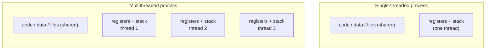
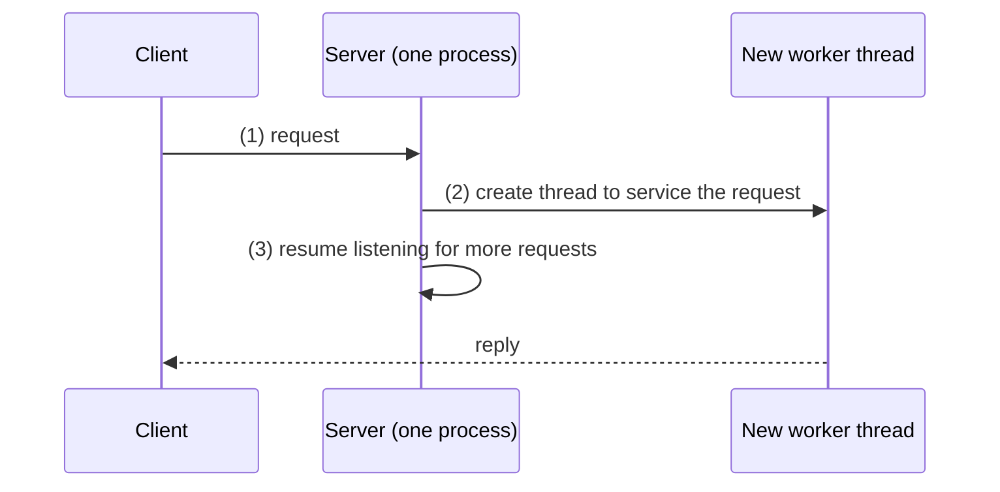
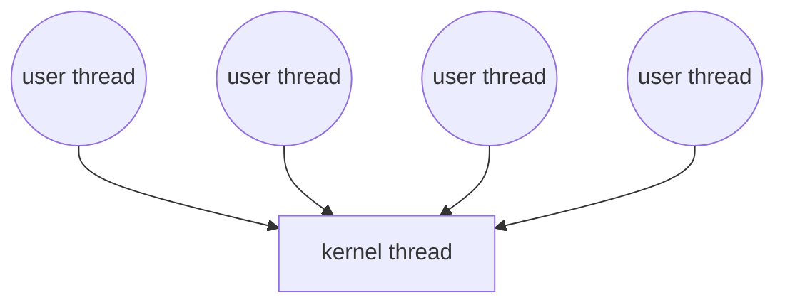
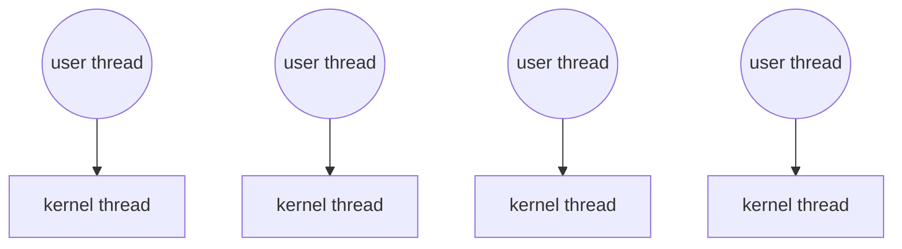
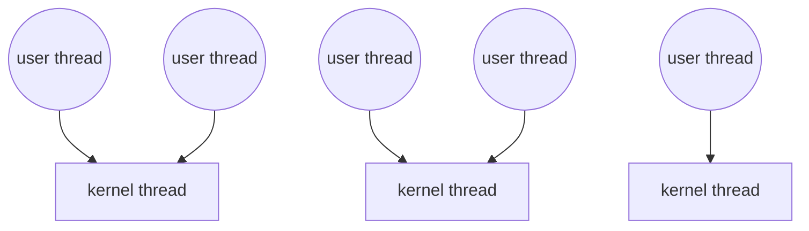
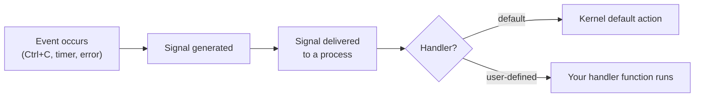
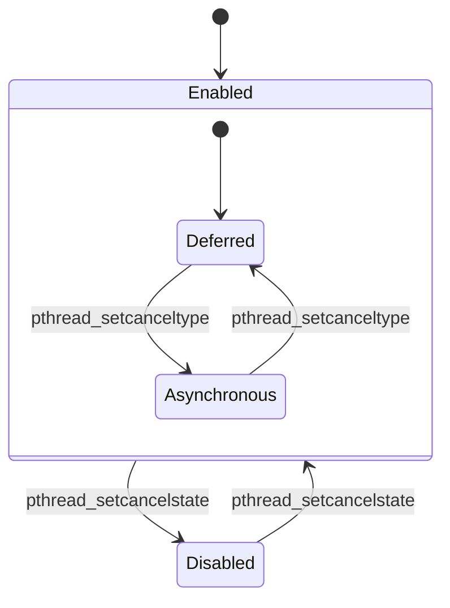

**Notes based off of:** Threads & Concurrency (lecture slides, based on _Operating System Concepts_ by Silberschatz, Galvin, and Gagne)

## Overview

A **thread** is the basic unit of CPU execution inside a process. Where the previous topic (processes) treated a process as one flow of execution, here a single process can contain **several flows of execution** that share the same memory and resources.

Topics covered:

- Why threads exist, and what they share vs. what is private
- Multicore programming: concurrency vs. parallelism, speedup, Amdahl's law
- Multithreading models (how user threads map to kernel threads)
- Thread libraries (Pthreads) with worked code examples
- Threading issues: `fork()`/`exec()`, signals, and thread cancellation

## Why Threads?

### Threads in modern systems

- Most modern applications are **multithreaded**; the threads run _within_ the application's process.
- **Process creation is heavyweight, thread creation is lightweight.** A new process needs its own address space, page tables and resource tables. A new thread needs little more than a stack and a register set.
- Threads can simplify code (each independent job gets its own thread, such as updating the display, fetching data, spell-checking, or answering a network request) and increase efficiency.
- **Kernels are generally multithreaded** too. The _kernel_ is the core program at the center of the OS that acts as the bridge between system software and the hardware.

### Single-threaded vs. multithreaded processes

A process has code, data, and files. In a single-threaded process there is exactly one set of registers and one stack. In a multithreaded process the threads **share** the code, data, and files, but each thread has its **own** registers and stack.

|Shared by all threads in a process|Private to each thread|
|---|---|
|Code (text)|Thread ID|
|Global / static data|Program counter|
|Heap|Register set|
|Open files (descriptor table)|Stack (local variables, call chain)|
|Signal handlers|Signal mask, thread-local storage|



Because the data is shared, a write by one thread is immediately visible to the others. This is what makes threads convenient and also what makes them dangerous (race conditions, which are the subject of later synchronization topics).

### The multithreaded kernel

- `ps -ef` on Linux shows kernel threads as well (names in square brackets).
- `kthreadd` has **pid 2** and is the parent of all other kernel threads. (pid 1 is `systemd`/`init`, the parent of user processes.)
- Use `ps -eLf` to list the threads of user processes too (the `LWP` column is the thread ID).
- With multiple cores, an application can run several CPU-intensive tasks **in parallel**.

### Client-server: processes vs. threads

A server must handle many clients at once. Two designs:

- **One process per request**: the server forks a process for every incoming request. Correct but slow, since process creation is costly.
- **One thread per request**: the server runs as a single process that creates a _new thread_ to service each request, then goes straight back to listening.



### Benefits of threads

|Benefit|Meaning|
|---|---|
|**Responsiveness**|If part of the process blocks (e.g. waiting for disk or network), other threads can continue. Crucial for user interfaces: the UI thread should never be stuck on I/O.|
|**Resource sharing**|Threads share the process's resources by default, which is easier than setting up shared memory or message passing between processes.|
|**Economy**|Cheaper to create than processes, and switching between threads is usually faster than switching between processes. (Same address space, so no page-table switch or TLB flush.)|
|**Scalability**|A multithreaded process can use multiple cores; a single-threaded one can only ever use one.|

## Multicore Programming

### Multicore systems

- Systems evolved from single CPU to **multi-CPU** and later **multicore** (multiple computing cores on the same processor chip).
- **Multithreaded programming** is the mechanism for taking advantage of multiple cores.
- **Multicore programming** is writing software that divides work into smaller tasks that run at the same time on different processing units (cores).
- Typical application: **parallel image filtering**. Split the image into regions and let each core filter its own region.

### Concurrency vs. parallelism

These are easy to mix up:

- **Concurrency**: more than one task is _making progress_. On a single core this is achieved by **interleaving**: run task A a bit, then task B, then A, and so on.
- **Parallelism**: the system can perform more than one task _simultaneously_. This requires multiple cores.

```mermaid
gantt
    title Single core: concurrent but not parallel
    dateFormat X
    axisFormat %s
    section Core 1
    T1 :a1, 0, 1
    T2 :a2, 1, 2
    T3 :a3, 2, 3
    T4 :a4, 3, 4
    T1 again :a5, 4, 5
    T2 again :a6, 5, 6
```

```mermaid
gantt
    title Dual core: parallel execution
    dateFormat X
    axisFormat %s
    section Core 1
    T1 :b1, 0, 1
    T3 :b2, 1, 2
    T1 again :b3, 2, 3
    section Core 2
    T2 :c1, 0, 1
    T4 :c2, 1, 2
    T2 again :c3, 2, 3
```





> Concurrency is possible **without** parallelism. Parallelism implies concurrency.

### Two types of parallelism

|Type|Idea|Example|
|---|---|---|
|**Data parallelism**|Split _the same data_ into subsets across cores; **same operation** on each subset|An array of 1000 numbers on 4 cores: each core gets 250 numbers and each runs "multiply by 2" on its chunk|
|**Task parallelism**|Split _the work_ into distinct, independent functions; each thread does a **different operation** (possibly on the same data, possibly on different data)|One thread computes the mean, another the maximum, another sorts|

### Challenges for programmers

Multicore hardware puts the burden on the programmer:

- **Dividing activities**: which tasks can be separated and run independently?
- **Balance**: do all tasks do roughly equal work? An idle core is wasted hardware.
- **Data splitting**: how can the data be divided as evenly as possible?
- **Data dependency**: does one task need the output of another? If so, they can't simply run side by side.
- **Testing and debugging**: more possible execution paths (interleavings) means bugs that appear only occasionally.

### Parallel speedup

- **Latency** is the time a task takes from start to finish.
- **Speedup in latency** is the ratio of serial time to parallel time:

$$ \text{Speedup} = \frac{T_{\text{serial}}}{T_{\text{parallel}}} $$ Example: a serial task takes 60 s and the parallel version takes 30 s.

- Speedup = $60/30 = 2$, so the parallel version is **2 times faster**.
- Equivalently, it takes $30/60 = 1/2$ the time.

Exercise from the slides: parallel = 10 s, serial = 50 s gives a speedup of $50/10 = 5$ (5 times faster, or $1/5$ of the time).

**Beware:** speedup is usually greater than 1, but parallel is not automatically faster. If the parallelization is done poorly or has a lot of overhead (creating threads, coordinating, copying data), the speedup can be **less than 1**. Parallelizing a very small task usually loses to just doing it serially.

### Amdahl's law

Amdahl's law gives an **upper bound** on the speedup from adding cores to an application that has both serial and parallel parts. Let $S$ be the **serial fraction** (the part that cannot be parallelized) and $N$ the number of cores:

$$ \text{speedup} \le \frac{1}{S + \frac{1 - S}{N}} $$ The intuition: the serial part always takes time $S$ no matter how many cores you add. Only the parallel part, $(1-S)$, shrinks, and it shrinks by a factor of $N$.

**Worked example (75% parallel, 25% serial):**

- 2 cores: $\dfrac{1}{0.25 + \frac{0.75}{2}} = \dfrac{1}{0.625} = 1.6$
- 8 cores: $\dfrac{1}{0.25 + \frac{0.75}{8}} = \dfrac{1}{0.34375} \approx 2.91$
- 2056 cores: $\dfrac{1}{0.25 + \frac{0.75}{2056}} \approx 3.99$ (practically the limit of 4)
- Only 50% parallel ($S = 0.5$): 2 cores gives $\approx 1.33$ and 8 cores gives $\approx 1.78$

**What it tells us:** as $N \to \infty$, the speedup converges to $\dfrac{1}{S}$. If 25% of an application is serial, the speedup can **never exceed 4**, no matter how many cores you add. The serial portion has a disproportionate impact on the gains from adding cores.

Speedup upper bound for different serial fractions:

|Serial fraction $S$|N = 2|N = 8|N = 64|N → ∞ ($1/S$)|
|---|---|---|---|---|
|5%|1.90|5.93|15.42|20|
|10%|1.82|4.71|8.77|10|
|25%|1.60|2.91|3.82|4|
|50%|1.33|1.78|1.97|2|

Practical lesson: before buying more cores, find and shrink the serial portion of the program (locks, I/O, initialization, reduction steps). Amdahl's law is also deliberately pessimistic since it assumes the problem size is fixed. In practice, bigger machines are often used to solve bigger problems, where the parallel part grows too.

## Multithreading Models

### User threads vs. kernel threads

Thread support can be provided at two levels:

- **User threads**: supported _above_ the kernel and managed **without kernel support** (by a user-space library).
- **Kernel threads**: supported and managed **by the OS** itself. Virtually all general-purpose OSes support them.

A relationship must exist between the two, and there are three classic ways to model it. The kernel schedules _kernel threads_ onto cores, so a user thread only runs when it is connected to a kernel thread.

### Many-to-one

Many user threads map to **one** kernel thread. Thread management is done by the thread library in user space.



**Why do very few systems use it?**

- If **one thread makes a blocking system call, the entire process blocks**, since the kernel only sees one thread.
- Only one thread can be in the kernel at a time, so there is **no parallelism on multicore** systems.

Upside: thread creation and switching are very cheap, because they don't involve the kernel.

### One-to-one

Each user thread maps to its **own** kernel thread.



- When one thread makes a blocking system call, **other threads keep running**.
- Threads can run **in parallel** on multiple cores.

**Drawbacks:** creating a user thread means creating a kernel thread, which carries overhead (kernel memory, scheduling), and many systems **limit the number of threads** for this reason. Creating thousands of threads can burden the system.

### Many-to-many

Multiplexes **many user threads onto an equal or smaller number of kernel threads**. The number of kernel threads can depend on the application or the machine.



- The developer can create as many user threads as needed, and the kernel threads run in parallel on a multicore system. A blocking call only blocks one kernel thread, and the library can schedule another.

**Drawbacks:** it is **complex to implement**. The user-level scheduler and the kernel scheduler have to cooperate, and it is hard to tune well.

### Summary: why one-to-one dominates

Most systems today (Linux, Windows, macOS) use **one-to-one**. Reasons:

- It is much simpler: the kernel scheduler handles everything.
- The extra flexibility of many-to-many wasn't worth the complexity.
- The cost of creating kernel threads has come down, and cores are plentiful, so limits on thread counts matter less.

Other models are mostly variations or hybrids of these three (e.g. a two-level model, which is many-to-many that also allows binding a user thread to a kernel thread).

## Thread Libraries

A **thread library** provides the programmer an API for creating and managing threads. Two implementation approaches:

1. A library entirely in **user space** with no kernel support.
2. A **kernel-level library** supported directly by the OS.

### Pthreads

- **POSIX** (which Linux is compliant with) defines **Pthreads**, a _specification_ for thread behaviour (not an implementation). It may be provided at user level or kernel level.
- You must `#include <pthread.h>`, and compile with `gcc -pthread file.c -o file`.
- **On Linux, both `fork()` and `pthread_create()` use the same underlying system call, `clone()`.** The difference is the flags that control what is shared:
    - `fork()` shares **nothing** (child gets its own copy).
    - Pthreads share, for example, via `CLONE_FS` (filesystem info), `CLONE_VM` (address space), `CLONE_SIGHAND` (signal handlers), and `CLONE_FILES` (open files).

This is a nice way to see that Linux doesn't think of "process" and "thread" as different kinds of objects. Both are "tasks", and they differ in how much they share.

## Pthreads Examples

### Creating a thread

```c
int pthread_create(pthread_t *thread, pthread_attr_t *attr,
                   void *(*start_routine)(void *), void *arg);
```

- Returns **0 on success**, otherwise an **error code** (note: it does _not_ set `errno`).
- `thread`: where the new thread's ID (handle) is stored.
- `attr`: attributes of the new thread (`NULL` = defaults).
- `start_routine`: the function the new thread starts executing.
- `arg`: the single argument passed to that function (a `void *`, so you can pass the address of anything).

### Waiting for a thread to complete

```c
int pthread_join(pthread_t thread, void **retval);
```

- Returns **0 on success**, otherwise an error code.
- `thread`: the thread to wait for.
- `retval`: if non-`NULL`, receives the value the thread passed to `pthread_exit()` (or returned).
- **Always join**: if you don't wait, `main` can return (ending the entire process, and all its threads) before the thread has done its work.

`pthread_join` is the thread analogue of `wait()` for processes.

### Hello, World thread

```c
#include <stdio.h>
#include <unistd.h>
#include <pthread.h>

void *do_work()
{
    printf("Hello, World!...I am a thread\n");
}

int main(int argc, char **argv)
{
    pthread_t worker_thread;
    if (pthread_create(&worker_thread, NULL, do_work, NULL))
    {
        printf("Error while creating thread\n");
    }
    pthread_join(worker_thread, NULL);
}
```

`pthread_create` returns 0 on success, so the `if` body only runs on **failure**. (Strictly, a thread function should `return NULL;` at the end. It is left off in the slides for brevity.)

### Three threads

Create the threads in one loop, join them in a second loop:

```c
pthread_t worker_thread[3];
for (int i = 0; i < 3; i++)
{
    if (pthread_create(&worker_thread[i], NULL, do_work, NULL))
        printf("Error while creating thread\n");
}
for (int i = 0; i < 3; i++)
{
    if (pthread_join(worker_thread[i], NULL))
        printf("Error joining with thread");
}
```

Don't join inside the creation loop. That would wait for each thread before starting the next and give you no parallelism. Also, the order in which the three "Hello" lines print is **nondeterministic**, exactly like parent/child output after a `fork()`.

### Passing data to threads

Ways to get data between a parent and its threads, or between threads:

- **Global variables** (all threads share them)
- **Arguments** to `pthread_create()`, and values through `pthread_exit()` / `pthread_join()`
- A **pipe** passed as an argument

#### Passing a message

```c
void *thread_prints_msg(void *msg)
{
    printf("From thread_prints_msg: %s\n", (char *) msg);
}

int main(int argc, char **argv)
{
    pthread_t thread_1;
    printf("From main: Going to create Thread...\n");
    pthread_create(&thread_1, NULL, thread_prints_msg, "Hello, World!");
    pthread_join(thread_1, NULL);
    printf("thread terminates…\n");
    return 0;
}
```

The `void *` argument is cast back to the real type inside the thread. A string literal lives for the whole program, so passing it is safe.

#### Three threads, each with its own number

```c
void *do_work(void *args)
{
    int threadNumber = *(int *) args;
    printf("Hello, World!...I am thread %d\n", threadNumber);
}

int main(int argc, char **argv)
{
    pthread_t worker_thread[3];
    int threadNumber[3];
    for (int i = 0; i < 3; i++)
    {
        threadNumber[i] = i;   // Each thread needs to use its own variable
        if (pthread_create(&worker_thread[i], NULL, do_work, &threadNumber[i]))
            printf("Error while creating thread\n");
    }
    /* ... join the threads ... */
    return 0;
}
```

**Why a separate array?** If you passed `&i` (the loop counter) to every thread, they would all point to the _same_ variable. By the time a thread reads it, the loop may have incremented `i` already, so several threads could see the same (or an out-of-range) number. Giving each thread its own element, `&threadNumber[i]`, removes the problem.

Also, the variable passed in must still be alive when the thread reads it. Passing the address of a local variable that goes out of scope before the thread runs is a classic bug.

#### Fifteen threads: threads that modify data

```c
#define MAX_NUMBER 15

void *do_work(void *args)
{
    int *square = (int *) args;
    *square *= *square;
}

int main(int argc, char **argv)
{
    pthread_t worker_thread[MAX_NUMBER];
    int squareNumber[MAX_NUMBER];
    for (int i = 0; i < MAX_NUMBER; i++)
    {
        squareNumber[i] = i;
        if (pthread_create(&worker_thread[i], NULL, do_work, &squareNumber[i]))
            printf("Error while creating thread\n");
    }
    for (int i = 0; i < MAX_NUMBER; i++)
    {
        if (pthread_join(worker_thread[i], NULL))
            printf("Error joining with thread");
        printf("%d squared is %d\n", i, squareNumber[i]);
    }
    return 0;
}
```

- Each thread receives a **pointer** to one array element and squares it in place. This is **data parallelism**: same operation on different pieces of data.
- This is safe because every thread touches a **different** element, so there are no conflicting accesses.
- The `pthread_join` **before** the `printf` guarantees the thread has finished modifying that element before main reads it.

#### Threads and pipes

```c
void *dowork(void *args)
{
    int *port = (int *) args;
    char s[4];
    read(port[0], &s, sizeof(s));
    printf("Thread finds %s\n", s);
}

int main(void)
{
    int port[2];
    pthread_t tid;

    if (pipe(port) < 0)
    {
        perror("pipe error");
        exit(1);
    }

    char s[4] = "ABC";                // Note: sizeof(s) == 4
    write(port[1], s, sizeof(s));     // write string

    pthread_create(&tid, NULL, dowork, port);
    pthread_join(tid, NULL);

    close(port[0]);
    close(port[1]);
    return 0;
}
```

- `pipe(port)` creates a one-way channel: `port[0]` is the **read** end, `port[1]` is the **write** end.
- `"ABC"` needs **4 bytes** (3 letters plus the terminating `'\0'`), which is why `sizeof(s) == 4`. Writing the terminator means the thread can print the buffer as a C string.
- The pipe's file descriptors work in the thread because **threads share the process's file descriptor table**. This contrasts with `fork()` where the child gets a _copy_ of the table.
- `read()` **blocks** if the pipe is empty, so a pipe also works as a simple synchronization mechanism.

## Threading Issues

### `fork()` and `exec()` semantics

If one thread in a program calls `fork()`, does the new process duplicate **all** threads or only the calling one?

- **On Linux, only the calling thread is duplicated**, so the child process starts **single-threaded**.
- Some UNIX flavours provide two versions of `fork()`: one that duplicates all threads, and one that duplicates only the caller.
- `exec()` usually works as normal: it replaces the running process **including all of its threads**.

Practical consequence: if the child calls `exec()` immediately after `fork()`, only the calling thread matters anyway. Duplicating every thread would be wasted work, since `exec()` discards them. A subtle trap is that the child's copy of memory may contain locks held by threads that no longer exist in the child, so the child should do little besides `exec()`.

### Signal handling

A **signal** is how UNIX notifies a process that a particular event has occurred. Events can come from internal sources (e.g. a divide-by-zero, an illegal memory access, a timer you set) or external ones (e.g. Ctrl+C, another process calling `kill`).

Life cycle of a signal:

1. A signal is **generated** by a particular event.
2. It is **delivered** to a process.
3. It is **handled** by one of two kinds of signal handler:
    - **Default** handler (supplied by the kernel; usually terminate, ignore, stop, or dump core)
    - **User-defined** handler (a function you register)



#### Important signals

See `man 7 signal` or `kill -l` for the full list.

|Signal|Meaning|
|---|---|
|`SIGALRM`|Timer signal. Set with `alarm()`, or send with `raise(SIGALRM)`|
|`SIGINT`|Interrupt from keyboard (Ctrl+C)|
|`SIGTERM`|Termination request (e.g. `kill <pid>`). Can be caught, so a program can clean up first|
|`SIGKILL`|**Cannot be caught or ignored** (e.g. `kill -9 <pid>`). No user-defined handler is possible. The kernel simply terminates the process|

(`SIGSTOP` is likewise uncatchable.)

#### Signal example (alarm)

The version from the slides:

```c
#include <signal.h>
int alarm_flag = 0;
void alarm_handler()
{
    printf("An alarm clock signal was received\n");
    alarm_flag = 1;
}

int void main()
{
    signal(SIGALRM, alarmHandler);
    alarm(3);
    printf("Alarm has been set\n");
    while (alarm_flag == 0);
    printf("Back from alarmHandler function\n");

    return 0;
}
```

What it does: register a handler for `SIGALRM`, ask the kernel to send `SIGALRM` after 3 seconds, then spin in a loop until the handler sets a flag.

The slide code has a few typos that won't compile as written: `int void main()` should be `int main(void)`, the handler is named `alarm_handler` but registered as `alarmHandler`, and `<stdio.h>`/`<unistd.h>` are missing. A cleaned-up version:

```c
#include <stdio.h>
#include <signal.h>
#include <unistd.h>

volatile sig_atomic_t alarm_flag = 0;

void alarm_handler(int sig)
{
    alarm_flag = 1;      // keep handlers tiny; printf is not async-signal-safe
}

int main(void)
{
    signal(SIGALRM, alarm_handler);
    alarm(3);
    printf("Alarm has been set\n");
    while (alarm_flag == 0)
        ;                // busy-wait (pause() would be nicer)
    printf("Back from the handler\n");
    return 0;
}
```

`volatile` tells the compiler the flag can change behind its back, so the loop can't be optimized into an infinite loop. `sig_atomic_t` is the type guaranteed to be read and written atomically.

#### Delivering signals: single-threaded

In a single-threaded program the signal is delivered to the process, and there's only one thread to run the handler:

```c
kill(pid_t pid, int signal);   // send to a given pid
raise(int signal);             // send to getpid() (i.e. "myself")
```

#### Delivering signals: multithreaded

Which thread should receive a signal sent to a multithreaded process? **It depends on the signal.** Options:

- Deliver it to the **thread to which the signal applies** (e.g. a signal caused by that thread's illegal memory access).
- Deliver it to **every** thread in the process (e.g. `SIGKILL`, since the whole process must die).
- Deliver it to **certain** threads in the process (the ones that haven't blocked it).
- Assign **one specific thread** to receive all signals for the process (a common design: a dedicated signal-handling thread).

For signals aimed at a particular thread:

```c
pthread_kill(pthread_t tid, int signal);   // send to a specific thread
raise(int signal);                         // in a multithreaded program: send to pthread_self() ("myself")
```

### Thread cancellation

**Cancellation** means terminating a thread before it has finished. The thread being cancelled is the **target thread**. Examples: a "Stop" button halts a search being run by several threads, or one thread finds the answer and the others should quit.

**It may not be safe to simply stop a running thread.** It might be holding a lock, halfway through updating shared data, or have allocated memory it hasn't freed. Killing it at a random instant could leave things corrupted. So threads can be set to **permit or ignore** cancellation.

#### Cancellation states

|State|Behaviour|
|---|---|
|**Disabled**|Cancellation requests are ignored (they stay pending)|
|**Enabled**|Cancellation requests are permitted (**default on Linux**)|

Set with `pthread_setcancelstate()`.

#### Cancellation types (if enabled)

|Type|Behaviour|
|---|---|
|**Asynchronous**|Terminate the target thread **immediately** (risky, for the reasons above)|
|**Deferred**|The target thread **periodically checks** whether it should be cancelled, and exits at safe points (**default on Linux**)|

Set with `pthread_setcanceltype()`.



#### Cancelling with deferred cancellation

- `pthread_cancel(tid)` only **requests** cancellation. It doesn't kill the thread by itself.
- The target thread honours the request when it reaches a **cancellation point**. You can create one explicitly with `pthread_testcancel()`.

```c
void *worker(void *arg)
{
    while (1)
    {
        /* ... do a unit of work ... */
        pthread_testcancel();   // safe point: exit here if cancellation was requested
    }
}

/* in main */
pthread_cancel(tid);        // request
pthread_join(tid, NULL);    // wait for the thread to actually finish
```

`pthread_testcancel()` is only _one_ way to get a cancellation point. `man pthreads` lists many system calls that block and therefore act as cancellation points, including `sleep()`, `open()`, `read()`, `write()`, `close()`, `send()`, and `recv()`, plus library calls built on them such as `scanf()` and `printf()`. So a thread that frequently does I/O gets cancellation points "for free".

## Quick Review

- Threads in one process **share** code, data, heap, and files; each has its **own** stack and registers.
- Threads are cheaper than processes to create and switch, and allow responsiveness, resource sharing, and multicore scalability.
- **Concurrency** = progress on multiple tasks (can be interleaved on one core). **Parallelism** = truly simultaneous execution (needs multiple cores).
- **Data parallelism**: same operation on different data. **Task parallelism**: different operations on threads.
- $\text{Speedup} = T_{\text{serial}} / T_{\text{parallel}}$, and **Amdahl's law** bounds it by $\frac{1}{S + (1-S)/N}$, so the serial fraction limits you to at most $1/S$.
- Models: **many-to-one** (blocking call stalls everything, no parallelism), **one-to-one** (what modern OSes use), **many-to-many** (flexible but complex).
- Pthreads: `pthread_create`, `pthread_join`; on Linux both `fork()` and `pthread_create()` are built on `clone()`.
- Give each thread its **own** data to work on, and join before reading results.
- Linux `fork()` in a multithreaded program duplicates **only the calling thread**; `exec()` replaces **all** threads.
- Signals can be default- or user-handled (`SIGKILL` can't be caught); in a multithreaded process the delivery target depends on the signal.
- Thread cancellation is safest when **deferred**: `pthread_cancel()` is only a request, honoured at a cancellation point.

> The agenda also lists **Implicit Threading** (letting compilers or libraries manage threads, via thread pools, OpenMP, fork-join, and Grand Central Dispatch), but the slides in this deck don't cover it, so it isn't included here.

**Prev:** [[CS3305A/3. Operations on Processes|3. Operations on Processes]], **Next:** [[CS3305A/5. CPU Scheduling|5. CPU Scheduling]]