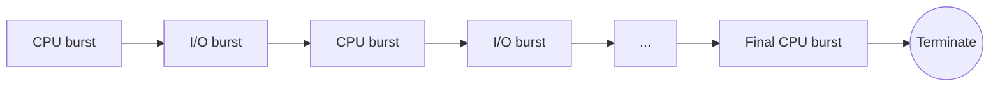
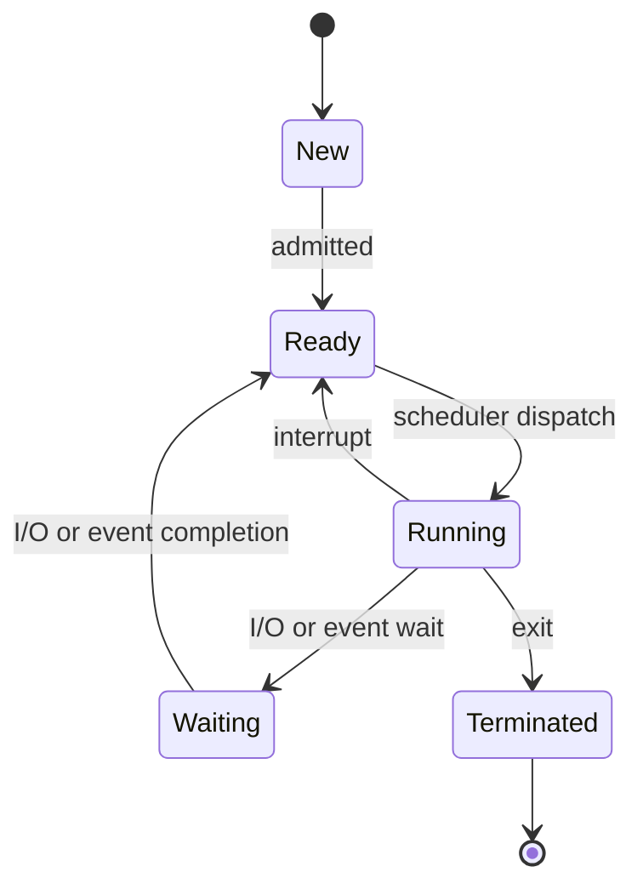
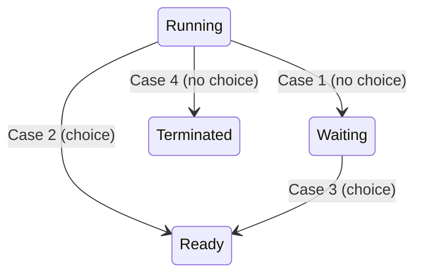
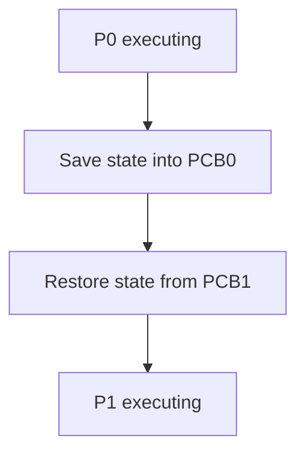

**Notes based off of:** CS-3305 _Intro to Scheduling_ slides (based on _Operating System Concepts_ by Silberschatz, Galvin, and Gagne)

## Overview

This note covers the foundations of CPU scheduling: why it matters, when scheduling decisions happen, what the dispatcher does, and how we measure whether a scheduler is doing a good job. The actual scheduling _algorithms_ (FCFS, SJF, Round Robin, etc.) and multiprocessor scheduling come in the next set of notes.

- Basic concepts
- Scheduling criteria
- Algorithms (next time)
- Multiprocessor scheduling (next time)

## Basic Concepts

### Why Scheduling Exists

- Going forward, "process" and "thread" will be used interchangeably. Strictly, the OS schedules _threads_ (kernel-level), but the terminology is looser in this context.
- On a **single-core** machine, only one process can run at any instant. Everything else must wait.
- **Multicore** machines can run several processes truly simultaneously (one per core).
- The CPU is the primary resource in the system, so how it is divided among processes largely determines how fast and responsive the whole machine feels.

The core idea behind **multiprogramming**: if a process is stuck waiting (e.g., for disk), the CPU shouldn't sit idle. The OS hands the CPU to another process. Scheduling is the mechanism that decides _which_ one.

### The CPU-I/O Burst Cycle

Process execution is an alternating cycle of:

- **CPU burst**: the process is executing instructions (loads, stores, arithmetic, etc.)
- **I/O burst**: the process is waiting on I/O (reading/writing files, network, user input)

A process starts with a CPU burst, then an I/O burst, then another CPU burst, and so on, until it ends with a CPU burst that terminates it.



#### CPU Burst Distribution

The histogram of CPU burst durations (Fig. 5.2 in the slides) is the key empirical observation:

- Very **many short** CPU bursts
- Very **few long** CPU bursts
- The curve is roughly exponential / hyperexponential, with a big peak at short durations and a long, thin tail

Why this matters: the shape of the distribution is what scheduling algorithms are designed around. This leads to a useful way to classify processes:

- **I/O-bound** processes: many short CPU bursts, lots of waiting on I/O (e.g., a text editor, a web server handling requests)
- **CPU-bound** processes: few, long CPU bursts (e.g., video encoding, scientific simulation)

A good scheduler should keep I/O-bound processes responsive (they only need the CPU briefly) without letting CPU-bound processes starve.

### Recall: Process State

The scheduler operates on the process state diagram from earlier in the course.



Only processes in the **Ready** state are candidates for the CPU. The scheduler's job is the **Ready → Running** transition.

## The CPU Scheduler

### What It Does

- Whenever the CPU becomes idle, the **CPU scheduler** (a.k.a. short-term scheduler) selects one process from the **ready queue** to run.
- The thing actually stored in the ready queue is a **PCB** (process control block), the OS's data structure holding a process's state (registers, program counter, memory info, etc.).
- The scheduler then allocates the CPU to the selected process.

### The Ready Queue Isn't Necessarily FIFO

The slides note the ready queue "could take on several forms." Depending on the algorithm, it may be:

- A simple FIFO queue
- A priority queue
- A tree (e.g., Linux's CFS uses a red-black tree)
- An unordered list

The data structure is chosen to make the scheduling policy efficient to implement.

### When Do Scheduling Decisions Happen?

A scheduling decision may be needed when a process:

1. Switches from **running → waiting** (e.g., it issues an I/O request)
2. Switches from **running → ready** (e.g., a timer interrupt fires)
3. Switches from **waiting → ready** (e.g., its I/O completes)
4. **Terminates**



### Nonpreemptive (Cooperative) Scheduling

Applies to cases **1 and 4**.

- There is **no choice**: the running process gave up the CPU on its own (blocked or finished), so the scheduler _must_ pick a new process from the ready queue (if one exists).
- Under this scheme a process **keeps the CPU until it releases it**, either by terminating or by waiting.
- Also called **cooperative** scheduling, because it depends on processes voluntarily yielding.
- Downside: one misbehaving or very long-running process can hog the CPU and make the system unresponsive. Early systems like Windows 3.x and classic Mac OS used cooperative scheduling.

### Preemptive Scheduling

Applies to cases **2 and 3**.

- There **is a choice**: the currently running process hasn't asked to stop, but the scheduler may decide someone else should run instead.
- Under this scheme, the OS can **forcibly interrupt** a running process, depending on the algorithm.
- Example of case 3: a high-priority process finishes its I/O and becomes ready. A preemptive scheduler can immediately kick off the lower-priority process currently running.
- Example of case 2: a timer interrupt ends a process's time slice and puts it back on the ready queue.
- Virtually all modern general-purpose OSes (Linux, Windows, macOS) use preemptive scheduling.

#### The Cost: Race Conditions

Preemptive scheduling can cause **race conditions** when data are shared among several processes. A process can be interrupted in the _middle_ of updating shared data, leaving it in an inconsistent state for the next process that reads it.

Classic example: two threads both execute `counter++`, which is really _load, add, store_. If thread A is preempted after the load but before the store, thread B can increment the counter, and then A overwrites it with a stale value. One increment is lost.

This is why synchronization (mutexes, semaphores, etc.) is a major topic later in the course. It also applies to the **kernel itself**: kernel data structures like the ready queue and I/O queues are shared, so a preemptible kernel has to be careful.

### A Couple of Notes on Interrupts

- Interrupts can occur **at any time**, and the OS needs to accept them almost always (ignoring them would mean missing I/O completions, timer ticks, etc.).
- Sections of code affected by interrupts must be **guarded** to avoid simultaneous use of shared structures.
- The standard technique: **disable interrupts at entry** to the critical section and **re-enable them on exit**.
- This shouldn't happen often, and the guarded sections generally contain **very few instructions**. Keeping interrupts off for long would hurt responsiveness and risk losing events.

## The Dispatcher

### What It Does

The **dispatcher** is the module that actually gives control of the CPU to the process the scheduler selected. The scheduler decides _who_; the dispatcher does the handoff. It involves:

1. **Switching context** from one process to another (save the old process's state, load the new one's)
2. **Switching to user mode**
3. **Jumping to the proper location** in the user program to resume it (restoring the program counter)



### Dispatch Latency

**Dispatch latency** is the time it takes the dispatcher to stop one process and start another running (everything between "P0 stops" and "P1 starts" in the diagram).

- It is pure **overhead**: no useful user work happens during a context switch.
- The dispatcher runs on _every_ context switch, so it must be **as fast as possible**.
- If time slices are very short, the CPU spends a larger fraction of its time context switching. This tradeoff shows up again in Round Robin.

### Observing Context Switches on Linux

- `vmstat -w 1 3`
    - `vmstat` is a built-in OS monitoring command that reports real-time and average statistics on virtual memory, processes, CPU activity, and disk I/O.
    - `-w` uses wide output, `1` is the sampling interval in seconds, and `3` is the number of reports. The `cs` column shows context switches per second.
- `cat /proc/<pid>/status`
    - Shows per-process info, including counts of **voluntary** context switches (the process blocked, e.g., on I/O) and **nonvoluntary** context switches (the process was preempted).
    - Tying back to the above: voluntary switches correspond to cases 1 and 4, and nonvoluntary switches to preemption. A high voluntary count suggests an I/O-bound process; a high nonvoluntary count suggests a CPU-bound one.

## Scheduling Criteria

The scheduler uses several criteria to decide which process to run. Different algorithms favor different criteria, and different systems (a batch server vs. an interactive laptop) care about different ones.

### The Five Criteria

|Criterion|Question it asks|How it's measured|Goal|
|---|---|---|---|
|**CPU utilization**|Can we keep the CPU(s) as busy as possible?|0% to 100%|Maximize|
|**Throughput**|How many processes can we run in a time frame?|Processes completed per unit time|Maximize|
|**Turnaround time**|How long does a process take to go from new to terminated?|Sum of time waiting in the ready queue, executing, and doing I/O|Minimize|
|**Waiting time**|How long does a process sit in the ready queue?|Sum of the periods spent waiting in the ready queue|Minimize|
|**Response time**|How long until a process starts giving responses?|Time from request submission to the first response|Minimize|

### Notes on Each Criterion

#### CPU Utilization

- Ranges from 0% to 100%.
- In real systems it typically falls between roughly 40% (lightly loaded) and 90% (heavily loaded).

#### Throughput

- Depends heavily on the workload: for long processes it might be one per hour, for short transactions maybe tens per second.

#### Turnaround Time

- This is the **total** time from submission to completion. It includes waiting in the ready queue, running on the CPU, and waiting for/performing I/O.
- Most relevant for **batch** systems.

#### Waiting Time

- The scheduling algorithm does **not** affect how long a process executes or how long its I/O takes. It only affects time spent in the **ready queue**, which is why waiting time is the criterion most directly tied to scheduler quality.

#### Response Time

- The time until the **first** response, _not_ until the output is complete. This is the relevant measure for **interactive** systems: users care how quickly the system reacts when they click or type.
- A process can have a long turnaround time but a short response time.

### Relationship Between the Criteria

For a process $i$ in a simple model where it doesn't do I/O: $$ T_{\text{turnaround}} = T_{\text{completion}} - T_{\text{arrival}} $$ $$ T_{\text{waiting}} = T_{\text{turnaround}} - T_{\text{burst}} $$ $$ T_{\text{response}} = T_{\text{first run}} - T_{\text{arrival}} $$ Throughput over a window is: $$ \text{Throughput} = \frac{\text{number of processes completed}}{\text{total elapsed time}} $$

### Optimization Goals

- **Maximize:** CPU utilization, throughput
- **Minimize:** turnaround time, waiting time, response time
- Usually we optimize the **average** of a measure. For interactive systems, it can be more important to minimize the **variance** in response time (predictable is better than fast-on-average but occasionally terrible).
- These goals **conflict**. For example, favoring short response times usually means more context switches, which lowers throughput and utilization. No single algorithm wins on every criterion, which is why many exist.

### Quick Worked Example

Three processes all arrive at time 0, run in the order P1, P2, P3, **nonpreemptively**, with no I/O:

|Process|Burst time|
|---|---|
|P1|5|
|P2|3|
|P3|2|

Timeline (Gantt chart):

```
| P1        | P2     | P3   |
0           5        8      10
```

| Process | Completion | Turnaround | Waiting | Response |
| ------- | ---------- | ---------- | ------- | -------- |
| P1      | 5          | 5          | 0       | 0        |
| P2      | 8          | 8          | 5       | 5        |
| P3      | 10         | 10         | 8       | 8        |

- Average turnaround time: $(5 + 8 + 10)/3 \approx 7.67$
- Average waiting time: $(0 + 5 + 8)/3 \approx 4.33$
- Throughput: $3/10 = 0.3$ processes per time unit
- Response equals waiting here because without preemption a process never runs, stops, and resumes. Its first run is also when its waiting ends.

Reordering to P3, P2, P1 would give an average waiting time of $(0 + 2 + 5)/3 \approx 2.33$, which shows how the _order_ chosen by the scheduler changes the metrics even though the total work is identical. This is exactly the motivation for the algorithms covered next.

## Summary

- The CPU is the key resource, and scheduling decides which ready process uses it.
- Processes alternate between CPU bursts and I/O bursts. CPU bursts are mostly short.
- Scheduling decisions occur at four points. Cases 1 and 4 force a choice (**nonpreemptive**); cases 2 and 3 allow one (**preemptive**).
- Preemption improves responsiveness but introduces **race conditions** on shared data.
- The **dispatcher** performs the context switch. **Dispatch latency** is overhead and should be minimized.
- Schedulers are judged by CPU utilization, throughput, turnaround time, waiting time, and response time, and these goals often trade off against each other.

## Review Questions

1. Which of the four scheduling-decision situations allow a nonpreemptive scheduler to act, and why is there "no choice" in those cases?
	- 1. Running -> waiting (waiting for IO). 2. Running -> Terminated. There is not an active choice to stop for the sake of better scheduling, the process is literally stuck waiting
2. Why can preemptive scheduling cause race conditions, and how does the kernel guard its own critical sections?
	- Because a thread can be interrupted after changing data and before committing it to memory, another thread that accesses that data will use stale data. This thread may write to it, and when the previous thread resumes it will just re-overwrite this data again. This is non-deterministic because we never know if a CPU happen to interrupt at that exact moment. 
3. What is the difference between the scheduler and the dispatcher?
	- Dispatcher does the actual work to switch the process (goes to the correct location in memory restores from PCB). CPU scheduler decides which process the dispather should switch to. 
4. Why is waiting time the criterion most directly influenced by the scheduling algorithm?
	- Waiting time is the amount of time spent in the queue, since the scheduler is fully responsible for how long something spends in queue, small changes to the algorithm or its priorities could make large changes in wait time
5. Give an example where response time and turnaround time would lead you to prefer different schedules.
	- For somebody's laptop, response time is very important. A user is interacting with a system and expect immediate responsiveness. For a backend for a banking app, we don't want to leave any API request waiting for a long time, so we need to prioritize turnaround time to keep processes fast

**Prev:** [[CS3305A/4. Threads and Concurrency|4. Threads and Concurrency]]