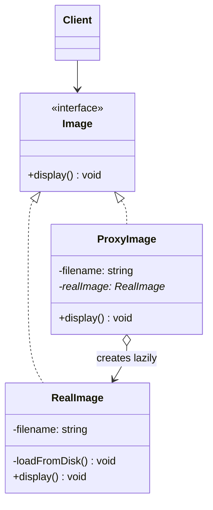
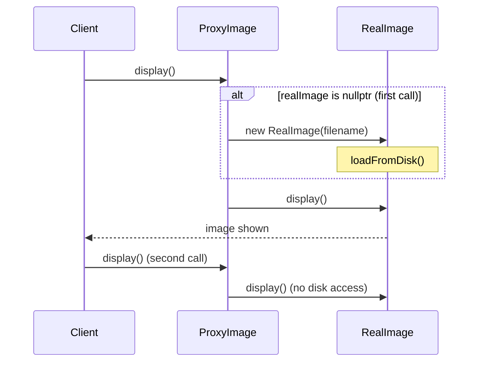
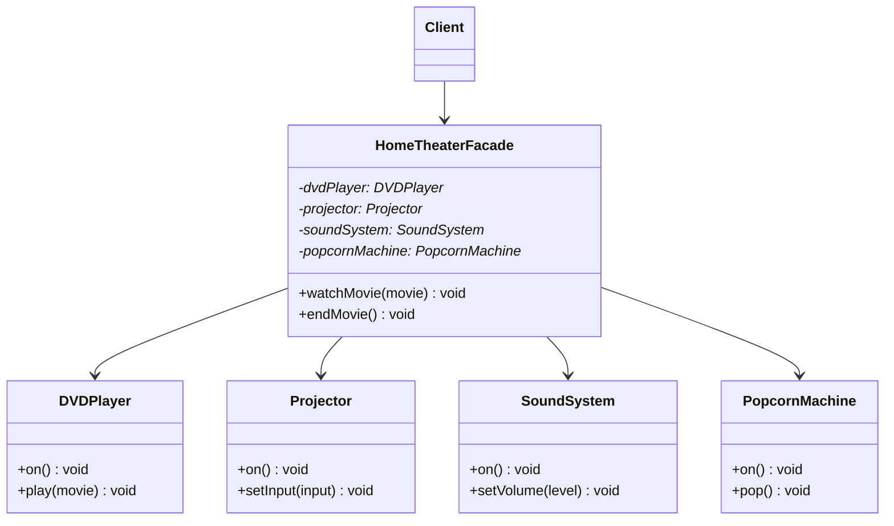

**Notes based off of:** CS3307A – Object-Oriented Design and Analysis, Lecture 12 (Dr. Umair Rehman), CS3307_W8A.pdf

## Overview

This lecture finishes off the **structural design patterns**. Structural patterns are about _how classes and objects are composed_ into larger structures, while keeping those structures flexible and easy to change. Two patterns are covered in depth:

- **Proxy**: a stand-in object that controls access to another object.
- **Facade**: a simplified front door to a complicated subsystem.

They look superficially similar (both put an object "in front of" other objects), but they solve different problems. The goal of these notes is to make that difference clear.

## Structural Patterns at a Glance

| Pattern   | One-line purpose                                                            |
| --------- | --------------------------------------------------------------------------- |
| Adapter   | Converts one interface into another compatible one                          |
| Facade    | Simplifies a complex subsystem behind a unified interface                   |
| Bridge    | Separates an abstraction from its implementation so both can vary           |
| Composite | Treats individual objects and groups of objects uniformly (tree structures) |
| Decorator | Adds behaviour to an object dynamically by wrapping it                      |
| Flyweight | Shares common data between many objects to save memory                      |
| Proxy     | Substitutes for another object to control access or add functionality       |

### Comparing the "wrapper-like" structures

The slide shows UML for **Decorator**, **Composite**, and **Proxy** side by side. They all involve a shared interface/base type plus objects that hold a reference to other objects, which is why they get confused. The distinguishing feature is _intent_:

- **Decorator**: wraps a component and _adds_ behaviour. Decorators are meant to be stacked (a decorator wrapping a decorator wrapping a component). The client usually builds the chain.
- **Composite**: a node holds a _collection_ of children of the same type (`add()`, `remove()`) so a tree can be treated as a single object.
- **Proxy**: holds a _single_ real service and implements the **same interface**. It decides _whether/when_ to forward a call (`checkAccess()` then `realService.operation()`). Often the proxy manages the real object's lifecycle itself.

> [!tip] How to tell them apart 
> Ask "what is the wrapper's job?" Decorator: add features. Composite: represent part-whole hierarchies. Proxy: control access to the thing. Facade: make the thing easier to use.

---

## Proxy Pattern

### Definition

> Provide a placeholder or surrogate for another object to control access to it.

The client talks to the proxy _as if_ it were the real object. Because the proxy and real object share an interface, the client code never needs to know which one it has.

### Components

|Role|Responsibility|
|---|---|
|**Client**|Uses the object through the common interface; unaware of whether it holds a proxy or the real thing|
|**Subject (interface)**|Common interface implemented by both the proxy and the real subject (`Image` in the example)|
|**Real Subject**|Does the actual work or holds the actual data (`RealImage`)|
|**Proxy**|Holds a reference to the real subject, controls access, and can add caching, logging, access control, lazy creation, etc. (`ProxyImage`)|

### Types of Proxy

- **Virtual Proxy**: manages _lazy initialization_; the expensive object is only created when first needed. (This is the lecture example.)
- **Protection Proxy**: controls access based on permissions, e.g. only admins may call `deleteAccount()`.
- **Remote Proxy**: represents an object living in another address space or on another machine. The proxy handles the networking so the client can call methods as if the object were local. gRPC/RPC client "stubs" are remote proxies.
- **Caching Proxy**: stores results of expensive operations and returns them on repeated requests.
- **Logging Proxy**: records every interaction for debugging, auditing, or monitoring.

In practice, one proxy often combines several of these roles (e.g. a protection proxy that also logs).

### UML



### Worked Example: Lazy-Loading Images

**Problem.** An image viewer loads images from disk. High-resolution images are expensive to load (time and memory), and the user may never even look at some of them (think of a document with 200 images where only a few are scrolled into view). Loading everything upfront wastes resources.

**Solution.** Put a `ProxyImage` in front of `RealImage`. The proxy is cheap to construct (it only stores the filename). The first time `display()` is called, the proxy creates the `RealImage`, which triggers the disk load. Every later call reuses the already-loaded object.



#### Code (from the lecture)

```cpp
#include <iostream>
#include <string>

// Interface: abstract base class for image operations
class Image {
public:
    virtual void display() const = 0;   // pure virtual
    virtual ~Image() = default;         // virtual destructor
};

// Real Subject: the expensive high-resolution image
class RealImage : public Image {
private:
    std::string filename;

    void loadFromDisk() const {
        std::cout << "Loading image from disk: " << filename << std::endl;
    }

public:
    RealImage(const std::string& file) : filename(file) {
        loadFromDisk();   // expensive work happens at construction
    }

    void display() const override {
        std::cout << "Displaying image: " << filename << std::endl;
    }
};

// Proxy: controls access to the real image
class ProxyImage : public Image {
private:
    std::string filename;
    RealImage* realImage = nullptr;

public:
    ProxyImage(const std::string& file) : filename(file) {}

    ~ProxyImage() {
        delete realImage;
    }

    void display() const override {
        if (realImage == nullptr) {
            realImage = new RealImage(filename);  // load only if not already loaded
        }
        realImage->display();
    }
};

// Client code
int main() {
    Image* image = new ProxyImage("high_resolution_photo.jpg");
    std::cout << "Image created, but not loaded from disk yet.\n";

    std::cout << "Now displaying the image:\n";
    image->display();   // loads from disk at this point

    std::cout << "Displaying the image again:\n";
    image->display();   // already loaded, no disk access

    delete image;
    return 0;
}
```

**Output:**

```
Image created, but not loaded from disk yet.
Now displaying the image:
Loading image from disk: high_resolution_photo.jpg
Displaying image: high_resolution_photo.jpg
Displaying the image again:
Displaying image: high_resolution_photo.jpg
```

Notice that "Loading image from disk" prints exactly once, even though `display()` was called twice. That is the whole point of the virtual proxy.

#### Things the slides gloss over

> [!warning] The slide code does not compile as written
>  `display()` is declared `const`, but it assigns to `realImage` when lazily creating the object. Assigning to a normal data member inside a `const` method is a compile error. The fix is to mark the pointer `mutable` (it is a _cache_, so logically the proxy's observable state is unchanged):
> 
> ```cpp
> mutable RealImage* realImage = nullptr;
> ```

> [!warning] Copying a ProxyImage is dangerous 
> The proxy owns a raw pointer and `delete`s it in the destructor. If a `ProxyImage` is copied, both copies point at the same `RealImage` and both try to delete it (**double free**). This is the Rule of Three/Five problem. Either delete the copy operations or, better, use smart pointers.

A more modern version of the same idea:

```cpp
class ProxyImage : public Image {
    std::string filename;
    mutable std::unique_ptr<RealImage> realImage;   // needs <memory>

public:
    explicit ProxyImage(std::string file) : filename(std::move(file)) {}

    void display() const override {
        if (!realImage) {
            realImage = std::make_unique<RealImage>(filename);
        }
        realImage->display();
    }
    // No manual destructor needed; copying is automatically disabled.
};
```

Other points worth remembering:

- `delete image;` in `main` through an `Image*` is only safe because `Image` has a **virtual destructor**. Without it, `~ProxyImage()` would not run and the `RealImage` would leak.
- The proxy only calls `new RealImage` once. If `display()` were called from multiple threads, the lazy initialization would be a race condition and would need a mutex or `std::call_once`.

### Lazy Initialization (key idea)

When the client calls `display()` on the proxy:

1. The proxy checks whether `realImage` is `nullptr`.
2. If so, it creates the `RealImage` (this is where the expensive work happens).
3. It then forwards the call to the real object.

The expensive object is created _only when needed_, which conserves resources. If it is never needed, it is never created.

### Real-World Uses of Proxy

- **Smart pointers** (`std::shared_ptr`, `std::unique_ptr`) act as proxies around raw pointers, adding ownership semantics.
- **ORMs** (Hibernate, etc.) return lazy-loading proxies for related database rows: the related data is only fetched when you access it.
- **Remote services**: RPC/gRPC client stubs, web service clients.
- **Reverse proxies / API gateways** (e.g. nginx): control access, cache responses, log requests.
- **Access control layers** that check permissions before forwarding to a sensitive object.

---

## Facade Pattern

### Definition

A Facade provides a **simplified interface to a complex subsystem**. It is a wrapper class that hides the details of a set of interfaces in a software system and exposes a more user-friendly one to the client.

### Purpose

The main goal is to simplify interaction with complex systems by:

- Providing a **single entry point** for the client.
- **Hiding the complexity** of the subsystems.
- Making the subsystem **easier to use** without revealing internal details.
- **Decoupling** the client from the implementation details of the subsystem.

### Analogy

A **universal remote for a home theater**. You press "Play Movie" and the remote coordinates the TV, speakers, and player for you. You (the client) interact only with the remote, never with the individual devices.

### Key Concepts

- **Subsystem classes**: do the real work; each handles a specific function and often needs several steps or configuration calls.
- **Facade class**: wraps the subsystem classes and offers a few easy-to-use methods that manage the complexity internally.
- **Client**: calls the facade instead of the subsystem classes.

An important subtlety: the facade **does not remove** access to the subsystem. A power user can still talk to `DVDPlayer` directly if they need fine control. The facade just provides a convenient path for the common case.

### UML



### Worked Example: Home Theater

**Without a facade**, to start movie night the client has to know about four subsystems _and_ the correct order of about eight calls: turn on the popcorn machine, pop, turn on the sound system, set volume, turn on the projector, set the input, turn on the DVD player, play the movie.

**With a facade**, the client makes one call: `watchMovie("Inception")`.

#### Code (from the lecture)

```cpp
#include <iostream>
#include <string>

// Subsystem 1: DVD Player
class DVDPlayer {
public:
    void on() { std::cout << "DVD Player: On" << std::endl; }
    void play(const std::string& movie) {
        std::cout << "DVD Player: Playing movie " << movie << std::endl;
    }
};

// Subsystem 2: Projector
class Projector {
public:
    void on() { std::cout << "Projector: On" << std::endl; }
    void setInput(const std::string& input) {
        std::cout << "Projector: Set input to " << input << std::endl;
    }
};

// Subsystem 3: Sound System
class SoundSystem {
public:
    void on() { std::cout << "Sound System: On" << std::endl; }
    void setVolume(int level) {
        std::cout << "Sound System: Set volume to " << level << std::endl;
    }
};

// Subsystem 4: Popcorn Machine
class PopcornMachine {
public:
    void on() { std::cout << "Popcorn Machine: On" << std::endl; }
    void pop() { std::cout << "Popcorn Machine: Popping popcorn!" << std::endl; }
};

// Facade
class HomeTheaterFacade {
private:
    DVDPlayer* dvdPlayer;
    Projector* projector;
    SoundSystem* soundSystem;
    PopcornMachine* popcornMachine;

public:
    // Takes pointers to each subsystem and stores them
    HomeTheaterFacade(DVDPlayer* dvd, Projector* proj,
                      SoundSystem* sound, PopcornMachine* popcorn)
        : dvdPlayer(dvd), projector(proj),
          soundSystem(sound), popcornMachine(popcorn) {}

    // Simplified method to watch a movie
    void watchMovie(const std::string& movie) {
        std::cout << "Get ready to watch a movie..." << std::endl;
        popcornMachine->on();
        popcornMachine->pop();
        soundSystem->on();
        soundSystem->setVolume(10);
        projector->on();
        projector->setInput("DVD");
        dvdPlayer->on();
        dvdPlayer->play(movie);
    }

    // Simplified method to end the movie
    void endMovie() {
        std::cout << "Shutting down the home theater..." << std::endl;
        // In a real scenario, each subsystem would be turned off here
    }
};

// Client code
int main() {
    DVDPlayer dvdPlayer;
    Projector projector;
    SoundSystem soundSystem;
    PopcornMachine popcornMachine;

    HomeTheaterFacade homeTheater(&dvdPlayer, &projector,
                                  &soundSystem, &popcornMachine);

    homeTheater.watchMovie("Inception");
    return 0;
}
```

**Output:**

```
Get ready to watch a movie...
Popcorn Machine: On
Popcorn Machine: Popping popcorn!
Sound System: On
Sound System: Set volume to 10
Projector: On
Projector: Set input to DVD
DVD Player: On
DVD Player: Playing movie Inception
```

#### Design observations

- The facade **encodes the knowledge of ordering and configuration** (e.g. set the projector input _after_ turning it on). The client no longer needs to know this.
- The subsystems are created **outside** and passed in as pointers, so the facade does not own them and does not need to `delete` anything. This is a form of **dependency injection**, which also makes the facade easy to test with mock subsystems. (The caller must make sure the subsystems outlive the facade.)
- `endMovie()` is only a stub on the slide. A real one would reverse the startup in a sensible order (stop the DVD, turn off the projector, and so on).
- The subsystem classes have **no knowledge** of the facade. Dependencies only point one way: Client → Facade → Subsystems.

### Key Benefits

- **Simplification**: a single point of access for managing the whole system.
- **Encapsulation**: hides the complexity of interacting with multiple subsystems.
- **Convenience**: start and stop a movie with simple method calls, without worrying about the individual devices.

### When to Use Facade

- **To simplify complex systems**: when you need a simpler interface for working with a complicated subsystem.
- **For decoupling**: separate the client from the subsystems so the subsystems can change without affecting client code.
- **To reduce dependencies**: minimizing client-to-subsystem coupling improves maintainability and extensibility.

### Real-World Uses of Facade

- A **compiler** class exposing `compile(file)` that internally runs the lexer, parser, optimizer, and code generator.
- High-level library entry points that wrap many lower-level classes (e.g. a `VideoConverter.convert(file, format)` that hides codecs, bitrate, and audio mixing).
- A service-layer method like `placeOrder()` that coordinates inventory, payment, and shipping subsystems.

> [!caution] Watch out:
> the "God object" trap If a facade keeps growing to expose every subsystem feature, it turns into a bloated class coupled to everything. Keep the facade focused on the common use cases, and consider several smaller facades instead of one huge one.

---

## Comparing the Patterns

The lecture gives two comparisons. Here they are, plus a few more that are likely to be asked.

|Comparison|Difference|
|---|---|
|**Adapter vs. Facade**|Adapter _converts_ an interface into one the client expects (making incompatible things work together). Facade _simplifies_ an existing interface (making a complicated thing easy to use).|
|**Proxy vs. Facade**|Proxy _controls access_ to a single object and has the **same interface** as it. Facade focuses on _ease of use_ across **many** objects and defines a **new, simpler interface**.|
|**Proxy vs. Decorator**|Both wrap an object with the same interface. Proxy controls access/lifecycle (often creating the real object itself); Decorator adds behaviour and is composed by the client, often in stacks.|
|**Facade vs. Mediator**|Facade is a one-way simplification (subsystems don't know about it). A Mediator coordinates two-way communication between components that know about it.|

### Interface relationship summary

- **Proxy**: _same_ interface as the real object.
- **Decorator**: _same_ interface as the wrapped object.
- **Adapter**: _different_ interface from the wrapped object (translated).
- **Facade**: _new_, simpler interface over several objects.

---

## Key Takeaways

- Structural patterns are about composing classes and objects into flexible, maintainable structures.
- **Proxy** = a surrogate with the _same interface_ that controls access (lazily create, check permissions, cache, log, forward remotely).
- The **virtual proxy** example delays an expensive disk load until `display()` is first called, via a `nullptr` check on the real object.
- **Facade** = one simple interface over a _complex subsystem_; the client only talks to the facade.
- Facade reduces coupling and hides ordering/configuration details, but doesn't prevent direct subsystem access.
- Choose the pattern by **intent**: control access (Proxy), simplify (Facade), convert (Adapter), add behaviour (Decorator).

## Self-Check Questions

1. Why must `ProxyImage` and `RealImage` share the `Image` interface?
2. Why does the lecture's proxy code need `mutable` (or a non-`const` `display()`) to compile?
3. What happens if `Image` does not have a virtual destructor and `delete image;` is called on a `ProxyImage`?
4. Name the five types of proxy and give a one-line use case for each.
5. In the home theater example, which classes depend on which? Draw the dependency arrows.
6. Does a Facade stop clients from using the subsystem classes directly? Should it?
7. How would you explain the difference between Proxy and Facade to someone who has only seen "a class that wraps other classes"?