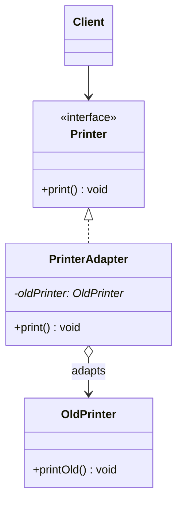
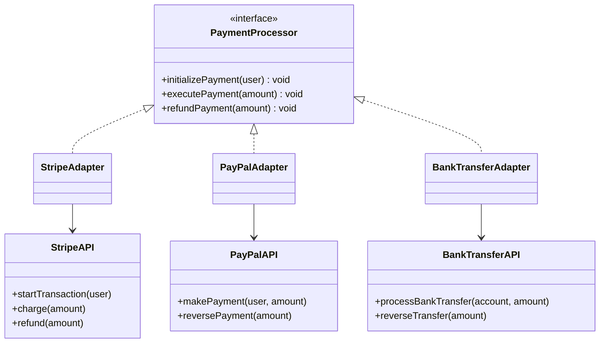
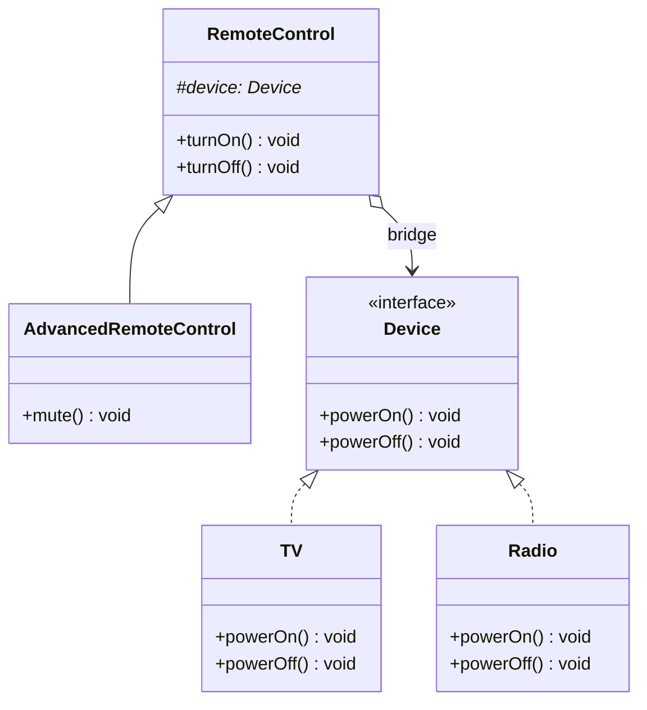
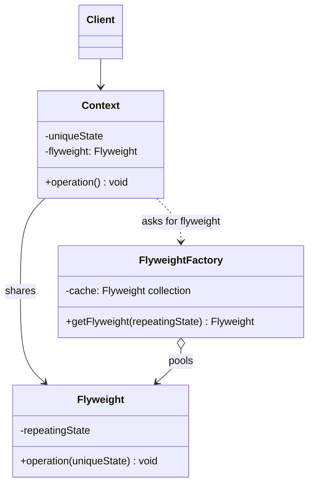

**Notes based off of:** CS3307A – Object-Oriented Design and Analysis, Lecture 13 (Dr. Umair Rehman), CS3307_W8B.pdf

## Overview

This lecture continues the **structural design patterns** from [[12. Structural Patterns - Facade and Proxy]]. Three patterns are covered:

- **Adapter**: make an existing class with the "wrong" interface usable by your code.
- **Bridge**: split an abstraction from its implementation so each can vary independently.
- **Flyweight**: share common state between many small objects to save memory.

The agenda also lists _combinations_ of patterns (Adapter + Composite, Decorator + Composite, Facade + Adapter, Proxy + Flyweight). The slides don't actually work through these, so a short section at the end fills that gap.

### Structural vs. Creational (recap)

- **Creational patterns** are about _object creation_: they abstract and simplify instantiation. Examples: Singleton (one instance), Factory Method (create via a common interface), Abstract Factory (families of related objects), Builder (step-by-step construction), Prototype (clone existing objects).
- **Structural patterns** are about the _composition and organization_ of classes and objects. The big idea is that changing one part of the system should have **minimal impact** on other parts, which makes the design more flexible and efficient.

|Structural pattern|One-line purpose|
|---|---|
|Adapter|Converts one interface into another compatible one|
|Facade|Simplifies a complex subsystem behind a unified interface|
|Bridge|Separates an abstraction from its implementation|
|Composite|Treats individual and grouped objects uniformly|
|Decorator|Adds behaviour to objects dynamically|
|Flyweight|Shares data to reduce memory usage|
|Proxy|Controls access, or adds functionality, as a substitute for another object|

---

## Adapter Pattern

### The Idea

The Adapter pattern is useful when you have an **existing class whose interface differs from what your application expects**. The adapter "adapts" the old interface to the new one, acting as a bridge between the two. The everyday analogy is a travel plug adapter: the laptop (client) and the foreign wall socket (adaptee) are both fine, they just don't fit, so you put a small converter between them. Neither side is modified.

### Scenario: Legacy Printer

An enterprise system generates reports and needs to print them.

- The **new system** expects a standardized printing interface: `print()`.
- The organization owns an **old legacy printer** with a proprietary interface: `printOld()`.

The client cannot use the old printer directly because the interfaces are incompatible:

```cpp
// Old interface
class OldPrinter {
public:
    void printOld() { cout << "Printing with Old Printer" << endl; }
};

// New interface expected by the client
class Printer {
public:
    virtual void print() = 0;
};

int main() {
    OldPrinter oldPrinter;
    oldPrinter.printOld();           // works, but not through Printer

    Printer* printer;
    printer = &oldPrinter;           // ERROR: OldPrinter is not a Printer
    return 0;
}
```

`OldPrinter` simply isn't a `Printer`. There is no inheritance relationship, so the compiler rejects the assignment.

### Three Approaches That Fall Short

The lecture walks through three "obvious" fixes before presenting the pattern, to show _why_ the pattern is better.

#### 1. Simple refactoring

Change `OldPrinter` so it inherits from `Printer` and rename `printOld()` to `print()`.

```cpp
class OldPrinter : public Printer {
public:
    void print() override { cout << "Printing with Refactored Old Printer" << endl; }
};
```

Problems:

- You may **not be able to modify** the class at all (legacy, third-party, closed-source).
- Changing working code can **introduce bugs** or compatibility issues.
- Other code that depends on the old name/behaviour **breaks**.

#### 2. Multiple inheritance

Create a class that inherits from both the new interface and the old class.

```cpp
class PrinterAdapter : public Printer, public OldPrinter {
public:
    void print() override { printOld(); }   // forwards to the old method
};
```

Problems:

- **Tight coupling**: the adapter is welded to both hierarchies.
- Multiple inheritance risks **name conflicts** if both bases have methods with the same name.
- Harder to maintain as the system grows.

(This is actually a legitimate variant called the _class adapter_. It works, but composition is generally the safer default in C++.)

#### 3. Encapsulation (wrapping without the interface)

Wrap an `OldPrinter` inside a new class that has a `print()` method.

```cpp
class NewPrinter {
private:
    OldPrinter oldPrinter;               // encapsulated old printer
public:
    void print() { oldPrinter.printOld(); }
};
```

Problems:

- `NewPrinter` is **tied to** `OldPrinter`.
- It **doesn't implement `Printer`**, so it still isn't substitutable wherever a `Printer*` is expected. This is "no full adaptation."
- **Limited polymorphism**: you can't swap `NewPrinter` for other implementations.

> [!tip] Spotting the pattern 
> Approach 3 is _almost_ the Adapter. The missing ingredient is that the wrapper must also **inherit from the target interface**. Adapter = **composition (hold the adaptee) + inheritance (implement the target)**.

### The Adapter Solution

```cpp
#include <iostream>
using namespace std;

// Adaptee: the incompatible legacy class
class OldPrinter {
public:
    void printOld() { cout << "Printing with Old Printer" << endl; }
};

// Target: the interface the client expects
class Printer {
public:
    virtual void print() = 0;
};

// Adapter: makes OldPrinter usable as a Printer
class PrinterAdapter : public Printer {
private:
    OldPrinter* oldPrinter;              // holds a reference to the adaptee
public:
    PrinterAdapter(OldPrinter* p) : oldPrinter(p) {}

    void print() override {
        oldPrinter->printOld();          // translate the call
    }
};

// Client works only with the Printer interface
int main() {
    OldPrinter* oldPrinter = new OldPrinter();
    Printer* printer = new PrinterAdapter(oldPrinter);

    printer->print();                    // Printing with Old Printer

    delete oldPrinter;
    delete printer;
    return 0;
}
```



#### Roles

| Role        | In the example   | Responsibility                                                                   |
| ----------- | ---------------- | -------------------------------------------------------------------------------- |
| **Client**  | `main()`         | Programs against the target interface only                                       |
| **Target**  | `Printer`        | The interface the client expects (`print()`)                                     |
| **Adaptee** | `OldPrinter`     | Existing class with an incompatible interface (`printOld()`)                     |
| **Adapter** | `PrinterAdapter` | Implements the target, holds the adaptee, translates `print()` into `printOld()` |

> [!warning] Missing virtual destructor 
> `Printer` has no virtual destructor, yet `main` does `delete printer;` through a `Printer*`. Deleting a derived object through a base pointer without a virtual destructor is **undefined behaviour**. Add `virtual ~Printer() = default;`. (The same problem appears in the `PaymentProcessor` example below.) Also note the adapter does **not own** the `OldPrinter`, which is why `main` deletes both separately.

### Why Use an Adapter? (The Nine Arguments)

The slides give nine business-flavoured justifications. Grouped by theme:

**Working with what you already have**

1. **Compatibility with new systems**: integrates old with new _without changing the old code_; smooth migration, minimal disruption.
2. **Third-party integration constraints**: vendor-specific or non-modifiable code can still be used in your system and still match your internal standards.
3. **Cost and efficiency**: adapting is much cheaper than rewriting a legacy system (which brings high cost, downtime, and risk).
4. **Gradual migration**: the old and new worlds can coexist during a transition instead of one big-bang overhaul.

**Keeping the design clean**

5. **Consistency across the system**: every printer is accessed through `Printer`, giving uniform behaviour. Using `OldPrinter` directly would let inconsistencies creep in.
6. **Future scalability and flexibility**: adding a new printer means writing one new adapter, with **no client changes**. This is the **Open/Closed Principle**: open for extension, closed for modification.
7. **Separation of concerns**: the client focuses on its job (print jobs); compatibility is handled as an infrastructure concern in the adapter.

**Managing risk**

8. **Minimizing risk**: if `OldPrinter` is fragile or error-prone, the adapter keeps its behaviour intact and isolates the rest of the system from it. This matters in domains like finance and healthcare where downtime is unacceptable.
9. **Compliance and regulations**: standardized interfaces support auditability, security, and industry standards. Direct use of a non-standard class may violate these.

### Case Study: Multi-Provider Payment Gateway

**Scenario.** A global e-commerce platform supports credit cards, digital wallets, and bank transfers. Each provider (Stripe, PayPal, local banks) has its own API: different method names, signatures, authentication, and data formats. Integrating each one directly into business logic is not feasible.

**Goal.** Design a system with a **standardized interface** so interactions are uniform regardless of provider.

**Requirements**

- Seamless payment integration
- Scalable for new providers
- Preserve existing client code
- Maintain core business logic

**Design.** Define one `PaymentProcessor` interface, then write one adapter per provider.



How each provider's methods map onto the standard interface:

|Standard method|Stripe|PayPal|Bank transfer|
|---|---|---|---|
|`initializePayment(user)`|`startTransaction(user)`|(no equivalent; prints "preparing")|(no equivalent; prints "preparing")|
|`executePayment(amount)`|`charge(amount)`|`makePayment(user, amount)`|`processBankTransfer(account, amount)`|
|`refundPayment(amount)`|`refund(amount)`|`reversePayment(amount)`|`reverseTransfer(amount)`|

Notice that this is more than renaming. PayPal and the bank API have **no separate "initialize" step** and want extra arguments (user, account) in the execute call, so the adapter has to bridge a _semantic_ gap too.

```cpp
#include <iostream>
#include <string>
using namespace std;

// Standardized interface for payment processors
class PaymentProcessor {
public:
    virtual void initializePayment(const string& user) = 0;
    virtual void executePayment(double amount) = 0;
    virtual void refundPayment(double amount) = 0;
};

// ---- Incompatible third-party APIs (cannot be modified) ----
class StripeAPI {
public:
    void startTransaction(const string& user) {
        cout << "Stripe: Starting transaction for " << user << endl;
    }
    void charge(double amount) { cout << "Stripe: Charging $" << amount << endl; }
    void refund(double amount) { cout << "Stripe: Refunding $" << amount << endl; }
};

class PayPalAPI {
public:
    void makePayment(const string& user, double amount) {
        cout << "PayPal: Making payment of $" << amount << " for " << user << endl;
    }
    void reversePayment(double amount) {
        cout << "PayPal: Reversing payment of $" << amount << endl;
    }
};

class BankTransferAPI {
public:
    void processBankTransfer(const string& account, double amount) {
        cout << "Bank: Processing bank transfer of $" << amount
             << " for account " << account << endl;
    }
    void reverseTransfer(double amount) {
        cout << "Bank: Reversing bank transfer of $" << amount << endl;
    }
};

// ---- Adapters ----
class StripeAdapter : public PaymentProcessor {
    StripeAPI stripe;
public:
    void initializePayment(const string& user) override { stripe.startTransaction(user); }
    void executePayment(double amount) override { stripe.charge(amount); }
    void refundPayment(double amount) override { stripe.refund(amount); }
};

class PayPalAdapter : public PaymentProcessor {
    PayPalAPI paypal;
public:
    void initializePayment(const string& user) override {
        cout << "PayPal: Preparing payment for " << user << endl;
    }
    void executePayment(double amount) override {
        paypal.makePayment("User", amount);          // hard-coded user (see note below)
    }
    void refundPayment(double amount) override { paypal.reversePayment(amount); }
};

class BankTransferAdapter : public PaymentProcessor {
    BankTransferAPI bank;
public:
    void initializePayment(const string& user) override {
        cout << "Bank: Preparing bank transfer for user " << user << endl;
    }
    void executePayment(double amount) override {
        bank.processBankTransfer("UserAccount", amount);   // hard-coded account
    }
    void refundPayment(double amount) override { bank.reverseTransfer(amount); }
};

// ---- Client: knows only PaymentProcessor ----
void processOrder(PaymentProcessor* processor, const string& user, double amount) {
    processor->initializePayment(user);
    processor->executePayment(amount);
    // (optional) refund step could go here
}

int main() {
    PaymentProcessor* stripePayment = new StripeAdapter();
    processOrder(stripePayment, "Alice", 100.00);

    PaymentProcessor* paypalPayment = new PayPalAdapter();
    processOrder(paypalPayment, "Bob", 200.00);

    PaymentProcessor* bankPayment = new BankTransferAdapter();
    processOrder(bankPayment, "Charlie", 300.00);

    delete stripePayment;
    delete paypalPayment;
    delete bankPayment;
    return 0;
}
```

**Output:**

```
Stripe: Starting transaction for Alice
Stripe: Charging $100
PayPal: Preparing payment for Bob
PayPal: Making payment of $200 for User
Bank: Preparing bank transfer for user Charlie
Bank: Processing bank transfer of $300 for account UserAccount
```

> [!warning] Design flaw worth noticing 
> The PayPal and bank adapters **discard the user passed to `initializePayment()`** and then hard-code `"User"` / `"UserAccount"` in `executePayment()`. The output above shows it: PayPal says "for User", not "for Bob". In a real system the adapter should **store** the user in a member variable during `initializePayment()` and use it later. This is a typical job for an adapter: bridging a _stateless_ standard interface to an API that needs extra context.

**Why this satisfies the requirements:**

- **Seamless integration / preserved client code**: `processOrder()` never changes.
- **Scalable**: a new provider (say, Apple Pay) is one new class implementing `PaymentProcessor`. Nothing existing is touched.
- **Business logic maintained**: the core logic talks to one stable abstraction; provider quirks are contained in the adapters.

> [!note] Adapter vs. Facade (from the previous lecture) 
> Adapter _converts_ an interface so incompatible things can work together. Facade _simplifies_ an existing interface. Adapters usually wrap **one** class to change its shape; facades usually wrap **many** to make them easier to use.

---

## Bridge Pattern

### The Idea

> Decouple an abstraction from its implementation, allowing them to vary independently.

Use the Bridge when you want to separate a class's **interface** (what clients see) from its **implementation** (how the work is done), so that either side can be modified or extended without affecting the other.

### The Problem It Solves: Class Explosion

Suppose you have two kinds of remote (basic and advanced) and two kinds of device (TV and radio). With plain inheritance you'd need a class for every combination:

- `BasicTVRemote`, `BasicRadioRemote`, `AdvancedTVRemote`, `AdvancedRadioRemote`

Add a third device and you need two more classes; add a third remote type and you need three more. The number of classes grows **multiplicatively** (remotes × devices). With a Bridge, the two dimensions live in **separate hierarchies** connected by a reference, so the class count grows **additively** (remotes + devices). At this tiny scale (2 remotes and 2 devices) the saving is negligible, but with 5 remotes and 5 devices it's roughly 5 + 5 = 10 classes instead of 5 × 5 = 25.

### Components

| Component                | Role                                                                                                       | In the example          |
| ------------------------ | ---------------------------------------------------------------------------------------------------------- | ----------------------- |
| **Abstraction**          | High-level interface for clients; holds a reference to an implementor; unaware of concrete implementations | `RemoteControl`         |
| **Refined Abstraction**  | Extends the abstraction, adding variations; still uses the implementor for the actual work                 | `AdvancedRemoteControl` |
| **Implementor**          | Interface for the implementation layer                                                                     | `Device`                |
| **Concrete Implementor** | Specific implementations of that interface                                                                 | `TV`, `Radio`           |

The **"bridge"** itself is the pointer from `RemoteControl` to `Device`. It is composition standing in for what would otherwise be inheritance.



### Example Code

```cpp
#include <iostream>

// Implementor interface
class Device {
public:
    virtual void powerOn() = 0;
    virtual void powerOff() = 0;
    virtual ~Device() {}                 // virtual destructor for safe deletion
};

// Concrete Implementor 1
class TV : public Device {
public:
    void powerOn() override  { std::cout << "TV is now ON." << std::endl; }
    void powerOff() override { std::cout << "TV is now OFF." << std::endl; }
};

// Concrete Implementor 2
class Radio : public Device {
public:
    void powerOn() override  { std::cout << "Radio is now ON." << std::endl; }
    void powerOff() override { std::cout << "Radio is now OFF." << std::endl; }
};

// Abstraction
class RemoteControl {
protected:
    Device* device;                      // the bridge to the implementor
public:
    RemoteControl(Device* dev) : device(dev) {}
    virtual ~RemoteControl() {}

    virtual void turnOn()  { device->powerOn(); }
    virtual void turnOff() { device->powerOff(); }
};

// Refined Abstraction
class AdvancedRemoteControl : public RemoteControl {
public:
    AdvancedRemoteControl(Device* dev) : RemoteControl(dev) {}

    void mute() { std::cout << "Muting the device." << std::endl; }
};

int main() {
    Device* tv = new TV();
    Device* radio = new Radio();

    RemoteControl* simpleRemote = new RemoteControl(tv);
    simpleRemote->turnOn();              // TV is now ON.
    simpleRemote->turnOff();             // TV is now OFF.

    AdvancedRemoteControl* advancedRemote = new AdvancedRemoteControl(radio);
    advancedRemote->turnOn();            // Radio is now ON.
    advancedRemote->mute();              // Muting the device.
    advancedRemote->turnOff();           // Radio is now OFF.

    delete simpleRemote;
    delete advancedRemote;
    delete tv;
    delete radio;
    return 0;
}
```

**Output:**

```
TV is now ON.
TV is now OFF.
Radio is now ON.
Muting the device.
Radio is now OFF.
```

**What to notice**

- You can add a new device (e.g. `Speaker`) **without touching** any remote class, and add a new remote (e.g. `VoiceRemote`) **without touching** any device class.
- The pairing is chosen at construction time. Any remote works with any device, because the remote only knows the `Device` interface. You could even add a `setDevice()` method to swap implementations at runtime.
- The remotes don't own the devices, so `main` deletes the devices itself. Clients must ensure each device outlives every remote using it.

### Real-World Uses

- **GUI toolkits**: a `Window` abstraction (dialog, tool window) bridged to a platform-specific implementation (Windows, macOS, X11).
- **Graphics**: `Shape` abstraction (circle, square) bridged to a `Renderer` implementation (OpenGL, Vulkan, software).
- **Database access**: an application-facing API bridged to different database drivers.
- The C++ **pimpl idiom** ("pointer to implementation") is closely related: a public class forwards to a hidden implementation class.

### Advantages and Disadvantages

| Advantages                                                             | Disadvantages                                     |
| ---------------------------------------------------------------------- | ------------------------------------------------- |
| Decouples abstraction and implementation, so they evolve independently | Increased complexity: more classes and interfaces |
| Improves maintainability (cleaner, modular code)                       | Higher upfront design effort                      |
| Enhances flexibility: new variations are easy to add                   | May be overkill for simple systems                |
| Platform independence: consistent interface across platforms           | Harder to debug (more layers to trace)            |
| Supports the Open/Closed Principle                                     | Multiple indirections can affect performance      |

### Bridge vs. Adapter

They look similar on a UML diagram (a class holding a reference to another interface), but the **intent and timing** differ:

- **Bridge** is a _design-up-front_ choice: you plan from the start that the abstraction and implementation will evolve separately.
- **Adapter** is a _retrofit_: two things that already exist and don't match need to be made compatible.

---

## Flyweight Pattern

### The Idea

> Minimize memory use by sharing data among many similar objects.

It is ideal when you have a **very large number of similar objects** that differ only slightly. Instead of each object storing everything, the common data is stored once in a shared object, and the small unique part is supplied from outside.

### Intrinsic vs. Extrinsic State

This is the central concept of the pattern.

- **Intrinsic state**: data that is **shared** and does not depend on context. It is stored _inside_ the flyweight. (Example: a character's symbol, font, and size.)
- **Extrinsic state**: data that is **unique** to each use and depends on context. It is **not stored** in the flyweight; the client keeps it and passes it in when calling methods. (Example: the character's x, y position on the page.)

### Components

| Component              | Role                                                                                                               |
| ---------------------- | ------------------------------------------------------------------------------------------------------------------ |
| **Flyweight**          | Interface through which flyweights act on extrinsic state                                                          |
| **Concrete Flyweight** | Implements the interface and stores the shared intrinsic state                                                     |
| **Flyweight Factory**  | Creates and manages flyweights; returns an existing one if it matches, creates a new one only if needed            |
| **Client**             | Holds the extrinsic state and obtains flyweights via the factory (clients never call `new` on flyweights directly) |



> [!note] From the diagram on the slide 
> The diagram's side notes make two points worth remembering. First, Flyweight is **merely an optimization**: confirm you really have a RAM problem caused by a massive number of similar objects before applying it. Second, the _Context_ holds the unique (extrinsic) state plus a reference to a shared flyweight; together they represent the full state of the "original" object.

### Example: Characters in a Document Editor

A word processor may contain hundreds of thousands of characters. Each `'A'` in Arial 12pt has the same symbol, font, and size, so there's no reason to create a separate object for each one. Only the **position** differs.

```cpp
#include <iostream>
#include <string>          // missing from the slide, needed for std::string
#include <unordered_map>

// Flyweight: stores INTRINSIC state (symbol, font, size)
class Character {
public:
    Character(char symbol, const std::string& font, int size)
        : symbol_(symbol), font_(font), size_(size) {}

    // x, y are EXTRINSIC state: supplied by the client at call time
    void display(int x, int y) const {
        std::cout << "Displaying character '" << symbol_ << "' at position ("
                  << x << ", " << y << ") with font " << font_
                  << " and size " << size_ << "." << std::endl;
    }

private:
    char symbol_;
    std::string font_;
    int size_;
};

// Flyweight Factory: guarantees sharing
class CharacterFactory {
public:
    Character* getCharacter(char symbol, const std::string& font, int size) {
        // Key uniquely identifies the intrinsic state
        std::string key = std::string(1, symbol) + "_" + font + "_" + std::to_string(size);

        if (characters_.find(key) == characters_.end()) {
            characters_[key] = new Character(symbol, font, size);
            std::cout << "Creating new character '" << symbol << "' with font "
                      << font << " and size " << size << "." << std::endl;
        }
        return characters_[key];
    }

    ~CharacterFactory() {
        for (auto& pair : characters_) {
            delete pair.second;
        }
    }

private:
    std::unordered_map<std::string, Character*> characters_;
};

int main() {
    CharacterFactory factory;

    Character* charA  = factory.getCharacter('A', "Arial", 12);
    Character* charB  = factory.getCharacter('B', "Arial", 12);
    Character* charA2 = factory.getCharacter('A', "Arial", 12);   // reuses existing 'A'

    charA->display(10, 20);
    charB->display(15, 25);
    charA2->display(30, 40);
    return 0;
}
```

**Output:**

```
Creating new character 'A' with font Arial and size 12.
Creating new character 'B' with font Arial and size 12.
Displaying character 'A' at position (10, 20) with font Arial and size 12.
Displaying character 'B' at position (15, 25) with font Arial and size 12.
Displaying character 'A' at position (30, 40) with font Arial and size 12.
```

Only **two** "Creating" lines appear even though three characters were requested, because `charA` and `charA2` are the **same object** (`charA == charA2` is true). The two `'A'`s are drawn at different positions simply because different x, y values are passed into `display()`.

**Back-of-the-envelope savings.** A document with 100,000 characters but only about 100 distinct (symbol, font, size) combinations needs ~100 `Character` objects instead of 100,000. The per-character cost shrinks to the extrinsic data (like a position) and a pointer.

**Points to keep in mind**

- The factory **owns** the flyweights. Clients must not `delete` them. (Returning `const Character*` would make that harder to do by accident.)
- Flyweights should be **immutable**. If one client could change the shared font, every other user of that object would see the change.
- The key uses `"_"` as a separator. That is fine here, but you must make sure keys can't collide (e.g. a font name containing an underscore).
- A shared factory needs **thread-safety** (a mutex around the map) in multithreaded programs.

### Real-World Uses

- **Text rendering**: glyph objects shared across a document (the classic example).
- **Games**: thousands of trees, bullets, or tiles sharing one mesh/texture object, with per-instance position and rotation.
- **String interning**: identical string literals share one stored copy.
- **Integer caching**: for example, Java's small `Integer` cache. Similar pooling shows up in many runtimes.

### Advantages and Disadvantages

|Advantages|Disadvantages|
|---|---|
|**Memory efficiency**: far fewer objects|**Complexity**: extra layers to manage state|
|**Performance**: fewer allocations, better cache behaviour|**Intrusive**: forces you to split intrinsic from extrinsic state|
|**Consistency**: shared state is uniform|**Limited use**: only worth it for large numbers of similar objects|
|**Modularity**: clean intrinsic/extrinsic separation|**Maintenance**: harder to track what's shared vs. unique|
|**Scalability**: handles huge volumes with little overhead|**Debugging**: extra indirection makes tracing harder|
|**Flexibility**: vary extrinsic state without duplication|Trades CPU time (lookups, passing state) for memory|

---

## Combining Patterns

> [!info] Not covered in the slides The agenda lists four combinations, but the PDF doesn't go through them. The following is a short explanation of how each pairing typically works, so treat it as background rather than lecture content.

Real systems rarely use one pattern in isolation. Structural patterns combine well because they all deal with wrapping and sharing objects.

- **Adapter + Composite**: adapt several incompatible third-party objects to one interface, then group those adapters into a Composite tree. For instance, adapt different file-system APIs (local disk, cloud storage) to a common `Node` interface, then treat a folder of mixed sources as a single composite.
- **Decorator + Composite**: both share a common component interface. You can decorate a whole composite (e.g. add logging or a border to an entire group of UI widgets) or put decorated leaves inside a composite.
- **Facade + Adapter**: a facade offers the simple front door, and behind it, adapters normalize the various backends. For example, a `PaymentFacade.checkout()` method that internally uses the Stripe/PayPal/bank adapters from above, so the client doesn't even need to choose a processor.
- **Proxy + Flyweight**: a proxy can fetch flyweights lazily or control access to the flyweight factory. For example, a virtual proxy for images (from the previous lecture) that, when it finally loads, asks a flyweight factory so that identical images are loaded and shared only once.

---

## Pattern Comparison Cheat Sheet

| Pattern       | Core question it answers                                                            | Typical shape                                              |
| ------------- | ----------------------------------------------------------------------------------- | ---------------------------------------------------------- |
| **Adapter**   | "These two interfaces don't match. How do I make them work together?"               | Wraps **one** object, **changes** its interface            |
| **Bridge**    | "How do I stop two independent dimensions from multiplying into a class explosion?" | Abstraction **holds** an implementor; planned up front     |
| **Facade**    | "How do I make this big subsystem easy to use?"                                     | Wraps **many** objects, offers a **new simpler** interface |
| **Proxy**     | "How do I control access to this object?"                                           | Wraps one object, **same** interface                       |
| **Flyweight** | "How do I avoid creating a million near-identical objects?"                         | Factory **shares** objects holding intrinsic state         |
| **Decorator** | "How do I add behaviour without subclassing?"                                       | Wraps one object, **same** interface, stackable            |
| **Composite** | "How do I treat a group like a single object?"                                      | Tree of nodes with a common interface                      |

---

## Key Takeaways

- Structural patterns organize classes/objects so a change in one place has minimal impact elsewhere.
- **Adapter** = implement the target interface + hold the adaptee + translate calls. It beats refactoring (may be impossible or risky), multiple inheritance (tight coupling), and plain wrapping (doesn't implement the interface).
- Adapters support the **Open/Closed Principle**: adding a provider means adding a class, not editing the client.
- **Bridge** splits abstraction from implementation into two hierarchies connected by composition, avoiding a multiplicative class explosion.
- **Flyweight** saves memory by sharing **intrinsic** state through a factory while clients supply **extrinsic** state. It's an optimization, so use it only when you actually have a memory problem.
- Each pattern has a cost: more classes, more indirection, and harder debugging. Don't apply a pattern where a simple design will do.

## Self-Check Questions

1. Why can't `Printer* printer = &oldPrinter;` compile? What is missing?
2. Give one drawback each for the refactoring, multiple-inheritance, and encapsulation approaches.
3. What two things must a class do to be an Adapter? (Hint: one is inheritance, one is composition.)
4. In the payment example, what is wrong with the PayPal adapter's `executePayment()`, and how would you fix it?
5. Draw the Bridge diagram for `RemoteControl` and `Device`. Which line is "the bridge"?
6. How many classes do you need for 4 remote types and 6 device types with and without a Bridge?
7. In the Flyweight example, which fields are intrinsic and which value is extrinsic? Why can `charA` and `charA2` be the same object?
8. Why should flyweights be immutable, and who is responsible for deleting them?
9. How would you explain the difference between Adapter and Bridge when their UML looks similar?