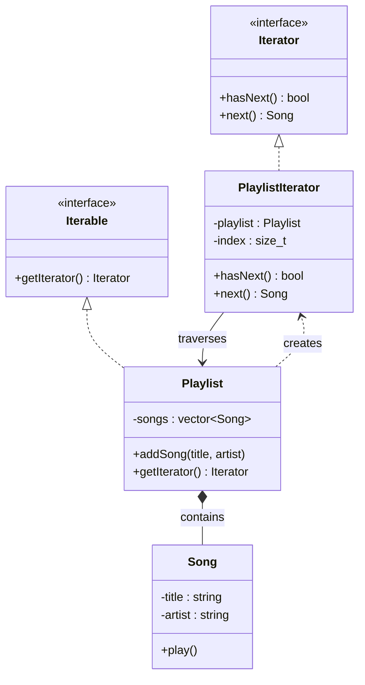
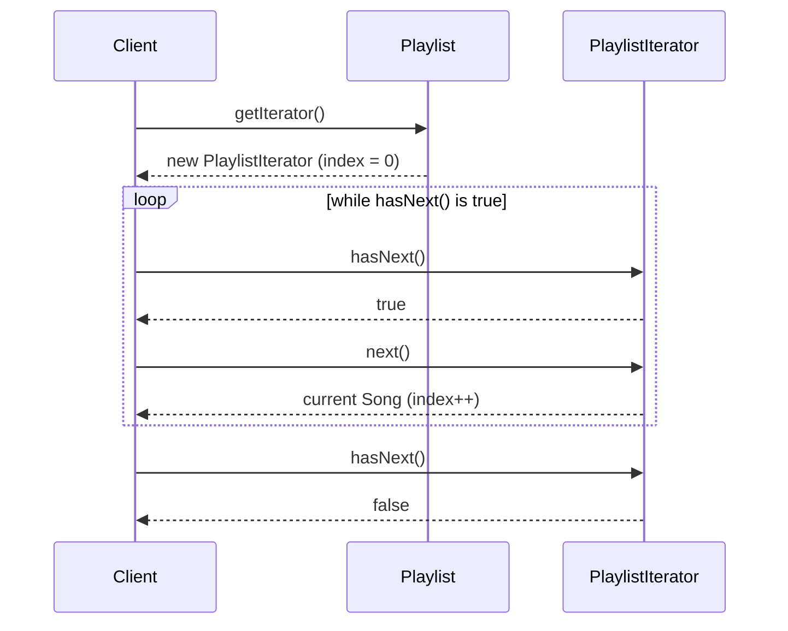

**Notes based off of:** CS3307A Lecture 15 – Behavioral Design Patterns & the Iterator Pattern (Dr. Umair Rehman, 11/4/2026)

## Overview

This lecture introduces the **behavioral** family of design patterns, then focuses on one of them: the **Iterator** pattern. The central comparison is:

- **Direct access iteration**: the client reaches into the collection and loops over it itself (`for (i = 0; i < v.size(); ++i)`).
- **Iterator pattern**: the client asks the collection for an _iterator object_ and uses a standard interface (`hasNext()`, `next()`) to walk through it, never touching the underlying storage.

The running example is a **Song Playlist** console app: create a playlist, add songs, play each song in order.

---

## Behavioral Design Patterns

Creational patterns are about _how objects get made_, structural patterns are about _how objects are composed_, and **behavioral patterns are about how objects communicate and divide responsibility**.

Goals:

- Promote flexible, efficient communication between objects.
- Keep responsibilities clearly assigned.
- Reduce dependencies (coupling) between objects so they can "work together more seamlessly".

|Pattern|One-line purpose|
|---|---|
|**Iterator**|Sequential access to a collection without exposing its structure|
|Chain of Responsibility|Pass a request along a chain of handlers until one handles it|
|Command|Encapsulate an action/request as an object|
|Observer|Notify dependents when state changes|
|State|Change an object's behavior when its internal state changes|
|Strategy|Swap algorithms at runtime|
|Template Method|Define an algorithm's skeleton; subclasses fill in steps|

> [!note] Only Iterator is covered in this lecture; the others are listed for context and will come up later.

---

## The Iterator Pattern

### What is an iterator?

An **iterator** is an object whose job is to traverse a collection, one element at a time.

- Enables **element-by-element access**.
- **Hides the collection's structure** (array, linked list, tree, hash table...).
- Gives a **standardized** way to do sequential access.
- Operates **without knowing how the data is stored** (from the client's point of view).

Simplest mental model: an iterator is like a **pointer/cursor** that sits at a position in the collection and can advance.

> [!example] The librarian analogy 
> You want to read every book in a library. You don't need to know how the shelves are laid out; you ask the **librarian** (iterator), who hands you one book at a time, in order. If the library reorganizes its shelves, you still just ask the librarian for the next book.

### Uniform interface

The whole point is that **every collection offers the same traversal methods**:

|Benefit|Meaning|
|---|---|
|Standard methods|`hasNext()` and `next()`|
|Consistency|Works the same across arrays, lists, trees, etc.|
|Ease of use|Simple element access regardless of structure|
|Abstraction|Data-handling details are hidden|
|Flexibility|You can swap one collection type for another with minimal client changes|

Generic usage (library example from the slides):

```cpp
Iterator* iterator = library.getIterator();   // 1. ask the collection for an iterator

while (iterator->hasNext()) {                  // 2. are there more books?
    Book book = iterator->next();              // 3. get current book AND advance
    book.display();
}
```

- `getIterator()`: gets the collection's iterator.
- `hasNext()`: checks whether more elements remain.
- `next()`: returns the current element **and** advances the iterator.

### Why use an iterator?

- Iterate through _different_ kinds of collections (arrays, lists, trees...) using the **same method calls**.
- **Separates traversal logic from the data structure.** The collection stores data; the iterator knows how to walk it.
- Simplifies client code and reduces off-by-one and bounds errors.
- **Lazy evaluation**: elements can be produced/fetched only when requested, which saves memory. (Think: reading lines from a huge file, a database cursor, or an infinite sequence like the Fibonacci numbers; none of these need to exist in memory all at once.)

---

## Iterators in the C++ Standard Library

The STL uses iterators _everywhere_: `std::vector`, `std::list`, `std::map`, etc. all provide them, giving consistent access to elements.

```cpp
#include <iostream>
#include <vector>

int main() {
    std::vector<int> numbers = {1, 2, 3, 4, 5};

    // Iterator to go through each element
    for (std::vector<int>::iterator it = numbers.begin(); it != numbers.end(); ++it) {
        std::cout << *it << " ";   // dereference the iterator to access the value
    }
    return 0;
}
```

Key points:

- `it` is just the conventional name for "iterator".
- `begin()` points at the first element; `end()` points **one past the last** element (a sentinel, not a valid element; never dereference it).
- `*it` **dereferences** the iterator to get the element at the current position.
- `++it` advances to the next element.
- Because `list`, `set`, `map`... all provide `begin()`/`end()`, the same loop shape works across container types.

### STL style vs. the GoF/Java style

The lecture's `hasNext()` / `next()` interface is the classic textbook (and Java) form. The STL expresses the same idea differently:

| |Textbook / Java style|C++ STL style|
|---|---|---|
|"Is there more?"|`it->hasNext()`|`it != c.end()`|
|"Get current"|`it->next()` (returns and advances)|`*it`|
|"Advance"|included in `next()`|`++it`|
|Shape|One iterator object|A `begin`/`end` **pair** of iterators|
|Polymorphism|Virtual interface|Templates (compile-time)|

> [!tip] Beyond the slides
> 
> - The range-based `for (const auto& x : numbers)` loop is syntactic sugar over `begin()`/`end()`, so it _is_ the iterator pattern under the hood.
> - STL iterators are categorized (input, forward, bidirectional, random access) by what operations they support; e.g. `std::list` iterators can't jump by `+ 5` but `std::vector` iterators can.
> - Modifying a container while iterating (e.g. `push_back` on a vector) can **invalidate** iterators. This is a classic source of bugs.

---

## Direct Access Iteration

**Definition:** iterating over a collection by _directly_ accessing elements by their **index or position**, rather than through an iterator.

Characteristics:

- The client manually writes `for`/`while` loops over arrays or vectors.
- The client interacts **directly** with the collection's structure.
- **Dependency risk:** the client is tied to the collection's concrete type (array vs. linked list, etc.).

### Example: Playlist with direct access

```cpp
class Playlist {
public:
    class Song {
        std::string title;
        std::string artist;
    public:
        Song(const std::string& songTitle, const std::string& songArtist)
            : title(songTitle), artist(songArtist) {}

        std::string getTitle()  const { return title; }
        std::string getArtist() const { return artist; }

        void play() const {
            std::cout << "Playing: " << title << " by " << artist << std::endl;
        }
    };

private:
    std::vector<Song> songs;     // internal structure...

public:
    void addSong(const std::string& title, const std::string& artist) {
        songs.emplace_back(title, artist);
    }

    // ...but we hand it straight to the client!
    const std::vector<Song>& getSongs() const { return songs; }
};

int main() {
    Playlist playlist;
    playlist.addSong("Let it Be", "The Beatles");
    playlist.addSong("Imagine", "John Lennon");
    playlist.addSong("Bohemian Rhapsody", "Queen");

    const std::vector<Playlist::Song>& songs = playlist.getSongs();

    for (size_t i = 0; i < songs.size(); ++i) {   // client does the traversal itself
        songs[i].play();
    }
    return 0;
}
```

### What's wrong with this?

1. **Encapsulation leak.** `getSongs()` reveals that the playlist uses a `std::vector`. Returning `const&` stops the client from _modifying_ it, but not from _depending on_ it.
2. **Tight coupling.** The client uses `songs.size()` and `songs[i]`. If the developer later changes `songs` to a `std::list` (e.g. for cheap mid-playlist insertion), `operator[]` doesn't exist and **every client breaks**.
3. **Traversal logic lives in the client**, so every client re-writes the loop (and can get bounds wrong).
4. **Only one traversal order** is naturally supported (index 0 to n-1).

---

## Iterator Design Pattern (applied)

Same problem, same requirements (create playlist, add songs, play sequentially), but the client never sees the vector.

### Participants

|Role|Responsibility|In the Playlist example|
|---|---|---|
|**Iterator** (interface)|Declares `hasNext()` and `next()`|`Iterator`|
|**Iterable** / Aggregate (interface)|Declares `getIterator()`|`Iterable`|
|**Concrete Iterable**|Stores the data; creates an iterator for itself|`Playlist`|
|**Concrete Iterator**|Implements traversal; tracks the current position|`PlaylistIterator`|
|**Client**|Uses only the two interfaces|`main()`|

> [!info] Many textbooks (e.g. GoF) call the Iterable role the **Aggregate**. Same idea, different name.

### Structure



Notice the **two parallel hierarchies**: collections (`Iterable` / `Playlist`) and traversals (`Iterator` / `PlaylistIterator`). The collection acts as a **factory** for its own iterator (see factory method), which is how the client gets an iterator without knowing its concrete type.

### Step 1: Iterator interface

Defines the standard traversal contract.

- `hasNext()`: are there more elements?
- `next()`: return the current element and advance.

```cpp
class Iterator {
public:
    virtual bool hasNext() const = 0;
    virtual const Playlist::Song& next() = 0;
    virtual ~Iterator() = default;     // virtual destructor: safe delete via base pointer
};
```

### Step 2: Iterable interface

Any collection that wants to be traversable must supply an iterator.

```cpp
class Iterable {
public:
    virtual Iterator* getIterator() const = 0;
    virtual ~Iterable() = default;
};
```

### Step 3: Concrete Iterable (`Playlist`)

- Implements `Iterable`.
- Holds the actual data (`std::vector<Song>`, now truly **private** with no getter).
- `addSong()` appends a song.
- `getIterator()` returns a new `PlaylistIterator` bound to this playlist.

### Step 4: Concrete Iterator (`PlaylistIterator`)

- Implements `Iterator` for `Playlist` specifically.
- Holds a **reference to the playlist** plus an **index** for the current position.
- `hasNext()` returns `index < playlist.songs.size()`.
- `next()` returns `playlist.songs[index++]` (return the current song, then move forward).

```cpp
class PlaylistIterator : public Iterator {
    const Playlist& playlist;   // what we're traversing
    size_t index;               // where we are

public:
    PlaylistIterator(const Playlist& pl) : playlist(pl), index(0) {}

    bool hasNext() const override { return index < playlist.songs.size(); }

    const Song& next() override { return playlist.songs[index++]; }
};

Iterator* getIterator() const override {
    return new PlaylistIterator(*this);
}
```

> [!warning] Compile issue in the slide code 
> As written on the slides, the code has a **circular declaration problem**: `Iterator::next()` mentions `Playlist::Song`, but `Playlist` derives from `Iterable`, which needs `Iterator`, which needs `Playlist::Song`... C++ can't forward-declare a _nested_ class, so this won't compile in this order. The usual fix is to make `Song` a **top-level class** (declared before everything else). A full, compilable version is given below.
> 
> Also note: `next()` does **no bounds checking**. Calling it when `hasNext()` is false is undefined behavior, so the contract is _always check `hasNext()` first_.

### Step 5: Client code

```cpp
int main() {
    Playlist playlist;
    playlist.addSong("Imagine", "John Lennon");
    playlist.addSong("Hey Jude", "The Beatles");
    playlist.addSong("Bohemian Rhapsody", "Queen");

    Iterator* iterator = playlist.getIterator();   // get iterator

    while (iterator->hasNext()) {                  // loop while more songs
        const Playlist::Song& song = iterator->next();
        song.play();
    }

    delete iterator;   // we allocated it with new in getIterator(), so we must free it
    return 0;
}
```

The client only knows about `Iterator` and `Playlist::addSong`. It does **not** know there is a vector, that indexing is used, or what `PlaylistIterator` is.

### Compilable version (with modern C++ ownership)

Differences from the slides: `Song` is top-level, `getIterator()` returns a `std::unique_ptr` (so no manual `delete` and no leak if an exception is thrown), and `PlaylistIterator` is a **private nested class** so even its name is hidden from clients.

```cpp
#include <iostream>
#include <memory>
#include <string>
#include <vector>

class Song {
    std::string title;
    std::string artist;
public:
    Song(const std::string& t, const std::string& a) : title(t), artist(a) {}
    const std::string& getTitle()  const { return title; }
    const std::string& getArtist() const { return artist; }
    void play() const {
        std::cout << "Playing: " << title << " by " << artist << '\n';
    }
};

class Iterator {
public:
    virtual bool hasNext() const = 0;
    virtual const Song& next() = 0;
    virtual ~Iterator() = default;
};

class Iterable {
public:
    virtual std::unique_ptr<Iterator> getIterator() const = 0;
    virtual ~Iterable() = default;
};

class Playlist : public Iterable {
    std::vector<Song> songs;

    // Nested classes can access the enclosing class's private members
    class PlaylistIterator : public Iterator {
        const Playlist& playlist;
        std::size_t index = 0;
    public:
        explicit PlaylistIterator(const Playlist& pl) : playlist(pl) {}
        bool hasNext() const override { return index < playlist.songs.size(); }
        const Song& next() override { return playlist.songs[index++]; }
    };

public:
    void addSong(const std::string& title, const std::string& artist) {
        songs.emplace_back(title, artist);
    }
    std::unique_ptr<Iterator> getIterator() const override {
        return std::make_unique<PlaylistIterator>(*this);
    }
};

int main() {
    Playlist playlist;
    playlist.addSong("Imagine", "John Lennon");
    playlist.addSong("Hey Jude", "The Beatles");
    playlist.addSong("Bohemian Rhapsody", "Queen");

    auto it = playlist.getIterator();
    while (it->hasNext()) {
        it->next().play();
    }
    return 0;
}
```

---

## Tracing the Iteration

How the pieces interact at runtime:



Trace for the 3-song playlist:

|Call #|`hasNext()`|`index` before|`next()` returns|`index` after|
|---|---|---|---|---|
|1|true (0 < 3)|0|"Imagine"|1|
|2|true (1 < 3)|1|"Hey Jude"|2|
|3|true (2 < 3)|2|"Bohemian Rhapsody"|3|
|end|**false** (3 < 3 is false)|3|not called|3|

The loop ends when `index` equals the number of songs.

---

## Direct Access vs. Iterator Pattern

|Aspect|Direct access iteration|Iterator pattern|
|---|---|---|
|Who writes the traversal?|Client|Iterator object|
|Client knows storage type?|**Yes** (`vector`, indexing)|**No**|
|Encapsulation|Weak (internal structure exposed)|Strong (internals hidden)|
|Swapping `vector` to `list`|Client code breaks|Client unchanged; only `PlaylistIterator` changes|
|Multiple traversal orders|Client must re-implement each|Provide different iterator classes|
|Simultaneous traversals|Client manages its own indices|Each iterator keeps its own state|
|Code size|Smaller, simpler|More classes and boilerplate|
|Speed|Slightly faster (no virtual calls)|Small overhead|

### Why this matters in practice

- **Changing the data structure.** If `Playlist` later stores songs in a linked list, only `PlaylistIterator` and `Playlist` change. Every client loop stays identical.
- **New traversal orders** without touching `Playlist` or its clients: write a `ReverseIterator` or `ShuffleIterator` (very natural for a music player!) and add e.g. `getShuffleIterator()`.
- **Concurrent traversals.** Two independent iterators over the same playlist (say, a "now playing" cursor and a "find duplicates" scan) each have their own `index`, so they don't interfere.

---

## Pros & Cons

### Pros

- **Hides collection details** (encapsulation).
- **Consistent interface**: `hasNext()` / `next()` everywhere.
- **Simpler client code**: no traversal logic in the client.
- **Flexible traversal**: forward, reverse, filtered, shuffled...
- **Concurrent traversal**: multiple independent iterators on one collection.

### Cons

- **Added complexity**: extra classes (`Iterator`, `Iterable`, `PlaylistIterator`) and logic. For a simple vector used in one place, it can be overkill.
- **Performance overhead**: extra (virtual) method calls compared to raw indexing.

> [!tip] When to use it 
> Use it when the collection's internal representation is likely to change, when several kinds of collections need to be traversed uniformly, or when you need multiple traversal strategies. For a tiny private helper loop over a `std::vector`, a plain range-for is perfectly fine; in fact, in C++ the STL's own iterators already give you the pattern for free.

---

## Key Takeaways

- Behavioral patterns manage **communication and responsibility** between objects.
- The **Iterator** pattern separates _what is stored_ (the collection) from _how it is walked_ (the iterator).
- Core interface: `hasNext()` (check) and `next()` (return current + advance).
- **Direct access** couples the client to the collection's type and exposes its internals; the **Iterator pattern** removes that coupling at the cost of some extra code and a bit of overhead.
- The STL is built on this idea (`begin()`, `end()`, `*it`, `++it`), just expressed with templates and operator overloading rather than virtual `hasNext()`/`next()`.

## Self-Check Questions

1. What two methods make up the standard iterator interface, and what exactly does `next()` do besides returning an element?
2. In the direct-access playlist, what breaks if `std::vector<Song>` is replaced with `std::list<Song>`? Why does the iterator version avoid this?
3. Why does `getIterator()` live on the _collection_ rather than being something the client constructs directly?
4. Why does `Iterator` need a virtual destructor?
5. How would you add reverse playback to the Playlist without changing existing client code?