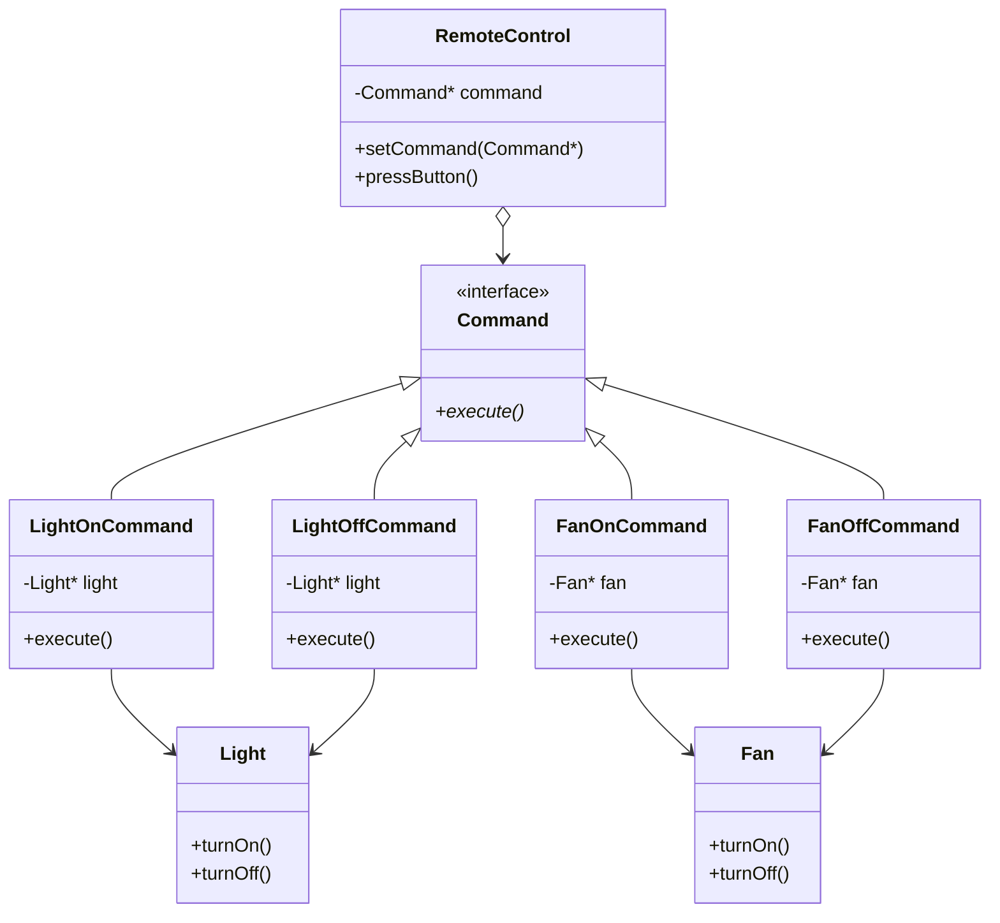
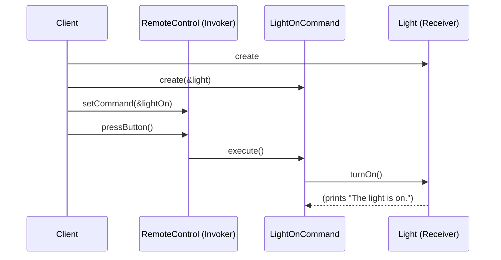

**Notes based off of:** CS3307A Lecture 16 (W10A), Dr. Umair Rehman, "Command Design Pattern" (slides dated 11/9/2026)

## Context: behavioural Design Patterns

behavioural patterns are concerned with how objects **communicate and divide responsibility**, rather than how they are constructed (creational) or composed (structural). The goal is to let objects collaborate while keeping each one's job clear and its dependencies on others small.

|Pattern|One-line idea|
|---|---|
|Iterator|Sequential access to a collection without exposing its internals|
|Chain of Responsibility|Pass a request along a chain of handlers until one handles it|
|**Command**|Encapsulate an action as an object|
|Observer|Notify dependents when state changes|
|State|Change behaviour based on internal state|
|Strategy|Swap algorithms at runtime|
|Template Method|Fixed algorithm skeleton, overridable steps|

> [!tip] Heuristic 
> If you are asking "how do I decouple _who asks for something_ from _who does it_?", think Command. If you are asking "how do I decouple _who changes_ from _who gets told_?", think Observer.

## Running Example: Universal Home Automation Remote

Requirements driving the design:

- One remote controls many devices (light, fan, TV, thermostat), including **devices that do not exist yet**.
- Each device supports several actions: basic (on/off) and parameterized (fan speed, dimming).
- Adding a device or action should require **minimal changes** to existing code. This is the open/closed principle in disguise.

## Approach 1: Direct Invocation

Each remote button is wired directly to a device-specific method.

```cpp
class Light { public: void turnOn(); void turnOff(); };
class Fan   { public: void turnOn(); void turnOff(); };

class RemoteControl {
    Light* light;
    Fan* fan;
public:
    RemoteControl(Light* l, Fan* f) : light(l), fan(f) {}
    void turnOnLight()  { light->turnOn(); }
    void turnOffLight() { light->turnOff(); }
    void turnOnFan()    { fan->turnOn(); }
    void turnOffFan()   { fan->turnOff(); }
};
```

It works, and for a two-device toy it is perfectly reasonable. The problems only show up as the system grows.

### Problems with Direct Invocation

- **Tight coupling.** `RemoteControl` holds `Light*` and `Fan*` and knows each device's method names. A change to `Light` can force a change to the remote.
- **Poor scalability.** Adding a TV means editing `RemoteControl` to add `turnOnTV()` and `turnOffTV()`. Every new device or action grows the class, so it becomes a maintenance magnet.
- **No reuse.** Actions are hardcoded inside the remote. A different remote (e.g. one per room) must duplicate the logic.
- **Violates the Single Responsibility Principle (SRP).** The remote both triggers actions _and_ knows device-specific details, so it has multiple reasons to change.

> [!note] Why this matters in practice 
> The smell to watch for is a class that gains a new method every time a feature is added elsewhere. That is a sign that the class knows too much about its collaborators.

## Approach 2: Command Pattern

**Definition:** a behavioural pattern that turns a request or operation into a standalone **object** containing everything needed to carry it out (which receiver, which method, which arguments).

The core insight is that once a request is an object, you can **store it, pass it around, queue it, log it, and reverse it**, none of which is possible with a bare method call.

Benefits listed in lecture:

- New commands are easy to add.
- Undo/redo support.
- Action queuing.
- Command history logging.

### Participants

| Role                    | Class in example                                                     | Responsibility                                                                |
| ----------------------- | -------------------------------------------------------------------- | ----------------------------------------------------------------------------- |
| **Command** (interface) | `Command`                                                            | Declares `execute()`                                                          |
| **Concrete Command**    | `LightOnCommand`, `LightOffCommand`, `FanOnCommand`, `FanOffCommand` | Binds a receiver to an action; implements `execute()` by calling the receiver |
| **Receiver**            | `Light`, `Fan`                                                       | Does the real work                                                            |
| **Invoker**             | `RemoteControl`                                                      | Holds a command and triggers it; knows nothing about what it does             |
| **Client**              | `main()`                                                             | Creates receivers, commands, and the invoker, and wires them together         |



Note that the **only** dependency `RemoteControl` has is on the abstract `Command` interface. All device knowledge lives in the concrete commands.

### Code

```cpp
// Command interface
class Command {
public:
    virtual void execute() = 0;
    virtual ~Command() = default;
};

// Concrete command: holds its receiver, delegates to it
class LightOnCommand : public Command {
    Light* light;
public:
    LightOnCommand(Light* l) : light(l) {}
    void execute() override { light->turnOn(); }
};
// LightOffCommand, FanOnCommand, FanOffCommand follow the same shape

// Invoker
class RemoteControl {
    Command* command;
public:
    void setCommand(Command* cmd) { command = cmd; }
    void pressButton() {
        if (command) command->execute();
        else std::cout << "No command set." << std::endl;
    }
};

// Client
int main() {
    Light light;  Fan fan;                       // receivers
    LightOnCommand lightOn(&light);              // commands (receiver injected)
    LightOffCommand lightOff(&light);
    FanOnCommand fanOn(&fan);
    FanOffCommand fanOff(&fan);

    RemoteControl remote;                        // invoker
    remote.setCommand(&lightOn);  remote.pressButton();  // "The light is on."
    remote.setCommand(&lightOff); remote.pressButton();  // "The light is off."
    remote.setCommand(&fanOn);    remote.pressButton();  // "The fan is on."
    remote.setCommand(&fanOff);   remote.pressButton();  // "The fan is off."
}
```

> [!warning] Caveat in the slide code 
> `RemoteControl` has no constructor initializing `command`, so it holds an indeterminate pointer until `setCommand` is called. Checking `if (command)` before that is undefined behaviour, not a safe "no command" test. Fix with `Command* command = nullptr;`. Also, the invoker stores **raw, non-owning pointers**, so the commands must outlive the remote (in `main()` they do because they are stack objects). Real code often uses `std::unique_ptr` or `std::shared_ptr`.

### Step-by-Step Flow

1. **Client creates the receiver** (`Light light;`). The receiver is the object that ultimately carries out the action.
2. **Client creates the command** (`LightOnCommand lightOn(&light);`). The receiver is passed in through the constructor, which is **dependency injection**. The command now "knows" which `Light` to act on.
3. **Client creates the invoker** (`RemoteControl remote;`). It does not yet know what it will run.
4. **Client sets the command** (`remote.setCommand(&lightOn);`). The remote holds the command but has no idea what it does.
5. **Invoker executes** (`pressButton()` calls `command->execute()`). The remote only knows "call `execute()` when the button is pressed".
6. **Command calls the receiver** (`light->turnOn()`), translating the generic `execute()` into the specific device call.
7. **Receiver performs the action** and prints "The light is on."



> [!tip] Mental model 
> Think of a restaurant. The **customer** (client) writes an order slip (command). The **waiter** (invoker) carries the slip without knowing how to cook. The **chef** (receiver) reads it and does the work. The slip is the Command object: it can be queued, logged, or cancelled independent of either person.

## Advantages of the Command Pattern

- **Loose coupling.** `RemoteControl` knows only the `Command` interface, never `Light` or `Fan`. New devices do not touch the remote.
- **Scalability.** New commands (new device or new action) are new classes. Nothing existing is modified.
- **Reusability.** Commands are independent; the same `LightOnCommand` can be used by a wall remote, a phone app, or a voice assistant.
- **Flexibility.** Undo/redo and logging can be added by extending commands or wrapping them, without rewriting existing code.

Compared to direct invocation, this fixes each of the earlier complaints: coupling goes away, SRP is restored (the remote triggers, commands translate, devices act), and duplication disappears because commands are shared.

## Extensions Not Shown on the Slides

These are the reasons the pattern is used in real systems, and are likely to come up in discussion or exam questions.

### Undo and redo

Add an `undo()` to the interface; each command reverses its own effect. The invoker keeps a stack of executed commands.

```cpp
class Command {
public:
    virtual void execute() = 0;
    virtual void undo() = 0;
    virtual ~Command() = default;
};

class LightOnCommand : public Command {
    Light* light;
public:
    LightOnCommand(Light* l) : light(l) {}
    void execute() override { light->turnOn(); }
    void undo() override    { light->turnOff(); }
};

// In the invoker
std::stack<Command*> history;
void press(Command* c) { c->execute(); history.push(c); }
void undoLast() { if (!history.empty()) { history.top()->undo(); history.pop(); } }
```

For parameterized actions (fan speed), the command must store the **previous state** before executing so that `undo()` can restore it.

### Other common uses

- **Macro commands.** A `MacroCommand` holds a list of commands and runs them in order (a "movie night" button that dims lights, turns on the TV, and lowers the thermostat). This is the Composite pattern combined with Command.
- **Queuing and scheduling.** Commands can be placed in a queue or thread pool and executed later or on another thread (job queues, schedulers).
- **Logging and replay.** Persisting the command history lets you replay or recover state after a crash (transaction logs, event sourcing).
- **Real-world examples.** Text editor undo stacks, GUI menu items and toolbar buttons, database transactions, task runners.

### Modern C++ note

For simple cases, a command can just be a `std::function<void()>` holding a lambda, which avoids writing one class per action. Full command classes are still preferable when you need `undo()`, state, or a named, testable type.

## Direct Invocation vs Command: Summary

| Concern              | Direct invocation                       | Command pattern              |
| -------------------- | --------------------------------------- | ---------------------------- |
| Invoker depends on   | Concrete devices                        | Abstract `Command` only      |
| Adding a device      | Edit `RemoteControl`                    | Add new command classes      |
| Reuse across remotes | Duplicate code                          | Share command objects        |
| SRP                  | Remote does triggering and device logic | Responsibilities separated   |
| Undo, queue, log     | Hard to bolt on                         | Natural fit                  |
| Cost                 | Minimal code                            | More classes and indirection |

> [!note] Trade-off 
> Command adds one class per action and a layer of indirection. For a two-device remote with no need for undo, direct invocation is simpler and acceptable. The pattern pays off when the set of actions grows, or when you need to treat actions as data (store, queue, undo, log).