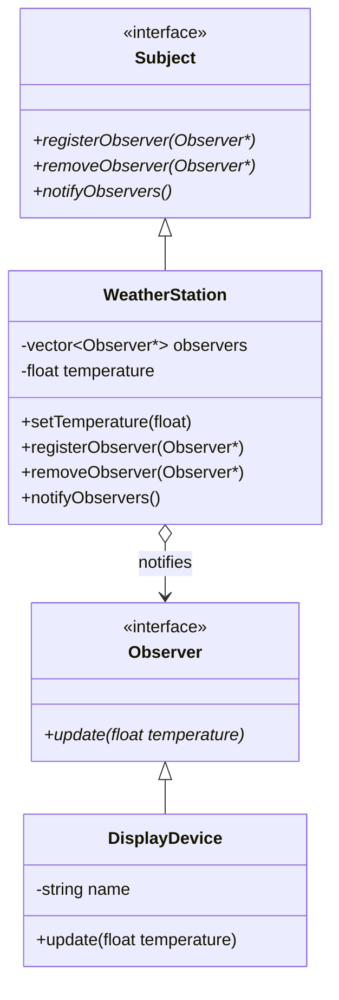
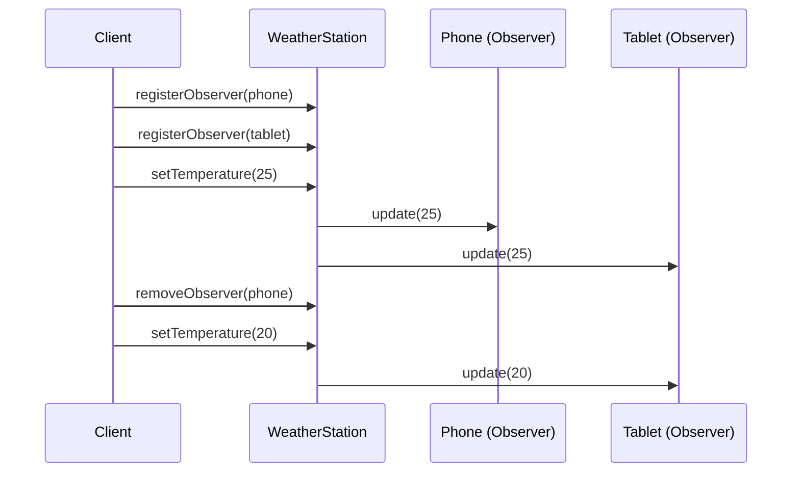
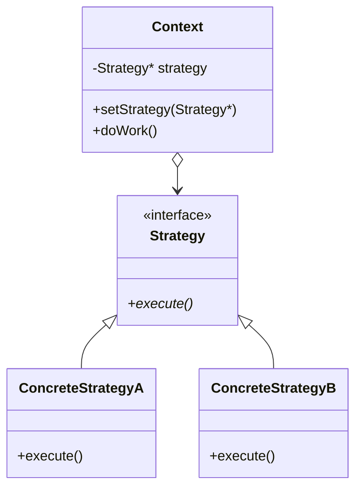
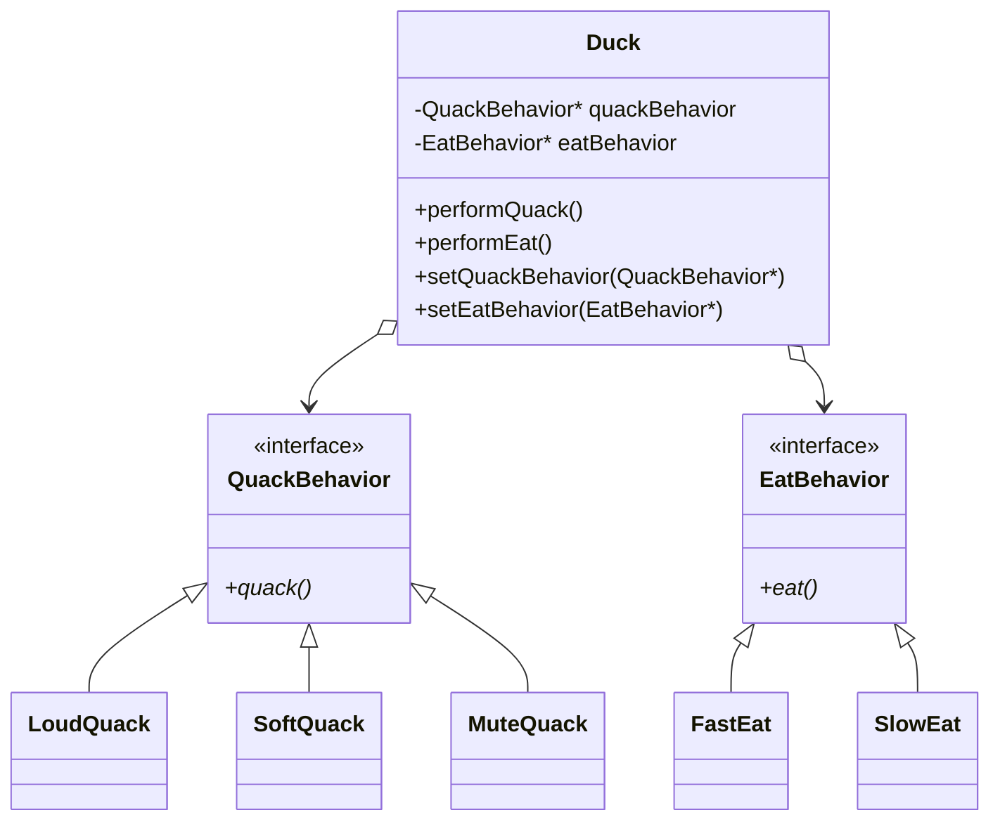

**Notes based off of:** CS3307A Lecture 17 (W10B), Dr. Umair Rehman, slides dated 11/11/2026

> [!note] Lecture scope Two behavioral patterns: **Observer** (one subject notifies many dependents) and **Strategy** (swap interchangeable algorithms at runtime). Both are contrasted against a tightly coupled "traditional" or monolithic design. See also [[16. Command Design Pattern]].

## Observer Pattern

### Overview

The Observer pattern is a behavioral pattern that creates a **one-to-many dependency**: when one object (the **subject**) changes state, all objects that depend on it (the **observers**) are notified and updated automatically.

Key properties:

- **Decoupling through a shared interface.** The subject only knows that its observers implement `Observer`. It knows nothing about their concrete types or what they do with the update.
- **Dynamic relationships.** Observers can subscribe and unsubscribe at runtime.
- **Typical use.** Several components must stay synchronized with one central source of truth.

> [!tip] Heuristic The signal for Observer is the phrase "when X changes, A, B and C need to know, and we may add D later". If the subject's code would have to be edited every time a new interested party shows up, you want Observer.

You have already met this idea in practice: GUI event listeners, the "View" side of MVC reacting to the "Model", `addEventListener` in JavaScript, Qt signals and slots, and publish/subscribe messaging are all variations of it.

### Problem Space

A `WeatherStation` tracks temperature in real time. Devices such as `PhoneDisplay` and `TabletDisplay` must show the new value whenever it changes. The design questions are:

1. How does the station notify several devices immediately?
2. How can new devices be added **without changing the station's code**?
3. How can devices start or stop receiving updates at runtime?
4. How does the system stay scalable and decoupled from specific devices?

### Traditional (Tightly Coupled) Approach

The station holds a pointer to each concrete display type and calls each one by hand.

```cpp
class WeatherStation {
    float temperature;
    PhoneDisplay*  phoneDisplay;
    TabletDisplay* tabletDisplay;
public:
    void setPhoneDisplay(PhoneDisplay* d)   { phoneDisplay = d; }
    void setTabletDisplay(TabletDisplay* d) { tabletDisplay = d; }

    void setTemperature(float t) {
        temperature = t;
        if (phoneDisplay)  phoneDisplay->showTemperature(temperature);
        if (tabletDisplay) tabletDisplay->showTemperature(temperature);
    }
};
```

Every new display type means a new pointer, a new setter, and a new `if` block inside `setTemperature`. The subject has to be reopened and edited for each one.

### Observer Pattern Implementation

#### Participants

|Role|Class|Responsibility|
|---|---|---|
|**Observer** (interface)|`Observer`|Declares `update(...)`, the callback invoked on change|
|**Subject** (interface)|`Subject`|Declares `registerObserver`, `removeObserver`, `notifyObservers`|
|**Concrete Subject**|`WeatherStation`|Holds the state and the list of observers; calls `notifyObservers()` when state changes|
|**Concrete Observer**|`DisplayDevice`|Implements `update(...)` to react to the new state|



#### Code

```cpp
class Observer {
public:
    virtual void update(float temperature) = 0;
    virtual ~Observer() = default;
};

class Subject {
public:
    virtual void registerObserver(Observer*) = 0;
    virtual void removeObserver(Observer*) = 0;
    virtual void notifyObservers() = 0;
    virtual ~Subject() = default;
};

class WeatherStation : public Subject {
    std::vector<Observer*> observers;
    float temperature = 0.0f;
public:
    void setTemperature(float t) {
        temperature = t;
        notifyObservers();                      // state change triggers notification
    }
    void registerObserver(Observer* o) override { observers.push_back(o); }
    void removeObserver(Observer* o) override {
        observers.erase(std::remove(observers.begin(), observers.end(), o),
                        observers.end());       // erase-remove idiom
    }
    void notifyObservers() override {
        for (Observer* o : observers) o->update(temperature);   // polymorphic call
    }
};

class DisplayDevice : public Observer {
    std::string name;
public:
    DisplayDevice(const std::string& n) : name(n) {}
    void update(float t) override {
        std::cout << "Device " << name << ": Temperature updated to " << t << "C.\n";
    }
};
```

Client usage: create the station and two `DisplayDevice`s, register both, call `setTemperature(25)` and `setTemperature(30)` (both notified), call `removeObserver(&phoneDisplay)`, then `setTemperature(20)` (only the tablet is notified).



> [!note] The erase-remove idiom 
> `std::remove` does not shrink the vector. It shuffles the elements to keep to the front and returns an iterator to the new logical end. `erase` then actually deletes the leftover tail. The two calls are always used together.

### Observer vs Traditional Approach

|Aspect|Traditional|Observer|
|---|---|---|
|**Coupling**|Subject knows each concrete observer class|Subject knows only the `Observer` interface|
|**Abstraction**|No shared interface; calls `showTemperature` on specific types|Common interface with abstract `update`; observers treated uniformly|
|**Flexibility**|New observer type means editing the subject (violates Open/Closed Principle)|New observers added with no change to the subject|
|**Dynamic management**|Observers hardcoded at setup; cannot be added or removed at runtime|`registerObserver` / `removeObserver` at any time|
|**Scalability**|More observers means more members, setters, and calls in the subject|One list and one loop handle any number of observers|
|**Notification logic**|Duplicated per observer, error-prone as the count grows|Written once, polymorphic|

> [!note] Open/Closed Principle 
> Software entities should be **open for extension, closed for modification**. In Observer, you extend the system by writing a new `Observer` subclass; `WeatherStation` is never touched.

#### When to use which

- **Traditional approach** is acceptable for small systems with a fixed, known set of observers where the relationship is static, or where the overhead of abstraction and dynamic management genuinely matters.
- **Observer pattern** is the better choice when observers may change at runtime, there are many of them (or more may appear), and following OO principles such as Open/Closed is a priority.

The performance concern is real but usually small: a virtual call per observer and a vector traversal are rarely a bottleneck outside tight real-time loops.

### Second Example: Stock Market

A stock exchange publishes real-time prices. Trading bots, portfolio managers, and dashboards must stay up to date. The four design questions are the same as in the weather problem, and the answers come from the same structure:

| Question                                       | Answer                                                          |
| ---------------------------------------------- | --------------------------------------------------------------- |
| Notify many systems in real time?              | `Stock::setPrice` calls `notifyObservers()`                     |
| Add new systems without changing the exchange? | Implement `Observer` in a new class                             |
| Start or stop receiving updates dynamically?   | `registerObserver` / `removeObserver`                           |
| Scale to more tickers and subscribers?         | One `Stock` subject per ticker, each with its own observer list |

What differs from the weather version is the **update signature**: `update(const std::string& stockName, float stockPrice)`. The subject passes the stock name along with the price, so one observer can subscribe to several stocks and still tell which one changed. `Investor` is the concrete observer; the slide's comment notes that extra behavior, such as buying or selling, could be triggered inside `update`.

In the demo, Alice and Bob both observe AAPL. After the price moves from 150 to 155 to 140, Bob unregisters, and the drop to 135 notifies only Alice.

### Practical Caveats (Not on the Slides)

> [!warning] Things that go wrong in real code
> 
> - **Dangling pointers.** The subject stores raw, non-owning `Observer*`. If an observer is destroyed without calling `removeObserver`, the next notification calls a method on freed memory. Observers should deregister in their destructor, or the subject should hold `std::weak_ptr<Observer>`.
> - **Modifying the list during notification.** If an observer's `update` registers or removes observers, the range-for loop's iterators can be invalidated. A common fix is to iterate over a copy of the list.
> - **Notification order is unspecified.** Do not write observers that depend on being called before or after another observer.
> - **Push vs pull.** The slides use the **push** model, where the subject sends the changed data as arguments to `update`. In the **pull** model, `update()` carries little or nothing, and the observer calls getters on the subject to fetch what it needs. Push is simpler but couples the `update` signature to the data; pull is more flexible when observers need different pieces of state.
> - **Update cascades.** An observer that modifies another subject can trigger long chains of notifications, or even cycles.

### Related Patterns

- [[16. Command Design Pattern]]: both decouple a sender from receivers, but Command wraps one request for one receiver, while Observer broadcasts a state change to many.
- [[#Strategy Pattern]]: also built on a polymorphic interface, but there the context _chooses one_ implementation to do work rather than _notifying many_ of an event.

## Strategy Pattern

### Overview

The Strategy pattern is a behavioral pattern that lets you **select an algorithm's behavior at runtime**. Each algorithm lives in its own class behind a common interface, and the object that uses it can swap one for another.

Key points:

- Each algorithm is encapsulated in a separate class.
- Algorithms are interchangeable inside the **context** class.
- Clients can choose or change the algorithm dynamically.

> [!tip] Heuristic 
> If you find yourself writing `if (type == "A") ... else if (type == "B") ...` to choose _how_ something is done, and the list of types keeps growing, that conditional is asking to be replaced by polymorphism. Strategy is the standard way to do it. It is the practical expression of "favor composition over inheritance": the object _has a_ behavior instead of _being_ a subclass for each behavior.

#### Roles

| Role                    | Description                                                                          |
| ----------------------- | ------------------------------------------------------------------------------------ |
| **Context**             | Holds a reference to a strategy, configured at runtime, and delegates the task to it |
| **Strategy interface**  | Declares the method(s) all algorithms must implement                                 |
| **Concrete strategies** | Different implementations of the interface, switchable at runtime                    |



#### Benefits

- **Flexibility and reusability.** New strategies can be added without modifying the context.
- **Separation of concerns.** Algorithms are isolated in modular classes.
- **Less duplication.** Common logic stays in the context; only the algorithm-specific parts are in strategies.

### Example 1: Duck Behaviors

**Goal:** a `Duck` that can be configured with different quack and eat behaviors (loud, soft, mute; fast, slow), and can change them at runtime.

#### Monolithic design

One `Duck` class stores a type string and branches on it inside every behavior method.

```cpp
void quack() const {
    if (type == "Mallard")      std::cout << "Quacking loudly!\n";
    else if (type == "Rubber")  std::cout << "Silence. This duck doesn't quack.\n";
    else                        std::cout << "Unknown quack behavior.\n";
}
// eat() has the same if/else chain over the same types
```

Adding a new duck type means editing every method. Behavior is fixed by the type string, so a duck cannot change how it quacks later. The same type check is duplicated in each method.

#### Strategy design

Two independent strategy hierarchies, one per behavior:



```cpp
class QuackBehavior { public: virtual void quack() const = 0; virtual ~QuackBehavior() = default; };
class LoudQuack : public QuackBehavior { public: void quack() const override { /* "Quacking loudly!" */ } };
class SoftQuack : public QuackBehavior { /* ... */ };
class MuteQuack : public QuackBehavior { /* ... */ };
// EatBehavior, FastEat, SlowEat follow the same shape

class Duck {                                   // the Context
    QuackBehavior* quackBehavior;
    EatBehavior*   eatBehavior;
public:
    Duck(QuackBehavior* qb, EatBehavior* eb) : quackBehavior(qb), eatBehavior(eb) {}
    ~Duck() { delete quackBehavior; delete eatBehavior; }

    void performQuack() const { quackBehavior->quack(); }   // delegate
    void performEat()   const { eatBehavior->eat(); }

    void setQuackBehavior(QuackBehavior* qb) { delete quackBehavior; quackBehavior = qb; }
    void setEatBehavior(EatBehavior* eb)     { delete eatBehavior;   eatBehavior = eb; }
};

int main() {
    Duck mallard(new LoudQuack(), new FastEat());
    mallard.performQuack();                    // "Quacking loudly!"
    mallard.setQuackBehavior(new SoftQuack()); // swap at runtime
    mallard.performQuack();                    // "Quacking softly..."

    Duck rubber(new MuteQuack(), new SlowEat());
}
```

Why two separate hierarchies matter: quacking and eating vary **independently**. With inheritance alone you would need a subclass for every combination (loud+fast, loud+slow, soft+fast, ...), and the count multiplies as behaviors are added. With Strategy, 3 quack strategies and 2 eat strategies give all 6 combinations from 5 small classes.

> [!warning] Ownership in this example 
> `Duck` **owns** its behaviors: the destructor and both setters call `delete`. That means every behavior passed in must be heap-allocated with `new`. Passing the address of a stack object would cause an invalid `delete`. Modern C++ would make this explicit with `std::unique_ptr<QuackBehavior>`, which also removes the manual `delete` calls. Compare this with Example 2, where the context does _not_ own its strategy.

### Example 2: Payment Processing

**Goal:** an e-commerce cart that can pay by credit card or PayPal, switch methods at runtime, and gain new methods (Apple Pay, Google Wallet) without disturbing existing code.

#### Monolithic design

```cpp
class ShoppingCart {
public:
    void checkout(int amount, const std::string& paymentMethod) {
        if (paymentMethod == "CreditCard")  payWithCreditCard(amount);
        else if (paymentMethod == "PayPal") payWithPayPal(amount);
        else std::cout << "Invalid payment method!\n";
    }
private:
    void payWithCreditCard(int amount) { /* ... */ }
    void payWithPayPal(int amount)     { /* ... */ }
};
```

#### Problems with the monolith

- **Tight coupling.** The cart is bound to specific payment methods. Adding Bitcoin means editing `ShoppingCart`, violating the Open/Closed Principle.
- **Poor scalability.** Each addition or change touches the same class, increasing the risk of errors as options grow.
- **No reusability.** Payment logic is buried inside the cart, so other parts of the program cannot use it. Each method should be its own class.
- **No runtime flexibility.** The set of options is hardcoded in `checkout`, and the method is chosen via a fragile string.
- **Poor testability.** You cannot test credit card payment in isolation because it is embedded in the cart. With injected strategies you can test each one alone, or inject a fake strategy to test the cart.

> [!note] String-typed dispatch 
> Passing `"Bitcoin"` compiles fine and fails only at runtime with "Invalid payment method!". A typo like `"Paypal"` fails the same way. With Strategy, the compiler guarantees that anything you pass implements `pay`.

#### Strategy design

```cpp
class PaymentStrategy {
public:
    virtual void pay(int amount) = 0;
    virtual ~PaymentStrategy() = default;
};

class CreditCardPayment : public PaymentStrategy {
public: void pay(int amount) override { std::cout << "Paying " << amount << " using Credit Card.\n"; }
};
class PayPalPayment : public PaymentStrategy {
public: void pay(int amount) override { std::cout << "Paying " << amount << " using PayPal.\n"; }
};

class ShoppingCart {                           // the Context
    PaymentStrategy* paymentStrategy = nullptr;
public:
    void setPaymentStrategy(PaymentStrategy* s) { paymentStrategy = s; }
    void checkout(int amount) {
        if (paymentStrategy) paymentStrategy->pay(amount);
        else std::cout << "Payment strategy not set!\n";
    }
};

int main() {
    ShoppingCart cart;
    CreditCardPayment cc;  cart.setPaymentStrategy(&cc);  cart.checkout(100);
    PayPalPayment pp;      cart.setPaymentStrategy(&pp);  cart.checkout(200);
}
```

`checkout` no longer contains any payment logic or branching. Adding Apple Pay is one new class implementing `PaymentStrategy`; `ShoppingCart` is unchanged.

> [!warning] Lifetime 
> Here the cart holds a **non-owning** raw pointer to a stack-allocated strategy. The strategy objects must outlive any call to `checkout`, otherwise the pointer dangles. Also notice this version initializes the pointer to `nullptr` in the constructor, which makes the `if (paymentStrategy)` check meaningful.

### Strategy vs Monolith: Summary

|Concern|Monolithic (`if`/`switch` on type)|Strategy|
|---|---|---|
|Adding a behavior|Edit the context class|Add a new strategy class|
|Choosing at runtime|Pass a string or enum, branch every call|Swap the strategy object|
|Open/Closed Principle|Violated|Respected|
|Testing|Behaviors entangled with the context|Each strategy tested alone; fakes injectable|
|Reuse|Logic locked inside one class|Strategies usable anywhere|
|Cost|Fewer classes|More classes and indirection|

> [!note] When not to bother 
> If there are two fixed variants that will never change, a simple `if` is clearer than a class hierarchy. Strategy pays off when variants multiply, change at runtime, or must be tested separately.

### Related Patterns and Modern C++

- **Strategy vs State.** Their class diagrams look nearly identical. In Strategy the **client** picks the algorithm and strategies usually do not know about each other. In State the object **changes its own behavior** as its internal state transitions, and states often trigger transitions to other states.
- **Strategy vs Command.** Both wrap behavior in an object. A Command represents a _request_ (do this specific action, possibly undoable); a Strategy represents _a way of doing a task_ that the context calls whenever needed.
- **Strategy vs [[#Observer Pattern]].** Strategy delegates a task to _one_ chosen implementation; Observer broadcasts an event to _many_ listeners.
- **Lightweight strategies in C++.** When a strategy is a single operation with no state, a `std::function<void(int)>` or a lambda can replace the whole interface-plus-subclass setup. The standard library uses this idea itself: the comparator passed to `std::sort` is a strategy.