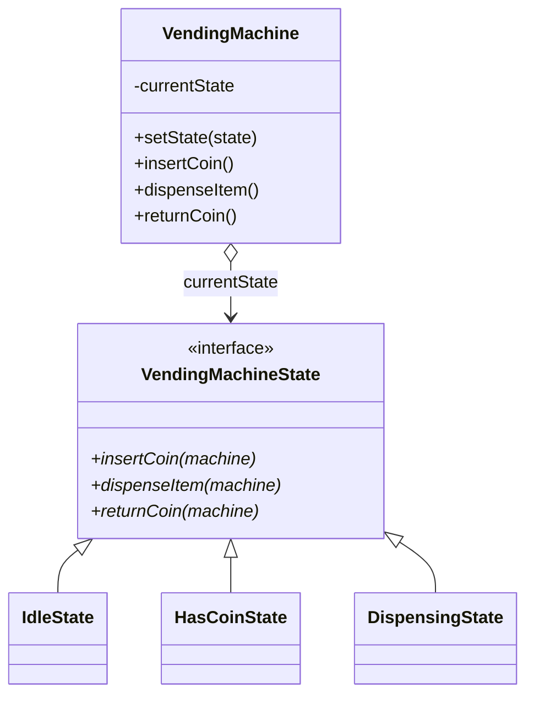
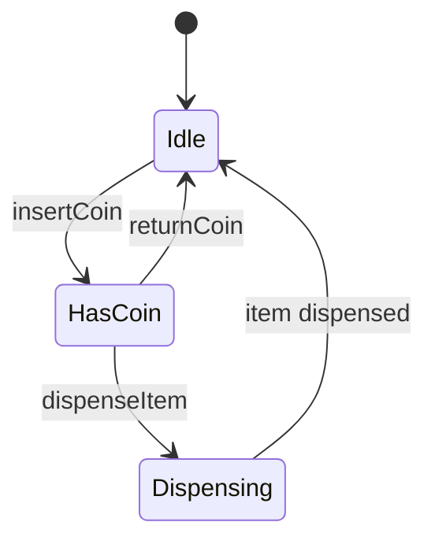
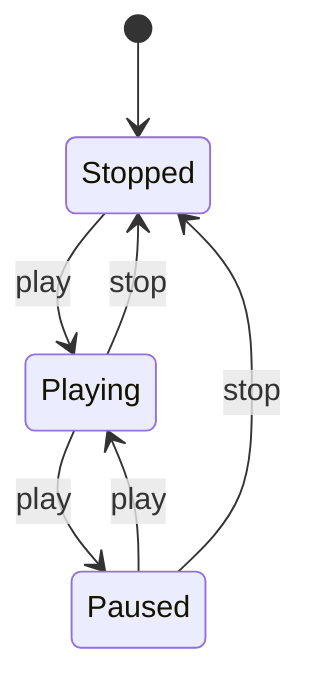

**Notes based off of:** CS3307A Lecture 18 (W11A), _Object-Oriented Design and Analysis_, Dr. Umair Rehman

## Where State Fits

State is one of the **behavioural** design patterns, which are about how objects distribute responsibility and communicate. The lecture lists the common ones: Iterator, Chain of Responsibility, Command, Observer, State, Strategy, and Template Method.

State and Strategy are the pair most often confused (see [[#State vs Strategy]]).

## The State Pattern

**Intent:** let an object change its behavior when its internal state changes, so that it appears to change its class.

The mechanism is two moves:

1. Put each state's behavior in its own class, all implementing one common interface.
2. Have the main object (the **context**) hold a pointer to its current state object and **delegate** every state-dependent call to it.

Changing state then just means swapping which state object the context points to.

> [!tip] The heuristic 
> If you find the same `if (state == X) ... else if (state == Y) ...` or `switch (state)` repeated across many methods of one class, that is the signal to use State. The pattern turns "branch on state inside every method" into "dispatch on state via polymorphism".

### Structure



|Role|In the example|Job|
|---|---|---|
|Context|`VendingMachine`|Owns the current state; forwards each public call to it|
|State interface|`VendingMachineState`|Declares one method per action the context supports|
|Concrete states|`IdleState`, `HasCoinState`, `DispensingState`|Implement the actions as they should behave _in that state_|

**Key detail:** every state method receives a pointer to the context (`VendingMachine* machine`). This is how a state triggers a transition: it calls `machine->setState(...)`. The states, not the context, decide what comes next.

## Example: Vending Machine

The machine has three states, and every action is legal or illegal depending on which one it is in.



Behavior table (what each state does with each action):

|Action|IdleState|HasCoinState|DispensingState|
|---|---|---|---|
|`insertCoin`|Accept, go to HasCoin|"Coin already inserted"|"Please wait"|
|`dispenseItem`|"Insert a coin first"|Go to Dispensing, then dispense|Item out, go to Idle|
|`returnCoin`|"No coin to return"|Return it, go to Idle|"Cannot return coin while dispensing"|

Notice the table is exactly the set of `if`s that would otherwise live inside the machine. Each **column** becomes one class.

### How the code works

- **Context (`VendingMachine`)**: creates all three state objects once in its constructor, starts in `idleState`, and frees them in its destructor. Its `insertCoin()`, `dispenseItem()`, `returnCoin()` are one-liners such as `currentState->insertCoin(this)`. It contains no state logic at all.
- **Pre-allocated states**: the context hands out its states through accessors (`getIdleState()` etc.). States are stateless (no fields), so one shared instance of each is enough and no allocation happens per transition.
- **Chained transition**: in `HasCoinState::dispenseItem`, the state moves to `DispensingState` and then immediately calls `machine->dispenseItem()`. That re-enters the context, which now delegates to the _new_ state, whose `dispenseItem` finishes the job and returns to Idle. So HasCoin to Dispensing to Idle happens inside a single call.
- **Forward declaration**: `class VendingMachine;` appears first because the state interface mentions the context and the context mentions the states (a circular dependency).

> [!warning] Two issues in the lecture code 
> **1. It does not compile as written.** The state methods are defined inside the class bodies and call `machine->setState(...)` while `VendingMachine` is still an incomplete type. The standard fix is to declare the state methods in the class and **define them out-of-line after `VendingMachine`** (in a `.cpp` file, or below the context class). I confirmed this with `g++`: it errors with "invalid use of incomplete type".
> 
> **2. The `main` comments are wrong for the last two calls.** Because dispensing is synchronous, the machine is already back in `IdleState` by the time `main` calls `insertCoin()` "while dispensing". That call is accepted (Idle to HasCoin), and the following `returnCoin()` prints "Returning coin..." instead of being rejected. To actually observe `DispensingState` rejecting actions, dispensing would need to be asynchronous (e.g. a timer or a separate step), or you would call into it before the chained `dispenseItem()` returns.

### Practical improvements (beyond the slide)

- Raw `new`/`delete` is fine for teaching; in modern C++ prefer `std::unique_ptr<VendingMachineState>` members (or plain member objects) so cleanup is automatic.
- Since states hold no data, they can be **singletons** or shared objects. If a state needs per-context data, allocate it per context or keep that data in the context.
- The transitions can live in the states (as here, decentralized) or in the context (a table of state and event to next state). States-own-transitions makes adding a state local; a central table makes the whole graph easier to see.

## Small Coded Example: Media Player

A smaller, compilable version that fixes the [[#How the code works|problems above]]. One **play button** means something different in each state: start when stopped, pause when playing, resume when paused. That "same input, different behavior" property is the signature of State.



```cpp
#include <iostream>

class MediaPlayer;  // forward declaration (context)

// State interface: one method per user action
class PlayerState {
public:
    virtual ~PlayerState() = default;
    virtual void pressPlay(MediaPlayer& p) = 0;
    virtual void pressStop(MediaPlayer& p) = 0;
};

class StoppedState : public PlayerState {
public:
    void pressPlay(MediaPlayer& p) override;
    void pressStop(MediaPlayer& p) override;
};
class PlayingState : public PlayerState {
public:
    void pressPlay(MediaPlayer& p) override;  // acts as "pause"
    void pressStop(MediaPlayer& p) override;
};
class PausedState : public PlayerState {
public:
    void pressPlay(MediaPlayer& p) override;  // acts as "resume"
    void pressStop(MediaPlayer& p) override;
};

// Context: holds the current state and delegates to it
class MediaPlayer {
    StoppedState stopped_;   // states are stateless, so one shared
    PlayingState playing_;   // instance of each is enough, and they
    PausedState  paused_;    // are cleaned up automatically (no new/delete)
    PlayerState* current_ = &stopped_;  // initial state
public:
    void setState(PlayerState& s) { current_ = &s; }
    StoppedState& stopped() { return stopped_; }
    PlayingState& playing() { return playing_; }
    PausedState&  paused()  { return paused_; }

    void pressPlay() { current_->pressPlay(*this); }  // pure delegation
    void pressStop() { current_->pressStop(*this); }
};

// State methods are defined AFTER MediaPlayer is a complete type
void StoppedState::pressPlay(MediaPlayer& p) { std::cout << "Start playing\n"; p.setState(p.playing()); }
void StoppedState::pressStop(MediaPlayer&)   { std::cout << "Already stopped\n"; }

void PlayingState::pressPlay(MediaPlayer& p) { std::cout << "Pause\n"; p.setState(p.paused()); }
void PlayingState::pressStop(MediaPlayer& p) { std::cout << "Stop\n"; p.setState(p.stopped()); }

void PausedState::pressPlay(MediaPlayer& p)  { std::cout << "Resume\n"; p.setState(p.playing()); }
void PausedState::pressStop(MediaPlayer& p)  { std::cout << "Stop\n"; p.setState(p.stopped()); }

int main() {
    MediaPlayer player;
    player.pressPlay();  // Stopped -> Playing
    player.pressPlay();  // Playing -> Paused
    player.pressPlay();  // Paused  -> Playing
    player.pressStop();  // Playing -> Stopped
    player.pressStop();  // Stopped: no-op
}
```

Output (compiled and run with `g++ -std=c++17`):

```
Start playing
Pause
Resume
Stop
Already stopped
```

**What to notice**

- `MediaPlayer` has no `if` or `switch` on state anywhere; `pressPlay()` always does the same thing, and the behavior comes from whichever object `current_` points at.
- The four lines of transition logic are spread across the state classes, so adding, say, a `BufferingState` means writing one new class and editing only the states that should lead into it.
- Stateless states let the context own them by value, which avoids the manual memory management in the lecture version.

## State vs Strategy

Both have a context delegating to an interchangeable object behind an interface, so the class diagrams look identical. The difference is **intent and who changes the object**:

|                                 | State                                               | Strategy                        |
| ------------------------------- | --------------------------------------------------- | ------------------------------- |
| Who picks the object            | The states themselves (transitions)                 | The client, from outside        |
| Do the variants know each other | Yes, they name their successor states               | No, they are independent        |
| Typical change                  | Frequent, driven by events during the object's life | Rare, chosen at setup           |
| Question it answers             | "What mode am I in?"                                | "Which algorithm should I use?" |

## Use Cases

- **Finite state machines**: workflows and devices with a defined set of modes (vending machines, elevators, order processing: placed, paid, shipped).
- **Game development**: character states such as idle, running, jumping.
- **UI components**: a button with hover, pressed, and disabled appearances and behaviors.
- **TCP connections**: listening, established, closing, and so on, each reacting differently to the same packets.

## Advantages and Disadvantages

**Advantages**

- **Encapsulation:** all behavior for one state lives in one class, so it is easy to find, maintain, and extend.
- **Flexibility:** states can be added or changed without touching unrelated code.
- **Readability:** removes long, repeated conditional chains by using polymorphism.
- **Open/Closed Principle:** a new state is a new class, ideally without modifying the context or existing states.

**Disadvantages**

- **Complexity:** one class per state; for a machine with two states and one or two methods this is overkill and a plain `enum` plus `switch` is simpler.
- **Overhead:** extra objects and indirection (small in practice).
- **Coupling:** states and context know about each other (states call `setState`, the context exposes accessors); poorly designed, this becomes tightly entangled.

> [!note] Open/Closed caveat 
> "Add a state without modifying existing code" is only partly true. Adding a state usually means editing at least one **existing** state to transition into the new one, and adding a new _action_ means changing the interface and every state. State is open to new states, not to new operations.

> [!summary] Rule of thumb 
> Use State when an object has several modes, behavior differs substantially between modes, and the mode-checking `if`/`switch` logic is spreading across methods. Skip it for a couple of states with trivial differences.