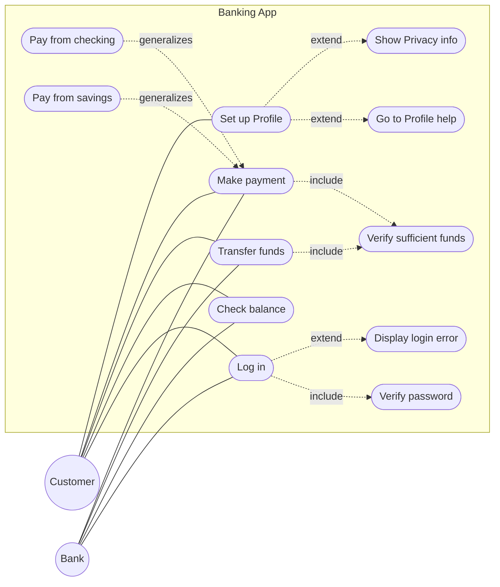
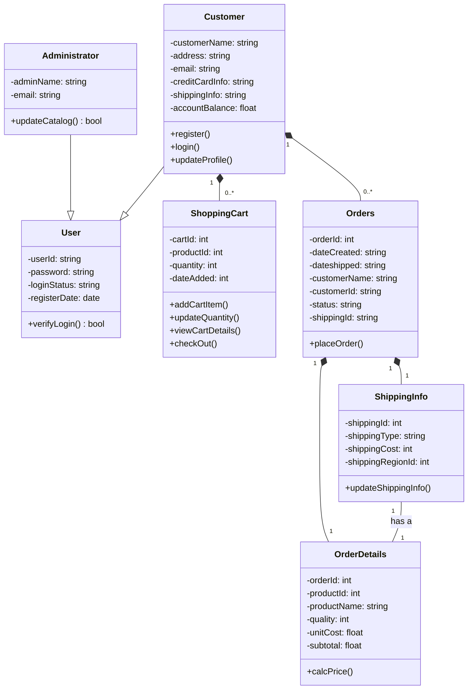
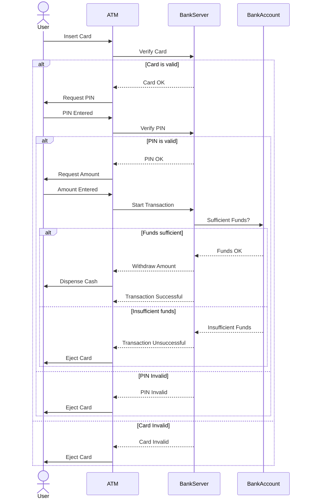

**Notes based off of:** CS3307A – Lecture 3, Dr. Umair Rehman (9/17/2026)

# Requirements Gathering and UML Modelling

## Requirements Gathering

Requirements gathering is a critical step in the software development lifecycle — it is the foundation a project is built on. If requirements are vague or wrong, everything downstream (design, code, tests) inherits that error, which is why so much emphasis is placed on getting this stage right before any design work begins.

Within the Object-Oriented Design and Analysis (OOD&A) framework, requirements gathering has two jobs:

- Translate what stakeholders say they need into **functional** and **non-functional** requirements.
- Identify the key system **objects**, their **relationships**, and their **behaviors** — this is what makes it "object-oriented": you are not just writing a spec, you are already looking for the nouns and verbs that will become classes and methods later.

### From Requirements to Models

Requirements analysis starts as natural language (what a stakeholder literally says) and gets progressively converted into more formal representations:

- **Natural language requirements** — plain descriptions of what's needed.
- **Modelling requirements** — turning that language into something structured, using:
    - Visualizations (UML diagrams)
    - Formulas
    - Code
    - Artifacts
- Throughout this process you're tracking three things: **goals** (what stakeholders want), **stakeholders** (who wants it), and **constraints** (what limits the solution — budget, time, technology, regulation, etc.).

## Functional vs Non-Functional Requirements

### Functional Requirements

Functional requirements describe **what the system should do** — the observable behavior.

**Examples:**

- "User can create a new account"
- "System should send an email after registration"

The key idea for OOD&A: functional requirements map almost directly onto **objects and their methods**. A requirement is basically a method waiting to be attached to a class.

**Worked example — online bookstore:**

> "User can add books to the shopping cart"

|Requirement fragment|Maps to|
|---|---|
|"books"|`Book` object|
|"shopping cart"|`ShoppingCart` object|
|"add ... to"|`addToCart()` method|

### Non-Functional Requirements

Non-functional requirements describe **the quality of the system** rather than a specific behavior — things like performance, security, and reliability. A system can satisfy every functional requirement and still fail if it doesn't meet these.

**Examples:**

- "System must support 500 transactions per minute"
- "Response time should not exceed 2 seconds"

**Why they matter for design, not just testing:** a non-functional requirement like "System should handle 10,000 concurrent users" doesn't map to one method the way a functional requirement does — instead it pushes back on architectural decisions:

- Infrastructure (e.g., load balancers, number of servers)
- How classes/responsibilities are distributed across the system
- Architecture choices, e.g. multi-threading vs. single-threaded processing

> **Note:** this is a useful contrast to keep in mind — functional requirements shape your _class diagram_, non-functional requirements shape your _architecture_.

## Techniques for Requirements Gathering

Three techniques were covered, and in each one the goal is the same: extract candidate **nouns** (→ objects/classes) and **verbs** (→ methods).

### Interviews

- One-on-one or group sessions with stakeholders.
- Provide detailed, nuanced insight since you can ask follow-up questions.
- **Example:** a stakeholder says, "The customer places an order." This single sentence already hands you:
    - Objects: `Customer`, `Order`
    - Method: `placeOrder()`

### Structured Questionnaires

- Used to gather input from a _large_ group of stakeholders at once (trades depth for breadth compared to interviews).
- Useful for spotting **patterns** — if many respondents mention the same need independently, it's a strong signal that need is a core requirement.
- **Example:** repeated survey requests for a "login" feature point to:
    - Object: `User`
    - Method: `authenticate()`

### Observation

- Watching how users interact with an **existing** system (or an analogous physical process).
- Especially good at surfacing **implicit** requirements — things users expect but would never think to mention, because they take them for granted.
- **Example:** watching a customer place items into a physical shopping cart in a store translates to:
    - Object: `ShoppingCart`
    - Method: `addItem()`

## UML

**UML (Unified Modeling Language)** is a standard set of notations for modelling object-oriented systems. It's a _shared vocabulary of diagrams_ — the point is that any developer who knows UML can read your diagram without you having to explain your own personal notation.

This course covers UML in the form of:

- Class diagrams
- Sequence / collaboration diagrams
- State diagrams
- Activity diagrams, use case diagrams, etc.

### The Object-Oriented Paradigm

Object-oriented techniques view a software system as a **network of communicating objects**:

- Each object is an **instance** of a class.
- All objects of the same class share the same features: **attributes** (data) and **methods** (behavior).
- Classes can be specialized into **subclasses** (inheritance).
- Objects communicate by **sending messages** to one another (in practice: calling each other's methods).

### What an Object Can Do When It Receives a Message

When an object receives a message, it isn't limited to one kind of response. It may:

- Update its own internal state (e.g., set a field)
- Return a value derived from its internal state
- Perform a calculation using its state and return the result
- Create a new object (or a whole set of objects)
- Delegate part or all of the task to another object

This last point — delegation — is important: it's the mechanism that keeps objects **loosely coupled**, since an object doesn't need to know _how_ to do everything itself, only _who_ to ask.

### Designing Good Objects

Two properties to aim for when designing classes:

- **Highly Cohesive** — a class should have a single, clear purpose, and it should make use of all the features it defines. (If a class has attributes/methods that are only used by half its instances, that's a sign it should be split into two classes.)
- **Loosely Coupled** — a class should depend on as few other classes as possible. Fewer dependencies mean a change in one class is less likely to break others.

> These two goals are in tension with pure decomposition: cohesion pushes you to give each class exactly what it needs to do its one job, while coupling pushes you to minimize how much classes need to know about each other to collaborate. Good OO design is a balance of both.

## Use Case Modelling

Use case modelling is the bridge between **requirements** (what the system needs to do) and **design** (how it will do it). It gives a structured way to model interactions between:

- The **System**
- **Actors**
- **Use Cases**
- The **Relationships** between them

### System

The system is simply whatever you're building — a game, app, website, or other piece of software. Every system has a goal (or set of goals) it exists to accomplish.

### Actors

An actor is anything **external** to the system that uses it to achieve a goal:

- A person (most common case)
- An organization
- An external device (e.g., a sensor, another system)

**Actors are categorical, not specific individuals.** You model "Person," not "Michael"; "Bank," not "RBC." This matters because a use case diagram is describing a _role_, and any number of concrete entities could fill that role.

Actors also come in two flavors:

- **Primary Actor** — initiates use of the system (e.g., the Customer starting a transfer).
- **Secondary Actor** — reacts to the system rather than initiating (e.g., the Bank verifying and approving a request the system made on the Customer's behalf).

### Use Cases

A use case represents an action taken to accomplish some task **within the system**. In diagrams these are drawn as ovals, connected to the actors who participate in them.

### Relationships

Four relationship types connect actors and use cases (or use cases to each other):

|Relationship|Meaning|
|---|---|
|**Association**|A basic connection between an actor and a use case (they interact).|
|**Include**|A use case _always_ includes another use case as part of its normal flow (mandatory sub-step).|
|**Extend**|A use case _optionally_ adds extra behavior to another, under some condition.|
|**Generalization**|A specialized use case inherits from a more general one.|

**Worked example — Banking App use case diagram** (from the lecture slides):

> Mermaid has no dedicated use-case-diagram type, so this is rendered as a flowchart: actors as circles, use cases as pills, and `include`/`extend`/`generalize` as labelled dashed edges.

- Actors: `Customer` (primary — initiates login, checking balance, transferring funds, making payments, setting up a profile) and `Bank` (secondary — the system consults it to verify things).
- `Log in` **includes** `Verify password` (verifying the password always happens as part of logging in) and **extends** to `Display login error` (this only happens conditionally, if verification fails).
- `Transfer funds` **includes** `Verify sufficient funds`, and so does `Make payment` — both transactions must check funds are available before proceeding.
- `Make payment` generalizes into two more specific use cases: `Pay from checking` and `Pay from savings`.
- `Set up Profile` has **extension points** (`Profile help`, `Privacy info`) — conditional add-ons that only trigger if, for example, the user clicks a help link.

This is a good illustration of _why_ `include` vs. `extend` matters: `include` describes something that will definitely happen every time (a required sub-step), while `extend` describes an optional branch that depends on a condition being met.

### Identifying Use Cases

To find use cases from gathered requirements:

- Analyze how users actually interact with the system.
- Focus on **user goals** — what is the user trying to achieve? (e.g., "Borrow Book", "Return Book" for a library system.)
- Look for **recurring activities** that involve the system — if it happens often, it's probably worth modelling explicitly as its own use case.

### Prioritization

Not all use cases are equal:

- Focus on the most important, **high-impact** use cases first (e.g., "Borrow Book" is more critical to get right than "Renew Book" — the system doesn't function at all without the former).
- Weigh **risk** as well as importance — high-risk or complex use cases may need to be tackled earlier, even if they aren't the most-used feature, because they're the most likely to blow up your timeline or reveal a design flaw.

## UML Class Diagrams

### Notation

A class in a UML class diagram is drawn as a box split into three sections:

1. **Name** (top)
2. **Attributes** (middle) — the data the class holds
3. **Methods** (bottom) — the behavior the class exposes

Lines between class boxes represent relationships, and the line style tells you _what kind_ of relationship it is:

- **Solid line** → Association
- **Arrow** (with a hollow/open triangle head, typically) → Inheritance
- **Diamond** → Composition

### Class Relationships

|Relationship|Type|Example|
|---|---|---|
|**Association**|"has-a"|A teacher has a student|
|**Inheritance**|"is-a"|Admin is a type of User|
|**Composition**|"strong has-a"|A car contains an engine|

The distinction between plain association and composition matters: **composition** implies the parts don't have independent existence — if the whole is destroyed, so are the parts (an `Engine` typically doesn't outlive the `Car` it belongs to in the model). Plain association is a looser relationship — two objects are linked, but neither one "owns" the other in that strong sense.

**Worked example — e-commerce class diagram** (from the lecture slides):

- `User` is a base class with `userId`, `password`, `loginStatus`, `registerDate`, and a `verifyLogin()` method.
- `Administrator` **inherits from** `User` (is-a relationship, shown with the hollow-triangle arrow) and adds `adminName`, `email`, and `updateCatalog()`.
- `Customer` also **inherits from** `User`, and additionally holds `customerName`, `address`, `email`, `creditCardInfo`, `shippingInfo`, `accountBalance`, with methods `register()`, `login()`, `updateProfile()`.
- `Customer` **composes** `ShoppingCart` (filled diamond on the `Customer` end) with a `1` to `0..*` multiplicity — one customer can have zero or many items associated through their cart lifecycle.
- `Customer` **composes** `Orders` (`1` to `0..*`) — a customer can place many orders, but each order belongs to exactly one customer.
- `Orders` **composes** `Order Details` and is associated (`has a`) with `Shipping Info` — reflecting that an order's line items and shipping information are tightly bound to that specific order.

### Reading Multiplicity Notation

Multiplicity numbers on the ends of a relationship line describe _how many_ of one class can be associated with _how many_ of another. This is a detail that's easy to misread, so it's worth having the full table of common patterns:

|Notation|Meaning|
|---|---|
|`A — B` (no numbers)|One B with each A; one A with each B|
|`A 1 — 1 B`|Same as above, written explicitly|
|`A 1 — * B`|Zero or more Bs with each A; exactly one A with each B|
|`A * — * B`|Zero or more Bs with each A, and zero or more As with each B (many-to-many)|
|`A 1 — 2..5 B`|Two to five Bs with each A; one A with each B|
|`A — → * B` (directed arrow)|Zero or more Bs with each A; **B has no knowledge of A** (the association is one-directional/navigable only from A to B)|

That last row is worth flagging specifically because it's easy to skim past: a plain line means both classes "know about" each other (bidirectional navigability), but an **arrowhead** on the line means the relationship is only navigable in one direction — the class being pointed _to_ has no reference back to the class it came _from_. This has real design consequences (e.g., it controls whether B needs a field/reference pointing at A).

### Refining Class Diagrams

- Class diagrams are built **iteratively** — you're not expected to get it right in one pass.
- Avoid overcomplicating diagrams — a diagram that tries to capture everything becomes unreadable and defeats the purpose of using a diagram in the first place.
- Each class should represent one clear, distinct concept (this is the class-diagram expression of the "highly cohesive" principle from earlier).

## Sequence Diagrams

### Purpose

A sequence diagram shows the **flow of messages (method calls) between objects** during one particular scenario or use case. Where a use case diagram tells you _what_ interactions exist, a sequence diagram tells you the **order** they happen in — it models the dynamic, time-ordered behavior. This is why sequence diagrams are described as complementing use case diagrams rather than replacing them: one is static/structural, the other is temporal.

### Components

- **Actors** — external entities interacting with the system (drawn as stick figures, same as in use case diagrams).
- **Objects/Participants** — the internal entities/objects involved in the interaction (drawn as boxes at the top, each with a vertical "lifeline" running down the page).
- **Messages** — arrows between lifelines showing communication; a solid arrow typically represents a call/request, and a dashed arrow represents a return/response.
- **Conditions** — control-flow structures such as `alt` (alternatives — i.e., if/else branches) and loops, drawn as labelled boxes wrapping the relevant messages.

### Worked Example — ATM Withdrawal

The lecture's ATM sequence diagram is a good template for how these pieces fit together. Participants: `User`, `ATM`, `BankServer`, `BankAccount`.

Flow (paraphrased from the diagram):

1. `User` → `ATM`: **Insert Card**
2. `ATM` → `BankServer`: **Verify Card**
3. **`alt` [If card is valid]:**
    - `BankServer` → `ATM`: Card OK
    - `ATM` → `User`: Request PIN
    - `User` → `ATM`: PIN Entered
    - `ATM` → `BankServer`: Verify PIN
    - **nested `alt` [If PIN is valid]:**
        - `BankServer` → `ATM`: PIN OK
        - `ATM` → `User`: Request Amount → `User` → `ATM`: Amount Entered
        - `ATM` → `BankServer`: Start Transaction
        - `BankServer` → `BankAccount`: Sufficient Funds?
        - **nested `alt` [If funds sufficient]:** `BankAccount` confirms Funds OK → `BankServer` withdraws the amount → `ATM` dispenses cash → transaction marked successful
        - **`alt` [Insufficient funds]:** `BankAccount` reports Insufficient Funds → transaction marked unsuccessful → `ATM` ejects the card
    - **`alt` [PIN Invalid]:** `ATM` ejects the card

- **`alt` [Card Invalid]:** `ATM` ejects the card immediately (skipping the PIN/amount flow entirely)

Notice how the **nested `alt` blocks** mirror exactly the kind of conditional branching you'd write in code (`if card valid { if pin valid { if funds sufficient {...} else {...} } else {...} } else {...}`) — this is exactly the point of a sequence diagram: it's a visual trace of the branching logic that will eventually become the method bodies of `ATM`, `BankServer`, and `BankAccount`.

### Best Practices / Pitfalls to Avoid

- **Clarity over completeness** — a sequence diagram doesn't need to capture every possible edge case; it needs to be readable enough to communicate the scenario clearly.
- **Iterative design** — same principle as class diagrams; refine over multiple passes rather than aiming for a perfect first draft.
- **Avoid pitfalls:**
    - Too many classes/participants in one diagram (split into multiple diagrams for different scenarios instead).
    - Making the diagram too detailed for its intended audience (a diagram for stakeholders should look different from one meant for engineers implementing the classes).

## Summary

|Topic|Key Takeaway|
|---|---|
|Requirements Gathering|Foundation of OOD&A; translates stakeholder needs into functional/non-functional requirements and candidate objects|
|Functional Requirements|"What" the system does → maps to objects + methods|
|Non-Functional Requirements|"How well" the system does it → shapes architecture, not just methods|
|Gathering Techniques|Interviews (depth), Questionnaires (breadth/patterns), Observation (implicit needs)|
|UML|Shared visual language: class, sequence, state, activity, use case diagrams|
|Use Case Modelling|System + Actors + Use Cases + Relationships (association, include, extend, generalization)|
|UML Class Diagrams|Boxes (name/attributes/methods) + association/inheritance/composition lines + multiplicity|
|Sequence Diagrams|Time-ordered messages between objects/actors for one specific scenario, with `alt`/loop control structures|

**Prev:** [[CS3307A/2. Lecture 2|2. Lecture 2]], **Next:** [[CS3307A/4. Lecture 4|4. Lecture 4]]