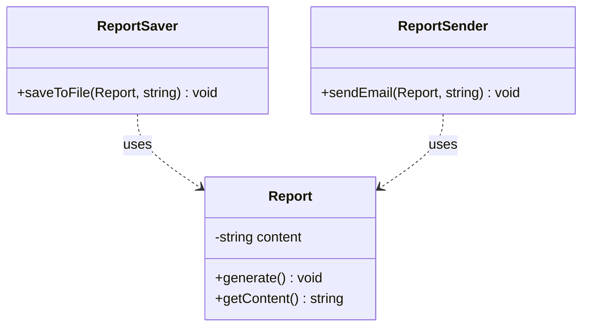
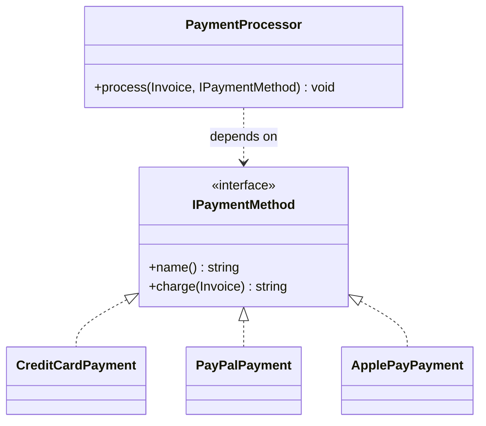
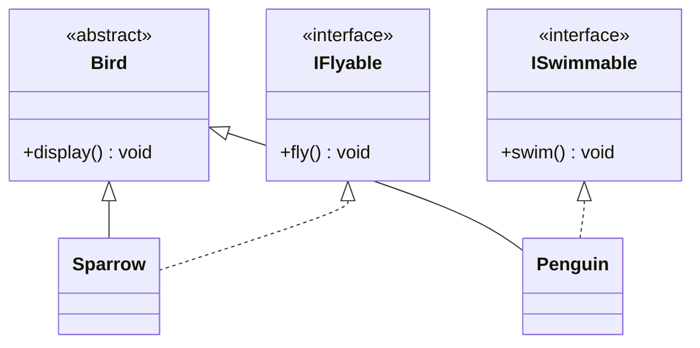
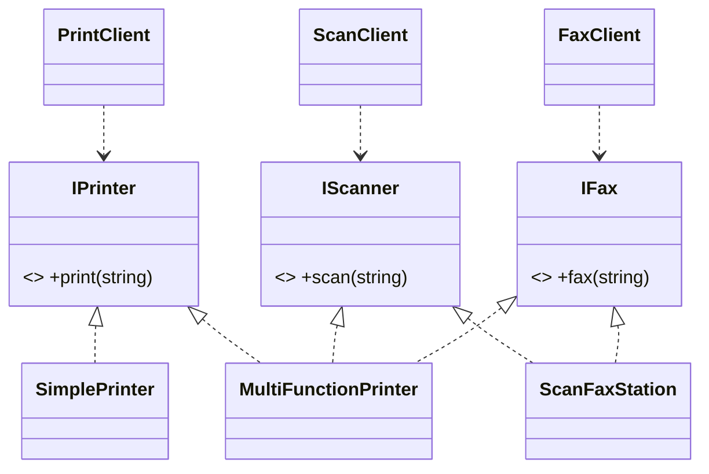
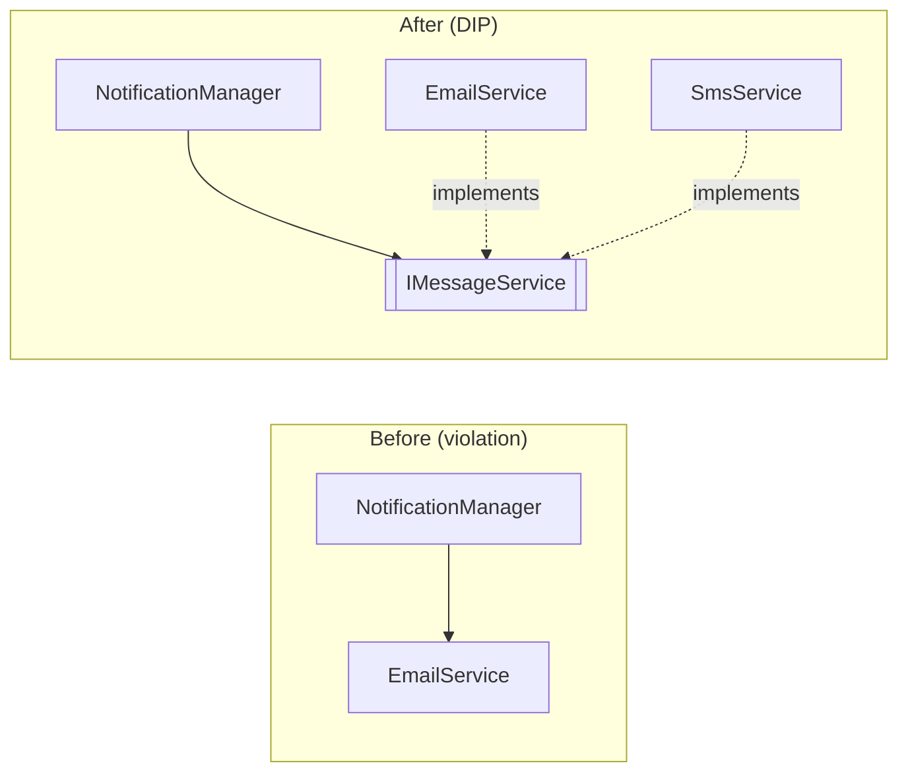
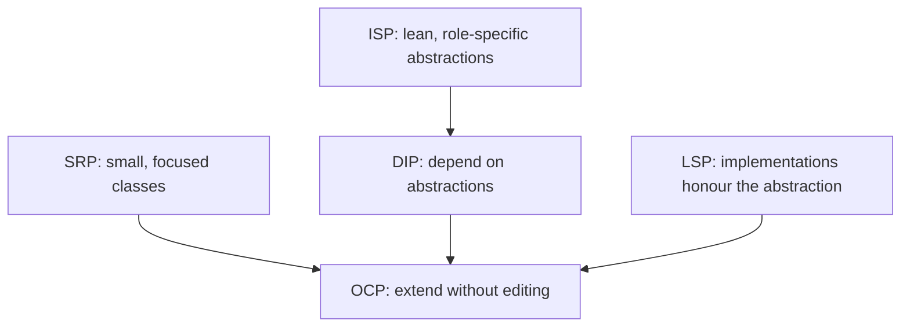

**Notes based off of:** CS3307A – Object-Oriented Design and Analysis, Lecture 6 (Dr. Umair Rehman) – _SOLID Principles_ (CS3307_W4A.pdf)

## Overview

SOLID is a set of five design principles for making object-oriented code easier to **change, extend, test and reason about**. They were popularised by Robert C. Martin ("Uncle Bob"); the "Liskov" in LSP is Barbara Liskov, who formulated substitutability in 1987.

|Letter|Principle|One-line takeaway|Slide teaching note|
|---|---|---|---|
|**S**|Single Responsibility|A class has one reason to change|Cohesion|
|**O**|Open/Closed|Extend behaviour without editing stable code|Extensibility|
|**L**|Liskov Substitution|Subtypes must be usable wherever the base type is|Behavioural substitutability|
|**I**|Interface Segregation|Don't force clients to depend on methods they don't use|Lean contracts|
|**D**|Dependency Inversion|Depend on abstractions, not concretions|Dependency flow inversion|

> [!tip] Big picture SOLID is really about **managing coupling and change**. Every principle answers the same question: _"When a requirement changes, how many places in my code do I have to touch, and how likely am I to break something unrelated?"_

All examples in the lecture are in **C++17** (`g++ -std=c++17`), and each principle is taught the same way: _violation → why it's bad → refactor → why it's better_.

---

## 1. Single Responsibility Principle (SRP)

> "A class should have only one reason to change."

### Key ideas

- A module should encapsulate **one axis of change**.
- "Responsibility" here means a **stakeholder or concern**, e.g. business logic, persistence, presentation, communication. It does **not** mean "does exactly one method".
- A class with several reasons to change couples unrelated concerns, so it becomes **fragile**: a change for one stakeholder can break code that serves another.

> [!note] Context the slides skip Martin later reworded SRP as: _"a module should be responsible to one, and only one, actor."_ A good test is to ask **"who would ask me to change this class?"** If the answer is the finance team _and_ the ops team _and_ the DBA, the class has too many responsibilities.
> 
> SRP is closely tied to **cohesion** (things that change together should live together) and to _separation of concerns_.

### Violation: `Report` does everything

```cpp
class Report {
    std::string content;
public:
    Report(const std::string& text) : content(text) {}

    void generate() { std::cout << "Generating Report: " << content << "\n"; }   // business logic

    void saveToFile(const std::string& filename) {                                // persistence
        std::ofstream file(filename);
        file << content;
    }

    void sendEmail(const std::string& address) {                                  // communication
        std::cout << "Sending report to " << address << "\n";
    }
};
```

Three responsibilities in one class:

1. Report content generation (business logic)
2. File persistence (I/O)
3. Email communication (messaging)

So `Report` must change if **the file format changes**, **the email system changes**, or **the business rules change**: three unrelated reasons.

### Refactor: one class per responsibility

```cpp
class Report {                       // ONLY holds/generates content
    std::string content;
public:
    Report(const std::string& text) : content(text) {}
    void generate() const { std::cout << "Generating Report: " << content << "\n"; }
    std::string getContent() const { return content; }   // read-only access
};

class ReportSaver {                  // ONLY persistence
public:
    void saveToFile(const Report& report, const std::string& filename) const {
        std::ofstream file(filename);
        file << report.getContent();
    }
};

class ReportSender {                 // ONLY communication
public:
    void sendEmail(const Report& report, const std::string& address) const {
        std::cout << "Sending report to " << address << "\n";
        std::cout << "Content: " << report.getContent() << "\n";
    }
};

int main() {
    Report report("Quarterly Sales");
    report.generate();
    ReportSaver saver;   saver.saveToFile(report, "sales.txt");
    ReportSender sender; sender.sendEmail(report, "ceo@company.com");
}
```



### What improved

- Change to report logic → only `Report`.
- Change of save format (CSV, JSON, DB) → only `ReportSaver`.
- Change of communication (email → Slack) → only `ReportSender`.
- **Scalability:** add `ReportDatabaseSaver` or `ReportSlackSender` without touching `Report`.
- Relationships are **associations** (a `Report` is passed _into_ the saver/sender), **not inheritance**.

> [!note] Also notice The refactor marks methods `const` and exposes `getContent()` as a read-only accessor, which is good const-correctness. Splitting the class also makes each piece **independently testable**.

---

## 2. Open/Closed Principle (OCP)

> "Software entities should be open for extension, but closed for modification."

### Key ideas

- You should be able to **add new behaviour (extension)** without **editing existing, stable code (modification)**.
- Achieved through **abstraction** (interfaces, base classes) or **composition** (Strategy pattern, plugins).
- Editing working code risks **regressions**. Adding new classes doesn't touch the old, already-tested ones.

### Violation: enum + `switch` in `PaymentProcessor`

```cpp
enum class PaymentMethod { CreditCard, PayPal };   // adding ApplePay => edit enum...

class PaymentProcessor {
public:
    void process(const Invoice& inv, PaymentMethod method) {
        switch (method) {                          // ...AND edit this switch
        case PaymentMethod::CreditCard: {
            const double feeRate = 0.029, fixedFee = 0.30;
            double total = inv.amount() * (1.0 + feeRate) + fixedFee;
            // charge via gateway, build receipt, saveReceiptToDisk(...), sendEmail(...)
            break;
        }
        case PaymentMethod::PayPal: {
            const double feeRate = 0.034, fixedFee = 0.49;
            double total = inv.amount() * (1.0 + feeRate) + fixedFee;
            // charge via PayPal API, duplicate receipt logic...
            break;
        }
        default:
            throw std::runtime_error("Unsupported payment method");
        }
    }
};
```

**Why it violates OCP**

- The high-level policy class must be **modified** for every new payment method _or_ fee change.
- Branching by enum (`switch` / `if-else` ladder) guarantees constant churn.
- Details leak in (fees, gateways, receipts), tangling responsibilities and coupling.
- Receipt code is **duplicated** in every branch.
- One big method with many paths is hard to test and grows into a **"god method"**.
- Unhandled values fail at **runtime** (`default: throw`) rather than being prevented at compile time.

> [!warning] Code smell to recognise A `switch` or `if/else` chain on a **type tag** (enum, string, int) is the classic OCP smell. The usual cure is **replace conditional with polymorphism**.

### Refactor: Strategy via an interface

```cpp
struct IPaymentMethod {                                  // the abstraction
    virtual ~IPaymentMethod() = default;
    virtual std::string name() const = 0;
    virtual std::string charge(const Invoice& inv) const = 0;   // returns receipt text
};

class CreditCardPayment : public IPaymentMethod {
public:
    std::string name() const override { return "CreditCard"; }
    std::string charge(const Invoice& inv) const override {
        constexpr double feeRate = 0.029, fixed = 0.30;
        double total = inv.amount() * (1.0 + feeRate) + fixed;
        return "CC receipt $" + std::to_string(total);
    }
};
// PayPalPayment and ApplePayPayment follow the same shape with their own fees

class PaymentProcessor {                                 // closed to modification
public:
    void process(const Invoice& inv, const IPaymentMethod& method) const {
        std::cout << "[PROCESS] $" << inv.amount() << " via " << method.name() << "\n";
        const std::string receipt = method.charge(inv);  // polymorphic dispatch
        saveReceipt(receipt);
        emailReceipt(inv.email(), receipt);
    }
};
```



### What improved

- `PaymentProcessor` depends only on `IPaymentMethod`.
- To add ApplePay, Crypto or BankTransfer, **add a new class**. `PaymentProcessor` is **never edited**.
- Each strategy has **one reason to change** (its own fee rules and gateway), so this also supports SRP.
- Later, pluggable receipts/notifications can be added by introducing `IReceiptSink` / `INotifier` and **injecting** them.

> [!note] Honest caveats (what a professor would mention)
> 
> - The refactored `PaymentProcessor` is **not perfectly closed**: it still hard-codes `saveReceipt(...)` and `emailReceipt(...)`. The slide's own comment says these should become interfaces too.
> - No design is closed against _every_ change. You choose which axis of change to protect (here: **new payment methods**). Adding a completely new _operation_ to the interface (e.g. `refund()`) still forces edits to every strategy.
> - **Never use `double` for money in real systems**. The lecture does it for brevity. Use integer cents or a decimal type.
> - OCP is why the **Strategy pattern** (and Decorator, Observer, plugin architectures) exists.

---

## 3. Liskov Substitution Principle (LSP)

> "Subtypes must be substitutable for their base types without altering the correctness of the program."

### Key ideas

- A derived class must honour the **contract** of its base class.
- Client code written against the base type should **not need to know** which concrete subtype it received.
- Violations typically happen when a derived class **throws, restricts, or weakens** behaviour the base promised.

> [!note] The formal rules of the "contract" (not on the slides) A subtype is safe to substitute when it:
> 
> - **Does not strengthen preconditions** (can't demand more from callers than the base did).
> - **Does not weaken postconditions** (must still deliver everything the base promised).
> - **Preserves invariants** of the base class.
> - **Doesn't throw new kinds of exceptions** the base's clients aren't expecting.
> 
> C++ will happily compile a subclass that breaks all of these. **LSP is about behaviour, not syntax**, which is why the compiler can't catch it. Another famous example is `Square` deriving from `Rectangle`: "is-a" in geometry, but `setWidth` breaking `setHeight` expectations in code.

### Violation: `Penguin` is-a `Bird`, but can't `fly()`

```cpp
class Bird {
public:
    virtual ~Bird() = default;
    virtual void fly() { std::cout << "Flapping wings and flying high!\n"; }  // contract: ALL birds fly
};

class Penguin : public Bird {
public:
    void fly() override { throw std::logic_error("Penguins cannot fly!"); }   // breaks the promise
};

void makeItFly(Bird& b) {
    b.fly();                 // safe for a sparrow, explodes for a penguin
}
```

**Why it's a violation**

- `Bird` promises _"you can always call `fly()`."_
- Substituting a `Penguin` anywhere a `Bird` is expected **breaks the client's expectations**.
- Real-world "is-a" (taxonomy) ≠ **behavioural** "is-a". Penguins are birds biologically, but not behaviourally substitutable for a _flying_ bird.

### Refactor: model capabilities, not taxonomy

```cpp
struct IFlyable  { virtual ~IFlyable()  = default; virtual void fly()  = 0; };
struct ISwimmable{ virtual ~ISwimmable()= default; virtual void swim() = 0; };

class Bird {                                   // only behaviour true for ALL birds
public:
    virtual ~Bird() = default;
    virtual void display() const = 0;
};

class Sparrow final : public Bird, public IFlyable {
public:
    void display() const override { std::cout << "Sparrow\n"; }
    void fly() override           { std::cout << "Sparrow: flapping and flying!\n"; }
};

class Penguin final : public Bird, public ISwimmable {
public:
    void display() const override { std::cout << "Penguin\n"; }
    void swim() override          { std::cout << "Penguin: torpedo swimming!\n"; }
};

void launchIntoSky(IFlyable& f)   { f.fly(); }
void sendIntoWater(ISwimmable& s) { s.swim(); }

// launchIntoSky(penguin);   // compile-time error: Penguin isn't IFlyable
```



### What improved

- **No broken promises:** `Bird` no longer claims all birds can fly.
- Clients depend on the **capability** they need (`IFlyable`, `ISwimmable`), so any `IFlyable` is a valid substitute.
- Misuse is caught at **compile time** rather than at runtime.
- Uses **multiple inheritance of pure interfaces**. This is safe and idiomatic in C++ because the interfaces have no state (unlike multiple inheritance of concrete classes).

> [!tip] Red flags for LSP violations
> 
> - An override that **throws** `logic_error` / `not_implemented`.
> - An override that is an **empty no-op** where the base does real work.
> - Client code that uses `dynamic_cast` or `typeid` to check the concrete type before acting.

---

## 4. Interface Segregation Principle (ISP)

> "Clients should not be forced to depend upon interfaces they do not use."

### Key ideas

- Prefer **many small, role-specific interfaces** over one large "fat" interface.
- Reduces coupling and makes it **impossible to misuse** an object through methods it doesn't truly support.
- Prevents classes from carrying **no-op or error-throwing** implementations.

> [!note] Relationship to LSP ISP violations very often _cause_ LSP violations. A class forced to implement a method it can't support usually throws, and that is exactly the `Penguin::fly()` problem. Both refactors end up in the same place: **split the interface by capability**.

### Violation: `IMultiFunctionDevice`

```cpp
struct IMultiFunctionDevice {                    // fat interface
    virtual ~IMultiFunctionDevice() = default;
    virtual void print(const std::string& doc)   = 0;
    virtual void scan (const std::string& dest)  = 0;
    virtual void fax  (const std::string& number)= 0;
};

class SimplePrinter : public IMultiFunctionDevice {      // can ONLY print
public:
    void print(const std::string& doc) override { std::cout << "[PRINT] " << doc << "\n"; }
    void scan(const std::string&) override { throw std::logic_error("SimplePrinter does not support scanning"); }
    void fax (const std::string&) override { throw std::logic_error("SimplePrinter does not support faxing"); }
};

class ScanFaxStation : public IMultiFunctionDevice {     // can scan + fax, NOT print
public:
    void print(const std::string&) override { throw std::logic_error("ScanFaxStation cannot print"); }
    void scan(const std::string& dest) override { std::cout << "[SCAN] -> " << dest << "\n"; }
    void fax (const std::string& n)    override { std::cout << "[FAX] -> "  << n    << "\n"; }
};

class PrintClient {                              // only needs print, but is coupled to everything
    IMultiFunctionDevice& device;
public:
    explicit PrintClient(IMultiFunctionDevice& d) : device(d) {}
    void run() { device.print("Quarterly Report"); }
};
```

**What makes this an ISP violation**

- The fat interface forces implementers to provide methods they **don't support**.
- Narrow clients (print-only, scan-only) are **coupled to unused members**, which widens the surface area for errors.
- Swapping implementations **compiles fine** (same interface) but **fails at runtime** when an unsupported method is called. E.g. `PrintClient(scanFaxStation).run()` compiles, then throws.

### Refactor: role interfaces

```cpp
struct IPrinter { virtual ~IPrinter() = default; virtual void print(const std::string& doc)    = 0; };
struct IScanner { virtual ~IScanner() = default; virtual void scan (const std::string& dest)   = 0; };
struct IFax     { virtual ~IFax()     = default; virtual void fax  (const std::string& number) = 0; };

class SimplePrinter final : public IPrinter { /* print only */ };
class ScanFaxStation final : public IScanner, public IFax { /* scan + fax */ };
class MultiFunctionPrinter final : public IPrinter, public IScanner, public IFax { /* all three */ };

class PrintClient {
    IPrinter& printer;                            // narrow dependency
public:
    explicit PrintClient(IPrinter& p) : printer(p) {}
    void run() { printer.print("Quarterly Report"); }
};
// ScanClient depends only on IScanner; FaxClient only on IFax
```

**Composition example (adapter style):** `CompositeMFD` implements all three interfaces by _delegating_ to separate `IPrinter&`, `IScanner&`, `IFax&` objects. That builds a multi-function device from parts **without** creating a god interface.



### Why this fixes ISP

- **No fat interface:** devices implement only what they support.
- **Narrow clients:** `PrintClient` depends on `IPrinter` only, and so on.
- **Fewer runtime hazards:** passing a non-printer to a print client **won't compile**.
- **Extensible:** add `ICopier` or new devices without breaking existing clients.
- **Composable:** `CompositeMFD` assembles capabilities from parts.

> [!note] Practical consequence in C++ Beyond design cleanliness, fat interfaces increase **compile-time coupling**: any change to `IMultiFunctionDevice` forces every client (and implementer) to recompile, even those that never call the changed method.

---

## 5. Dependency Inversion Principle (DIP)

> "Depend on abstractions, not on concretions."

### Key ideas

1. **High-level modules should not depend on low-level modules. Both should depend on abstractions.**
2. **Abstractions should not depend on details. Details should depend on abstractions.**

- In C++ this is commonly realised through **interfaces + constructor injection**, which allows easy substitution and testing.

> [!note] What "inversion" actually means In a naive design, the _high-level_ policy code calls _low-level_ detail code, so the source-code dependency points **downward** (`NotificationManager → EmailService`). DIP **flips** that arrow: the policy owns an interface, and the details **implement** it, so the detail now depends **upward** on the abstraction.
> 
> Don't confuse three related terms:
> 
> - **DIP**: the _principle_ (depend on abstractions).
> - **Dependency Injection (DI)**: a _technique_ for supplying dependencies from outside (constructor, setter, parameter).
> - **Inversion of Control (IoC)**: the broader idea that a framework/caller controls wiring rather than the object itself.

### Violation: `NotificationManager` hard-wires `EmailService`

```cpp
class EmailService { public: void send(const std::string& to, const std::string& msg){ /* ... */ } };
class SmsService   { public: void send(const std::string& to, const std::string& msg){ /* ... */ } };

class NotificationManager {
    EmailService email_;                    // hard dependency on a low-level detail
public:
    void notifyWelcome(const std::string& userContact) {
        email_.send(userContact, "Welcome aboard!");
    }
    void notifyAlert(const std::string& userContact, const std::string& alert) {
        email_.send(userContact, "ALERT: " + alert);
    }
};
```

**Why it violates DIP**

- High-level policy depends on a **concrete** low-level class.
- **No abstraction** (`IMessageService`) sits between them.
- **No injection:** the manager _constructs_ its own dependency, so it can't be substituted at runtime or in tests.
- Every new transport (SMS/Slack) forces **modifying** `NotificationManager`, with ripple effects, recompiles and regressions. This is also an OCP failure.

### Refactor: abstraction + constructor injection

```cpp
struct IMessageService {                                   // 1) abstraction (the contract)
    virtual ~IMessageService() = default;
    virtual void send(const std::string& to, const std::string& msg) = 0;
};

class EmailService final : public IMessageService {        // 2) details implement the contract
public:
    void send(const std::string& to, const std::string& msg) override {
        std::cout << "[EMAIL -> " << to << "] " << msg << "\n";
    }
};
class SmsService final : public IMessageService { /* same shape, prints [SMS -> ...] */ };

class NotificationManager {                                // 3) high-level depends ONLY on abstraction
    IMessageService& transport_;                           // reference: no ownership
public:
    explicit NotificationManager(IMessageService& transport) : transport_(transport) {}
    void notifyWelcome(const std::string& c)                    { transport_.send(c, "Welcome aboard!"); }
    void notifyAlert(const std::string& c, const std::string& a){ transport_.send(c, "ALERT: " + a); }
};

int main() {                                               // 4) composition root wires details at the edge
    EmailService email;
    SmsService   sms;

    NotificationManager viaEmail(email);
    viaEmail.notifyWelcome("alice@example.com");

    NotificationManager viaSms(sms);                       // swap transport: manager unchanged
    viaSms.notifyWelcome("+1-555-0100");
}
```



### Why this satisfies DIP

- High-level code depends on `IMessageService`, **not** on concrete details.
- Details (`EmailService`, `SmsService`) **depend on the abstraction** by implementing it.
- **Constructor injection** decouples wiring from behaviour, giving easy swapping _and_ easy testing.
- The **composition root** (`main`) is the _one place_ that knows which concrete classes are used.

> [!warning] Gap in the slides: `FakeService` The refactored `main()` declares `FakeService fake;` ("pretend unit-test double") but the class is **never defined** on the slides (the code jumps from line 31 to line 42), so the code as shown won't compile. It was meant to be something like this:
> 
> ```cpp
> class FakeService final : public IMessageService {
> public:
>     std::vector<std::string> sent;                          // record calls for assertions
>     void send(const std::string& to, const std::string& msg) override {
>         sent.push_back(to + ": " + msg);
>     }
> };
> ```
> 
> This is the _payoff_ of DIP: a unit test can inject `FakeService` into `NotificationManager` and assert on `sent` **without sending any real email or SMS**.

> [!note] Lifetime caution `NotificationManager` stores a **reference** and doesn't own the service. The injected object must **outlive** the manager. If you need shared or transferred ownership, inject a `std::unique_ptr<IMessageService>` or `std::shared_ptr<IMessageService>` instead.

---

## How the Principles Work Together



- **SRP** gives you small units with a single axis of change.
- **DIP** provides the abstraction seam between high-level policy and low-level details.
- **ISP** keeps those abstractions small so nobody depends on more than they use.
- **LSP** guarantees implementations of an abstraction are truly interchangeable.
- **OCP** is the _outcome_: new behaviour is added by writing new classes, not editing old ones.

Notice that the lecture's own OCP refactor is described as "DIP friendly", and the LSP and ISP refactors are nearly identical in structure.

## Violation → Symptom → Fix Cheat Sheet

|Principle|Typical symptom (smell)|Typical fix|
|---|---|---|
|SRP|Class mixes logic, I/O, messaging; "and" in its description|Split into one class per concern|
|OCP|`switch`/`if-else` on a type tag; edit core code for each new variant|Interface + Strategy/polymorphism|
|LSP|Override throws or does nothing; `dynamic_cast` in client code|Model capabilities; rework the hierarchy|
|ISP|Empty/throwing method implementations; huge interface|Split into role interfaces; compose|
|DIP|`new`/member of a concrete class inside high-level code|Introduce interface; inject via constructor|

## Study Tips & Likely Exam Angles

- **Be able to identify** which principle a code snippet violates, and _justify why_ using the "reason to change / needs editing / breaks contract / unused methods / concrete dependency" test.
- **Be able to refactor:** name the abstraction, the concrete classes and where wiring happens.
- **Distinguish similar-looking violations:**
    - _Penguin throws in `fly()`_ → primarily **LSP** (broken base contract).
    - _`SimplePrinter` throws in `scan()`_ → primarily **ISP** (fat interface), with an LSP symptom.
    - _`NotificationManager` owns `EmailService`_ → **DIP**, and consequently OCP.
- **Know the trade-off:** applying SOLID everywhere adds interfaces and indirection. Apply it where you actually expect change (payment providers, transports, storage) and don't pre-abstract things that will never vary.
- **One-line recall:** SRP → Cohesion · OCP → Extensibility · LSP → Behavioural substitutability · ISP → Lean contracts · DIP → Dependency flow inversion.

## Related

- Strategy pattern (the mechanism behind the OCP refactor)
- Dependency injection & composition root
- Abstract classes vs. pure interfaces in C++ (`= 0`, virtual destructors)
- UML: association, generalisation, realisation, dependency

**Prev:** [[4. Lecture 4]]