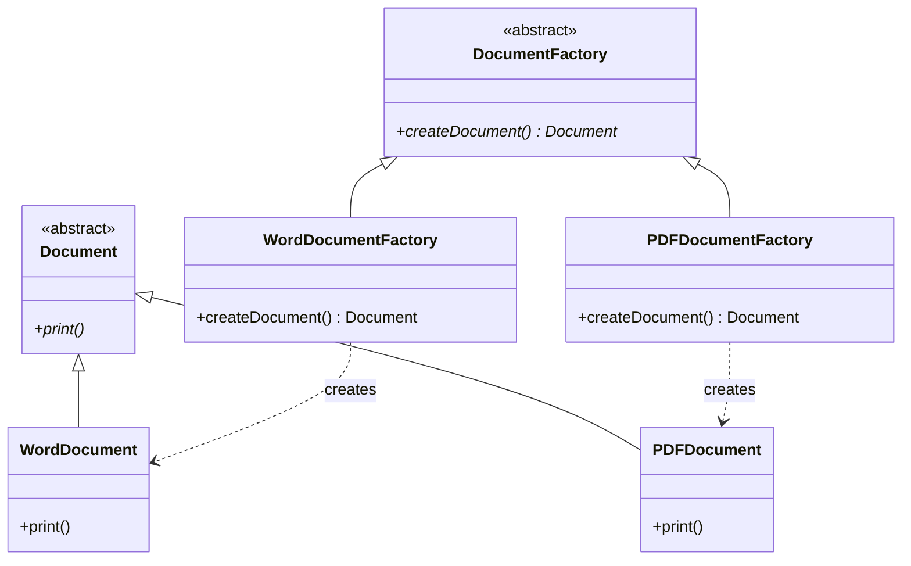
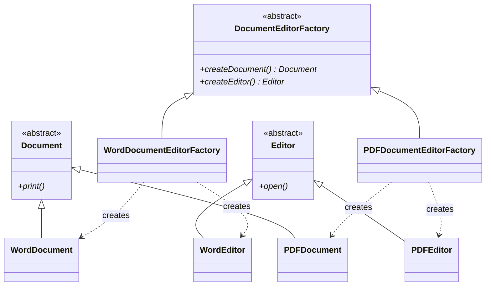

**Notes based off of:** CS3307A Lecture 8 (Dr. Umair Rehman), _Design Patterns: Singleton, Factory Method, Abstract Factory_

## Design Patterns Overview

A **design pattern** is a reusable _conceptual template_ for a problem that keeps showing up in software design. It is not copy-paste code: it is a named, well-tested way of structuring classes and objects, so you (and your teammates) can say "use a Factory here" and everyone knows what is meant. Benefits: reusability, scalability, maintainability, and a shared vocabulary.

The four broad families from the lecture:

| Family            | Concerned with                                                 | Examples                                                                     |
| ----------------- | -------------------------------------------------------------- | ---------------------------------------------------------------------------- |
| **Creational**    | How objects are created, decoupling _instantiation_ from _use_ | Singleton, Factory Method, Abstract Factory, Builder, Prototype              |
| **Structural**    | How objects/classes are composed into larger structures        | Adapter, Bridge, Composite, Decorator, Facade, Flyweight, Proxy              |
| **Behavioral**    | Communication and responsibility between objects               | Observer, Strategy, Command, Chain of Responsibility, State, Template Method |
| **Architectural** | High-level organization of whole systems                       | Layered, Microservices, Event-Driven, MVC, Client-Server, SOA                |

This lecture covers three **creational** patterns: **Singleton**, **Factory Method**, and **Abstract Factory**.

---

## Singleton Pattern

### Idea

Guarantee that a class has **exactly one instance** and provide a **global access point** to it. The class itself makes it impossible for outside code to create a second one.

Typical real-world uses: a logger, a configuration manager, a connection pool, a hardware device manager, a cache. Anything where "two of these" would be a bug or a waste of resources.

### Pros and Cons

**Pros**

- **Single instance**: only one object ever exists.
- **Global access**: one central way to reach it.
- **Lazy initialization**: it is only built the first time someone asks for it.
- **Controlled resource management**: no duplicated expensive resources (files, sockets, DB connections).
- **Consistency**: everyone shares the same state.

**Cons**

- **Global state**: hard to track who changed what and when.
- **Tight coupling**: code that calls `getInstance()` is welded to that specific class.
- **Difficult testing**: you can't easily swap in a mock, and state leaks between tests.
- **Hidden dependencies**: a function's signature doesn't reveal that it secretly uses the singleton.
- **Concurrency issues**: two threads may both see `instance == nullptr` and create two objects.

> [!note] Because of these cons, 
> Singleton is often called an _anti-pattern_ when overused. Use it only when "exactly one" is a true requirement, not just a convenience for global access.

### Building it step by step

**Step 1: Define a class**

```cpp
class MySingleton {
    // contents go here
};
```

**Step 2: Make the constructor private.** If the constructor were public, anyone could write `MySingleton obj;` and create as many instances as they like. Making it private means only the class's own methods can call it.

```cpp
class MySingleton {
private:
    MySingleton() { /* private */ }
};
// MySingleton obj = MySingleton();  // compile error: blocked
```

**Step 3: Add a static pointer to hold the one instance.** A `static` member belongs to the _class_, not to any object, which is exactly what we need since there is only one instance to track.

```cpp
private:
    static MySingleton* instance;
```

**Step 4: Add a static `getInstance()` method.** This is the _only_ door into the class. It creates the object on the first call and returns the same one every time after.

```cpp
public:
    static MySingleton* getInstance() {
        if (instance == nullptr) {
            instance = new MySingleton();
        }
        return instance;
    }
```

**Step 5: Initialize the static member outside the class.** Static data members must be defined (once) outside the class body, in a `.cpp` file. Starting at `nullptr` lets `getInstance()` detect "not created yet".

```cpp
MySingleton* MySingleton::instance = nullptr;
```

**Step 6: Use it**

```cpp
int main() {
    MySingleton* s1 = MySingleton::getInstance(); // creates the instance
    MySingleton* s2 = MySingleton::getInstance(); // returns the same one
    if (s1 == s2) {
        std::cout << "Both are the same instance!" << std::endl;
    }
}
```

`s1` and `s2` are two _pointers_ to the _same_ object, which is the whole point.

### Summary of the four moving parts

|Part|Role|
|---|---|
|Private constructor|Blocks outside instantiation|
|Static pointer|Stores and shares the single instance|
|Static `getInstance()`|Creates or returns the instance|
|Out-of-class static initialization to `nullptr`|Gives the pointer a starting value|

### Gaps the slides don't cover (worth knowing)

1. **Copying still breaks it.** A private constructor doesn't stop `MySingleton copy = *MySingleton::getInstance();`, which uses the _copy constructor_. Delete it and the assignment operator:
    
    ```cpp
    MySingleton(const MySingleton&) = delete;MySingleton& operator=(const MySingleton&) = delete;
    ```
    
2. **The instance is never deleted.** The slide version leaks `instance` at program exit. For a true singleton this is usually harmless (the OS reclaims memory), but destructors won't run, which matters if it holds files or connections.
3. **Not thread-safe.** The `if (instance == nullptr)` check is a race condition. Two threads can both pass it.
4. **The modern fix: the Meyers Singleton.** Since C++11, initialization of a function-local `static` is guaranteed thread-safe, and it is destroyed automatically:
    
    ```cpp
    class MySingleton {private:    MySingleton() {}public:    MySingleton(const MySingleton&) = delete;    MySingleton& operator=(const MySingleton&) = delete;    static MySingleton& getInstance() {        static MySingleton instance; // created on first call, thread-safe        return instance;    }};
    ```
    
    Returning a **reference** (not a pointer) also stops callers from accidentally `delete`-ing it.

---

## Why Object Creation Matters

How and _when_ objects are created affects how well a system can **evolve**, stay **flexible**, and keep **clean code**.

### Rigid dependencies and tight coupling

Writing `new ConcreteClass()` directly inside business logic ties that logic to one specific implementation:

```cpp
CreditCardPayment* payment = new CreditCardPayment();
payment->process();
// ...later you need PayPal, so you must edit this code:
PayPalPayment* payment = new PayPalPayment();
payment->process();
```

Every new type means finding and editing every place that creates objects, which is risky and doesn't scale. If creation logic is **hidden inside a factory**, that responsibility is isolated in one place and the rest of the system doesn't care.

### Running example: a document management system

We want to create and print different documents (Word, PDF). The naive version:

```cpp
int main() {
    std::string docType;
    std::cin >> docType;

    if (docType == "Word") {
        WordDocument* doc = new WordDocument();
        doc->print();
        delete doc;
    } else if (docType == "PDF") {
        PDFDocument* doc = new PDFDocument();
        doc->print();
        delete doc;
    } else {
        std::cout << "Unknown document type!" << std::endl;
    }
}
```

Problems:

- `main()` knows about every concrete class (**tight coupling**).
- Adding `SpreadsheetDocument` means **modifying `main()`**, and every other place that does this same `if/else` (**lack of flexibility**).
- The two document classes share no common type, so no code can treat them uniformly.

> [!question] Exercise from the lecture 
> Think of real scenarios where object creation depends on input. For example: an e-commerce site creating different product types (physical, digital, subscription), a game spawning different enemy types, a parser choosing a reader for JSON vs XML vs CSV.

---

## Factory Method Pattern

### Definition

Define an **interface for creating an object**, but let **subclasses decide which concrete class to instantiate**. The client only works with **abstract types** (e.g., `Document*`) and never names a concrete class.

### Principles it leans on

- **Separation of concerns**: creation logic is separated from the core logic that _uses_ the objects.
- **Single Responsibility Principle (SRP)**: the client is only responsible for _using_ the object; the factory is responsible for _creating_ it.
- **Polymorphism**: the client holds a `Document*` and calls `print()` without knowing (or caring) whether it's a Word or PDF document. New document types work without changing client code.
- **Open/Closed Principle**: open for extension (add a new factory + product), closed for modification (existing client code is untouched).

### Why not constructor overloading?

You could make a constructor take a type string (`"Word"`, `"PDF"`) and branch inside. That violates SRP: the class is now responsible for both its **core behaviour** _and_ **deciding what kind of thing to be**. It's less flexible and harder to maintain. Factories keep those jobs separate: factories create the right type, and the document just knows how to `print()` itself.

### Structure



There are **two parallel hierarchies**: _products_ (what gets built) and _creators/factories_ (who builds them). Each concrete factory is paired with one concrete product.

### Code walkthrough

**Step 1: abstract product**

```cpp
class Document {
public:
    virtual void print() = 0;      // pure virtual: subclasses must implement
    virtual ~Document() {}         // virtual destructor so delete via base pointer is safe
};
```

**Step 2: concrete products**

```cpp
class WordDocument : public Document {
public:
    void print() override { std::cout << "Printing Word document..." << std::endl; }
};

class PDFDocument : public Document {
public:
    void print() override { std::cout << "Printing PDF document..." << std::endl; }
};
```

**Step 3: abstract factory (creator)**

```cpp
class DocumentFactory {
public:
    virtual Document* createDocument() = 0;   // the "factory method"
    virtual ~DocumentFactory() {}
};
```

**Step 4: concrete factories**

```cpp
class WordDocumentFactory : public DocumentFactory {
public:
    Document* createDocument() override { return new WordDocument(); }
};

class PDFDocumentFactory : public DocumentFactory {
public:
    Document* createDocument() override { return new PDFDocument(); }
};
```

**Step 5: client**

```cpp
int main() {
    std::string docType;
    std::cout << "Enter document type (Word/PDF): ";
    std::cin >> docType;

    DocumentFactory* factory = nullptr;
    if (docType == "Word")      factory = new WordDocumentFactory();
    else if (docType == "PDF")  factory = new PDFDocumentFactory();
    else {
        std::cout << "Unknown document type!" << std::endl;
        return 1;
    }

    Document* document = factory->createDocument();
    document->print();

    delete document;   // clean up both to avoid leaks
    delete factory;
    return 0;
}
```

**Flow:** user input chooses a factory, the factory builds the document, the client calls `print()` through the abstract `Document*`.

> [!tip] Notice the `if/else` choosing the factory still exists in `main()`. 
> The pattern doesn't eliminate _the decision_, it **confines it to one spot** (the "composition root") and keeps the rest of the client code type-agnostic. In larger systems this selection often lives in a config file or a registry map instead of an `if` chain.
> 
> Also, in modern C++ you'd return `std::unique_ptr<Document>` from `createDocument()` so nobody has to remember the `delete`.

### Extension: adding `SpreadsheetDocument`

To add a new type you only **add** code:

1. `class SpreadsheetDocument : public Document { ... }`
2. `class SpreadsheetDocumentFactory : public DocumentFactory { ... }`
3. One extra branch where the factory is selected in `main()`.

Existing `Document`, `WordDocument`, `PDFDocument`, `DocumentFactory`, and all code that merely _uses_ a `Document*` stay **unchanged**. That's the Open/Closed Principle in action.

### When it's overkill

- Only a few object types that rarely change: plain `new` is simpler.
- Object creation is trivial and needs no delegation or abstraction.
- Extra layers (abstract factory class + one subclass per product) add complexity with no payoff.

### Exercises from the lecture

- **Shapes**: abstract `Shape` with `draw()`; concrete `Circle`, `Square`; a `ShapeFactory` with `createShape()`; `main()` asks for Circle/Square and draws it.
- **Vehicles**: abstract `Vehicle` with `drive()`; `Car`, `Bike`, `Truck`; a `VehicleFactory` choosing from user input. Design it so new vehicles can be added without touching client code.

---

## Abstract Factory Pattern

(The slides sometimes call this "Abstract Factory Method"; the pattern's name is just **Abstract Factory**.)

### Motivation

Sometimes you need to create **several related objects that must work together**, a _family_ of products. In the running example: a `WordDocument` must be edited by a `WordEditor`, and a `PDFDocument` by a `PDFEditor`. Mixing them (a `WordDocument` with a `PDFEditor`) would be a bug.

Abstract Factory provides an interface for creating a whole **family of related objects** without specifying their concrete classes, and **guarantees the products come from the same family**.

### Factory Method vs. Abstract Factory

|                | Factory Method                                                | Abstract Factory                                                                                           |
| -------------- | ------------------------------------------------------------- | ---------------------------------------------------------------------------------------------------------- |
| Creates        | **One** product type at a time                                | A **family** of related products                                                                           |
| Example        | `DocumentFactory` makes a `WordDocument` _or_ a `PDFDocument` | One factory makes a `WordDocument` **and** a `WordEditor`; another makes `PDFDocument` **and** `PDFEditor` |
| Variation axis | Which _kind_ of one thing                                     | Which _family_ of several things                                                                           |
| Mechanism      | One factory method, overridden by subclasses                  | Several factory methods grouped in one interface                                                           |

A useful way to remember: Abstract Factory is often just **several Factory Methods bundled into one factory interface**, one per product in the family.

### Structure



### Code walkthrough

**Step 1: abstract products** (two of them now)

```cpp
class Document {
public:
    virtual void print() = 0;
    virtual ~Document() {}
};

class Editor {
public:
    virtual void open() = 0;
    virtual ~Editor() {}
};
```

**Steps 2 and 3: concrete products per family**

```cpp
class WordDocument : public Document {
public: void print() override { std::cout << "Printing Word document..." << std::endl; }
};
class WordEditor : public Editor {
public: void open() override { std::cout << "Opening Word editor..." << std::endl; }
};

class PDFDocument : public Document {
public: void print() override { std::cout << "Printing PDF document..." << std::endl; }
};
class PDFEditor : public Editor {
public: void open() override { std::cout << "Opening PDF editor..." << std::endl; }
};
```

**Step 4: abstract factory interface** (one creation method per product in the family)

```cpp
class DocumentEditorFactory {
public:
    virtual Document* createDocument() = 0;
    virtual Editor*   createEditor()   = 0;
    virtual ~DocumentEditorFactory() {}
};
```

**Step 5: one concrete factory per family**

```cpp
class WordDocumentEditorFactory : public DocumentEditorFactory {
public:
    Document* createDocument() override { return new WordDocument(); }
    Editor*   createEditor()   override { return new WordEditor(); }
};

class PDFDocumentEditorFactory : public DocumentEditorFactory {
public:
    Document* createDocument() override { return new PDFDocument(); }
    Editor*   createEditor()   override { return new PDFEditor(); }
};
```

**Step 6: client**

```cpp
int main() {
    std::string docType;
    std::cout << "Enter document type (Word/PDF): ";
    std::cin >> docType;

    DocumentEditorFactory* factory = nullptr;
    if (docType == "Word")     factory = new WordDocumentEditorFactory();
    else if (docType == "PDF") factory = new PDFDocumentEditorFactory();
    else { std::cout << "Unknown document type!" << std::endl; return 1; }

    Document* document = factory->createDocument();
    Editor*   editor   = factory->createEditor();

    editor->open();
    document->print();

    delete document;  // (omitted on the slide, but needed)
    delete editor;
    delete factory;
}
```

Key point: the client only sees `Document*`, `Editor*`, and `DocumentEditorFactory*`. It picks **one factory** and automatically gets a **matching** pair, so a mismatch is impossible by construction.

### Extensibility

Adding a **new family** (e.g., `SpreadsheetDocument` + `SpreadsheetEditor` + `SpreadsheetDocumentEditorFactory`) requires no changes to existing factories or client logic that uses the abstract interfaces, which satisfies the Open/Closed Principle.

> [!warning] The trade-off Adding a new _family_ is easy. Adding a new _product type_ to every family (say, a `Printer` alongside `Document` and `Editor`) is hard: you must change the abstract factory interface **and every concrete factory**.

### Pitfalls

- **Overkill for unrelated objects.** If the objects don't need to be created _together_ or must not be mixed, plain Factory Method (or just `new`) is better.
- **Few families and no plans to add more** means a simpler design is fine.
- **Avoid over-engineering**: don't pay the complexity cost unless multiple related objects are genuinely required.

### Activity from the lecture

Build an Abstract Factory for **phones and chargers**:

- Abstract `Phone` (`makeCall()`) and `Charger` (`charge()`).
- Concrete `AndroidPhone`, `iPhone`, `AndroidCharger`, `iPhoneCharger`.
- `AbstractPhoneChargerFactory` creating a matching `Phone` + `Charger`.
- Then add a new brand to demonstrate extensibility without touching client code.

---

## Quick Comparison of the Three Patterns

| Pattern              | Core purpose                              | Key mechanism                                      | Watch out for                                                 |
| -------------------- | ----------------------------------------- | -------------------------------------------------- | ------------------------------------------------------------- |
| **Singleton**        | Exactly one instance, globally accessible | Private constructor + static `getInstance()`       | Global state, testing difficulty, thread safety               |
| **Factory Method**   | Hide _which_ concrete class is created    | Abstract creator with overridable `createX()`      | Overkill with few, stable types                               |
| **Abstract Factory** | Create _families_ of compatible objects   | Factory interface with several `createX()` methods | Hard to add new product types; overkill for unrelated objects |

## Conclusion

- Creational patterns control **how objects get made** so the rest of the code stays flexible.
- **Singleton**: one instance, global access (use sparingly).
- **Factory Method**: delegate creation of _one_ product to subclasses; client depends only on abstractions.
- **Abstract Factory**: create _families_ of related products that are guaranteed to match.
- Both factory patterns support SRP, polymorphism, and the Open/Closed Principle, but each adds layers: use them when variation is real, not by default.