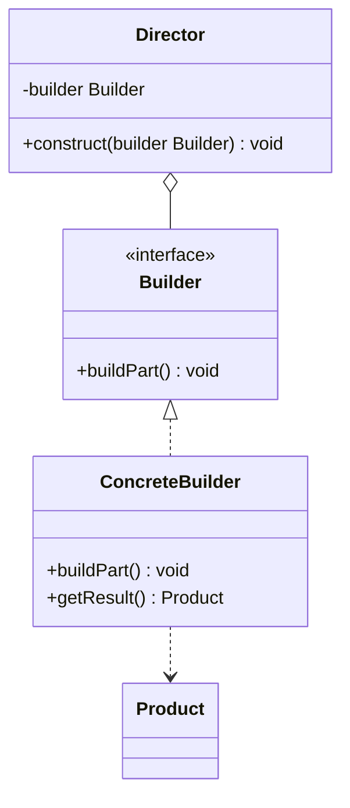
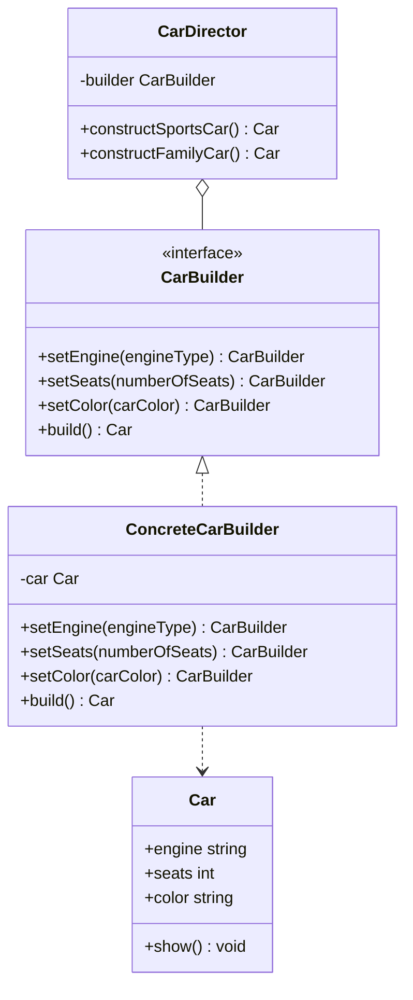
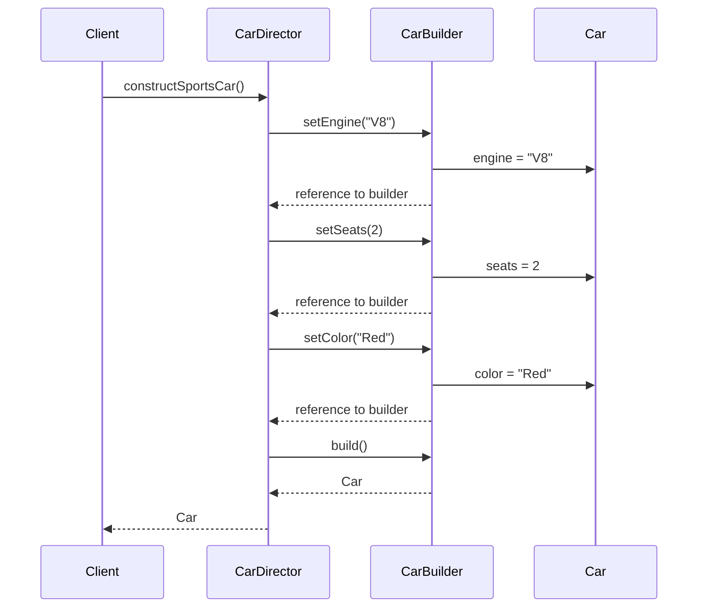

**Notes based off of:**

- CS3307A Lecture 9 slides (Dr. Umair Rehman), CS3307_W5B.pdf
- [https://www.oodesign.com/builder-pattern](https://www.oodesign.com/builder-pattern) (the UML source cited in the slides)

## Big Picture

The **Builder pattern** is a _creational_ design pattern. Its job is to construct a complex object **step by step**, and to **separate the construction process from the finished representation** of the object.

It shines when an object has:

- many configuration options,
- optional parameters,
- or several valid "recipes" (e.g. a sports car vs. a family car built from the same parts).

The central trade: you add a few extra classes, and in return you get readable, flexible, hard-to-misuse object creation.

> [!note] Prof-style intuition 
> Think of ordering a sandwich. You don't hand the cook a 12-argument constructor call. You say "bread, then cheese, then no onions, then toast it" and at the end you receive the sandwich. The _builder_ is the sandwich station taking your steps. The _director_ is the "combo #3" button that issues a fixed list of steps for you.

## The Problem: Why Not Just Use Constructors?

The lecture's running example: design a flexible system to construct different **cars** with varying **engine type, seat count, and colour**, e.g. sports cars and family cars.

### Approach 1: Without the Builder Pattern

`Car` has a constructor with default arguments, setters, and **helper functions** that create preset cars.

```cpp
class Car {
private:
    string engine;
    int seats;
    string color;
public:
    Car(const string& engineType = "", int seatCount = 0, const string& carColor = "")
        : engine(engineType), seats(seatCount), color(carColor) {}

    void setEngine(const string& engineType) { engine = engineType; }
    void setSeats(int seatCount)             { seats = seatCount; }
    void setColor(const string& carColor)    { color = carColor; }

    void show() const {
        cout << "Car with " << engine << " engine, " << seats
             << " seats, color " << color << endl;
    }
};

Car createSportsCar() {
    Car car;
    car.setEngine("V8");
    car.setSeats(2);
    car.setColor("Red");
    return car;
}

Car createFamilyCar() {
    Car car;
    car.setEngine("V6");
    car.setSeats(5);
    car.setColor("Blue");
    return car;
}
```

**Why this gets painful:**

- **Limited flexibility:** every new configuration means a new helper function or edits to existing code.
- **Maintenance complexity:** the helper functions multiply as configurations grow (`createElectricSUV`, `createRedFamilyCarWith7Seats`, ...).
- **No incremental setup:** there is no clean step-by-step construction, so complex setups are hard to manage.
- A subtler issue (worth mentioning): between `Car car;` and the last setter, the object exists in a **half-initialized state**. Nothing stops someone from forgetting `setSeats` and ending up with a car with `0` seats.

### Approach 2: Telescoping Constructors

A **telescoping constructor** is the pattern of writing _multiple overloaded constructors_, each one taking one more parameter than the last. Each shorter constructor conceptually delegates to the longer one with defaults filled in. The name comes from a telescope: each constructor "extends" the previous one.

```cpp
class Car {
private:
    string engine;
    int seats;
    string color;
public:
    Car() : engine(""), seats(0), color("") {}
    Car(const string& engineType) : engine(engineType), seats(0), color("") {}
    Car(const string& engineType, int seatCount)
        : engine(engineType), seats(seatCount), color("") {}
    Car(const string& engineType, int seatCount, const string& carColor)
        : engine(engineType), seats(seatCount), color(carColor) {}
};

int main() {
    Car basicCar;                          // all defaults
    Car engineOnlyCar("V6");               // engine only
    Car engineSeatsCar("V8", 2);           // engine + seats
    Car fullyConfiguredCar("V8", 2, "Red");// everything
}
```

| |Telescoping constructors|
|---|---|
|**Advantages**|Simple when there are few parameters. Direct initialization, with no setters or helpers needed.|
|**Disadvantages**|**Hard to maintain:** more parameters means more constructors. **Error-prone:** easy to misorder parameters. **Not self-documenting:** `Car("V8", 2, "Red")` doesn't say what `2` means.|

**Gaps worth filling in:**

- You **cannot skip a middle parameter.** If you want a colour but no seat count, you must still pass a dummy value for seats (`Car("V8", 0, "Red")`).
- With several parameters of the _same type_ (e.g. three `int`s: seats, doors, horsepower), the compiler **cannot catch a swapped order**. It just compiles and silently builds the wrong car.
- The number of overloads can grow combinatorially if you want to support arbitrary subsets of optional parameters.

Builder is the cure: **named steps, any order of optional parts, one final `build()`**.

## Builder Pattern Structure

### The Roles

|Role|Responsibility|In the car example|
|---|---|---|
|**Product**|The complex object we want to create.|`Car`|
|**Builder** (interface / abstract class)|Declares the _steps_ needed to create the product.|`CarBuilder`|
|**ConcreteBuilder**|Implements those steps to produce one specific variation; holds the product being built; exposes the result.|`ConcreteCarBuilder`|
|**Director** _(optional)_|Manages the construction process and ensures parts are built **in the correct order**. Encodes reusable "recipes".|`CarDirector`|

Key point: the **Director is optional**. You can use a builder directly from client code (as `main` does for the custom electric car) and only introduce a director when you want _named, reusable recipes_ like "sports car".

### Generic UML



The note attached to `Director` in the slide's diagram reads, in effect: _for all objects in the structure, call `builder.buildPart()`_. That is, the director walks through the steps and the builder does the actual work.

### Relationships (these are exam-friendly)

- **Director ◇— Builder (aggregation):** the Director _holds a reference_ to a Builder but **does not own it**. The builder is created and managed externally, so the Director uses it temporarily for construction without controlling its lifecycle.
- **ConcreteBuilder ▷— Builder (inheritance / realization):** the concrete builder implements the interface's steps.
- **ConcreteBuilder ⇢ Product (dependency):** the builder _needs_ `Car` to produce a final product, but doesn't strictly own or control its lifecycle in the UML sense.

## Running Example: The Builder Pattern for Cars

### Product

```cpp
class Car {
public:
    string engine;
    int seats;
    string color;

    void show() {
        cout << "Car with " << engine << " engine, " << seats
             << " seats, color " << color << endl;
    }
};
```

### Car-specific UML



### Version 1: With Pointers

**Builder interface:** each setter is pure virtual and returns the _builder_ (so calls can be chained); `build()` hands back the finished car. The virtual destructor is essential because we delete through a base pointer.

```cpp
class CarBuilder {
public:
    virtual CarBuilder* setEngine(const string& engineType) = 0;
    virtual CarBuilder* setSeats(int numberOfSeats) = 0;
    virtual CarBuilder* setColor(const string& carColor) = 0;
    virtual Car* build() = 0;
    virtual ~CarBuilder() = default;
};
```

**Concrete builder:** owns a `Car*` created in its constructor; every setter mutates that car and `return this;`.

```cpp
class ConcreteCarBuilder : public CarBuilder {
private:
    Car* car;
public:
    ConcreteCarBuilder() { car = new Car(); }

    CarBuilder* setEngine(const string& engineType) override {
        car->engine = engineType;
        return this;
    }
    CarBuilder* setSeats(int numberOfSeats) override {
        car->seats = numberOfSeats;
        return this;
    }
    CarBuilder* setColor(const string& carColor) override {
        car->color = carColor;
        return this;
    }
    Car* build() override { return car; }
};
```

**Director:** stores a `CarBuilder*` and offers preset recipes.

```cpp
class CarDirector {
private:
    CarBuilder* builder;
public:
    CarDirector(CarBuilder* builder) : builder(builder) {}

    Car* constructSportsCar() {
        return builder->setEngine("V8")->setSeats(2)->setColor("Red")->build();
    }
    Car* constructFamilyCar() {
        return builder->setEngine("V6")->setSeats(5)->setColor("Blue")->build();
    }
};
```

**Client:**

```cpp
int main() {
    // Using the builder directly
    CarBuilder* builder = new ConcreteCarBuilder();
    Car* customCar = builder->setEngine("Electric")->setSeats(4)->setColor("Green")->build();
    customCar->show();

    // Using the director for predefined types
    CarDirector director(builder);
    Car* sportsCar = director.constructSportsCar();
    sportsCar->show();

    Car* familyCar = director.constructFamilyCar();
    familyCar->show();

    delete builder;
    delete customCar;
    delete sportsCar;
    delete familyCar;
    return 0;
}
```

The `Director` doesn't create or manage the `Car` directly. It only calls builder methods (`setEngine`, `setSeats`, `setColor`), and those configure the car.

#### ⚠️ Gotcha: this slide code has a hidden bug

The builder creates **one** `Car` in its constructor, and `build()` returns that **same pointer** every time. So in `main`:

- `customCar`, `sportsCar`, and `familyCar` are **all the same object**. Each later call just overwrites the fields of the earlier "car".
- The output _looks_ right only because each `show()` happens right after the corresponding build. If you printed `customCar` at the end, it would say V6 / 5 / Blue.
- The three `delete` calls then free the **same address three times** (a double/triple free, which is **undefined behaviour**).

A fix is to have `build()` hand off ownership and start fresh:

```cpp
Car* build() override {
    Car* result = car;   // caller now owns this car
    car = new Car();     // builder starts a clean car for the next build
    return result;
}
~ConcreteCarBuilder() override { delete car; }  // free the in-progress car
```

In modern C++ you would return `std::unique_ptr<Car>` from `build()` and avoid manual `delete` entirely, which is also a good motivation for the next version.

### Version 2: Without Pointers (Method Chaining with References)

No `new`, no `delete`, no virtual interface. The builder simply **holds a `Car` by value**, and chaining works by returning a **reference to itself** (`*this`).

```cpp
class Car {
public:
    string engine;
    int seats;
    string color;

    void show() const {
        cout << "Car with " << engine << " engine, " << seats
             << " seats, color " << color << endl;
    }
};

class CarBuilder {
private:
    Car car;   // directly hold an instance of Car
public:
    CarBuilder& setEngine(const string& engineType) {
        car.engine = engineType;
        return *this;
    }
    CarBuilder& setSeats(int seatCount) {
        car.seats = seatCount;
        return *this;
    }
    CarBuilder& setColor(const string& carColor) {
        car.color = carColor;
        return *this;
    }
    Car build() const { return car; }   // returns a copy
};

class CarDirector {
private:
    CarBuilder builder;   // holds a CarBuilder object directly
public:
    CarDirector(const CarBuilder& builder) : builder(builder) {}

    Car constructSportsCar() {
        return builder.setEngine("V8").setSeats(2).setColor("Red").build();
    }
    Car constructFamilyCar() {
        return builder.setEngine("V6").setSeats(5).setColor("Blue").build();
    }
};

int main() {
    CarBuilder builder;

    Car customCar = builder.setEngine("Electric").setSeats(4).setColor("Green").build();
    customCar.show();   // Car with Electric engine, 4 seats, color Green

    CarDirector director(builder);
    Car sportsCar = director.constructSportsCar();
    sportsCar.show();   // Car with V8 engine, 2 seats, color Red

    Car familyCar = director.constructFamilyCar();
    familyCar.show();   // Car with V6 engine, 5 seats, color Blue
}
```

**What each piece does:**

- **Car (Product):** defines the attributes and a `show` method.
- **CarBuilder:** holds a `Car`; each setter updates it and returns `*this` so the next call can be chained; `build()` returns the configured car.
- **CarDirector:** uses a `CarBuilder` to produce preset configurations.
- **main:** builds a custom car with the builder directly, then predefined ones through the director.

**Things worth noticing (that the slides gloss over):**

- Because `build()` returns a **copy**, each of `customCar`, `sportsCar`, `familyCar` is an independent object. This version does **not** have the aliasing bug from Version 1.
- The slide text says the director "holds a reference" to the builder, but in this code `CarDirector` has a `CarBuilder` **member by value**, initialized from a copy of the one passed in. The director therefore works on its own _copy_ of the builder. If you wanted a genuine non-owning link (the UML aggregation), store a `CarBuilder&` or `CarBuilder*` instead.
- The builder **keeps its state between builds**. That's harmless here because every director recipe sets all three fields, but if a recipe only set two, the third would "leak" from the previous car. A `reset()` method is the usual remedy.

### Comparison of the Approaches

| |Helper functions + setters|Telescoping constructors|Builder|
|---|---|---|---|
|Readability at call site|Medium|Poor (positional args)|Good (named steps)|
|Optional parameters|Awkward|Needs many overloads|Natural|
|Misordering errors|Low|**High**|Low|
|Half-built objects visible?|Yes|No|No (only after `build()`)|
|Adding a new option|New helper or edit|New overload(s)|New setter|
|Extra classes needed|None|None|Yes|

## Method Chaining Explained

Method chaining lets you call several methods on the same object in one statement:

```cpp
builder.setEngine("Electric").setSeats(4).setColor("Green").build();
```

How it works:

- Each setter **returns the object it was called on**, so the next `.method()` is invoked on that very same object.
- **With pointers:** return `this`; chain using `->`.
- **Without pointers:** return `*this` as a **reference** (`CarBuilder&`) ; chain using `.`.
- The return type must be a **reference (or pointer)**. If a setter returned `CarBuilder` _by value_, each step in the chain would act on a **copy**, and your earlier setters would be lost.

This is the same idea behind a **fluent interface**. You've probably seen it in `std::cout << a << b << c;`, where each `operator<<` returns the stream by reference.

How a Director recipe unfolds:



## Pros and Cons

### Positives

- **Flexibility:** ideal for complex, step-by-step construction.
- **Readability:** chained, named methods make the configuration self-documenting (compare with `Car("V8", 2, "Red")`).
- **Encapsulation:** hides complex creation logic from the client.
- **"Immutability":** the client receives a fully configured object. _(Caveat: in the slides' code the `Car` fields are public and mutable, so it isn't truly immutable. For real immutability, make `Car`'s fields private with only getters, and give it a constructor that only the builder can call.)_

### Negatives

- **Complexity:** more classes, especially painful for simple objects.
- **Memory overhead:** the builder stores an instance of the product directly.
- **Overkill for simple objects:** if a class has two or three required fields, a plain constructor is better. Don't pattern-ify everything.

## When to Use It (and Related Patterns)

Reach for Builder when:

- a constructor would need **many parameters, especially optional ones**,
- the same construction process should produce **different representations**,
- you want to build an object **incrementally** and only release it once complete.

**Real-world examples:** Java's `StringBuilder`, HTTP request builders (e.g. `Request.Builder` in OkHttp), SQL/query builders, and document builders (HTML/PDF generators).

**How it differs from other creational patterns:**

- **Factory Method / Abstract Factory:** return a product (or family of products) **in one call**. Builder constructs **one complex product in multiple steps**, then hands it over.
- **Singleton:** controls _how many_ instances exist. Builder controls _how_ an instance is assembled. They solve unrelated problems.

## Quick Review

1. **What problem does Builder solve?** Creating complex objects with many/optional parameters without telescoping constructors or half-initialized objects.
2. **Name the four roles.** Product, Builder, ConcreteBuilder, Director (optional).
3. **What does the Director do?** Encodes construction _recipes_ and ensures parts are built in the right order.
4. **Relationship between Director and Builder?** Aggregation (it uses, but doesn't own, the builder).
5. **Relationship between ConcreteBuilder and Product?** Dependency.
6. **Why do setters return `*this` / `this`?** To enable method chaining.
7. **Why return a reference rather than a value from a setter?** A by-value return would copy the builder, so later setters would act on the copy.
8. **Name two downsides of telescoping constructors.** Hard to maintain, error-prone positional parameters, not self-documenting.
9. **What's the bug in the pointer version's `main`?** `build()` returns the same `Car*` each time, so all three pointers alias one object and get deleted three times.
10. **When is Builder overkill?** Simple objects with only a few required fields.