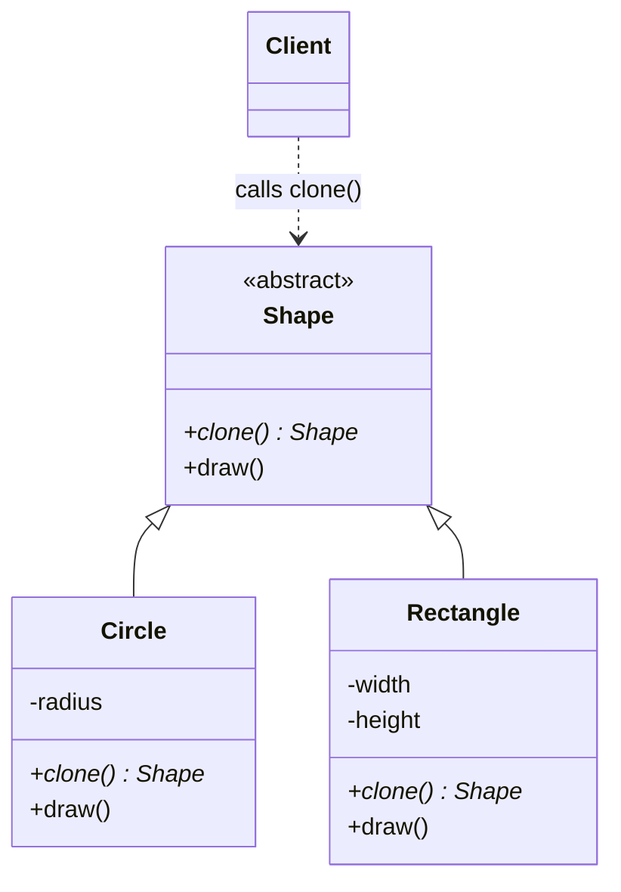
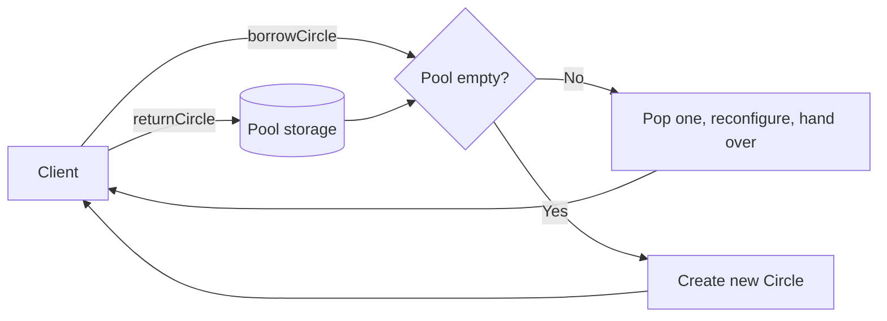
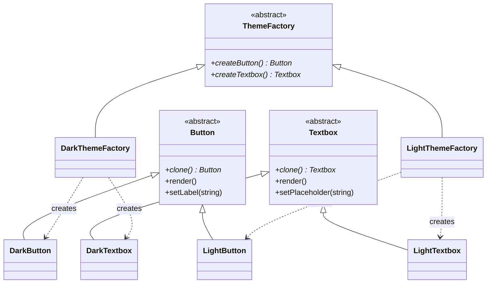

**Notes based off of:** CS3307A Lecture 10 slides, Dr. Umair Rehman (10/19/2026), _Creational Design Patterns: Prototype, Copy Constructors, Object Pooling, and Combining Patterns_

## Overview

This lecture finishes the **creational pattern** family (Singleton, Factory Method, Abstract Factory, Builder, and now **Prototype**) and then asks a more practical question: _what happens when one pattern isn't enough?_ Real systems usually mix several creational patterns.

Topics covered:

1. Prototype pattern (cloning objects instead of constructing from scratch)
2. Modifying cloned objects with setters
3. Copy constructors as a lighter alternative
4. Object pooling (reuse instead of re-create)
5. Combining creational patterns: **Abstract Factory + Prototype** and **Factory + Builder**

> [!tip] Big picture 
> All creational patterns answer the same question: _who is responsible for creating objects, and how do we keep the client code from depending on concrete classes?_ Prototype's answer: **ask an existing object to copy itself.**

---

## Prototype Pattern

### Core Idea

- Create new objects by **cloning** an existing one (the _prototype_) rather than calling a constructor and re-configuring everything.
- Useful when an object is **expensive or tedious to build** (many fields, loaded resources, a long configuration process) and you need many instances that are only _slightly_ different.

**Analogy from the slides:** a template document. You don't rewrite it each time; you copy it and change the name and date.

### Why not just `new`?

- The client would need to know the **concrete class** and all its constructor arguments.
- Rebuilding complex state repeatedly is wasteful.
- With Prototype, the client only needs a pointer/reference to the abstract type and calls `clone()`. The object itself knows how to copy itself, **including its dynamic (runtime) type**.

### Structure



- **Prototype interface:** a base class declaring a pure virtual `clone()`.
- **Concrete prototypes:** each subclass implements `clone()` by returning a copy of itself, usually `return new Circle(*this);` (this invokes the class's **copy constructor**).
- **Client:** holds a base-class pointer and calls `clone()` without knowing which subclass it is.

### Code: Basic Prototype

```cpp
#include <iostream>

// Prototype interface
class Shape {
public:
    virtual ~Shape() {}
    virtual Shape* clone() const = 0;   // returns a raw pointer to a NEW object
    virtual void draw() const = 0;
};

class Circle : public Shape {
public:
    Circle(float radius) : radius(radius) {}
    Shape* clone() const override { return new Circle(*this); }
    void draw() const override {
        std::cout << "Drawing Circle with radius " << radius << "\n";
    }
private:
    float radius;
};

class Rectangle : public Shape {
public:
    Rectangle(float w, float h) : width(w), height(h) {}
    Shape* clone() const override { return new Rectangle(*this); }
    void draw() const override {
        std::cout << "Drawing Rectangle with width " << width
                  << " and height " << height << "\n";
    }
private:
    float width, height;
};

int main() {
    Shape* originalCircle    = new Circle(5.0);
    Shape* originalRectangle = new Rectangle(3.0, 4.0);

    Shape* clonedCircle    = originalCircle->clone();
    Shape* clonedRectangle = originalRectangle->clone();

    originalCircle->draw();     // same output as clonedCircle
    clonedCircle->draw();
    originalRectangle->draw();
    clonedRectangle->draw();

    delete originalCircle;  delete originalRectangle;
    delete clonedCircle;    delete clonedRectangle;   // caller owns every clone
}
```

**Things worth noticing**

- `clone()` is `const`: cloning must not change the original.
- `clone()` returns `Shape*` (the interface type), so the client never mentions `Circle` or `Rectangle` after the initial creation.
- `new Circle(*this)` works because `*this` is a `Circle` inside `Circle::clone()`. The _virtual dispatch_ on `clone()` is what picks the right subclass at runtime.
- **Ownership:** whoever calls `clone()` receives a heap object and must `delete` it. This is why the slides finish with four `delete` calls.

> [!note] Beyond the slides
>  Modern C++ prefers returning `std::unique_ptr<Shape>` from `clone()` so ownership is explicit and the manual `delete` calls disappear. The slides use raw pointers to keep the pattern itself in focus.

---

## Modifying Cloned Objects

A clone that is _identical_ to the original isn't very useful. The typical workflow is **clone, then tweak**.

- Add a **setter** to the interface (e.g. `setDimension(int)`) so the client can change a clone's private state while **encapsulation is preserved** (no public fields).
- Because the setter is on the abstract base class, the client can modify a clone without knowing its concrete type.

```cpp
class Shape {
public:
    virtual ~Shape() {}
    virtual Shape* clone() const = 0;
    virtual void draw() const = 0;
    virtual void setDimension(int newDimension) = 0;
};

class Circle : public Shape {
    int radius;
public:
    Circle(int r) : radius(r) {}
    Shape* clone() const override { return new Circle(*this); }
    void draw() const override { std::cout << "Drawing a Circle with radius " << radius << "\n"; }
    void setDimension(int r) override { radius = r; }
};

class Square : public Shape {
    int side;
public:
    Square(int s) : side(s) {}
    Shape* clone() const override { return new Square(*this); }
    void draw() const override { std::cout << "Drawing a Square with side " << side << "\n"; }
    void setDimension(int s) override { side = s; }
};

int main() {
    Shape* originalCircle = new Circle(5);
    Shape* originalSquare = new Square(4);

    Shape* clonedCircle = originalCircle->clone();
    Shape* clonedSquare = originalSquare->clone();

    clonedCircle->setDimension(10);   // only the clone changes
    clonedSquare->setDimension(8);

    originalCircle->draw();   // radius 5  (unchanged)
    clonedCircle->draw();     // radius 10
    // ... delete all four
}
```

**Key point:** the clone is an **independent object**. Changing `clonedCircle` leaves `originalCircle` untouched. This only holds if the copy is a proper copy (see the shallow vs. deep copy discussion below).

---

## Copy Constructors

The slides then show that for simple cases you can duplicate and modify an object **without the Prototype pattern**, using only a C++ copy constructor.

```cpp
class Circle : public Shape {
    int radius;
public:
    Circle(int r) : radius(r) {}
    Circle(const Circle& other) : radius(other.radius) {}   // copy constructor
    void setRadius(int r) { radius = r; }
    void draw() const override { /* ... */ }
};

int main() {
    Circle original(5);
    Circle copy = original;   // copy constructor runs
    copy.setRadius(10);
    original.draw();          // radius 5
    copy.draw();              // radius 10
}
```

### Copy Constructor vs. Prototype: the crucial difference

A copy constructor requires the compiler to know the **exact static type** at the call site (`Circle copy = original;`).

If all you have is a `Shape*`, you **cannot** write `Shape copy = *ptr;`:

- `Shape` is abstract, so you can't instantiate it, and
- even for a concrete base class you'd get **object slicing** (only the base part is copied, the derived part is lost).

`clone()` solves this by being **virtual**: the call is dispatched to the real runtime type, which then uses its own copy constructor. This is sometimes called the **virtual constructor idiom**.

> [!important] Relationship Prototype's `clone()` is usually _implemented with_ the copy constructor. The copy constructor does the copying; `clone()` adds polymorphism on top.

### Shallow vs. Deep Copy (the "complex dependencies" caveat)

The slides' cons mention that cloning "can be complex with deep copies". Here is why:

- The compiler-generated copy constructor does a **shallow copy**: pointer members are copied as addresses, so the original and clone end up **sharing** the same underlying object.
- Two owners of one heap object leads to **double deletion** or accidental shared mutation.
- Fix: write a **deep-copying** copy constructor that clones whatever the object points to.

```cpp
class Canvas : public Shape {
    std::vector<Shape*> children;
public:
    Canvas(const Canvas& other) {
        for (Shape* c : other.children)
            children.push_back(c->clone());   // deep copy via Prototype
    }
    Shape* clone() const override { return new Canvas(*this); }
    ~Canvas() { for (Shape* c : children) delete c; }
    // ...
};
```

This is the **Rule of Three**: if you need a custom destructor, you almost certainly need a custom copy constructor and copy assignment operator too.

---

## Object Pooling

Not a Prototype variant, but the lecture groups it with the other "avoid expensive creation" techniques.

### Idea

- An **Object Pool** owns a set of **pre-initialized, reusable** objects.
- A client **borrows** an object, uses it, then **returns** it so it can be reused.
- Prototype/copy _makes more_ objects cheaply; pooling _avoids making more_ in the first place.

### When it pays off

Creating and destroying the object is expensive in time or resources:

- Database connections (the slides' main example: opening one is far costlier than reusing one)
- Threads (thread pools), network sockets
- Large buffers or heavyweight game entities (bullets, particles)



### Code

```cpp
class Circle {
public:
    Circle(float radius = 1.0) : radius(radius) {
        std::cout << "Creating Circle with radius: " << radius << "\n";
    }
    void setRadius(float r) { radius = r; }
    void draw() const { std::cout << "Drawing Circle with radius " << radius << "\n"; }
private:
    float radius;
};

class CirclePool {
public:
    ~CirclePool() { for (Circle* c : pool) delete c; }

    Circle* borrowCircle(float radius) {
        if (!pool.empty()) {
            Circle* c = pool.back();
            pool.pop_back();          // remove from storage
            c->setRadius(radius);     // reconfigure the recycled object
            return c;
        }
        return new Circle(radius);    // nothing spare: create one
    }

    void returnCircle(Circle* c) { pool.push_back(c); }

private:
    std::vector<Circle*> pool;
};

int main() {
    CirclePool circlePool;
    Circle* c1 = circlePool.borrowCircle(5.0);   // "Creating Circle..." printed
    Circle* c2 = circlePool.borrowCircle(10.0);  // "Creating Circle..." printed
    circlePool.returnCircle(c1);
    circlePool.returnCircle(c2);
    Circle* c3 = circlePool.borrowCircle(15.0);  // reuse: NO "Creating" message
    c3->draw();
    circlePool.returnCircle(c3);
}   // pool destructor deletes every circle it holds
```

**Walkthrough:** the first two borrows hit an empty pool, so two constructors run. After both are returned, the third borrow pops an existing circle and just changes its radius, so there is no construction cost. That missing "Creating Circle..." line is the visible proof that reuse worked.

### Gotchas (these are the "increased complexity / memory leak" cons)

- **Leak risk:** the pool's destructor only deletes circles currently _in_ the pool. A circle that a client borrowed and never returned is never freed.
- **Stale state:** a recycled object keeps whatever state it had. The pool must **reset** it (here `setRadius` does this; real objects may need much more).
- **Use-after-return:** a client that keeps using a pointer after returning it will corrupt another client's object.
- Real pools usually cap their size and use RAII wrappers (a smart pointer with a custom deleter that auto-returns the object).

---

## Comparing Copy Constructor, Object Pool, and Prototype

|                                       | **Copy Constructor**                                  | **Object Pooling**                                               | **Prototype Pattern**                                           |
| ------------------------------------- | ----------------------------------------------------- | ---------------------------------------------------------------- | --------------------------------------------------------------- |
| **Core idea**                         | Duplicate an object of a known type                   | Reuse existing objects                                           | Clone through an abstract interface                             |
| **Pros**                              | Efficient; preserves existing state                   | Resource-efficient; cuts creation and destruction overhead       | Flexible cloning of complex objects; fewer constructor calls    |
| **Cons**                              | Limited flexibility; costly with complex dependencies | More code; leaks if not managed carefully                        | Deep copies can be tricky; must handle dependencies carefully   |
| **Needs concrete type at call site?** | Yes                                                   | Pool is typically per-type                                       | No (polymorphic)                                                |
| **Best when**                         | Simple value-like objects                             | Creation or destruction is expensive and objects are short-lived | You hold base-class pointers and need copies of varied subtypes |

---

## Combining Creational Patterns

Individual patterns each solve one problem; larger systems often need **several strategies for object creation at once**. Pairings listed in the lecture:

|Combination|Division of labour|Good for|
|---|---|---|
|**Factory + Builder**|Factory creates the parts or picks the base type; Builder assembles or customizes|Complex step-by-step assembly with variants|
|**Abstract Factory + Prototype**|Abstract Factory defines the _families_; Prototype clones base instances for variations|Families of related products with subtle differences|
|**Singleton + Factory Method / Abstract Factory**|Singleton guarantees exactly one factory; factory provides flexibility in _what_ it creates|Global, configured creation point (e.g. one theme manager)|
|**Factory Method + Builder**|Factory picks a Builder based on runtime context; Builder produces the configuration|Dynamic customization depending on runtime conditions|
|**Builder + Prototype**|Prototype supplies a base object; Builder customizes it in steps|Modularizing complex multi-step creation|

> [!note] The slides list "Factory Method and Builder" twice (once under the Builder + Prototype bullet group). It's the same idea repeated; there are four distinct pairings plus that duplicate.

---

## Abstract Factory + Prototype

### Scenario

A UI library supports **Dark** and **Light** themes. Each theme has its own **family** of components (Button, Textbox, Dropdown...). Families differ in appearance (colors, sizes, styles), but behavior is the same.

### Roles

- **Abstract Factory** ensures you always get a **consistent family** (never a Dark button next to a Light textbox).
- **Prototype** lets you take one base component and **clone it** into many variations (a "Save" button, a "Cancel" button) without re-running construction.



### Code (condensed)

```cpp
// Abstract products are also PROTOTYPES (they have clone())
class Button {
public:
    virtual Button* clone() const = 0;
    virtual void render() const = 0;
    virtual void setLabel(const std::string& newLabel) = 0;
    virtual ~Button() = default;
};
class Textbox { /* same shape: clone(), render(), setPlaceholder() */ };

class DarkButton : public Button {
public:
    DarkButton() : label("Default Dark Button") {}
    Button* clone() const override { return new DarkButton(*this); }
    void render() const override {
        std::cout << "Rendering Dark Button with label: " << label << "\n";
    }
    void setLabel(const std::string& l) override { label = l; }
private:
    std::string label;
};
// DarkTextbox, LightButton, LightTextbox follow the same pattern.

// Abstract Factory
class ThemeFactory {
public:
    virtual Button*  createButton()  const = 0;
    virtual Textbox* createTextbox() const = 0;
    virtual ~ThemeFactory() = default;
};
class DarkThemeFactory : public ThemeFactory {
public:
    Button*  createButton()  const override { return new DarkButton(); }
    Textbox* createTextbox() const override { return new DarkTextbox(); }
};
// LightThemeFactory likewise.

// Selector: picks the concrete factory at runtime
ThemeFactory* getThemeFactory(const std::string& themeType) {
    if (themeType == "dark")  return new DarkThemeFactory();
    if (themeType == "light") return new LightThemeFactory();
    throw std::invalid_argument("Unknown theme type");
}

int main() {
    ThemeFactory* factory = getThemeFactory("dark");   // from config or user input

    Button*  baseButton  = factory->createButton();    // base prototypes
    Textbox* baseTextbox = factory->createTextbox();

    Button* saveButton = baseButton->clone();   saveButton->setLabel("Save");
    Button* cancelButton = baseButton->clone(); cancelButton->setLabel("Cancel");
    Textbox* user = baseTextbox->clone();       user->setPlaceholder("Enter Username");
    Textbox* pass = baseTextbox->clone();       pass->setPlaceholder("Enter Password");

    saveButton->render();   // Rendering Dark Button with label: Save
    cancelButton->render(); // Rendering Dark Button with label: Cancel
    user->render();         // Rendering Dark Textbox with placeholder: Enter Username
    pass->render();         // Rendering Dark Textbox with placeholder: Enter Password
}
```

**Switching to the light theme** requires changing exactly one string (`"light"`). Nothing else in `main` changes, which is the whole payoff.

### Who does what

- **ThemeFactory** creates the themed _base prototypes_ (a DarkButton or a LightButton).
- **Prototype** clones them to make variations (label, icon, text) **without re-initializing**.

> [!note] Beyond the slides
> 
> - The slide code omits `delete` calls for the factory and all components, so as written it leaks. Real code would use smart pointers.
> - It also needs `#include <string>` and `#include <stdexcept>`.
> - In the classic GoF version, the factory is **constructed holding prototype instances** and its `createButton()` just returns `prototypeButton->clone()`. The lecture's version has the factory call `new` directly and the _client_ does the cloning. Both illustrate the combination; the GoF version makes the factory itself prototype-driven (so one factory class can serve many themes by being handed different prototypes).

---

## Factory + Builder

### When to combine them

- The object is **assembled step by step**.
- The **initial setup requires choosing among variants**.
- **Optional customization** is needed _after_ the base type is chosen.

### Scenario

A car maker offers **Sedan, SUV, ElectricCar**, each with a different default engine, plus optional features (**GPS, sunroof**). The system must:

1. Pick the right car type.
2. Allow customization of features.
3. Keep design clean by **separating concerns**.

### Division of responsibilities

| Pattern                    | Responsible for                                                        |
| -------------------------- | ---------------------------------------------------------------------- |
| **Factory** (`CarFactory`) | _Which_ car? Selects and creates the base model based on a type string |
| **Builder** (`CarBuilder`) | _What extras?_ Adds optional features via chained calls                |


### Code

```cpp
// Core component
class Engine {
public:
    Engine(const std::string& type) : type(type) {}
    std::string getType() const { return type; }
private:
    std::string type;
};

// Base car owns its engine
class Car {
public:
    virtual void specifications() const = 0;
    virtual ~Car() { delete engine; }
protected:
    Engine* engine = nullptr;
};

class Sedan : public Car {
public:
    Sedan() { engine = new Engine("I4"); }
    void specifications() const override {
        std::cout << "Sedan with engine type: " << engine->getType() << "\n";
    }
};
// SUV -> "V6", ElectricCar -> "Electric" (same structure)

// FACTORY: chooses the type
class CarFactory {
public:
    static Car* createCar(const std::string& type) {
        if (type == "Sedan")    return new Sedan();
        else if (type == "SUV") return new SUV();
        else if (type == "Electric") return new ElectricCar();
        return nullptr;
    }
};

// BUILDER: only optional features
class CarBuilder {
public:
    CarBuilder(Car* car) : car(car) {}

    CarBuilder& addGPS()     { gpsInstalled = true;     return *this; }   // returns *this
    CarBuilder& addSunroof() { sunroofInstalled = true; return *this; }   // so calls chain

    void showSpecifications() const {
        car->specifications();
        if (gpsInstalled)     std::cout << "Feature: GPS\n";
        if (sunroofInstalled) std::cout << "Feature: Sunroof\n";
    }
    ~CarBuilder() { delete car; }   // builder takes ownership of the car
private:
    Car* car;
    bool gpsInstalled = false;
    bool sunroofInstalled = false;
};

int main() {
    Car* chosenCar = CarFactory::createCar("SUV");   // Step 1: Factory picks the type
    CarBuilder builder(chosenCar);                   // Step 2: Builder customizes
    builder.addGPS().addSunroof();                   // fluent / method chaining
    builder.showSpecifications();
    // cleanup happens in ~CarBuilder
}
```

**Output**

```
SUV with engine type: V6
Feature: GPS
Feature: Sunroof
```

### Concepts to take away

- **Method chaining (fluent interface):** each `addX()` returns `CarBuilder&` (a reference to itself), so `builder.addGPS().addSunroof()` reads naturally. This is the hallmark of Builder.
- **Separation of concerns:** adding a new car type touches only the factory and a new subclass. Adding a new option touches only the builder.
- **Ownership transfer:** `CarBuilder` deletes the car in its destructor, so after handing `chosenCar` to the builder, the client must **not** delete it (double free).

> [!note] Beyond the slides
> 
> - `CarFactory::createCar` returns `nullptr` for an unknown type; calling `CarBuilder` methods on that would crash in `showSpecifications()`. Real code would throw or check for `nullptr`.
> - This is a simplified use of Builder: the features live in the _builder_, not in the car. A fuller Builder would have a `build()` method that returns a finished car with those features baked in, so the finished product doesn't depend on the builder's lifetime.
> - Because `Car` owns a raw `Engine*`, **copying** a car would double-delete the engine. If you wanted to _clone_ cars (Prototype), you'd need a deep-copying copy constructor. A nice illustration of why patterns interact with the Rule of Three.

---

## Choosing the Right Tool (Quick Guide)

| Situation                                                                | Reach for                        |
| ------------------------------------------------------------------------ | -------------------------------- |
| Object is costly to _create_ and you need many similar copies            | **Prototype**                    |
| Object is costly to _create and destroy_ and used briefly then discarded | **Object Pool**                  |
| You know the exact type and just want a duplicate                        | **Copy constructor**             |
| You must produce _consistent families_ of related objects                | **Abstract Factory**             |
| Object has many optional parts configured step by step                   | **Builder**                      |
| Need to choose a type at runtime, then customize it                      | **Factory + Builder**            |
| Need themed families _and_ cheap variations                              | **Abstract Factory + Prototype** |

---

## Key Takeaways

1. **Prototype = polymorphic copying.** `clone()` is a virtual method that returns a copy of the _runtime_ type, typically via `new T(*this)`.
2. Clones are **independent** objects, so modify them with setters. Watch for **shallow vs. deep copy** when members are pointers.
3. A **copy constructor** duplicates when the static type is known; **Prototype** extends this to base-class pointers (avoids slicing).
4. **Object pooling** reuses rather than recreates: ideal for expensive resources, but you must manage returns, resets, and cleanup.
5. **Combining patterns** splits responsibilities: Factory decides _what_, Builder decides _how it's assembled/customized_, Prototype decides _how it's duplicated_, Singleton decides _how many_.
6. In every example, **ownership** (who calls `delete`) is a real design concern. Smart pointers are the modern answer.

## Review Questions

- Why can't a copy constructor replace `clone()` when you only have a `Shape*`?
- What goes wrong with the default copy constructor if a class holds a raw pointer member? How does `clone()` on the pointed-to objects fix it?
- In the `CirclePool`, what happens to a circle that is borrowed but never returned?
- In Abstract Factory + Prototype, what guarantee does the factory provide that cloning alone does not?
- In the car example, why does `CarBuilder` return `CarBuilder&` from `addGPS()`?
- Sketch how you would add a `Dropdown` to the theme example. Which classes change?