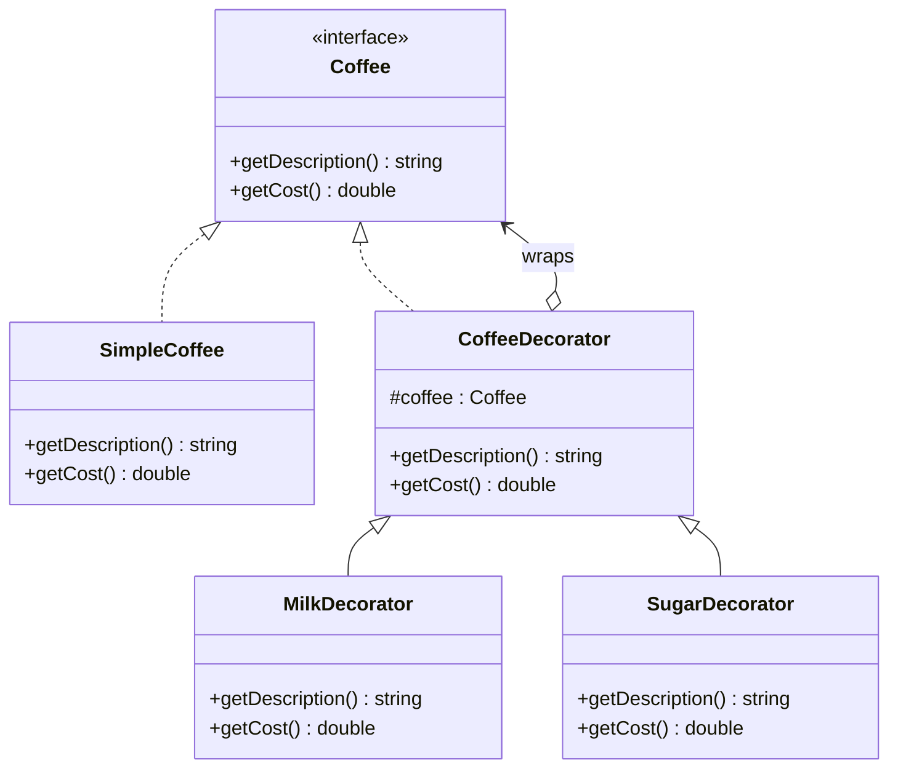
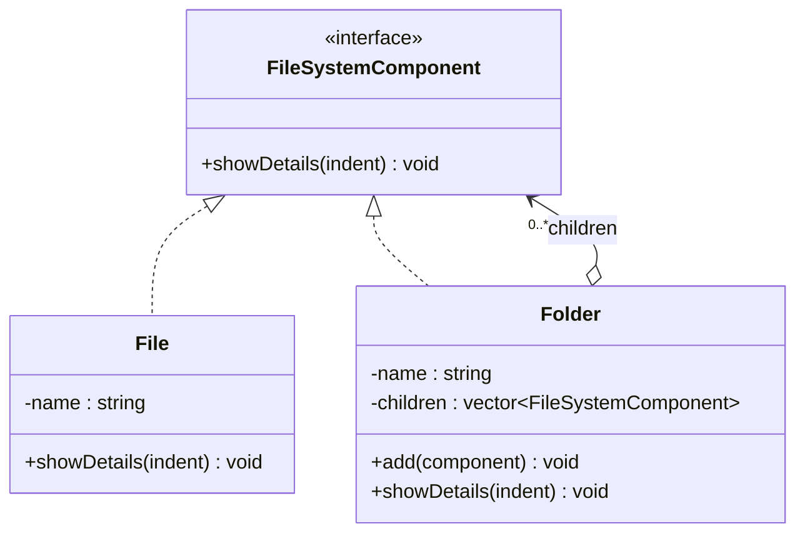
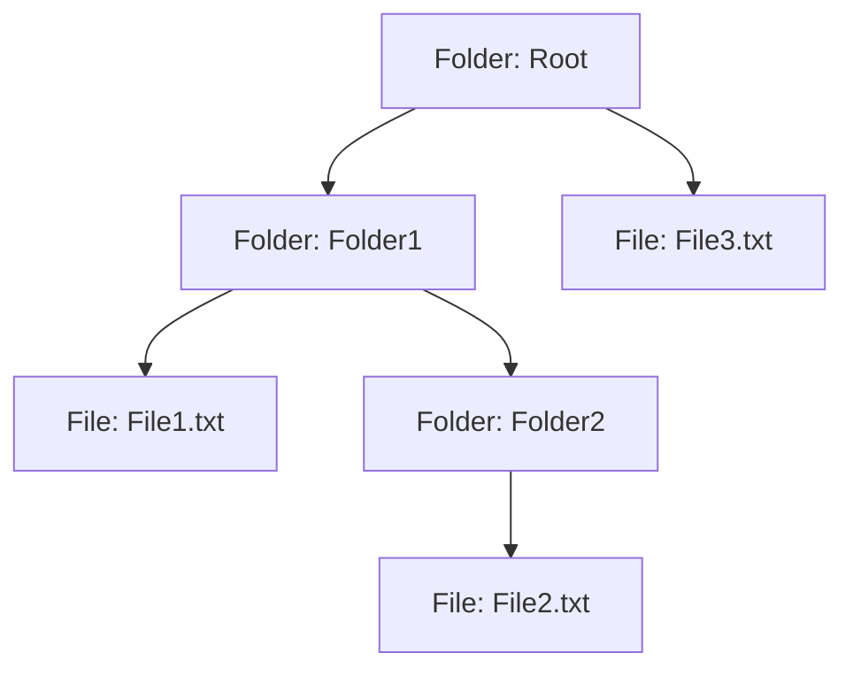

**Notes based off of:** CS3307A Lecture 11 (Dr. Umair Rehman), _CS3307_W7B.pdf_

## Overview

This lecture covers two **structural design patterns**: **Decorator** and **Composite**. Structural patterns are about _how classes and objects are assembled into larger structures_ while keeping those structures flexible and efficient. Both patterns today rely on the same underlying trick: an object that **holds a reference to another object of the same interface**. What differs is the _intent_.

- **Decorator**: wrap one object to _add behavior_ without changing its class.
- **Composite**: arrange objects into a _tree_ so that single objects and groups of objects are treated identically.

### The structural pattern family

| Pattern       | One-line purpose                                                    |
| ------------- | ------------------------------------------------------------------- |
| Adapter       | Converts one interface into another compatible one                  |
| Facade        | Simplifies a complex subsystem behind a single unified interface    |
| Bridge        | Separates an abstraction from its implementation                    |
| **Composite** | Treats individual objects and groups of objects uniformly           |
| **Decorator** | Adds behavior to objects dynamically                                |
| Flyweight     | Shares data between objects to reduce memory usage                  |
| Proxy         | Stands in for another object to control access or add functionality |

> [!note] Only Composite and Decorator are covered in depth in this lecture. The others are listed for context.

---

## The Task: A Customizable Coffee Order System

The motivating problem for Decorator. Requirements:

- Start with a **base coffee**.
- Add **milk, sugar, etc.** dynamically (at runtime, based on what the customer orders).
- Additions can be **chained in any order**.
- The **description** and **cost** must update automatically as additions are made.

The lecture first walks through four "obvious" approaches, shows why each breaks down, and then presents Decorator as the clean solution. This is worth understanding properly, because on an exam (and in real design discussions) you are expected to justify _why_ a pattern is better than the alternatives.

---

## Failed Approaches (Why We Need Decorator)

### 1. Inheritance

Create a subclass for every combination of toppings.

```cpp
class Coffee {                       // Base class (abstract)
public:
    virtual std::string getDescription() const = 0;
    virtual double getCost() const = 0;
};

class SimpleCoffee : public Coffee {
public:
    std::string getDescription() const override { return "Simple Coffee"; }
    double getCost() const override { return 5.0; }
};

class MilkCoffee : public SimpleCoffee {
public:
    std::string getDescription() const override { return SimpleCoffee::getDescription() + ", Milk"; }
    double getCost() const override { return SimpleCoffee::getCost() + 1.5; }
};

class SugarCoffee : public SimpleCoffee { /* same idea, ", Sugar", +0.5 */ };

class MilkAndSugarCoffee : public SimpleCoffee { /* ", Milk, Sugar", +2.0 */ };
```

**Cons**

- **Class explosion**: each new combination needs its own subclass. With $n$ optional toppings there are $2^{n}$ possible combinations. Add just 5 toppings and you are staring at 32 classes (and that ignores ordering and doubles like "extra milk").
- **Inflexible**: adding a new variation means writing a new subclass.
- **Static behavior**: what a coffee _is_ gets fixed at **compile time**. A customer cannot change their order after the object exists.

### 2. "Composition" (single class with mutators)

One `Coffee` class stores a description string and a cost, and has `addMilk()` / `addSugar()` methods that mutate them.

```cpp
class Coffee {
    std::string description = "Simple Coffee";
    double cost = 5.0;
public:
    void addMilk()  { description += ", Milk";  cost += 1.5; }
    void addSugar() { description += ", Sugar"; cost += 0.5; }
    std::string getDescription() const { return description; }
    double getCost() const { return cost; }
};

// Usage
Coffee coffee;
coffee.addMilk();
coffee.addSugar();
```

**Cons**

- **Limited reusability**: new behavior means editing the `Coffee` class itself.
- **Less flexible**: hard to change the composition dynamically (e.g., you cannot _remove_ milk, because only strings and a running total are stored).
- **Not scalable**: every new ingredient is another method bolted onto one growing class.

> [!tip] Terminology warning 
> The slide calls this "composition", but it is really just a **monolithic class with mutator methods**. It is _not_ the "favor composition over inheritance" principle, where an object holds _other objects_ and delegates to them. Decorator actually _is_ that principle done properly.

### 3. Switch-case / if-else

Encode each possible coffee as an integer `type` and branch on it.

```cpp
std::string getDescription(int type) {
    switch (type) {
        case 1: return "Simple Coffee";
        case 2: return "Simple Coffee, Milk";
        case 3: return "Simple Coffee, Sugar";
        case 4: return "Simple Coffee, Milk, Sugar";
        default: return "Unknown Coffee";
    }
}
// getCost(int type) has a parallel switch: 5.0, 6.5, 5.5, 7.0
```

**Cons**

- **Hard to maintain**: every new combination requires editing _both_ switch statements (description and cost). Forgetting one gives silent inconsistencies.
- **Limited flexibility**: combinations are hard-coded, so nothing adapts at runtime.
- Violates the **Open/Closed Principle** (the code must be _modified_ rather than _extended_).

### 4. Builder-style fluent interface

Same as approach 2, but each `addX()` returns `*this` so calls can be chained.

```cpp
class CoffeeBuilder {
    std::string description = "Simple Coffee";
    double cost = 5.0;
public:
    CoffeeBuilder& addMilk()  { description += ", Milk";  cost += 1.5; return *this; }
    CoffeeBuilder& addSugar() { description += ", Sugar"; cost += 0.5; return *this; }
    std::string getDescription() const { return description; }
    double getCost() const { return cost; }
};

CoffeeBuilder coffee;
coffee.addMilk().addSugar();   // method chaining
```

**Cons**

- **Limited scalability**: fine for a few options, unwieldy for many.
- **Limited extensibility**: new ingredients require modifying the builder class.
- **Code duplication**: other kinds of objects needing similar additions must reimplement the same logic.

> [!note] The slide's "Builder" is really _method chaining_ (a fluent interface). 
> The formal **Builder pattern** is a _creational_ pattern about constructing complex objects step by step. It is mentioned here mostly because the chained syntax looks appealing, but it still hard-codes the available additions.

### Summary of the alternatives

| Approach                | Runtime flexibility          | Adding a new topping                      | Main weakness                 |
| ----------------------- | ---------------------------- | ----------------------------------------- | ----------------------------- |
| Inheritance             | None (fixed at compile time) | New subclass(es), possibly many           | Class explosion               |
| Single class + mutators | Some                         | Edit the class                            | Monolith, hard to undo/reuse  |
| Switch-case             | None                         | Edit every switch                         | Maintenance, violates OCP     |
| Builder / fluent        | Some                         | Edit the builder                          | Not extensible                |
| **Decorator**           | **Full**                     | **Add one new class, touch nothing else** | Complexity, memory management |

---

## Decorator Design Pattern

### Definition

A **structural** pattern that **attaches additional behavior to an object dynamically** by **wrapping** it in another object that implements the same interface. It is an **alternative to subclassing** for extending functionality, and it does this **without altering the structure** of the wrapped object's class.

### Key idea

A decorator **is-a** `Coffee` (it implements the `Coffee` interface) _and_ **has-a** `Coffee` (it holds a pointer to the thing it wraps). Because it shares the interface, the client cannot tell whether it is holding a plain coffee or a coffee wrapped in ten layers of decorators. Each layer _delegates_ to the layer below and then adds its own contribution.

### Participants

| Role                      | In the coffee example             | Responsibility                                                |
| ------------------------- | --------------------------------- | ------------------------------------------------------------- |
| **Component** (interface) | `Coffee`                          | Common interface for both plain objects and decorators        |
| **Concrete Component**    | `SimpleCoffee`                    | The base object that gets decorated                           |
| **Base Decorator**        | `CoffeeDecorator`                 | Implements `Coffee`, stores a `Coffee*`, forwards calls to it |
| **Concrete Decorators**   | `MilkDecorator`, `SugarDecorator` | Call the wrapped object, then add their own behavior          |

### UML



### Implementation (C++)

**Component interface and concrete component**

```cpp
class Coffee {
public:
    virtual ~Coffee() {}                              // virtual destructor: required for safe delete via base pointer
    virtual std::string getDescription() const = 0;
    virtual double getCost() const = 0;
};

class SimpleCoffee : public Coffee {
public:
    std::string getDescription() const override { return "Simple Coffee"; }
    double getCost() const override { return 5.0; }
};
```

**Base decorator**

```cpp
class CoffeeDecorator : public Coffee {
protected:
    Coffee* coffee;                                   // the wrapped object
public:
    CoffeeDecorator(Coffee* coffee) : coffee(coffee) {}
    ~CoffeeDecorator() { delete coffee; }             // decorator OWNS what it wraps

    std::string getDescription() const override { return coffee->getDescription(); }   // default: just forward
    double getCost() const override { return coffee->getCost(); }
};
```

**Concrete decorators**

```cpp
class MilkDecorator : public CoffeeDecorator {
public:
    MilkDecorator(Coffee* coffee) : CoffeeDecorator(coffee) {}
    std::string getDescription() const override { return coffee->getDescription() + ", Milk"; }
    double getCost() const override { return coffee->getCost() + 1.5; }
};

class SugarDecorator : public CoffeeDecorator {
public:
    SugarDecorator(Coffee* coffee) : CoffeeDecorator(coffee) {}
    std::string getDescription() const override { return coffee->getDescription() + ", Sugar"; }
    double getCost() const override { return coffee->getCost() + 0.5; }
};
```

**Client code**

```cpp
int main() {
    Coffee* coffee = new SimpleCoffee();
    std::cout << coffee->getDescription() << " : $" << coffee->getCost() << "\n";

    coffee = new MilkDecorator(coffee);               // wrap with milk
    std::cout << coffee->getDescription() << " : $" << coffee->getCost() << "\n";

    coffee = new SugarDecorator(coffee);              // wrap with sugar
    std::cout << coffee->getDescription() << " : $" << coffee->getCost() << "\n";

    delete coffee;                                    // deletes the whole chain recursively
    return 0;
}
```

Expected output:

```
Simple Coffee : $5
Simple Coffee, Milk : $6.5
Simple Coffee, Milk, Sugar : $7
```

### Tracing what actually happens

After the last wrap, the object graph looks like nested boxes:

`SugarDecorator( MilkDecorator( SimpleCoffee ) )`

Calling `getCost()` on the outermost object unwinds like this:

1. `SugarDecorator::getCost()` calls `coffee->getCost()` (the milk layer) and will add $0.5$.
2. `MilkDecorator::getCost()` calls `coffee->getCost()` (the simple coffee) and will add $1.5$.
3. `SimpleCoffee::getCost()` returns $5.0$ (the base case).
4. Results propagate back up: $$ \text{cost} = ((5.0) + 1.5) + 0.5 = 7.0 $$ The description is built the same way, with each layer appending its label on the way back up.

### Why `coffee = new MilkDecorator(coffee);` works

The pointer `coffee` has type `Coffee*`. Both `SimpleCoffee` and `MilkDecorator` are `Coffee`s, so you can keep reassigning the _same variable_ to a bigger and bigger wrapper. The old pointer value is not leaked, because it was handed to the new decorator, which now owns it.

### Memory management details (important)

- The base decorator's destructor does `delete coffee`, so **deleting the outermost decorator deletes the entire chain** from the outside in.
- Because ownership is exclusive, **never wrap the same object in two decorators**, or you will get a **double delete**.
- `Coffee` has a **virtual destructor**. Without it, `delete coffee` on a `Coffee*` that really points to a `SugarDecorator` would be undefined behavior and the derived destructor would not run. (`~CoffeeDecorator` is automatically virtual because the base destructor is virtual.)
- In modern C++ you would normally avoid raw `new`/`delete` here and hold the wrapped object in a `std::unique_ptr<Coffee>` so ownership is explicit and cleanup is automatic. The lecture uses raw pointers to keep the pattern itself visible, and lists "memory management" as a con for exactly this reason.

### Order sensitivity

For the milk/sugar example, order does not change the _total_ because both just add a constant. But in general decorators are **order-sensitive**. Suppose we add a hypothetical `DiscountDecorator` that takes 10% off the cost:

- $(5.0 + 1.5) \times 0.9 = 5.85$ (discount applied _after_ milk)
- $5.0 \times 0.9 + 1.5 = 6.00$ (discount applied _before_ milk)

Same decorators, different result. The description string order also depends on wrapping order ("Milk, Sugar" vs "Sugar, Milk").

### Pros

- **Dynamic behavior**: add (and conceptually remove) features at runtime.
- **Open/Closed Principle**: extend by _adding_ a new decorator class; existing code is untouched.
- **Flexible combinations**: stack decorators in any order and any number of times (double milk is just two `MilkDecorator`s).
- **Less duplication**: modular, reusable components instead of one class per combo.
- **Single Responsibility**: each decorator does exactly one thing.
- **Runtime flexibility**: adapt to changing needs on the fly.

With $n$ toppings you write $n$ decorator classes instead of $2^{n}$ subclasses.

### Cons

- **Complexity**: harder to understand and debug, since the real behavior is spread across many small wrapper objects (stack traces go through many layers).
- **Order-sensitive**: results can depend on the wrapping sequence.
- **Performance hit**: every call passes through extra layers of indirection.
- **Verbose code**: nested construction, e.g. `new Sugar(new Milk(new Simple()))`, can be hard to read.
- **Memory management**: tricky with raw pointers (ownership, double delete).
- **Interface-bound**: every decorator must conform to the component interface, so you cannot add _new public methods_ that clients can reach through the base pointer.

### Where you see Decorator in practice

- **I/O streams** (the classic example): in Java, `new BufferedReader(new InputStreamReader(new FileInputStream(...)))`, where each layer adds buffering, character decoding, etc. to a plain byte stream.
- **GUI toolkits**: adding scrollbars, borders, or drop shadows to a widget without subclassing every widget type.
- **Web middleware**: request handlers wrapped with logging, authentication, compression layers.
- Python's `@decorator` syntax is _conceptually related_ (wrapping a function to extend behavior) but is a language feature, not the GoF class-based pattern.

---

## Composite Design Pattern

### Definition

A **structural** pattern that lets you **compose objects into tree structures** to represent **part-whole hierarchies**, and lets clients **treat individual objects and compositions of objects uniformly**. In other words: client code should not need to ask "is this one thing or a group of things?"

### Participants

| Role          | Meaning                                                                              | In the file system example |
| ------------- | ------------------------------------------------------------------------------------ | -------------------------- |
| **Component** | Common interface for both leaves and composites                                      | `FileSystemComponent`      |
| **Leaf**      | End object with **no children**; does the real work                                  | `File`                     |
| **Composite** | Holds **children** (leaves or other composites) and **delegates** operations to them | `Folder`                   |

### Analogy: your computer's folder structure

- A **folder** can contain files _and/or other folders_ (composite).
- A **file** contains no other elements (leaf).
- "Show me the contents" or "what is the total size?" should work the same way whether you point at a file or at a folder with thousands of nested items. The folder just asks each child to do the same thing recursively.

### UML



### Task in the lecture

Implement a file-system hierarchy where we:

- Treat **files and folders uniformly**.
- **Add, manage, and display** both.
- Let folders contain files or folders **recursively**.
- Produce **indented, structured output**.

### Implementation (C++)

**1. Component interface** (plus an indentation helper)

```cpp
class FileSystemComponent {
public:
    virtual ~FileSystemComponent() {}
    virtual void showDetails(int indent = 0) const = 0;   // common operation
};

void printIndent(int indent) {
    for (int i = 0; i < indent; ++i)
        std::cout << "  ";                                // two spaces per level
}
```

**2. Leaf**

```cpp
class File : public FileSystemComponent {
    std::string name;
public:
    File(const std::string& name) : name(name) {}
    void showDetails(int indent = 0) const override {
        printIndent(indent);
        std::cout << "File: " << name << "\n";            // base case: no recursion
    }
};
```

**3. Composite**

```cpp
class Folder : public FileSystemComponent {
    std::string name;
    std::vector<FileSystemComponent*> children;           // files OR folders
public:
    Folder(const std::string& name) : name(name) {}

    ~Folder() {
        for (auto* child : children) delete child;        // folder owns its children
    }

    void add(FileSystemComponent* component) {
        children.push_back(component);
    }

    void showDetails(int indent = 0) const override {
        printIndent(indent);
        std::cout << "Folder: " << name << "\n";
        for (const auto* child : children)
            child->showDetails(indent + 1);               // recursive call, one level deeper
    }
};
```

**4. Client code**

```cpp
int main() {
    File* file1 = new File("File1.txt");
    File* file2 = new File("File2.txt");
    File* file3 = new File("File3.txt");

    Folder* folder1 = new Folder("Folder1");
    Folder* folder2 = new Folder("Folder2");
    Folder* rootFolder = new Folder("Root");

    folder1->add(file1);        // Folder1 contains File1
    folder2->add(file2);        // Folder2 contains File2
    folder1->add(folder2);      // Folder1 also contains Folder2
    rootFolder->add(folder1);   // Root contains Folder1
    rootFolder->add(file3);     // Root also contains File3

    std::cout << "File System Structure:\n";
    rootFolder->showDetails();

    delete rootFolder;          // recursively deletes everything
    return 0;
}
```

### The resulting tree



Output (children print in the order they were added):

```
File System Structure:
Folder: Root
  Folder: Folder1
    File: File1.txt
    Folder: Folder2
      File: File2.txt
  File: File3.txt
```

### Why this is "uniform"

Look at this line inside `Folder::showDetails`:

```cpp
child->showDetails(indent + 1);
```

The folder has **no idea** whether `child` is a `File` or another `Folder`. It just calls the common interface method and **polymorphism** does the rest. A `File` handles it directly (base case); a `Folder` recurses (recursive case). No `if (isFile) ... else ...` anywhere. That absence of type-checking is the entire payoff of the pattern.

### Design points worth knowing

- **Where should `add()` live?** In this lecture it is only on `Folder` (the "safe" design): a `File` cannot be asked to `add` anything, so the compiler prevents nonsense. The alternative (the "transparent" design) puts `add`/`remove` on the Component interface, which makes leaves and composites fully interchangeable but forces `File::add` to either do nothing or throw. This is a classic **safety vs. transparency** trade-off.
- **Ownership**: `Folder` deletes its children, so each node must have **exactly one parent**. Adding the same node to two folders causes a double delete, and accidentally creating a cycle (a folder containing its own ancestor) causes infinite recursion.
- **Recursion cost**: operations like `showDetails` visit every node, so cost grows with the size of the tree, i.e. $O(N)$ for $N$ nodes.
- Other operations fit the same mold. For example, `getSize()`: a file returns its own size, a folder returns the **sum of its children's sizes**.

### Common uses

- **GUI hierarchies**: a window contains panels, panels contain buttons, and so on. Calling `draw()` on the window draws everything.
- **File systems**: folders contain files and other folders.
- **Menus**: a menu contains items and submenus.
- **Organizations**: departments contain employees and sub-departments (e.g., "total salary cost" of a department).

### Pros

- **Uniformity**: individual objects and composites are handled the same way.
- **Scalability**: easy to add or remove leaf and composite types.
- **Flexibility / simpler clients**: client code interacts with the whole structure consistently, without type checks.

### Cons

- **Complexity**: the design can get more complicated, especially as the hierarchy gets deep.
- **Performance**: operations over large structures can be slow due to recursion over all nodes.
- **Potential overuse**: forcing a Composite where there is no real part-whole hierarchy produces needlessly complicated designs.

### Summary

Ideal for **tree structures**: nodes are treated uniformly, the design is scalable and flexible, and it abstracts **part-whole hierarchies**.

---

## Composite vs. Decorator

| |**Decorator**|**Composite**|
|---|---|---|
|Intent|Add behavior dynamically|Manage tree hierarchies|
|Focus|Individual objects (wraps one)|Groups and leaves uniformly|
|Shape|Linear / flat chain of wrappers|Nested tree structures|
|Purpose|**Extends functionality**|**Composes parts into wholes**|

### Putting it in context

The two patterns look similar on a UML diagram because both have a class that **implements the interface and also holds a reference (or references) to that same interface**. The difference is purely in intent:

- A **Decorator** wraps **exactly one** component and _adds responsibility_ to it. You can picture it as a degenerate tree with one child per node (a chain).
- A **Composite** holds **many** children and _aggregates_ them (display all, sum all, etc.). It adds no new behavior to any single child.

> [!tip] Quick test Ask:
>  "Am I trying to _add a feature_ to one thing?" then think **Decorator**. "Am I trying to _represent a group of things as if it were one thing_?" then think **Composite**.

They can also be combined, e.g., decorating a node in a Composite tree (a `Folder` wrapped in a `ReadOnlyDecorator` that blocks modifications).

---

## Quick Review Questions

1. Why does the inheritance approach to the coffee problem lead to "class explosion", and how many classes would $n$ toppings need compared to Decorator?
2. In the Decorator example, why must `Coffee` have a virtual destructor, and who is responsible for deleting the wrapped object?
3. Give an example where the order of decorators changes the final result.
4. What are the three roles in the Composite pattern, and which one terminates the recursion?
5. Why is it a problem to add the same `Folder` object into two different parent folders in the lecture's implementation?
6. Name one similarity and one key difference between Decorator and Composite.