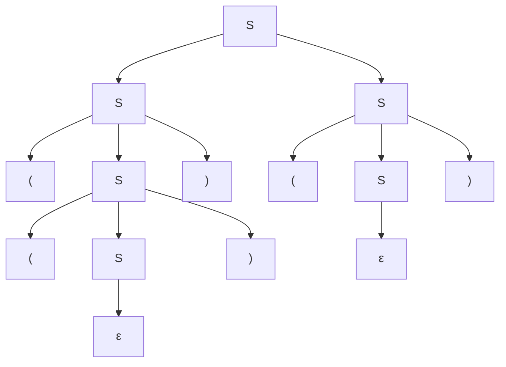
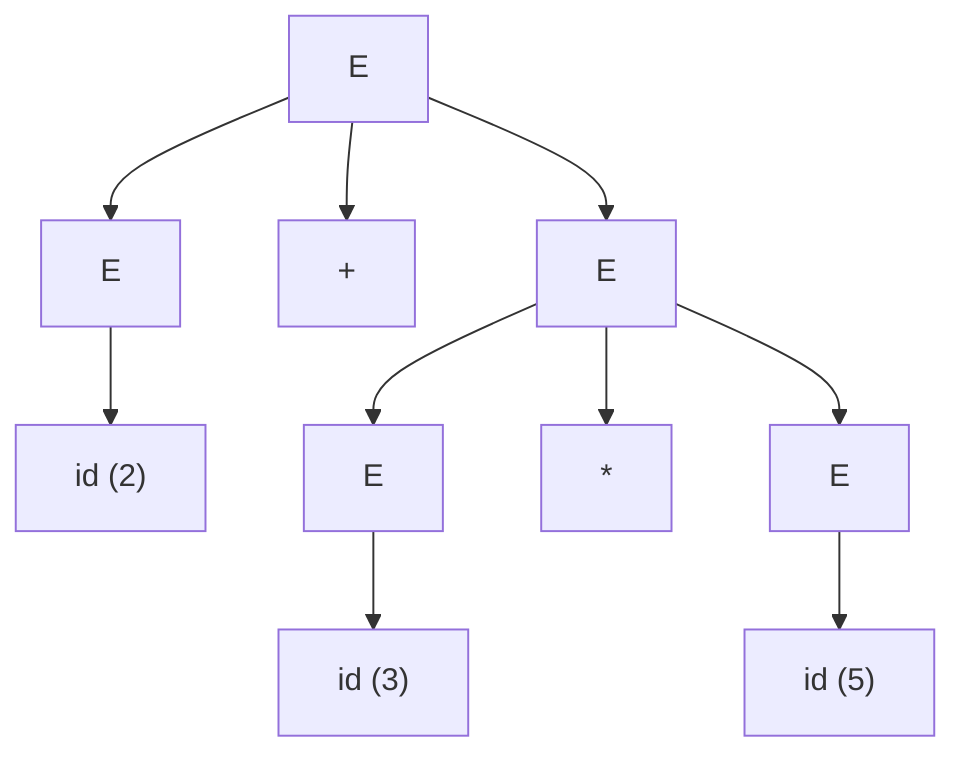
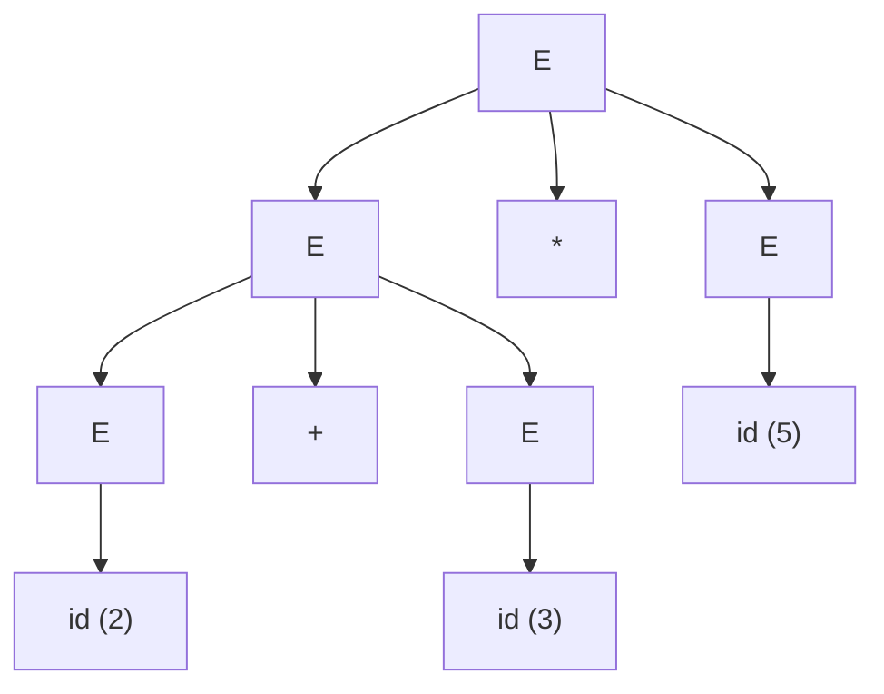
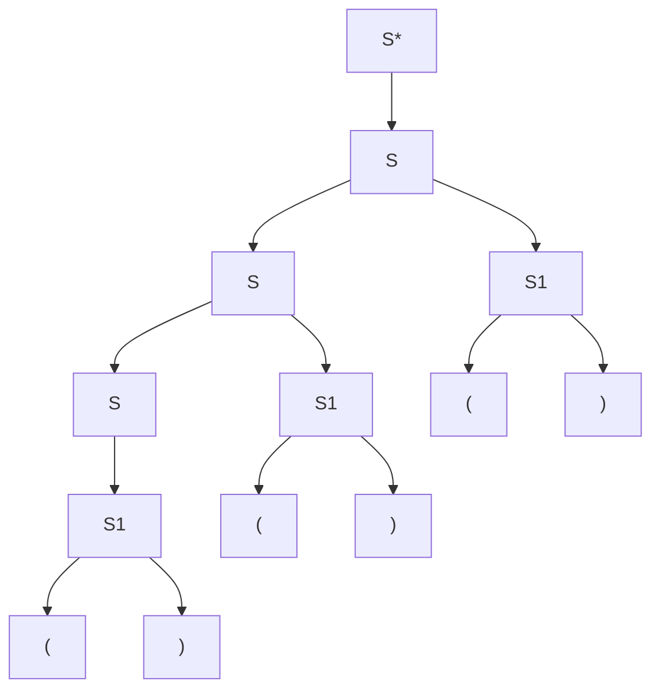
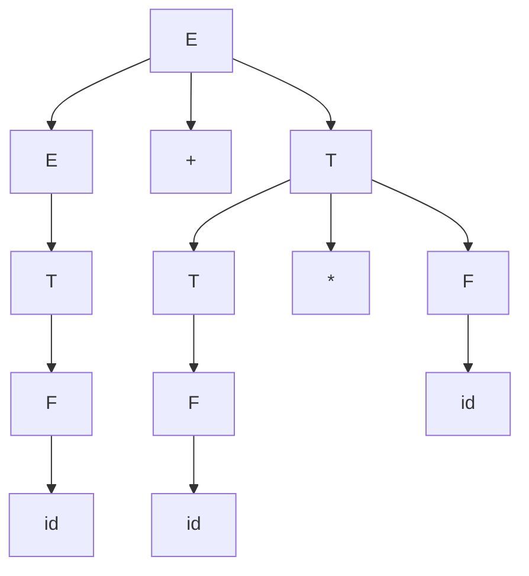
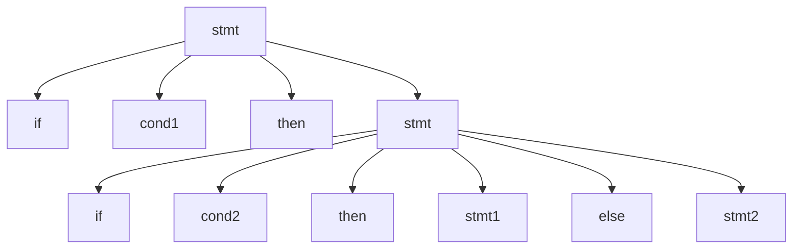
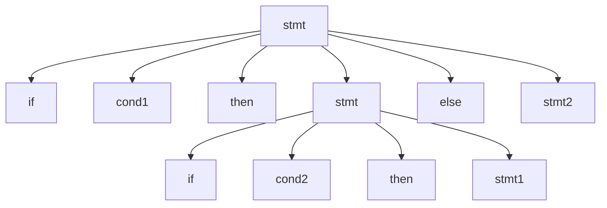
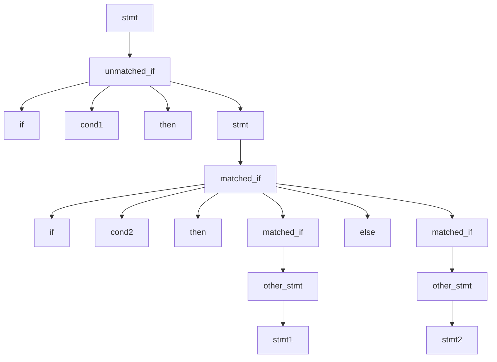

**Notes based off of:** Ch11a Context-Free Grammars (lecture slides, Chapter 11)

## Where Context-Free Languages Fit

The language classes form a strict hierarchy,**z** each with its own machine model:

|Language class|Machine|Example member not in the class below|
|---|---|---|
|Regular|FSM|—|
|Context-free|PDA (pushdown automaton)|${a^n b^n : n \geq 0}$|
|D (decidable)|Turing machine that always halts|${a^n b^n c^n : n \geq 0}$|
|SD (semidecidable)|Turing machine (may loop on "no")|the halting problem|

$$ \text{Regular} \subset \text{Context-free} \subset \text{D} \subset \text{SD} $$ A context-free language (CFL) can be described two ways, just like regular languages could be described by both regular grammars and FSMs:

- **generated** by a context-free grammar (CFG), or
- **accepted** by a pushdown automaton (PDA), an FSM extended with a stack.

This chapter covers the grammar side; PDAs come later.

## Context-Free Grammars

### Formal Definition

A **context-free grammar** $G$ is a quadruple $(V, \Sigma, R, S)$ where:

- $V$ is the rule alphabet,
    - $\Sigma \subseteq V$ is the set of **terminals**,
    - $V - \Sigma$ is the set of **nonterminals**,
- $R$ is a finite subset of $(V - \Sigma) \times V^{*}$, the set of **rules**,
- $S \in V - \Sigma$ is the **start symbol**.

The key part is $R \subseteq (V - \Sigma) \times V^{*}$: every rule has a **single nonterminal on the left** and **any string of terminals and nonterminals on the right**. Compare with regular grammars (Chapter 7), where the RHS was limited to $\varepsilon$, $a$, or $aY$. CFGs keep the LHS restriction but drop the RHS restriction.

#### Example

$$ G = (\underbrace{{S, a, b}}_{V}, \underbrace{{a, b}}_{\Sigma}, \underbrace{{S \rightarrow aSb, ; S \rightarrow \varepsilon}}_{R}, S) $$ Here $S$ is the only nonterminal and $a, b$ are the terminals.

### Derivations

One derivation step is defined as: $$ x \Rightarrow_G y \iff x = \alpha A \beta, \;\; A \rightarrow \gamma \in R, \;\; y = \alpha \gamma \beta $$ In words: pick some nonterminal $A$ in the current string, and replace it by the RHS of one of its rules.

**Why "context-free"?** Whether we may rewrite $A$ does not depend on its surroundings $\alpha$ and $\beta$ (its _context_). Any $A$, anywhere, can always be rewritten by any $A$-rule. A **context-sensitive** grammar, by contrast, allows rules like $\alpha A \beta \rightarrow \alpha \gamma \beta$, where $A$ may only be rewritten when it appears between $\alpha$ and $\beta$.

For example, with $S \rightarrow aSb$, the middle $S$ of $aSb$ is rewritten while the outer $a$ and $b$ are left alone: $$ aSb \Rightarrow a(aSb)b = aaSbb $$ A sequence $w_0 \Rightarrow_G w_1 \Rightarrow_G \dots \Rightarrow_G w_n$ is a **derivation** in $G$.

$\Rightarrow_G^{*}$ is the **reflexive, transitive closure** of $\Rightarrow_G$, meaning "derives in **zero or more** steps" (reflexive: zero steps, so $x \Rightarrow^{*} x$; transitive: chains of steps compose).

### The Language of a Grammar

$$ L(G) = { w \in \Sigma^{*} : S \Rightarrow_G^{*} w } $$ Note $w \in \Sigma^{*}$: only strings made **entirely of terminals** count. Nonterminals are scaffolding used during the derivation; terminals are the final product. A string like $aSb$ is a _sentential form_, not a member of the language.

A language $L$ is **context-free** iff it is generated by some context-free grammar $G$.

### An Example Derivation

With rules (1) $S \rightarrow aSb$ and (2) $S \rightarrow \varepsilon$: $$ S \overset{1}{\Rightarrow} aSb \overset{1}{\Rightarrow} aaSbb \overset{1}{\Rightarrow} aaaSbbb \overset{2}{\Rightarrow} aaabbb $$ So $S \Rightarrow^{*} aaabbb$, and since $aaabbb \in \Sigma^{*}$, we have $aaabbb \in L(G)$.

## Classic Example Grammars

### $A^nB^n = {a^n b^n : n \geq 0}$

$$ S \rightarrow \varepsilon \mid aSb $$ Applying $S \rightarrow aSb$ $n$ times then $S \rightarrow \varepsilon$ once: $$ S \Rightarrow aSb \Rightarrow a^2Sb^2 \Rightarrow \dots \Rightarrow a^nSb^n \Rightarrow a^n b^n $$ This language is **not regular** (an FSM cannot count an unbounded number of $a$'s), so this is the simplest proof that CFGs are strictly more powerful than regular grammars.

### Balanced Parentheses

$$ S \rightarrow \varepsilon \mid SS \mid (S) $$

- $S \rightarrow (S)$ wraps a balanced string in a matching pair (nesting).
- $S \rightarrow SS$ puts two balanced strings side by side (sequencing).

Derivation of $(())()$, replacing one nonterminal per step: $$ S \Rightarrow SS \Rightarrow (S)S \Rightarrow ((S))S \Rightarrow ((S))(S) \Rightarrow (())(S) \Rightarrow (())() $$

### PalEven $= {ww^R : w \in {a, b}^{*}}$

Even-length palindromes: $$ S \rightarrow aSa \mid bSb \mid \varepsilon $$ Each rule puts the **same** character at both ends, so the string is built from the outside in and is automatically a mirror image. $$ S \Rightarrow aSa \Rightarrow abSba \Rightarrow abbSbba \Rightarrow abbbba $$

### Equal Numbers of $a$'s and $b$'s

$$ L = { w \in {a, b}^{*} : \#_a(w) = \#_b(w) } $$ $$ S \rightarrow aSb \mid bSa \mid SS \mid \varepsilon $$

- $aSb$ and $bSa$ generate an $a$ and a $b$ together as a pair, in either order, so the counts stay equal.
- $SS$ is needed for strings that _start and end_ with the same character, e.g. $abba = ab \cdot ba$, which cannot be produced by wrapping alone.

Derivation of $aabbba$ (which splits as $aabb \cdot ba$): $$ S \Rightarrow SS \Rightarrow aSbS \Rightarrow aaSbbS \Rightarrow aabbS \Rightarrow aabbbSa \Rightarrow aabbba $$

### Arithmetic Expressions

$G = (V, \Sigma, R, E)$ with $\Sigma = {+, _, (, ), \text{id}}$ and $$ E \rightarrow E + E \mid E * E \mid (E) \mid \text{id} $$ Here $\text{id}$ is a single terminal standing for any identifier/number (in a compiler, the lexer has already turned `x` or `42` into an `id` token). $$ E \Rightarrow E + E \Rightarrow E + E * E \Rightarrow^{*} \text{id} + \text{id} * \text{id} $$ This grammar turns out to be **ambiguous**; see the Ambiguity section below.

## Recursion and Self-Embedding

### Recursive Rules

A rule is **recursive** iff it has the form $$ X \rightarrow w_1 Y w_2 \quad \text{where} \quad Y \Rightarrow^{*} w_3 X w_4 $$ for some $w_1, w_2, w_3, w_4 \in V^{*}$. In words: **$X$ eventually derives $X$ again**, directly or through other nonterminals. A grammar is recursive iff it has at least one recursive rule.

Examples: $S \rightarrow (S)$ is directly recursive. The pair $S \rightarrow (T)$, $T \rightarrow (S)$ is indirectly (mutually) recursive.

Recursion is what makes a language infinite: without it, every derivation would have bounded length.

### Self-Embedding Rules

A rule is **self-embedding** iff it is $X \rightarrow w_1 Y w_2$ with $Y \Rightarrow^{*} w_3 X w_4$ **and** both $w_1 w_3$ and $w_4 w_2$ are in $\Sigma^{+}$. In words: **$X$ eventually derives $X$ with nonempty terminal strings on both sides.**

|Rule(s)|Recursive?|Self-embedding?|
|---|---|---|
|$S \rightarrow aSa$|✅|✅ ($a$ on both sides)|
|$S \rightarrow aS$|✅|❌ (nothing on the right)|
|$S \rightarrow aT$, $T \rightarrow Sa$|✅|✅ since $S \Rightarrow aT \Rightarrow aSa$|

Note that every regular grammar ($X \rightarrow aY$) can be recursive but never self-embedding: the nonterminal is always at the right end.

### Where CFGs Get Their Power

- If a grammar $G$ is **not** self-embedding, then $L(G)$ is regular. (Not proved in this course.)
- If **every** grammar for $L$ is self-embedding, then $L$ is not regular.

Intuition: self-embedding is how a grammar "remembers" something on the left and matches it on the right, e.g. $n$ $a$'s on the left paired with $n$ $b$'s on the right. Recursion on only one side is just a loop, which an FSM can do; matching both sides needs memory that grows without bound, which an FSM lacks and a PDA's stack provides.

## Backus-Naur Form (BNF)

BNF is a notation for writing practical CFGs, used to specify real programming languages:

- `|` is read as "or", so $S \rightarrow aSb \mid bSa \mid SS \mid \varepsilon$ is shorthand for four separate rules.
- $\rightarrow$ is written `::=` (read "can be").
- Nonterminals can be any descriptive name in angle brackets, e.g. `<program>`, `<variable>`. Everything outside angle brackets is a terminal.

### BNF for a Java Fragment

```
<block>     ::= {<stmt-list>} | {}
<stmt-list> ::= <stmt> | <stmt-list> <stmt>
<stmt>      ::= <block> | while (<cond>) <stmt> |
                if (<cond>) <stmt> |
                do <stmt> while (<cond>); |
                <assignment-stmt>; |
                return | return <expression> |
                <method-invocation>;
```

- The braces `{` `}` here are **terminals** (literal characters in the source code); `{}` is the empty block.
- `<stmt-list> ::= <stmt-list> <stmt>` is how "one or more statements" is expressed: recursion replaces the Kleene star. (Extended BNF, EBNF, adds `{...}` / `*` for repetition and `[...]` for optional parts as shorthand.)
- `<block>` and `<stmt>` are mutually recursive, which is what allows arbitrarily deep nesting of blocks, loops and ifs.

### HTML

Nested lists such as

```html
<ul>
    <li>Item 1, which will include a sublist</li>
    <ul>
        <li>First item in sublist</li>
        <li>Second item in sublist</li>
    </ul>
    <li>Item 2</li>
</ul>
```

are described by $$ \begin{aligned} \textit{HTMLtext} &\rightarrow \textit{Element} ; \textit{HTMLtext} \mid \varepsilon \ \textit{Element} &\rightarrow \textit{UL} \mid \textit{LI} \mid \dots \ \textit{UL} &\rightarrow \texttt{<ul>} ; \textit{HTMLtext} ; \texttt{</ul>} \ \textit{LI} &\rightarrow \texttt{<li>} ; \textit{HTMLtext} ; \texttt{</li>} \end{aligned} $$ Matching open/close tags is exactly the balanced-parentheses pattern, with `<ul>` / `</ul>` as the brackets. This is why you famously cannot parse HTML in general with a regular expression.

### English

$$ \begin{aligned} S &\rightarrow NP ; VP \ NP &\rightarrow \text{the } Nominal \mid \text{a } Nominal \mid Nominal \mid ProperNoun \mid NP ; PP \ Nominal &\rightarrow N \mid Adjs ; N \ N &\rightarrow \text{cat} \mid \text{dogs} \mid \text{bear} \mid \text{girl} \mid \text{chocolate} \mid \text{rifle} \ ProperNoun &\rightarrow \text{Chris} \mid \text{Fluffy} \ Adjs &\rightarrow Adj ; Adjs \mid Adj \ Adj &\rightarrow \text{young} \mid \text{older} \mid \text{smart} \ VP &\rightarrow V \mid V ; NP \mid VP ; PP \ V &\rightarrow \text{like} \mid \text{likes} \mid \text{thinks} \mid \text{shoots} \mid \text{smells} \ PP &\rightarrow Prep ; NP \ Prep &\rightarrow \text{with} \end{aligned} $$ (The slide has "shots"; "shoots" is clearly intended.)

This grammar is ambiguous in a way real English is: in "Chris shoots the bear with the rifle", the $PP$ "with the rifle" can attach to the verb phrase ($VP \rightarrow VP ; PP$: Chris uses the rifle) or to the noun phrase ($NP \rightarrow NP ; PP$: the bear has the rifle). Natural languages are full of this; programming languages must avoid it.

## Designing Context-Free Grammars

Three core strategies:

1. **Generate related regions together.** If two parts of the string depend on each other (same count, mirror image), produce them in the same rule, e.g. $S \rightarrow aSb$ for $A^nB^n$.
2. **Generate concatenated regions separately.** If the string splits into independent parts, use $A \rightarrow BC$ and give each part its own nonterminal.
3. **Generate outside in.** For matched/nested structure, emit the outermost pair first and recurse inward: $A \Rightarrow aAb \Rightarrow aaAbb \Rightarrow \dots$

### Concatenating Independent Languages

$$ L = {a^n b^n c^m : n, m \geq 0} $$ The $c^m$ part is completely independent of the $a^n b^n$ part, so generate them separately and concatenate: $$ \begin{aligned} S &\rightarrow NC \ & N \rightarrow aNb \mid \varepsilon \ & C \rightarrow cC \mid \varepsilon \end{aligned} $$ $N$ handles the related region ($a^n b^n$, strategy 1), $C$ handles the independent region ($c^m$, which is even regular), and $S \rightarrow NC$ glues them (strategy 2).

### Kleene Star of a CFL

$$ L = {a^{n_1} b^{n_1} a^{n_2} b^{n_2} \dots a^{n_k} b^{n_k} : k \geq 0 \text{ and } \forall i , (n_i \geq 0)} = {a^n b^n : n \geq 0}^{*} $$ Examples in $L$: $\varepsilon$, $abab$, $aabbaaabbbabab$. $$ \begin{aligned} S &\rightarrow MS \mid \varepsilon \ & M \rightarrow aMb \mid \varepsilon \end{aligned} $$ $M$ generates one $a^n b^n$ block; $S \rightarrow MS \mid \varepsilon$ generates zero or more blocks. This is the general recipe for $L^{*}$: if $M$ generates $L$, then $S \rightarrow MS \mid \varepsilon$ generates $L^{*}$.

### Unequal $a$'s and $b$'s

$$ L = {a^n b^m : n \neq m} $$ Split into two cases, more $a$'s or more $b$'s: $$ \begin{aligned} S &\rightarrow A \mid B \ & A \rightarrow a \mid aA \mid aAb \ & B \rightarrow b \mid Bb \mid aBb \end{aligned} $$

- $A \rightarrow aAb$ adds one $a$ and one $b$ (keeps the difference unchanged).
- $A \rightarrow aA$ adds an extra $a$, and $A \rightarrow a$ guarantees **at least one** extra $a$ at the end. So $A$ generates exactly $a^n b^m$ with $n > m$.
- $B$ is symmetric, generating $n < m$.

$$ S \Rightarrow A \Rightarrow aAb \Rightarrow aaAb \Rightarrow aaab $$

## Structure: Derivations and Parse Trees

For regular languages we only asked _whether_ a string is in the language. For CFLs we also care about **structure**: how the string breaks into meaningful pieces. In $3 + 5 * 7$, we need to know that $5 * 7$ is a unit.

### Derivation Order Doesn't Matter

Two derivations of $(())()$ using $S \rightarrow \varepsilon \mid SS \mid (S)$: $$ S \Rightarrow SS \Rightarrow (S)S \Rightarrow ((S))S \Rightarrow (())S \Rightarrow (())(S) \Rightarrow (())() $$ $$ S \Rightarrow SS \Rightarrow (S)S \Rightarrow ((S))S \Rightarrow ((S))(S) \Rightarrow (())(S) \Rightarrow (())() $$ They apply the same rules to the same nonterminals, just in a different order (steps 4 and 5 swapped). That difference is irrelevant to structure, because the rewrites happen in independent parts of the string (this is context-freeness at work).

To pick one canonical order, two conventions are standard:

- **Leftmost derivation:** always rewrite the leftmost nonterminal (the first derivation above).
- **Rightmost derivation:** always rewrite the rightmost nonterminal.

### Parse Trees

A **parse tree** throws away the order and keeps only the structure. Both derivations above give the same tree:



Each internal node together with its children is one rule application; e.g. a node $S$ with children $($, $S$, $)$ is the rule $S \rightarrow (S)$.

**Formal definition.** A parse tree derived by $G = (V, \Sigma, R, S)$ is a rooted, ordered tree in which:

- every leaf is labeled with an element of $\Sigma \cup {\varepsilon}$,
- the root is labeled $S$,
- every other node is labeled with an element of $V - \Sigma$ (a nonterminal),
- if node $m$ is labeled $X$ and its children (left to right) are labeled $x_1, x_2, \dots, x_n$, then $R$ contains $X \rightarrow x_1 x_2 \dots x_n$.

Reading the leaves left to right (skipping $\varepsilon$) gives the derived string, called the tree's **yield**. Parse trees correspond one-to-one with leftmost derivations.

## Ambiguity

A grammar $G$ is **ambiguous** iff some string in $L(G)$ has **more than one parse tree** (equivalently, more than one leftmost derivation).

For most applications this is a problem. In a compiler:

- source code is a string,
- the code is syntactically correct ⟺ the string is in the language generated by the programming language's CFG,
- the parse tree determines the _meaning_ (what gets computed first, which `if` an `else` belongs to). Two parse trees = two possible meanings for the same program.

### Example: Arithmetic Expressions

With $E \rightarrow E + E \mid E * E \mid (E) \mid \text{id}$, the string $\text{id} + \text{id} * \text{id}$ (say $2 + 3 * 5$) has two parse trees:

Tree 1, meaning $2 + (3 * 5) = 17$:



Tree 2, meaning $(2 + 3) * 5 = 25$:



### Even a Very Simple Grammar Can Be Highly Ambiguous

$S \rightarrow \varepsilon \mid SS \mid (S)$ is ambiguous for $(())()$. Besides the natural tree, we can, for instance, split the left $S$ into $SS$ with the first $S \Rightarrow \varepsilon$. Since that trick can be repeated, $(())()$ actually has **infinitely many** parse trees.

### Inherent Ambiguity

Some languages have the property that **every** grammar for them is ambiguous. Such languages are **inherently ambiguous**. $$ L = {a^n b^n c^m : n, m \geq 0} \cup {a^n b^m c^m : n, m \geq 0} $$ Each half can be generated unambiguously, but strings of the form $a^n b^n c^n$ lie in **both** halves, and any grammar ends up generating them in two ways (proof omitted).

Both of the following problems are **undecidable** (no algorithm can answer them for all inputs):

- Given a CFG $G$, is $G$ ambiguous?
- Given a CFL $L$, is $L$ inherently ambiguous?

So removing ambiguity is done with heuristics and grammar-design techniques, not one universal algorithm.

## Reducing Ambiguity

We can often get rid of three common sources of ambiguity:

1. $\varepsilon$-rules like $S \rightarrow \varepsilon$,
2. rules with **symmetric** right-hand sides, e.g. $S \rightarrow SS$, $E \rightarrow E + E$,
3. rule sets that lead to ambiguous attachment of optional postfixes (e.g. the dangling `else`).

### 1. Removing $\varepsilon$-Rules

For balanced parentheses, the biggest problem is $S \rightarrow \varepsilon$: an $S$ can vanish anywhere, creating endless extra trees. An equivalent grammar without that rule: $$ \begin{aligned} S^{*} &\rightarrow \varepsilon \mid S \ & S \rightarrow SS \mid (S) \mid () \end{aligned} $$ ($S^{*}$ is just the name of a new start symbol, not a Kleene star.) Only the start symbol can produce $\varepsilon$, and only for the empty string itself. To do this in general, we need nullable variables.

#### Nullable Variables

A variable $X$ is **nullable** iff $X \Rightarrow^{*} \varepsilon$, i.e. it can disappear. This holds iff either:

1. there is a rule $X \rightarrow \varepsilon$, or
2. there is a rule $X \rightarrow PQR\dots$ where $P, Q, R, \dots$ are **all** nullable (then $X \Rightarrow PQR \Rightarrow^{*} QR \Rightarrow^{*} R \Rightarrow^{*} \varepsilon$).

Computing $N$, the set of nullable variables (a _fixed-point_ algorithm):

1. Set $N$ to the variables satisfying (1).
2. Repeat until no change: add variables satisfying (2).

It terminates because $N$ only grows and there are finitely many variables.

#### removeEps

A rule is **modifiable** iff it has the form $P \rightarrow \alpha R \beta$ for some nullable $R$, with $P \neq \alpha\beta \neq \varepsilon$.

```
removeEps(G: cfg) =
  1. Let G' = G.
  2. Find the set N of nullable variables in G'.
  3. For each modifiable rule P → αRβ of G' do
         Add the rule P → αβ.
  4. Delete from G' all rules of the form X → ε.
  5. Return G'.
```

The idea: we delete the $\varepsilon$-rules but recreate their effect. Adding $P \rightarrow \alpha\beta$ simulates "$R$ was used and then derived $\varepsilon$".

Why the side conditions?

- $\alpha\beta \neq \varepsilon$: otherwise we would be adding a new $\varepsilon$-rule $P \rightarrow \varepsilon$, defeating the purpose.
- $P \neq \alpha\beta$: avoids adding a useless rule $P \rightarrow P$.

Step 3 must be repeated on newly added rules too: when $R$ is removed from a rule with several nullable variables, the new rule may itself be modifiable (see the example). Each subset of the nullable occurrences can be dropped.

Result: $$ L(G') = L(G) - {\varepsilon} $$ The only string lost is $\varepsilon$, which can always be added back (next section).

#### Worked Example

$$ \begin{aligned} S &\rightarrow aTa \ & T \rightarrow ABC \ & &A \rightarrow aA \mid C \ && B \rightarrow Bb \mid C \ && C \rightarrow c \mid \varepsilon \end{aligned} $$ Nullable variables, found in order:

- $C$, by $C \rightarrow \varepsilon$ (round 1),
- $A$ by $A \rightarrow C$, and $B$ by $B \rightarrow C$ (round 2),
- $T$, by $T \rightarrow ABC$ with all three nullable (round 3).

So $N = {A, B, C, T}$.

Rules to add:

|From|Drop|Add|
|---|---|---|
|$S \rightarrow aTa$|$T$|$S \rightarrow aa$|
|$T \rightarrow ABC$|$A$ / $B$ / $C$|$T \rightarrow BC$, $T \rightarrow AC$, $T \rightarrow AB$|
|$T \rightarrow BC$, $T \rightarrow AC$, $T \rightarrow AB$|one more|$T \rightarrow C$, $T \rightarrow B$, $T \rightarrow A$|
|$A \rightarrow aA$|$A$|$A \rightarrow a$|
|$B \rightarrow Bb$|$B$|$B \rightarrow b$|
|$A \rightarrow C$, $B \rightarrow C$|$C$|nothing ($\alpha\beta = \varepsilon$)|

Remove: $C \rightarrow \varepsilon$. Final grammar: $$ \begin{aligned} S &\rightarrow aTa \mid aa \ &T \rightarrow ABC \mid BC \mid AC \mid AB \mid A \mid B \mid C \ &&A \rightarrow aA \mid a \mid C \ && B &\rightarrow Bb \mid b \mid C \ & C &\rightarrow c \end{aligned} $$

#### What If $\varepsilon \in L$? (atmostoneEps)

$\varepsilon \in L(G)$ iff $S \Rightarrow^{*} \varepsilon$ iff $S$ is nullable. In that case, add $\varepsilon$ back in a controlled way, through a new start symbol:

```
atmostoneEps(G: cfg) =
  1. G'' = removeEps(G).
  2. If S_G is nullable then          /* i.e., ε ∈ L(G)
       2.1 Create in G'' a new start symbol S*.
       2.2 Add to R_G'' the two rules:
             S* → ε
             S* → S_G
  3. Return G''.
```

The new start symbol is needed because $S$ may appear on right-hand sides; a rule $S \rightarrow \varepsilon$ would let $S$ vanish in the middle of derivations again. $S^{*}$ never appears on any RHS, so $S^{*} \rightarrow \varepsilon$ can only produce the empty string as a whole. This is exactly how the balanced-parentheses grammar above was obtained.

### 2. Eliminating Symmetric Recursive Rules

Even without $\varepsilon$-rules, $()()()$ still has two trees in $S^{*} \rightarrow \varepsilon \mid S$, $S \rightarrow SS \mid (S) \mid ()$. The top $S \rightarrow SS$ can split the three pairs as $[()()] , [()]$ (branching left) or as $[()] , [()()]$ (branching right). With a symmetric rule $X \rightarrow XX$, _both_ $X$'s may expand further, so any sequence of three or more units can be grouped in several ways.

**Fix:** replace $S \rightarrow SS$ with **one** of:

- $S \rightarrow SS_1$ (force branching to the left), or
- $S \rightarrow S_1S$ (force branching to the right),

where $S_1$ generates exactly one "unit" (one outermost pair) and cannot split further. Choosing the left version: $$ \begin{aligned} S^{*} &\rightarrow \varepsilon \mid S \ S &\rightarrow SS_1 \mid S_1 \ S_1 &\rightarrow (S) \mid () \end{aligned} $$ Now $S$ is a list of one or more $S_1$ units built left to right, and the only tree for $()()()$ is:



This grammar for balanced parentheses is unambiguous.

### Arithmetic Expressions: Associativity and Precedence

$E \rightarrow E + E \mid E * E \mid (E) \mid \text{id}$ has two symmetric rules, causing two separate problems.

#### Problem 1: Associativity

$\text{id} * \text{id} * \text{id}$ can be grouped as $(\text{id} * \text{id}) * \text{id}$ or $\text{id} * (\text{id} * \text{id})$. For $+$ and $*$ the value happens to be the same (they are associative), but for other operators the choice changes the result, so languages fix a convention:

|Operator|Associativity|Example|
|---|---|---|
|$+$, $*$|mathematically either; usually treated as left||
|$-$, $/$|left|$8 - 3 - 2 = (8 - 3) - 2 = 3$, not $7$|
|$\wedge$ (power)|right|$2^{3^{2}} = 2^{(3^2)} = 512$|
|`:=` / `=` (assignment)|right|`a = b = 0` means `a = (b = 0)`|

#### Problem 2: Precedence

$\text{id} * \text{id} + \text{id}$ can be grouped as $(\text{id} * \text{id}) + \text{id}$ (correct) or $\text{id} * (\text{id} + \text{id})$ (wrong). $*$ must bind tighter than $+$.

#### A Better Way: Layered Grammar

$$ \begin{aligned} E &\rightarrow E + T \mid T \ && T \rightarrow T * F \mid F \ && F \rightarrow (E) \mid \text{id} \end{aligned} $$ Read as: an **E**xpression is a sum of **T**erms, a term is a product of **F**actors, and a factor is an id or a parenthesized expression.

**Precedence** comes from the layering. Parse trees are evaluated bottom-up (children before parents), so: $$ \text{higher precedence} = \text{evaluated first} = \text{closer to the bottom of the tree} = \text{generated later} $$ $+$ is introduced at the $E$ level (top) and $*$ at the $T$ level (below it), so a $*$ always ends up below any $+$ and is evaluated first. Parentheses ($F \rightarrow (E)$) restart at the top level, which is how they override precedence.

**Associativity** comes from the direction of recursion. $E \rightarrow E + T$ is **left-recursive**: the recursive $E$ is on the left, so in $\text{id} + \text{id} + \text{id}$ the tree grows down the left side, the leftmost $+$ is deepest, and it is evaluated first: left-associative. For a right-associative operator, use right recursion instead, e.g. $P \rightarrow F \wedge P \mid F$.

Unique parse tree for $\text{id} + \text{id} * \text{id}$:



The $*$ subtree sits below the $+$, so $\text{id} * \text{id}$ is computed first.

Practical note: left recursion like $E \rightarrow E + T$ is fine for bottom-up (LR) parsers such as those generated by yacc/bison, but makes top-down (LL / recursive-descent) parsers loop forever, so those grammars are rewritten to remove left recursion. This comes up in compilers courses.

### 3. The Dangling "else"

```
<stmt> ::= if <cond> then <stmt>
<stmt> ::= if <cond> then <stmt> else <stmt>
```

This is ambiguous. Consider:

```
if cond1 then if cond2 then stmt1 else stmt2
```

Which `if` does the `else` belong to?

Interpretation A (the standard one): `else` belongs to the **inner** `if`.



Interpretation B: `else` belongs to the **outer** `if`.



These mean different things: if cond1 is false, A does nothing while B runs stmt2.

#### Solution

The convention used by C, Java and most languages: **an `else` matches the nearest previous unmatched `then`.** The grammar enforces this by splitting statements into two kinds:

```
<stmt>         ::= <matched_if>
                 | <unmatched_if>
<matched_if>   ::= if <cond> then <matched_if> else <matched_if>
                 | <other_stmt>
<unmatched_if> ::= if <cond> then <stmt>
                 | if <cond> then <matched_if> else <unmatched_if>
```

- A matched_if is a statement where every `if` has its `else` (or no `if` at all).
- An unmatched_if has at least one `if` without an `else`.
- The key restriction: **between `then` and `else`, only a matched_if is allowed.** So an unmatched `if` can never sit in front of an `else`, and interpretation B becomes impossible.

The unique parse tree for the example:



In practice, many parser generators resolve this conflict with a built-in rule (prefer attaching the `else` to the nearest `if`) rather than with the rewritten grammar. Other languages avoid the problem through syntax: Python uses indentation, and languages like Ada or Bash require an explicit `end if` / `fi`.

## Summary

- CFG rules have a single nonterminal on the left and anything on the right; "context-free" means a nonterminal can be rewritten regardless of its surroundings.
- CFLs strictly contain the regular languages. The extra power comes from **self-embedding**: matching material on both sides of a nonterminal.
- Design with three strategies: generate related regions together, concatenate independent regions, build outside in.
- **Parse trees** capture structure independently of derivation order. A grammar is **ambiguous** if some string has two parse trees; detecting this is undecidable, and some languages are inherently ambiguous.
- Common fixes: remove $\varepsilon$-rules (nullable variables, removeEps, atmostoneEps), break symmetric rules ($S \rightarrow SS_1$), layer the grammar for precedence and pick the recursion direction for associativity, and split matched/unmatched statements for the dangling `else`.

**Prev:** [[CS3331A/9. Regular and Nonregular Languages|9. Regular and Nonregular Languages]], **Next:** [[CS3331A/11. Push Down Automata|11. Push Down Automata]]