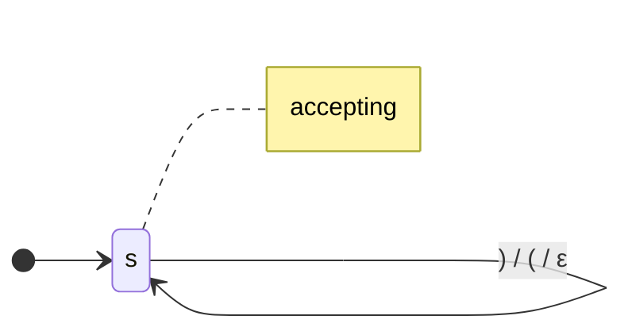
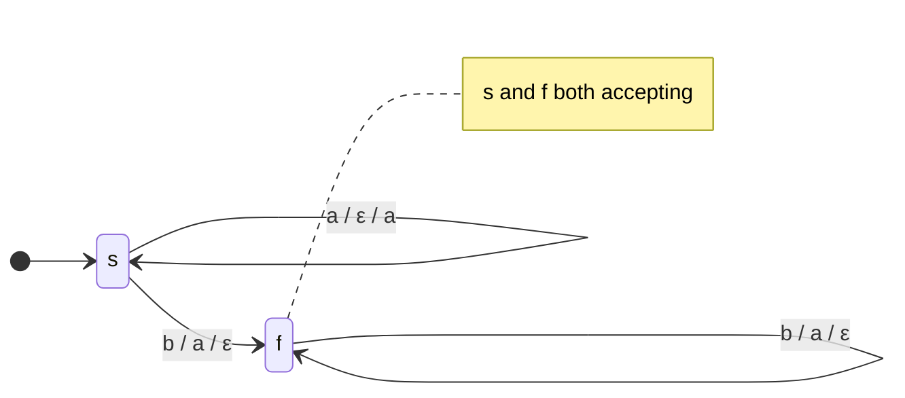
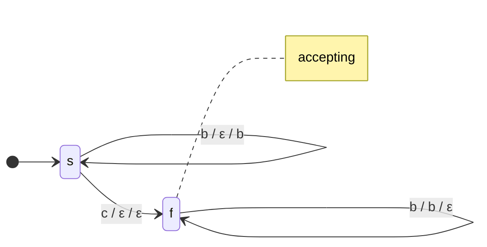
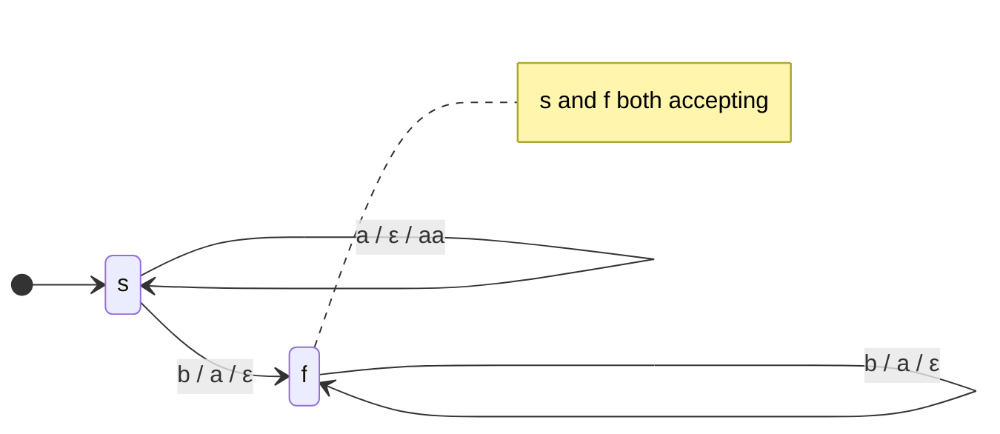
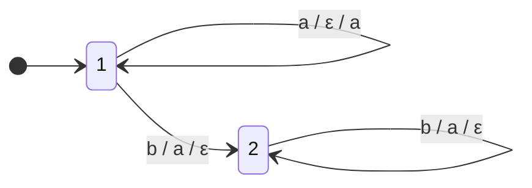
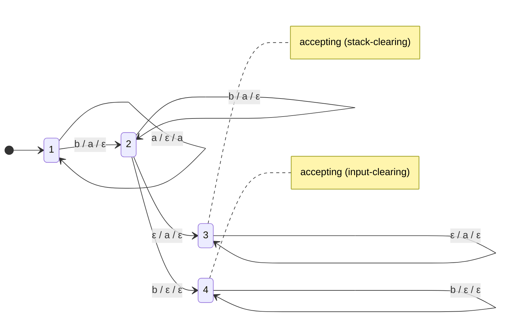
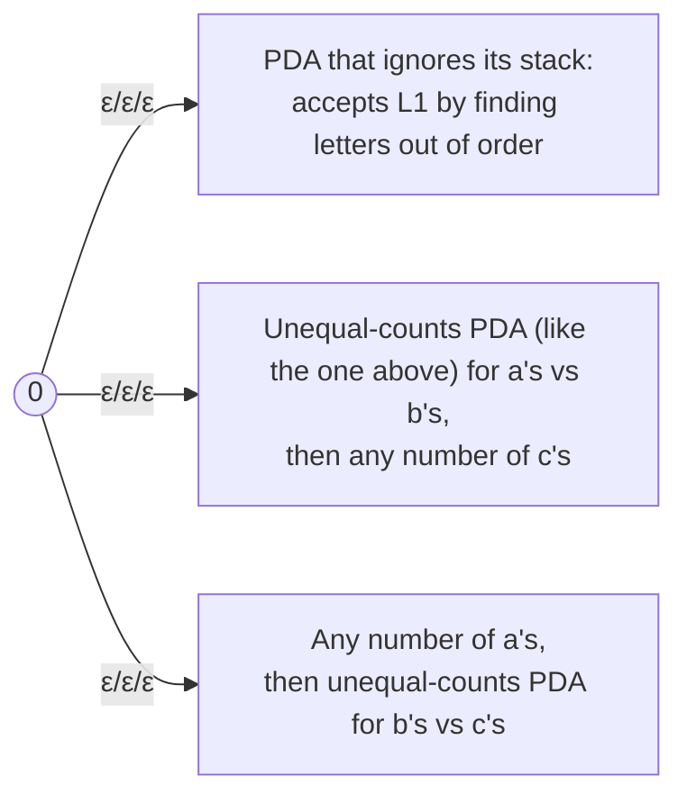
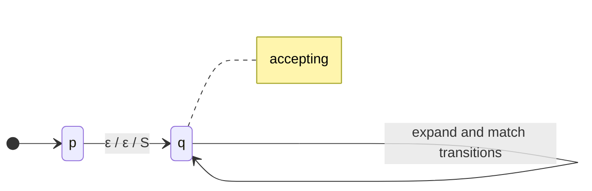

**Notes based off of:** Ch12 PDAs (lecture slides, Chapter 12)

## Recognizing Context-Free Languages

Context-free grammars _generate_ CFLs; we also want a machine that _recognizes_ them, the way FSMs recognize regular languages.

An FSM is not enough: it has only finitely many states, so it cannot remember an unbounded amount of information. To recognize balanced parentheses like $(((())))$, a machine must remember how many `(` are still open, and that number can be arbitrarily large.

**The insight:** precisely what is needed is a **stack**. A stack gives unlimited memory, but with a restricted structure: you can only look at, add to, or remove from the **top**. That restriction is exactly right for nested/matched structure: the most recently opened thing is the first one that must be closed (last in, first out).

A **pushdown automaton (PDA)** is a nondeterministic FSM plus a stack.

## Formal Definition

A PDA is a 6-tuple $$ M = (K, \Sigma, \Gamma, \Delta, s, A) $$ where:

- $K$ is a finite set of **states**,
- $\Sigma$ is the **input alphabet**,
- $\Gamma$ is the **stack alphabet** (may differ from $\Sigma$),
- $s \in K$ is the **initial state**,
- $A \subseteq K$ is the set of **accepting states**,
- $\Delta$ is the **transition relation**, a finite subset of $$ \underbrace{(K \times (\Sigma \cup {\varepsilon}) \times \Gamma^{*})}_{\text{state, input read, string popped}} \times \underbrace{(K \times \Gamma^{*})}_{\text{new state, string pushed}} $$

### Reading a Transition

A transition $((q_1, c, \gamma_1), (q_2, \gamma_2))$ means:

> In state $q_1$, read $c$ from the input (or nothing, if $c = \varepsilon$), pop $\gamma_1$ from the top of the stack, go to state $q_2$, and push $\gamma_2$ onto the stack.

In diagrams this is written as an arrow from $q_1$ to $q_2$ labeled **`input/pop/push`**, i.e. $c/\gamma_1/\gamma_2$.

|Label|Meaning|
|---|---|
|$a/\varepsilon/a$|read $a$, pop nothing, push $a$|
|$b/a/\varepsilon$|read $b$, pop an $a$, push nothing|
|$\varepsilon/a/\varepsilon$|read nothing, pop an $a$|
|$\varepsilon/\varepsilon/\varepsilon$|read nothing, change stack nothing: a pure state change|

**Important:** popping $\varepsilon$ means "pop nothing", **not** "the stack is empty". A transition with pop $\varepsilon$ can fire whatever is on the stack. A plain PDA has no built-in way to test for an empty stack (see the Accepting Mismatches section for the workaround).

Differences from an NDFSM:

- Every transition also manipulates the stack.
- $\Delta$ is a _relation_, so PDAs are nondeterministic by default (unlike FSMs, where we started with deterministic machines).
- Transitions may pop or push whole strings, not just single symbols.

## Configurations and Computations

### Configurations

A **configuration** captures everything about the machine at one moment: $$ (q, w, \gamma) \in K \times \Sigma^{*} \times \Gamma^{*} $$ the current state $q$, the **unread** input $w$, and the stack contents $\gamma$, written with the **top of the stack on the left**.

The **initial configuration** on input $w$ is $(s, w, \varepsilon)$: start state, all input unread, empty stack.

### Yields

For $c \in \Sigma \cup {\varepsilon}$, $\gamma_1, \gamma_2, \gamma \in \Gamma^{*}$, and $w \in \Sigma^{*}$: $$ (q_1, cw, \gamma_1\gamma) \vdash_M (q_2, w, \gamma_2\gamma) \iff ((q_1, c, \gamma_1), (q_2, \gamma_2)) \in \Delta $$ In words: the transition consumes $c$ from the front of the input, replaces $\gamma_1$ on top of the stack by $\gamma_2$, and leaves the rest of the stack ($\gamma$) untouched.

$\vdash_M^{*}$ is the reflexive, transitive closure of $\vdash_M$ (zero or more steps). $C_1$ **yields** $C_2$ iff $C_1 \vdash_M^{*} C_2$.

### Computations

A **computation** by $M$ is a finite sequence of configurations $C_0, C_1, \dots, C_n$ ($n \geq 0$) such that:

- $C_0$ is an initial configuration,
- $C_n$ has the form $(q, \varepsilon, \gamma)$ for some state $q$ and some stack $\gamma$,
- $C_0 \vdash_M C_1 \vdash_M \dots \vdash_M C_n$.

### Nondeterminism

In a configuration $(q_1, s, \gamma)$, $\Delta$ may contain:

- exactly one matching transition (one way forward),
- more than one matching transition (the machine "branches"; all branches are explored in parallel, conceptually),
- no matching transition (this branch dies).

Two transitions can compete in several ways: same input symbol, or one reads input while another reads $\varepsilon$, or they pop different-length strings that both match the top of the stack.

## Accepting and Rejecting

### Accepting

A computation of $M$ is an **accepting computation** iff it is $$ (s, w, \varepsilon) \vdash_M^{*} (q, \varepsilon, \varepsilon) \quad \text{with} \quad q \in A $$ So **three** conditions must all hold at the end:

1. all input has been read,
2. the stack is **empty**,
3. the state is **accepting**.

$M$ **accepts** $w$ iff **at least one** of its computations on $w$ accepts. Other paths may:

- read all the input and halt in a nonaccepting state,
- read all the input and halt in an accepting state but with a nonempty stack,
- loop forever and never finish reading the input (possible via $\varepsilon$-transitions that push),
- reach a dead end where no more input can be read.

The **language accepted by $M$**, $L(M)$, is the set of all strings $M$ accepts.

(Aside: some textbooks accept by final state alone, or by empty stack alone. All three conventions accept exactly the same class of languages, so the choice is a matter of convenience.)

### Rejecting

A computation is a **rejecting computation** iff

- it is $(s, w, \varepsilon) \vdash_M^{*} (q, w', \alpha)$,
- it is not an accepting computation, and
- $M$ has no moves it can make from $(q, w', \alpha)$.

$M$ **rejects** $w$ iff **all** of its computations reject.

Note the asymmetry: one accepting path is enough to accept, but rejection requires every path to halt without accepting. If some path loops forever and none accepts, then **$M$ neither accepts nor rejects $w$**. This never happens with an FSM.

## Example PDAs

### Balanced Parentheses

**Note:** There should be a $(/)/\varepsilon$ as well, mermaid wont render it

$M = ({s}, {(, )}, {(}, \Delta, s, {s})$ with $$ \Delta = { ((s, (, \varepsilon), (s, ()), ;; ((s, ), (), (s, \varepsilon)) } $$

- On `(`: push a `(` (remember one more open parenthesis).
- On `)`: pop a `(` (close the most recent open one). If the stack has no `(`, there is no matching transition and the branch dies, which correctly rejects strings like `())`.
- Accept if the input is done and the stack is empty (everything opened was closed).

Trace on $(())$:

|State|Unread input|Stack|
|---|---|---|
|$s$|$(())$|$\varepsilon$|
|$s$|$())$|$($|
|$s$|$))$|$(($|
|$s$|$)$|$($|
|$s$|$\varepsilon$|$\varepsilon$ ✅|

On the slide's example string $(((())))$, the stack grows to depth 4 and shrinks back to empty. (If the string has one more `(` than `)`, the input ends with a `(` left on the stack and the string is rejected.)

### $A^nB^n = {a^n b^n : n \geq 0}$

- In $s$: push one $a$ per $a$ read.
- On the first $b$: move to $f$ and pop. In $f$: pop one $a$ per $b$.
- $f$ has no $a$-transition, so an $a$ after a $b$ kills the branch (enforces the $a^{*}b^{*}$ order).
- $s$ is accepting so that $\varepsilon$ (with $n = 0$) is accepted.

$$ (s, aabb, \varepsilon) \vdash (s, abb, a) \vdash (s, bb, aa) \vdash (f, b, a) \vdash (f, \varepsilon, \varepsilon) $$

### ${wcw^R : w \in {a, b}^{*}}$

**Note:** once again mermaid is missing $a/\varepsilon /a$ 

$K = {s, f}$, $\Sigma = {a, b, c}$, $\Gamma = {a, b}$, $A = {f}$, and $$ \Delta = { ((s,a,\varepsilon),(s,a)), ; ((s,b,\varepsilon),(s,b)), ; ((s,c,\varepsilon),(f,\varepsilon)), ; ((f,a,a),(f,\varepsilon)), ; ((f,b,b),(f,\varepsilon)) } $$

- In $s$: push each character of $w$. The stack now holds $w$ reversed (top = last character).
- The marker $c$ says "the middle is here"; switch to $f$.
- In $f$: each input character must match the top of the stack. Popping in LIFO order reads $w$ backwards, which is exactly what $w^R$ requires.

This PDA is **deterministic**: at every point there is at most one possible move.

### ${a^n b^{2n} : n \geq 0}$

Same as $A^nB^n$, except each $a$ pushes **two** $a$'s ($a/\varepsilon/aa$), so $2n$ $b$'s are needed to empty the stack. This shows why pushing whole strings is useful: the stack can record a count scaled by any constant.

### PalEven $= {ww^R : w \in {a, b}^{*}}$

Grammar: $S \rightarrow \varepsilon \mid aSa \mid bSb$.

![[Screenshot 2026-10-21 at 3.46.32 PM.png]]

Same as $wcw^R$, but there is no $c$ marking the middle. The $\varepsilon/\varepsilon/\varepsilon$ transition lets the machine **guess** where the middle is: at every step it may either keep pushing or jump to $f$. Unlike the $wcw^R$ machine, this PDA is **nondeterministic**.

On $abba$, the accepting branch is: $$ (s, abba, \varepsilon) \vdash (s, bba, a) \vdash (s, ba, ba) \vdash (f, ba, ba) \vdash (f, a, a) \vdash (f, \varepsilon, \varepsilon) $$ Branches that guess the middle too early or too late hit a mismatch or end with a nonempty stack, and simply die. Since one accepting branch is enough, the string is accepted.

In fact, **no deterministic PDA** accepts PalEven: a machine reading left to right cannot know where the middle is. This is the standard example showing nondeterminism adds power to PDAs (see Nondeterminism and Minimality).

### Equal Numbers of $a$'s and $b$'s

$$ L = { w \in {a, b}^{*} : \#_a(w) = \#_b(w) } $$

![[Screenshot 2026-10-21 at 3.46.08 PM.png|539]]
Idea: the stack holds the **surplus** of whichever letter is currently ahead.

- Read $a$: if a $b$ is on top, cancel it ($a/b/\varepsilon$); otherwise record an extra $a$ ($a/\varepsilon/a$).
- Read $b$: symmetric.
- Empty stack at the end means no surplus: the counts are equal.

This is nondeterministic, since $a/\varepsilon/a$ can always fire even when $a/b/\varepsilon$ also could. That is harmless: on any path ending with an empty stack, every pushed symbol was popped by the opposite letter, so $\#_a(w) = \#_b(w)$ regardless of which choices were made.

## Accepting Mismatches

$$ L = {a^m b^n : m \neq n\; \; m, n > 0} $$ **Strategy:** start from the PDA for the case $m = n$, then add ways to accept when the counts _don't_ match.

After reading $a^m b^n$, three situations are possible:

- Stack and input both empty ($m = n$): **halt and reject**, since state 2 is not accepting.
- Input empty but stack not ($m > n$): **accept**. Add state 3, which clears the leftover $a$'s from the stack.
- Stack empty but input not ($m < n$): **accept**. Add state 4, which reads the leftover $b$'s.

### Putting It Together

- **State 3 (stack clearing, $m > n$):** pops remaining $a$'s without reading input.
- **State 4 (input clearing, $m < n$):** reads remaining $b$'s without touching the stack.

This machine is nondeterministic, and that is what makes it correct as drawn. For example, on $aabb$ the machine can jump to state 4 too early (with an $a$ still on the stack), but that branch ends with a nonempty stack and does not accept. Branches that jump to state 3 before the input ends get stuck with unread input. Only correct guesses survive.

The slide notes the two problems a **deterministic** version would have to solve:

- **Jumping to state 4: need to detect the bottom of the stack.** We should only start ignoring $b$'s once all $a$'s are popped, but a PDA cannot test for an empty stack.
- **Jumping to state 3: need to detect the end of input.** We should only start clearing the stack once the input is exhausted, but a PDA cannot see that the input has ended.

The standard tricks (covered later):

- Push a special **bottom-of-stack marker** (often $\#$) at the start; seeing $\#$ on top means "stack is empty" for practical purposes.
- Append an **end-of-input marker** (often $) to the input; reading means "input is over".

## $A^nB^nC^n$ vs. $\neg A^nB^nC^n$

### Is There a PDA for $A^nB^nC^n$?

$$ A^nB^nC^n = {a^n b^n c^n : n \geq 0} $$ No. A PDA could push the $a$'s and pop them against the $b$'s, but then the count is gone: nothing is left to compare against the $c$'s. A single stack can only match one pair of regions. $A^nB^nC^n$ is **not context-free** (proved later with the pumping lemma for CFLs).

### But Its Complement Is Context-Free

$L = \neg A^nB^nC^n$ (over ${a, b, c}$) is the union of two languages:

1. $L_1 = {w \in {a, b, c}^{*} : \text{the letters are out of order}}$, i.e. $w \notin a^{*}b^{*}c^{*}$. This is **regular** (the complement of the regular language $a^{*}b^{*}c^{*}$).
2. $L_2 = {a^i b^j c^k : i, j, k \geq 0 \text{ and } (i \neq j \text{ or } j \neq k)}$, unequal numbers of $a$'s, $b$'s, $c$'s.

#### PDA

A new start state $0$ nondeterministically guesses which case applies, using $\varepsilon/\varepsilon/\varepsilon$ transitions into three sub-machines:

This is the general technique for building a PDA for a **union**: a new start state with $\varepsilon$-moves into the PDA for each part.

#### Grammar for $L_2$

$$ L_2 = {a^n b^m c^p : n, m, p \geq 0 \text{ and } (n \neq m \text{ or } m \neq p)} $$ $$ \begin{aligned} S &\rightarrow NC \mid QP \ & N \rightarrow A \mid B \ &&A \rightarrow a \mid aA \mid aAb \ && B \rightarrow b \mid Bb \mid aBb \ && C \rightarrow \varepsilon \mid cC \ & P \rightarrow B' \mid C' \ & B' \rightarrow b \mid bB' \mid bB'c \ && C' \rightarrow c \mid C'c \mid bC'c \ &&Q \rightarrow \varepsilon \mid aQ \end{aligned} $$

|Nonterminal|Generates|
|---|---|
|$S \rightarrow NC$|$n \neq m$, then arbitrary $c$'s|
|$S \rightarrow QP$|arbitrary $a$'s, then $m \neq p$|
|$N \rightarrow A$ / $N \rightarrow B$|more $a$'s than $b$'s / more $b$'s than $a$'s|
|$C$|any number of $c$'s|
|$P \rightarrow B'$ / $P \rightarrow C'$|more $b$'s than $c$'s / more $c$'s than $b$'s|
|$Q$|any number of $a$'s|

$A$ and $B$ are exactly the "unequal $a$'s and $b$'s" grammar from Chapter 11; $B'$ and $C'$ are the same idea for $b$'s vs. $c$'s. (The slide lists $C' \rightarrow C'c$ twice; the duplicate is harmless.)

### Are CFLs Closed Under Complement?

**No.** $\neg A^nB^nC^n$ is context-free. If CFLs were closed under complement, then $$ \neg\neg A^nB^nC^n = A^nB^nC^n $$ would also be context-free, but it is not. Contradiction.

Contrast with regular languages, which **are** closed under complement (swap accepting and nonaccepting states of a DFSM). That trick fails for PDAs because they are nondeterministic: swapping accept/reject on an NDFSM or PDA does not complement the language, and PDAs cannot in general be made deterministic.

Useful context: CFLs **are** closed under union, concatenation and Kleene star (all easy with grammars: $S \rightarrow S_1 \mid S_2$, $S \rightarrow S_1S_2$, $S \rightarrow S_1S \mid \varepsilon$), but **not** under complement or intersection. For intersection: ${a^n b^n c^m} \cap {a^m b^n c^n} = A^nB^nC^n$, with both inputs context-free.

## PDAs and Context-Free Grammars

> **Theorem 12.3:** The class of languages accepted by PDAs is exactly the class of context-free languages.

Restated: a language can be described by a CFG ⟺ it can be accepted by a PDA. The proof has two directions.

### Going One Way: CFG → PDA

> **Theorem 12.1:** Each context-free language is accepted by some PDA.

**Proof** by construction (not required for the midterm). The idea: **let the stack do the work.** Two approaches:

- **Top down:** start from $S$ and expand rules, predicting what the input should look like (builds the parse tree root first).
- **Bottom up:** read input symbols and reduce them to nonterminals by running rules backwards (builds the parse tree from the leaves).

### Top-Down Construction

**Idea:** the stack holds the **expectations**: what we still expect to see in the rest of the input, as a string of terminals and nonterminals.

General construction: $M = ({p, q}, \Sigma, V, \Delta, p, {q})$, where the stack alphabet is the grammar's whole rule alphabet $V$, and $\Delta$ contains:

1. The **start-up** transition $((p, \varepsilon, \varepsilon), (q, S))$: push the start symbol.
2. For each rule $X \rightarrow s_1 s_2 \dots s_n$ in $R$, an **expand** transition $((q, \varepsilon, X), (q, s_1 s_2 \dots s_n))$: replace nonterminal $X$ on top of the stack by the rule's RHS.
3. For each terminal $c \in \Sigma$, a **match** transition $((q, c, c), (q, \varepsilon))$: if the top of the stack is the terminal we just read, pop it.

The stack's contents are always the remaining part of the current sentential form, and the machine simulates a **leftmost derivation**: the top of the stack is always the leftmost unexpanded symbol. Nondeterminism lets it guess which rule to apply when a nonterminal is on top; wrong guesses lead to mismatches and die.

#### Example: Arithmetic Expressions

Grammar: $E \rightarrow E + T \mid T$, $T \rightarrow T * F \mid F$, $F \rightarrow (E) \mid \text{id}$.

|#|Transition|From|
|---|---|---|
|1|$(q, \varepsilon, E), (q, E{+}T)$|$E \rightarrow E + T$|
|2|$(q, \varepsilon, E), (q, T)$|$E \rightarrow T$|
|3|$(q, \varepsilon, T), (q, T{*}F)$|$T \rightarrow T * F$|
|4|$(q, \varepsilon, T), (q, F)$|$T \rightarrow F$|
|5|$(q, \varepsilon, F), (q, (E))$|$F \rightarrow (E)$|
|6|$(q, \varepsilon, F), (q, \text{id})$|$F \rightarrow \text{id}$|
|7|$(q, \text{id}, \text{id}), (q, \varepsilon)$|match $\text{id}$|
|8|$(q, (, (), (q, \varepsilon)$|match $($|
|9|$(q, ), )), (q, \varepsilon)$|match $)$|
|10|$(q, +, +), (q, \varepsilon)$|match $+$|
|11|$(q, *, *), (q, \varepsilon)$|match $*$|

Note that transition 1 can fire forever ($E \Rightarrow E + T \Rightarrow E + T + T \Rightarrow \dots$) without reading any input. This is the **left recursion** problem from Chapter 11 showing up concretely: one branch of this PDA never halts. It doesn't break correctness (other branches still accept valid input), but it is why real top-down parsers require grammars without left recursion.

#### Example: $L = {a^n b^{*} a^n}$

Grammar: $S \rightarrow \varepsilon \mid B \mid aSa$, $B \rightarrow \varepsilon \mid bB$.

|#|Transition|From|
|---|---|---|
|0|$(p, \varepsilon, \varepsilon), (q, S)$|start-up|
|1|$(q, \varepsilon, S), (q, \varepsilon)$|$S \rightarrow \varepsilon$|
|2|$(q, \varepsilon, S), (q, B)$|$S \rightarrow B$|
|3|$(q, \varepsilon, S), (q, aSa)$|$S \rightarrow aSa$|
|4|$(q, \varepsilon, B), (q, \varepsilon)$|$B \rightarrow \varepsilon$|
|5|$(q, \varepsilon, B), (q, bB)$|$B \rightarrow bB$|
|6|$(q, a, a), (q, \varepsilon)$|match $a$|
|7|$(q, b, b), (q, \varepsilon)$|match $b$|

Accepting trace on $aabbaa$:

|Trans|State|Unread input|Stack|
|---|---|---|---|
||$p$|$aabbaa$|$\varepsilon$|
|0|$q$|$aabbaa$|$S$|
|3|$q$|$aabbaa$|$aSa$|
|6|$q$|$abbaa$|$Sa$|
|3|$q$|$abbaa$|$aSaa$|
|6|$q$|$bbaa$|$Saa$|
|2|$q$|$bbaa$|$Baa$|
|5|$q$|$bbaa$|$bBaa$|
|7|$q$|$baa$|$Baa$|
|5|$q$|$baa$|$bBaa$|
|7|$q$|$aa$|$Baa$|
|4|$q$|$aa$|$aa$|
|6|$q$|$a$|$a$|
|6|$q$|$\varepsilon$|$\varepsilon$ ✅|

The expand steps (3, 2, 5, 4) correspond one-to-one to the leftmost derivation $$ S \Rightarrow aSa \Rightarrow aaSaa \Rightarrow aaBaa \Rightarrow aabBaa \Rightarrow aabbBaa \Rightarrow aabbaa $$ with the match steps (6, 7) consuming terminals as they reach the top of the stack.

### Bottom-Up Construction (Brief)

The slides only name this approach. The idea, for context: the stack holds what has been **read and partially reduced so far**.

- **Shift:** read an input symbol and push it.
- **Reduce:** if the top of the stack matches the RHS of some rule $X \rightarrow \alpha$ (reversed, since the stack top is on the left), pop $\alpha$ and push $X$.
- Accept when the input is done and the stack contains just $S$ (then pop it).

This is the basis of **shift-reduce (LR) parsers**, used by tools like yacc and bison. Unlike top-down, it handles left-recursive grammars naturally.

### Going the Other Way: PDA → CFG

> **Theorem 12.2:** If a language is accepted by a PDA $M$, it is context-free (it can be described by a CFG).

The proof is by construction and very complicated; **not required**. (The rough idea: create a nonterminal for each triple "from state $p$ to state $q$ while popping stack symbol $X$" and derive rules from the transitions.)

## Nondeterminism and Minimality

A PDA $M$ is **deterministic** iff:

- $\Delta_M$ contains no pairs of transitions that **compete** with each other (no configuration ever has two possible moves), and
- whenever $M$ is in an accepting configuration, it has no available moves.

Three important facts:

1. **Determinism is strictly less powerful.** There are CFLs for which no deterministic PDA exists. PalEven is the standard example, while $wcw^R$ (with a center marker) has a deterministic PDA. The languages accepted by deterministic PDAs are the **deterministic context-free languages (DCFLs)**, a proper subset of the CFLs. This is unlike FSMs, where the subset construction makes NDFSMs and DFSMs equally powerful; there is no subset construction for PDAs, because a set of stacks cannot be stored in one stack.
2. **A PDA may not halt**, and may never finish reading its input (e.g. an $\varepsilon$-loop that keeps pushing, like transition 1 of the arithmetic PDA).
3. **There is no algorithm to minimize a PDA.** It is undecidable whether a PDA is minimal. Again unlike FSMs, where minimal DFSMs can be computed.

|                            | FSMs                     | PDAs                 |
| -------------------------- | ------------------------ | -------------------- |
| Nondeterminism adds power? | No (subset construction) | **Yes**              |
| Always halts?              | Yes                      | **No**               |
| Closed under complement?   | Yes                      | **No**               |
| Minimization algorithm?    | Yes                      | **No** (undecidable) |

**Why this matters in practice:** compilers need parsers that are fast and deterministic. Programming-language grammars are therefore designed to be deterministic context-free (more specifically LL or LR), so they can be parsed in linear time without guessing. General CFLs can still be parsed, but by slower algorithms (e.g. CYK or Earley, roughly cubic time) rather than by directly running a nondeterministic PDA.

## Summary

- PDA = NDFSM + stack. Transitions are labeled `input/pop/push`; popping $\varepsilon$ means "pop nothing", not "stack empty".
- Accept iff **some** path ends with all input read, an **empty stack**, and an **accepting state**. Reject iff **all** paths halt without accepting; a PDA can do neither.
- Stack patterns: push then pop to match counts ($a^n b^n$), push $k$ symbols to scale counts ($a^n b^{2n}$), push then pop in reverse to match mirrors ($wcw^R$), guess with $\varepsilon$-moves when the middle is unmarked (PalEven), use the stack as a surplus counter (equal $a$'s and $b$'s), add clearing states to accept mismatches.
- $A^nB^nC^n$ has no PDA, but its complement does, so CFLs are **not closed under complement**.
- PDAs accept exactly the CFLs. CFG → PDA by the top-down construction (stack = expectations, simulates a leftmost derivation); PDA → CFG exists but is not required.
- Deterministic PDAs are strictly weaker; PDAs may not halt; PDA minimization is undecidable.

**Prev:** [[CS3331A/10. Context Free Grammars|10. Context Free Grammars]]