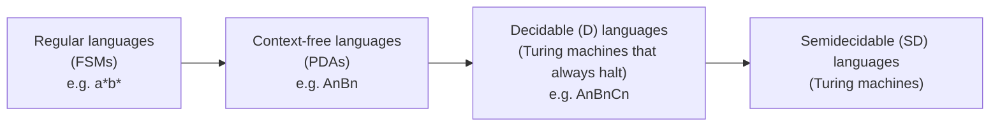
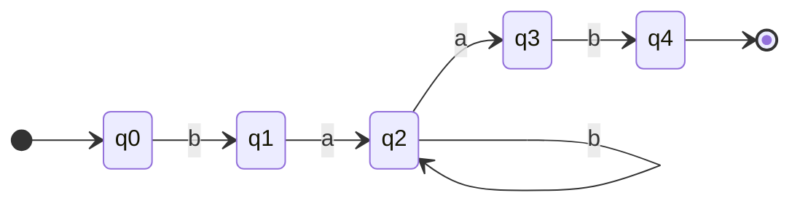
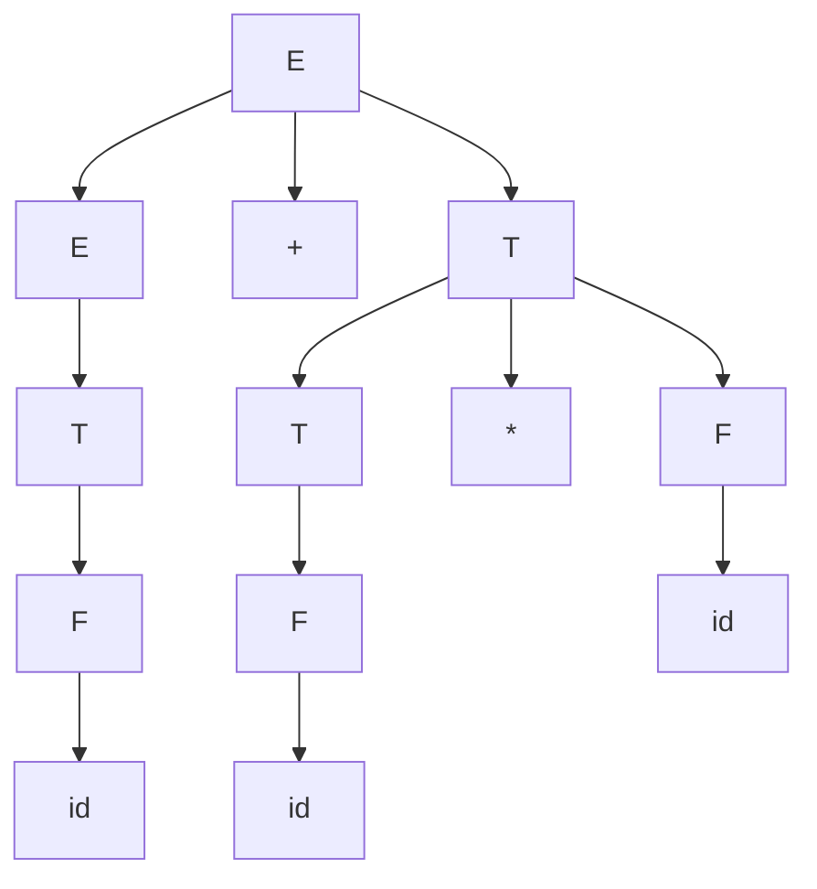
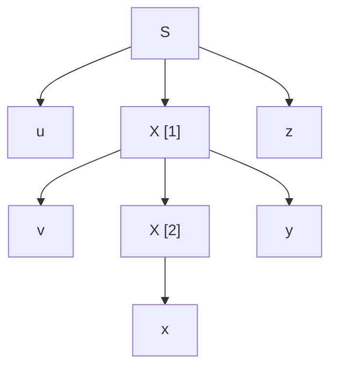
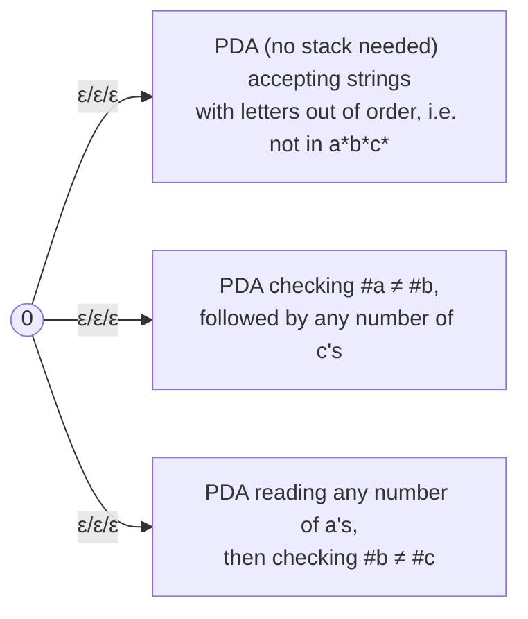

**Notes based off of:** Chapter 13 Lecture Slides, _Context-Free and Noncontext-Free Languages_ (Ch13CFornot.pdf)

## Overview: Where Context-Free Languages Sit

Three languages anchor the whole chapter, and each sits one level higher than the last:

- $a^{*}b^{*}$ is **regular**. An FSM only needs to remember "have I seen a `b` yet?", which is a finite amount of information.
- $A^nB^n = {a^nb^n : n \geq 0}$ is **context-free but not regular**. It needs one unbounded counter, which a PDA gets from its stack (push on `a`, pop on `b`).
- $A^nB^nC^n = {a^nb^nc^n : n \geq 0}$ is **not context-free**. It needs to compare _two_ pairs of counts. A PDA can use its stack to check that the `a`s match the `b`s, but popping to do that destroys the count, so nothing is left to check the `c`s against.

The intuition to carry forward: a single stack can enforce one "matching" constraint at a time, and matches must be **nested** (last opened, first closed). Anything that needs two independent counts or **crossing** dependencies is beyond a PDA.



Each arrow means "is a proper subset of". The regular languages sit inside the CFLs, which sit inside D, which sits inside SD.

### Regular Languages $\subseteq$ Context-Free Languages

**Theorem:** The regular languages are a _proper_ subset of the context-free languages.

The proof has two halves, which is the standard pattern for any "proper subset" claim:

1. **Every regular language is context-free ($\subseteq$).** Either argument works:
    - Every regular grammar is already a context-free grammar (regular grammars are just CFGs with a restricted rule shape).
    - Every FSM is a PDA that simply never touches its stack.
2. **The inclusion is strict (≠).** We need one language that is CF but not regular: $A^nB^n$ does the job (CF via the grammar $S \to aSb \mid \varepsilon$; not regular via the regular pumping theorem).

### How Many Context-Free Languages Are There?

**Theorem:** There are countably infinitely many CFLs.

- **Upper bound (at most countable):** every CFG is a finite string over a finite alphabet, so we can list all grammars lexicographically (shortest first, alphabetical within a length). Each CFL is generated by at least one grammar on that list, so there are at most countably many CFLs.
- **Lower bound (infinitely many):** ${a}, {aa}, {aaa}, \ldots$ are all CFLs (all finite, so even regular), and there are infinitely many of them.

**Why this matters (context the slide skips):** the set of _all_ languages over a nonempty alphabet $\Sigma$ is the power set of $\Sigma^{*}$, which is **uncountable** (by a diagonalization argument). A countable set cannot cover an uncountable one, so _most_ languages are not context-free. This counting argument proves non-CF languages exist without exhibiting one. $A^nB^nC^n$ is a concrete example, but proving that specific claim needs the pumping theorem below.

## Showing That a Language _Is_ Context-Free

There are three standard techniques:

1. **Exhibit a context-free grammar** for $L$.
2. **Exhibit a PDA** for $L$.
3. **Use closure properties**: build $L$ out of languages already known to be CF using operations that preserve context-freeness.

The catch with (3): CFLs have **weaker closure properties** than regular languages. They are _not_ closed under intersection or complement (see [[#Closure Properties]]), so many of the tricks that work for regular languages fail here.

## Showing That a Language Is _Not_ Context-Free: The Pumping Theorem

### Recall: Pumping for Regular Languages

For regular languages, the argument was about **automata**. A DFA with $k$ states, reading a string of length $\geq k$, must revisit some state. The portion of the string read between the two visits forms a loop that can be traversed any number of times (the "pumpable" middle). For example, an FSM shaped like:



accepts $bab^{*}ab$; the self-loop on `b` is what gets pumped.

For CFLs we use the same idea, a forced repetition in a long string, but the repetition lives in a **parse tree**, not an automaton. Instead of a repeated _state_, we find a repeated _nonterminal_ on a root-to-leaf path.

### Review of Parse Trees

A **parse tree** derived by a grammar $G = (V, \Sigma, R, S)$ is a rooted, ordered tree in which:

- every leaf is labeled with an element of $\Sigma \cup {\varepsilon}$,
- the root is labeled $S$,
- every other (internal) node is labeled with a nonterminal from $V - \Sigma$,
- if an internal node is labeled $X$ and its children (left to right) are labeled $x_1, x_2, \ldots, x_n$, then the rule $X \to x_1x_2\cdots x_n$ is in $R$.

In other words, each internal node together with its children is one application of one grammar rule.

#### Example: Arithmetic Expressions

Grammar: $$ E \to E + T \mid T \qquad T \to T \ast F \mid F \qquad F \to (E) \mid \text{id} $$ A derivation of `id + id * id`: $$ E \Rightarrow E + T \Rightarrow^{*} \text{id} + T \Rightarrow \text{id} + T \ast F \Rightarrow^{*} \text{id} + \text{id} \ast \text{id} $$ The corresponding parse tree:



This tree has **height 4** (the longest root-to-leaf path is E → E → T → F → id, four edges) and **branching factor 3** (no node has more than three children).

### Some Tree Basics

- The **height** of a tree is the length (number of edges) of the longest path from the root to any leaf.
- The **branching factor** of a tree is the largest number of children of any node.
- The **yield** of a tree is the string formed by reading its leaves left to right.

**Theorem:** A tree with height $h$ and branching factor $b$ has a yield of length at most $b^h$.

_Why:_ the root has at most $b$ children, each of those has at most $b$ children, and so on. After $h$ levels there are at most $b^h$ nodes at the bottom, and the leaves can't exceed that.

### From Grammars to Trees

Given a CFG $G$, define:

- $n$ = the number of **nonterminals** in $G$,
- $b$ = the **branching factor of $G$**, the length of the longest right-hand side: $$ b = \max{|\alpha| : A \to \alpha \text{ is a rule in } G} $$ Every parse tree from $G$ then has branching factor at most $b$, since each node's children come from one rule's RHS.

Now suppose a parse tree $T$ has **no nonterminal appearing more than once on any path**. A path consists of some internal nodes (all nonterminals, all distinct) and then one leaf, so it has at most $n$ internal nodes and thus at most $n$ edges. Therefore:

- the maximum height of $T$ is $n$,
- the maximum length of $T$'s yield is $b^n$.

Flip this around and you get the crucial consequence: **if $|w| > b^n$, then every parse tree for $w$ has height greater than $n$, so some path repeats a nonterminal** (pigeonhole principle).

### The Structure of a "Long" String's Parse Tree

If $|w| > b^n$, its parse tree contains a path with some nonterminal $X$ appearing at least twice. Call the upper occurrence $X[1]$ and the lower one $X[2]$. These two nodes split $w$ into five pieces:



- $x$ is the yield of the subtree under $X[2]$,
- $vxy$ is the yield of the subtree under $X[1]$ (so $v$ and $y$ are what $X[1]$ generates to the left and right of $X[2]$),
- $u$ and $z$ are everything outside $X[1]$'s subtree.

Two choices make the proof work:

1. **Choose a parse tree for $w$ with the fewest nodes** (no other parse tree of $w$ is smaller). This is what guarantees $vy \neq \varepsilon$.
2. **Choose the bottommost repeated pair** of nonterminals on the path. This is what bounds $|vxy|$.

### Why Pumping Works

The tree gives us these derivations: $$ S \Rightarrow^{*} uXz \qquad X \Rightarrow^{*} vXy \qquad X \Rightarrow^{*} x $$ Because the grammar is **context-free**, what $X$ can derive doesn't depend on where $X$ sits. So we can mix and match these pieces freely:

- **Pump out ($q = 0$):** skip the $X \Rightarrow^{*} vXy$ step and go straight to $x$: $$ S \Rightarrow^{*} uXz \Rightarrow^{*} uxz $$
- **Pump in ($q \geq 2$):** apply $X \Rightarrow^{*} vXy$ repeatedly before finishing: $$ S \Rightarrow^{*} uXz \Rightarrow^{*} uvXyz \Rightarrow^{*} uvvXyyz \Rightarrow^{*} uvvxyyz $$ Graphically, pumping in replaces the subtree at $X[2]$ with another copy of the subtree at $X[1]$, and pumping out replaces the subtree at $X[1]$ with the subtree at $X[2]$.

So every string of the form $uv^qxy^qz$ is in $L(G)$: $$ \forall q \geq 0, \quad uv^qxy^qz \in L(G) $$ Note the key difference from regular pumping: **two** pieces, $v$ and $y$, are pumped **in lockstep**, and they can be far apart in the string. This is exactly the "one nested match" power of a stack: $v$ and $y$ are like an opening and closing bracket generated together.

### Why $vy \neq \varepsilon$

Suppose $vy = \varepsilon$. Then the derivation $S \Rightarrow^{*} uXz \Rightarrow^{*} uxz$ yields $uxz = uvxyz = w$, using a parse tree that skips everything between $X[1]$ and $X[2]$. That tree has strictly fewer nodes, contradicting our choice of the smallest parse tree for $w$. So pumping always actually changes the string.

### Why $|vxy| \leq b^{n+1}$

Since $X[1]$ and $X[2]$ are the **bottommost** repeated pair, the subtree rooted at $X[1]$ has no other repetitions below it except this one pair. Any path down from $X[1]$ therefore contains at most $n + 1$ nonterminals ($n$ distinct ones plus the single repeat), so the subtree's height is at most $n + 1$. By the yield bound: $$ |vxy| \leq b^{n+1} $$ This bound is what lets proofs say "$vxy$ is short, so it can only touch a small, local part of $w$."

### The Context-Free Pumping Theorem (Statement)

> If $L$ is a context-free language, then there exists $k \geq 1$ such that any $w \in L$ with $|w| \geq k$ can be written as $w = uvxyz$ for some $u, v, x, y, z \in \Sigma^{*}$, such that:
> 
> 1. $vy \neq \varepsilon$,
> 2. $|vxy| \leq k$, and
> 3. $\forall q \geq 0$, $uv^qxy^qz \in L$.

(Often called the **pumping lemma** for CFLs, since it's a tool used inside proofs rather than a result for its own sake.)

### What Is $k$?

$k$ plays two roles at once:

- **How long must $w$ be to guarantee it's pumpable?** We showed $|w| > b^n$ suffices.
- **What's the bound on $|vxy|$?** We showed $|vxy| \leq b^{n+1}$.

One constant has to serve both purposes, so take the larger: $$ k = \max(b^n, b^{n+1}) = b^{n+1} $$ (For $b \geq 2$, $b^{n+1} > b^n$, so $|w| \geq k$ implies $|w| > b^n$. A grammar with $b = 1$ generates only very short strings anyway, so this edge case doesn't matter in practice.)

In real proofs **you never compute $k$**. You don't know the grammar (you're trying to show none exists!). You treat $k$ as an unknown constant and build your argument so it works for _every_ possible $k$.

### Worked Example: Pumping in the Expression Grammar

Using the arithmetic grammar from above: $n = 3$ nonterminals ($E, T, F$), $b = 3$ (rules like $E \to E + T$), so $k = 3^{4} = 81$.

Take $w = $ `id + id * id`. (This string is far shorter than 81, so it isn't _guaranteed_ pumpable, but it happens to be, and it shows the mechanics.) The nonterminal $T$ repeats on a path: $T[1] \to T[2] \ast F$. Reading off the pieces:

|Piece|Value|
|---|---|
|$u$|`id +`|
|$v$|$\varepsilon$|
|$x$|`id` (yield of $T[2]$)|
|$y$|`* id`|
|$z$|$\varepsilon$|

Check: $vy = $ `* id` $\neq \varepsilon$, $|vxy| \leq k$, and for every $q \geq 0$: $$ uv^qxy^qz = \text{id} + \text{id}(\ast,\text{id})^q \in L(G) $$ For $q = 2$ this is `id + id * id * id`, derived by applying $T \Rightarrow T \ast F$ one extra time. Note $v$ is empty here, which is allowed; only $vy$ as a whole must be nonempty.

## Proving a Language Is Not Context-Free: The Recipe

The pumping theorem says every CFL has a certain property. To show $L$ is **not** CF, show $L$ _lacks_ that property (proof by contradiction). It's useful to think of it as a game against an adversary:

1. **Adversary picks $k$.** Assume $L$ is CF, so some $k$ exists. You don't know its value.
2. **You pick $w$.** Choose a specific $w \in L$ with $|w| \geq k$, written in terms of $k$. A clever choice of $w$ is most of the work.
3. **Adversary picks the split.** You must consider _every_ way to write $w = uvxyz$ with $vy \neq \varepsilon$ and $|vxy| \leq k$. Usually you group these into a few cases.
4. **You pick $q$.** For each case, show some $q$ makes $uv^qxy^qz \notin L$.

Common pitfalls:

- You **don't** get to choose $u, v, x, y, z$. Covering only the "convenient" split is the classic mistake.
- Use $|vxy| \leq k$ aggressively: choosing $w$ with long blocks (length $k$ or more) means $vxy$ can touch at most two adjacent blocks, which keeps the case analysis short.
- Different cases can use different values of $q$.

### Example: $A^nB^nC^n$ Is Not Context-Free

Choose: $$ w = a^k,b^k,c^k = uvxyz $$ and think of $w$ as three regions: $a^k \mid b^k \mid c^k$ (regions 1, 2, 3).

Because $|vxy| \leq k$ and each region has length $k$, the window $vxy$ can't reach from region 1 all the way into region 3. So $v$ and $y$ together touch **at most two adjacent regions**. Two cases:

- **$v$ or $y$ spans a region boundary** (e.g. $v = aabb$). Pumping with $q = 2$ gives $\ldots aabbaabb\ldots$, so letters appear out of order and the result isn't even of the form $a^{*}b^{*}c^{*}$. Not in $L$.
- **$v$ and $y$ each contain only one kind of letter.** Then at most two of the three letters get pumped. With $q = 2$, the counts of the pumped letters increase while at least one letter's count stays at $k$. The three counts are no longer equal. Not in $L$.

Every case fails, so $A^nB^nC^n$ is not context-free.

### Example: ${a^{n^2} : n \geq 0}$ Is Not Context-Free

Here $L = {a^{n^2} : n \geq 0}$, strings of `a`s whose length is a perfect square. With a one-letter alphabet, there's no order to scramble, so the argument is about **gaps between lengths**.

Choose $n = k^2$, so: $$ w = a^{k^4} = uvxyz $$ Since everything is `a`, $vy = a^p$ for some $p$ with $1 \leq p \leq k$ ($p \geq 1$ because $vy \neq \varepsilon$; $p \leq k$ because $|vy| \leq |vxy| \leq k$).

Pump with $q = 2$: the result is $a^{k^4 + p}$, which must be in $L$, so $k^4 + p$ must be a perfect square. But $k^4 = (k^2)^2$ is a perfect square, and the **next** perfect square is: $$ (k^2 + 1)^2 = k^4 + 2k^2 + 1 $$ So $k^4 + p$ would have to be at least $k^4 + 2k^2 + 1$, meaning $p \geq 2k^2 + 1$. But $p \leq k < 2k^2 + 1$. The pumped length falls strictly between two consecutive squares, so it isn't in $L$. Contradiction.

**Big-picture intuition:** pumping can only grow lengths in an arithmetic progression ($|w|, |w| + p, |w| + 2p, \ldots$). Languages whose lengths grow faster than that (squares, powers of 2, primes) can never be context-free. The same idea shows they aren't regular either.

### Nested vs. Cross-Serial Dependencies

This is the best structural intuition for what CFLs can and can't do.

**$\text{PalEven} = {ww^R : w \in {a, b}^{*}}$ is context-free.** In `a a b b a a`, the first symbol must match the last, the second must match the second-to-last, and so on. The matching pairs are **nested** like parentheses:

```
a a b b a a
│ │ └─┘ │ │
│ └─────┘ │
└─────────┘
```

A stack handles this perfectly: push the first half, then pop and compare during the second half. (Grammar: $S \to aSa \mid bSb \mid \varepsilon$.)

**$\text{WW} = {ww : w \in {a, b}^{*}}$ is not context-free.** In `a a b a a b`, the first symbol matches the fourth, the second matches the fifth, and the third matches the sixth. The pairs **cross**:

```
a a b a a b
│ │ │ │ │ │
│ │ └─┼─┼─┘
│ └───┼─┘
└─────┘
```

A stack gives back symbols in reverse order, but here you need them back in the _same_ order (that's a queue, not a stack). This is the deeper reason WW fails.

(Real-world aside: Swiss German famously has cross-serial dependencies in some sentence structures, which is a classic argument that natural languages are not fully context-free.)

### Example: WW Is Not Context-Free

Choose: $$ w' = a^{k+1},b^{k+1},a^{k+1},b^{k+1} = uvxyz $$ (Picking a string that is $ww$ with $w = a^{k+1}b^{k+1}$ and long blocks keeps the case analysis manageable.)

Pump out with $q = 0$: then $uxz$ must be in WW, so $uxz = ss$ for some string $s$.

Observations:

- Since $|vxy| \leq k$, deleting $v$ and $y$ removes at most $k$ symbols, and each block has $k + 1$ symbols, so **no block disappears**. The string $uxz$ still has the shape $a^{+}b^{+}a^{+}b^{+}$.
- The deletion window touches **only one block, or two adjacent blocks**.
- If $uxz = ss$ and it has shape $a^{+}b^{+}a^{+}b^{+}$, then $s$ must have shape $a^{+}b^{+}$, and the two halves must be identical. That forces the first `a`-block to equal the second `a`-block in length, and likewise for the `b`-blocks.

Cases:

- **Only one block shrinks.** Then its counterpart in the other half still has $k + 1$ symbols, so the two halves can't match. Not in WW.
- **Two adjacent blocks shrink.** If they're blocks 1 and 2 or blocks 3 and 4, those are both in the same half, so the other half is untouched and longer. If they're blocks 2 and 3 (the `b`s of the first copy and the `a`s of the second), then the first `a`-block and the last `b`-block remain at $k + 1$ while their counterparts shrank. Either way the halves can't be equal. Not in WW.

(If $|vy|$ is odd, $uxz$ has odd length and can't be $ss$ at all, which is an even quicker contradiction.)

So WW is not context-free.

## Closure Properties

### Summary Table

|Operation|Regular|Context-Free|
|---|---|---|
|Union|✅|✅|
|Concatenation|✅|✅|
|Kleene star|✅|✅|
|Reverse|✅|✅|
|Intersection|✅|❌|
|Complement|✅|❌|
|Difference|✅|❌|
|Intersection with a regular language|✅|✅|
|Difference with a regular language|✅|✅|

The positive results are all proved by **constructing a grammar** (or PDA). The negative results are all proved by **counterexample**, usually involving $A^nB^nC^n$.

### Closure Under Union

Let $G_1 = (V_1, \Sigma_1, R_1, S_1)$ and $G_2 = (V_2, \Sigma_2, R_2, S_2)$.

Assume $G_1$ and $G_2$ have **disjoint sets of nonterminals**, neither containing $S$. This costs nothing: nonterminal names are arbitrary, so we can always rename them (e.g. add a subscript 1 or 2 to every nonterminal).

Construct: $$ G = (V_1 \cup V_2 \cup {S},\ \Sigma_1 \cup \Sigma_2,\ R_1 \cup R_2 \cup {S \to S_1,\ S \to S_2},\ S) $$ $S$ is a new start symbol that makes one choice: go to $S_1$ and derive any $w_1 \in L(G_1)$, or go to $S_2$ and derive any $w_2 \in L(G_2)$.

**Why disjointness matters:** if the grammars shared a nonterminal name, say both had a rule for $A$, a derivation starting in $G_1$ could accidentally use $G_2$'s rules for $A$, generating strings in neither language. With disjoint names, the two derivations can never mix.

### Closure Under Concatenation

Same setup (disjoint nonterminals, new $S$). Construct: $$ G = (V_1 \cup V_2 \cup {S},\ \Sigma_1 \cup \Sigma_2,\ R_1 \cup R_2 \cup {S \to S_1S_2},\ S) $$ The left part $S_1$ derives any $w_1 \in L(G_1)$ and the right part $S_2$ derives any $w_2 \in L(G_2)$, independently, giving exactly ${w_1w_2 : w_1 \in L(G_1), w_2 \in L(G_2)} = L(G_1)L(G_2)$.

### Closure Under Kleene Star

Let $G = (V, \Sigma, R, S_1)$, and assume $G$ doesn't already use the nonterminal $S$. We want: $$ L(G)^{*} = {\varepsilon} \cup {w_1w_2\cdots w_m : m \geq 1,\ \text{each } w_i \in L(G)} $$ Construct: $$ G' = (V \cup {S},\ \Sigma,\ R \cup {S \to \varepsilon,\ S \to SS_1},\ S) $$ How it generates everything:

- **Empty string:** $S \Rightarrow \varepsilon$.
- **Nonempty strings:** repeatedly apply $S \to SS_1$ to grow a row of $S_1$'s, then end with $S \to \varepsilon$: $$ S \Rightarrow SS_1 \Rightarrow SS_1S_1 \Rightarrow \cdots \Rightarrow SS_1S_1\cdots S_1 \Rightarrow S_1S_1\cdots S_1 $$ Each $S_1$ then independently derives some $w_i \in L(G)$.

### Closure Under Reverse

$$ L^R = {w \in \Sigma^{*} : w = x^R \text{ for some } x \in L} $$ Given $G = (V, \Sigma, R, S)$, every rule has the form $X \to \alpha$ with $\alpha \in V^{*}$. Build $G'$ with the same nonterminals, terminals, and start symbol, but:

- for every rule $X \to \alpha$ in $G$, put $X \to \alpha^R$ in $G'$.

**Why it works:** reversing every rule's right-hand side mirrors every parse tree left-to-right. Mirroring a tree reverses the order of its leaves, so each yield $x$ becomes $x^R$. Example: $S \to aSbb$ becomes $S \to bbSa$.

### Not Closed Under Intersection

Proof by counterexample: $$ L_1 = {a^nb^nc^m : n, m \geq 0} \qquad \text{(equal a's and b's)} $$ $$ L_2 = {a^mb^nc^n : n, m \geq 0} \qquad \text{(equal b's and c's)} $$ Both are context-free. Grammars the slide calls "straightforward":

- $L_1$: $S \to AC$, $A \to aAb \mid \varepsilon$, $C \to cC \mid \varepsilon$
- $L_2$: $S \to AB$, $A \to aA \mid \varepsilon$, $B \to bBc \mid \varepsilon$

Each language only imposes **one** matching constraint, which a single stack can handle. But their intersection imposes both at once: $$ L_1 \cap L_2 = {a^nb^nc^n : n \geq 0} $$ which is not context-free.

**Why the "run both in parallel" trick fails here:** for regular languages, intersection works by running two FSMs side by side (product construction). Running two PDAs side by side would need **two stacks**, and a machine with two stacks is as powerful as a Turing machine. That's far beyond a PDA.

### Not Closed Under Complement

By De Morgan's law: $$ L_1 \cap L_2 = \neg(\neg L_1 \cup \neg L_2) $$ CFLs are closed under union. If they were also closed under complement, the right-hand side would always be CF, meaning CFLs would be closed under intersection. They aren't, so they can't be closed under complement.

#### A Concrete Example

$\neg A^nB^nC^n$ **is** context-free. A string fails to be in $A^nB^nC^n$ for one of three reasons, and a PDA can nondeterministically guess which:



That's a union of three CFLs, which is CF. (Checking "unequal" counts only needs one comparison at a time, unlike "all three equal".)

But $\neg(\neg A^nB^nC^n) = A^nB^nC^n$ is not context-free. So complementing a CFL can produce a non-CFL.

**Aside worth knowing:** the _deterministic_ CFLs (those accepted by deterministic PDAs) **are** closed under complement. The failure here is tied to nondeterminism: a nondeterministic PDA accepts if _some_ path accepts, and you can't simply flip accept/reject states to get the complement.

### Not Closed Under Difference

Complement is a special case of difference: $$ \neg L = \Sigma^{*} - L $$ $\Sigma^{*}$ is context-free (it's even regular). If CFLs were closed under difference, then $\Sigma^{*} - L$, the complement of any CFL $L$, would be CF. We just showed that's false.

## Intersection and Difference With Regular Languages

Even though CF ∩ CF can fail, **CF ∩ Regular is always CF**. This is the single most useful closure property for proofs.

### The Intersection of a CFL and a Regular Language Is Context-Free

Let:

- $L = L(M_1)$, where $M_1 = (K_1, \Sigma, \Gamma_1, \Delta_1, s_1, A_1)$ is a PDA,
- $R = L(M_2)$, where $M_2 = (K_2, \Sigma, \delta, s_2, A_2)$ is a **deterministic** FSM (DFA).

We build a PDA $M_3$ that accepts $L \cap R$ by **simulating $M_1$ and $M_2$ in parallel** (a product construction, as in the regular-language intersection proof): $$ M_3 = (K_1 \times K_2,\ \Sigma,\ \Gamma_1,\ \Delta,\ (s_1, s_2),\ A_1 \times A_2) $$ Each state of $M_3$ is a pair $(q_1, q_2)$: the first component tracks where $M_1$ is, the second tracks where $M_2$ is. The stack is just $M_1$'s stack. $M_3$ accepts only if **both** machines end in accepting states.

Transitions in $\Delta$:

1. **Both machines read a symbol together.** For each PDA rule $((q_1, a, \beta), (p_1, \gamma))$ in $\Delta_1$ and each DFA transition $(q_2, a, p_2)$ in $\delta$, add: $$ (((q_1, q_2), a, \beta), ((p_1, p_2), \gamma)) $$
2. **The PDA makes an ε-move alone.** The DFA has no ε-moves, so it just stays put. For each PDA rule $((q_1, \varepsilon, \beta), (p_1, \gamma))$ in $\Delta_1$ and each state $q_2 \in K_2$, add: $$ (((q_1, q_2), \varepsilon, \beta), ((p_1, q_2), \gamma)) $$

**Why this works:** only one of the two machines needs a stack. A DFA's entire memory is its current state, which fits into the finite control of $M_3$. Contrast this with CF ∩ CF, where both machines would need their own stack.

### The Difference Between a CFL and a Regular Language Is Context-Free

**Theorem:** If $L_1$ is context-free and $L_2$ is regular, then $L_1 - L_2$ is context-free.

**Proof:** $$ L_1 - L_2 = L_1 \cap \neg L_2 $$

- $L_2$ is regular, and regular languages are closed under complement, so $\neg L_2$ is regular.
- $L_1$ is CF and $\neg L_2$ is regular, so by the previous theorem $L_1 \cap \neg L_2$ is CF.

(Note the direction: $L_1 - L_2$ with $L_1$ CF and $L_2$ regular. The reverse, regular minus CF, is $R \cap \neg L$, which involves complementing a CFL, so no such guarantee.)

## Using Intersection With a Regular Language to Prove Non-Context-Freeness

Closure properties can be run **backwards** as a proof technique:

> If $L$ were CF, then $L \cap R$ would be CF for any regular $R$. So if you can find a regular $R$ where $L \cap R$ is known to be non-CF, then $L$ is not CF.

The regular language acts as a **filter** that strips away the messy strings and leaves a clean, known-bad language.

### Example

$$ L = {w \in {a, b, c}^{*} : #_a(w) = #_b(w) = #_c(w)} $$ Pumping this directly is painful, since the letters can appear in any order and the adversary has lots of freedom.

Instead, intersect with the regular language $a^{*}b^{*}c^{*}$, which forces the letters into sorted order: $$ L' = L \cap a^{*}b^{*}c^{*} = A^nB^nC^n $$ If $L$ were CF, $L'$ would be CF (CF ∩ Regular is CF). But $L' = A^nB^nC^n$ is not CF. So $L$ is not CF.

**General strategy:** when a language has an unordered or awkward structure, look for a regular filter that turns it into $A^nB^nC^n$, WW, or another language already proven non-CF. This is usually far less work than a fresh pumping argument.

## Key Takeaways

- A single stack handles **one nested matching constraint**. Two simultaneous counts or **crossing** dependencies need more power.
- The CF pumping theorem comes from **repeated nonterminals in tall parse trees**. Long strings ($|w| > b^n$) force tall trees, and tall trees force repeats.
- Pumping CFLs pumps **two pieces, $v$ and $y$, in lockstep**, within a window of length at most $k$.
- In pumping proofs: you choose $w$ and $q$; the adversary chooses $k$ and the split, and you must defeat **every** split.
- CFLs are closed under **union, concatenation, star, reverse**, and **intersection/difference with regular languages**.
- CFLs are **not** closed under **intersection, complement, or difference**. The standard counterexample in each case leads to $A^nB^nC^n$.
- To show $L$ is not CF, consider intersecting with a regular language to reduce it to a known non-CF language before reaching for pumping.