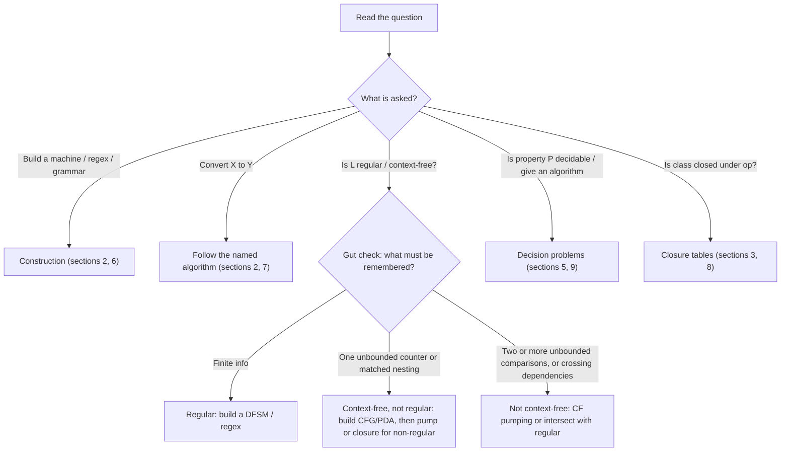
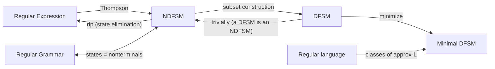

**Notes based off of:** Midterm Review (lecture slides)

The slides list _topics_; this note turns them into a playbook: for each kind of question that can show up, how to recognize it, what tool to grab, and the template for the answer. Notation follows the course (DFSM / NDFSM, $\approx_L$, "rip" state elimination).

## 0. Triage: What Is the Question Actually Asking?

Almost every midterm question falls into one of these buckets. Identify the bucket first, then use the matching section below.

### The memory gut check

Ask: _while reading the string left to right, what do I need to remember?_

- **A bounded amount** (last few symbols, a count mod $k$, whether I've seen "abb" yet, parity) → **regular**.
- **One unbounded count, or nested/matched structure** (e.g. $a^{n}b^{n}$, balanced parentheses, palindromes) → **context-free but not regular**. A stack is exactly one unbounded counter/nesting memory.
- **Two independent unbounded counts that must agree, or copies** (e.g. $a^{n}b^{n}c^{n}$, $ww$) → **not context-free**.

This is a heuristic, not a proof, but it tells you which proof to attempt. Watch for traps: ${w \in {a,b}^{*} : \#_{ab}(w) = \#_{ba}(w)}$ _looks_ like counting but is regular (it is just "starts and ends with the same letter"). Test your intuition on small strings.

## 1. Regular Languages: The Four Equivalent Representations

DFSMs, NDFSMs, regular expressions, and regular grammars all describe exactly the regular languages. Moore and Mealy machines are FSMs with output (transducers) rather than recognizers.

Takeaway: if a question hands you one representation and asks for another, there is always a mechanical path through this graph. If a direct conversion feels hard, route through an NDFSM.

## 2. Regular: Constructions and Conversions

### 2.1 Building a DFSM from scratch

- **States = "what I need to remember."** Name each state by its meaning (e.g. "seen even # of a's, last symbol b"). This makes the machine checkable.
- Every state needs a transition on **every** symbol. Add a **dead state** for hopeless prefixes.
- For "A **and** B" conditions, build two small machines and take the **product** (states are pairs). For "A **or** B", same product, different accepting states. For "**not** A", flip accepting states of a complete DFSM.
- Sanity check: trace $\varepsilon$, one short accepted string, one short rejected string.

### 2.2 Building an NDFSM

Use nondeterminism to **guess**: "contains substring $p$", "the 3rd symbol from the end is $a$", unions. NDFSMs are often far smaller than the equivalent DFSM (the "$k$th from the end" language needs $2^{k}$ DFSM states).

### 2.3 NDFSM → DFSM (subset construction)

1. Start state = **eps-closure** of the NDFSM start state.
2. For each new subset $S$ and symbol $c$: take every state reachable from $S$ on $c$, then take the eps-closure. That set is the target.
3. Only build subsets that are reachable (work from a queue). Don't enumerate all $2^{n}$.
4. A subset is accepting iff it contains **any** NDFSM accepting state.
5. The empty set is your dead state.

Most common lost marks: forgetting the eps-closure **after** each move, not just at the start.

### 2.4 DFSM → minimal DFSM

Partition refinement:

1. Remove unreachable states.
2. Initial partition: {accepting}, {non-accepting}.
3. Repeatedly split a class if two of its states go, on some symbol, to **different** classes.
4. Stop when nothing splits; each class is one state.

The minimal DFSM is **unique** (up to state names), which is why "minimize both and compare" decides equivalence.

### 2.5 Regex → NDFSM (Thompson)

Build bottom-up from the parse of the regex: a two-state machine per symbol, then glue with $\varepsilon$-transitions for union, concatenation, and Kleene star. It is mechanical; show the pieces and the glue.

### 2.6 NDFSM → Regex (rip / state elimination)

1. Make sure there is a start state with **no incoming** edges and a single accepting state with **no outgoing** edges (add new ones with $\varepsilon$-edges if not).
2. Merge parallel edges into a union.
3. Rip out one internal state $r$ at a time. For every pair $p \to r \to q$, the new label from $p$ to $q$ is $$ R(p,q) \cup R(p,r),R(r,r)^{*},R(r,q) $$
4. When only start and accept remain, the edge label is the answer.

Rip states with few connections first; it keeps expressions small. Rip order changes the look of the answer, not the language.

### 2.7 Regular grammars

Rules have the form $A \to aB$, $A \to a$, or $A \to \varepsilon$. Each nonterminal is a state; $A \to aB$ is an edge $A \xrightarrow{a} B$; $A \to \varepsilon$ makes $A$ accepting.

### 2.8 Moore vs. Mealy

- **Moore:** output attached to **states** (output depends only on current state).
- **Mealy:** output attached to **transitions** (depends on state and input symbol).
- They're interconvertible; Mealy usually needs fewer states. If asked to design one, decide what each output depends on.

## 3. Regular: Proving IS / IS NOT Regular

### 3.1 Proving L IS regular

Any **one** of these is a complete proof:

- Give a DFSM, NDFSM, regex, or regular grammar for $L$ (and briefly argue it's correct).
- Show $\approx_L$ has finitely many equivalence classes (this simultaneously gives you the minimal DFSM: one state per class).
- Build $L$ from known regular languages using closure operations.

Recall the definition: $$ x \approx_L y \iff \forall z \in \Sigma^{*},(xz \in L \leftrightarrow yz \in L) $$ Two prefixes are equivalent if no suffix can tell them apart.

### 3.2 Proving L is NOT regular: pumping theorem

The theorem (what regular languages must satisfy): $$ \exists k ;\forall w \in L,\ |w| \ge k ;\exists x,y,z:\ w = xyz,\ |xy| \le k,\ y \ne \varepsilon,\ \forall q \ge 0:\ xy^{q}z \in L $$ Treat it as an adversary game. **You** choose $w$ and $q$; the **adversary** chooses $k$ and the split.

Proof template:

1. Assume $L$ is regular; let $k$ be the pumping constant.
2. Pick $w \in L$ with $|w| \ge k$, **chosen so that the first $k$ symbols are all the same letter** (e.g. $w = a^{k}b^{k}$). Then $|xy| \le k$ forces $y = a^{p}$ for some $p \ge 1$. One case instead of many.
3. Pick $q$ (often $q = 0$ or $q = 2$) so that $xy^{q}z \notin L$.
4. Contradiction, so $L$ is not regular.

Common mistakes: picking a specific $k$ (like $k = 5$); picking the split yourself; choosing $w \notin L$; forgetting the $q = 0$ option, which is often the easiest.

### 3.3 Proving L is NOT regular: closure

Template: _assume $L$ regular → combine it with **regular** languages using closed operations → get a language known to be non-regular → contradiction._

Example: $L = {w : \#_a(w) = \#_b(w)}$. If $L$ were regular, $L \cap a^{*}b^{*} = {a^{n}b^{n}}$ would be regular. It isn't, so $L$ isn't.

Direction matters. "$L = L_1 \cup L_2$ and $L_1$ is not regular" proves **nothing** ($L_1 \cup \Sigma^{*}$ is regular). You must apply the operation **to $L$**, with **regular** partners.

### 3.4 Proving L is NOT regular: Myhill–Nerode

Exhibit infinitely many pairwise distinguishable prefixes. For $a^{n}b^{n}$: the prefixes $a^{i}$ and $a^{j}$ ($i \ne j$) are distinguished by the suffix $b^{i}$. Infinitely many classes → not regular. Often cleaner than pumping.

## 4. Regular: Closure Properties

Regular languages are closed under **all** of: union, concatenation, Kleene star, complement, intersection, difference, reverse.

How each is shown (good for "prove closure" questions):

|Operation|Construction|
|---|---|
|Union, concatenation, star|Regex operators / Thompson-style $\varepsilon$ glue|
|Complement|Complete DFSM, swap accepting and non-accepting|
|Intersection|Product construction, or De Morgan via complement + union|
|Difference|$L_1 - L_2 = L_1 \cap \overline{L_2}$|
|Reverse|Reverse all edges, swap start/accept (add new start with $\varepsilon$-edges)|

Complement requires a **DFSM**: flipping accept states of an NDFSM does not complement it.

## 5. Regular: Decision Problems

Everything about regular languages is decidable. Know one algorithm per problem; most reduce to "build a DFSM and look at the graph."

|Problem|Algorithm|
|---|---|
|Membership: $w \in L$?|Run the DFSM on $w$ (linear time)|
|Emptiness: $L = \emptyset$?|Is any accepting state reachable from start?|
|Totality: $L = \Sigma^{*}$?|Is the complement empty?|
|Finiteness|Remove states that can't reach an accept state; $L$ is infinite iff a reachable cycle remains|
|Equivalence: $L_1 = L_2$?|Minimize both and compare, or check symmetric difference is empty|
|Minimality|Minimize and compare state counts|

"Specific questions" (e.g. "does $L$ contain a string with 3 a's?"): intersect $L$ with a regular language describing the property, then test emptiness. This trick solves most of them.

### Pattern matching / searching

For pattern $p$ over text $T$:

- **Matching** (does $p$ occur anywhere in $T$?): $T \in L(\Sigma^{*}p,\Sigma^{*})$.
- **Searching** (where does it occur?): run a DFSM for $L(\Sigma^{*}p)$ over $T$; every time it hits an accepting state, an occurrence of $p$ just **ended** at that position.

Build the NDFSM (easy: loop on $\Sigma$, then spell out $p$), convert to a DFSM, then scan $T$ in one pass.

## 6. Context-Free Languages: Constructions

### 6.1 CFG design patterns

Most grammar questions are combinations of a few patterns:

|Want|Rule pattern|
|---|---|
|Matched counts $a^{n}b^{n}$|$S \to aSb \mid \varepsilon$|
|Palindromes|$S \to aSa \mid bSb \mid a \mid b \mid \varepsilon$|
|Balanced parentheses|$S \to SS \mid (S) \mid \varepsilon$|
|Union $L_1 \cup L_2$|$S \to S_1 \mid S_2$|
|Concatenation|$S \to S_1 S_2$|
|Star|$S \to S S_1 \mid \varepsilon$|
|Unequal counts $a^{n}b^{m}, n \ne m$|Union of "more a's" and "more b's": $S \to A \mid B$, $A \to aA \mid aC$, $B \to Bb \mid Cb$, $C \to aCb \mid \varepsilon$|

Strategy: decompose the language into pieces that match these, then glue. For constraints like $a^{i}b^{j}c^{k}$ with $j = i + k$, rewrite as $a^{i}b^{i},b^{k}c^{k}$ and concatenate.

### 6.2 PDA design

- **The stack is your counter/nesting memory.** Push on the first part, pop on the matching part.
- Use nondeterminism to **guess the middle** (palindromes, $ww^{R}$).
- Course convention: accept when in an accepting state **and** the stack is empty. Push a bottom marker (e.g. $#$) at the start if you need to detect emptiness.
- Transitions are written $((q, c, \gamma_1), (p, \gamma_2))$: in state $q$, read $c$, pop $\gamma_1$, go to $p$, push $\gamma_2$.

If a CFG is easier to write, write the CFG. Either is a valid proof that $L$ is context-free.

## 7. Context-Free: Conversions

### 7.1 CFG → Chomsky Normal Form (has an algorithm)

CNF: every rule is $A \to BC$ or $A \to a$ (plus $S \to \varepsilon$ if $\varepsilon \in L$). Steps, **in this order**:

1. If $S$ appears on a right-hand side, add a new start $S_0 \to S$.
2. **Remove $\varepsilon$-rules**: find nullable nonterminals, add every variant of each rule with nullable symbols dropped.
3. **Remove unit rules** $A \to B$: replace with $B$'s right-hand sides.
4. **Remove mixed rules** (terminals next to nonterminals): replace each terminal $a$ with a new $T_a \to a$.
5. **Remove long rules** $A \to BCD$: chain as $A \to BX$, $X \to CD$.

The order matters: removing $\varepsilon$-rules can create unit rules, so do units after. A string of length $n$ in CNF has a derivation of exactly $2n - 1$ steps, which is why CNF gives a membership algorithm.

### 7.2 CFG → unambiguous CFG (no algorithm)

- To show a grammar is **ambiguous**: find one string with **two different parse trees** (or two leftmost derivations). That's the whole proof.
- There is **no general algorithm** to remove ambiguity, and some languages are **inherently ambiguous** (e.g. ${a^{i}b^{j}c^{k} : i = j \text{ or } j = k}$).
- For specific grammars, the standard fix is layering by precedence: $E \to E + T \mid T$, $T \to T * F \mid F$, $F \to (E) \mid \text{id}$.

## 8. Context-Free: IS / IS NOT, and Closure

### 8.1 Closure table

|Operation|Closed?|
|---|---|
|Union, concatenation, Kleene star, reverse|Yes|
|Intersection with a **regular** language|Yes|
|Difference with a **regular** language|Yes|
|Complement|**No**|
|Intersection (CF with CF)|**No**|
|Difference (CF minus CF)|**No**|

Standard counterexample for intersection: ${a^{n}b^{n}c^{m}} \cap {a^{m}b^{n}c^{n}} = {a^{n}b^{n}c^{n}}$, two CFLs whose intersection isn't CF. Complement fails as a consequence (otherwise De Morgan would give intersection).

### 8.2 Proving L is NOT context-free: pumping theorem

$$ \exists k ;\forall w \in L,\ |w| \ge k ;\exists u,v,x,y,z:\ w = uvxyz,\ vy \ne \varepsilon,\ |vxy| \le k,\ \forall q \ge 0:\ uv^{q}xy^{q}z \in L $$ Template: same adversary game as before, but now **two** pieces pump together, and the window $vxy$ can be **anywhere** (not just the front). So you **must do case analysis**:

1. Pick $w$ with regions of length $k$, e.g. $w = a^{k}b^{k}c^{k}$.
2. Since $|vxy| \le k$, the window touches **at most two adjacent regions**. List the cases: inside one region; straddling two regions.
3. In each case, pumping either unbalances the counts (a region it doesn't touch stays fixed) or, if $v$ or $y$ crosses a boundary, scrambles the order (e.g. produces $\ldots ba \ldots$).
4. Every case fails → contradiction.

Missing a case is the most common way to lose marks. Write the case list explicitly.

### 8.3 Proving L is NOT context-free: closure

Intersect with a regular language to strip away everything but the hard core: $$ L = {w \in {a,b,c}^{*} : \#_a = \#_b = \#_c},\quad L \cap a^{*}b^{*}c^{*} = {a^{n}b^{n}c^{n}} $$ Since $a^{n}b^{n}c^{n}$ is not CF and intersection with a regular language preserves CF, $L$ is not CF. Only use operations from the "Yes" column of the table.

## 9. Context-Free: Decision Problems

|Problem|Decidable?|Algorithm|
|---|---|---|
|Membership|Yes|Convert to CNF; try all derivations of length $2n-1$ (or CKY)|
|Emptiness|Yes|Mark productive nonterminals bottom-up; is $S$ productive?|
|Finiteness|Yes|Remove useless symbols; infinite iff the grammar has a recursive nonterminal (cycle in the "derives" graph)|

What is **missing** from the slide matters too: for CFLs, **totality, equivalence, and ambiguity are undecidable**. If a question asks for an algorithm for one of these, the expected answer is "none exists." Compare with section 5, where every problem had an algorithm.

## 10. Known Languages Cheat Sheet

Use these as the "known" endpoint of closure proofs:

| Language                                                 | Regular? | CF? |
| -------------------------------------------------------- | -------- | --- |
| $a^{*}b^{*}$, strings with even # of a's, contains "aab" | Yes      | Yes |
| $a^{n}b^{n}$                                             | No       | Yes |
| $ww^{R}$, palindromes, balanced parentheses              | No       | Yes |
| ${w : \#_a(w) = \#_b(w)}$                                | No       | Yes |
| $a^{n}b^{n}c^{n}$                                        | No       | No  |
| $ww$                                                     | No       | No  |
| $a^{n^{2}}$, $a^{p}$ with $p$ prime                      | No       | No  |

Every regular language is context-free, so "not CF" implies "not regular," but not the other way around.

## 11. Last-Minute Checklist

- In pumping proofs: never pick $k$ or the split; always pick $w \in L$ with $|w| \ge k$; try $q = 0$.
- In CF pumping: enumerate **all** placements of $vxy$.
- In closure proofs: apply operations to $L$ with **regular** partners, and only operations the class is closed under.
- Subset construction: eps-closure after **every** move.
- Complement needs a **complete DFSM**.
- CNF steps in order: new start, $\varepsilon$, units, mixed, long.
- Ambiguity: one string, two parse trees. No algorithm to fix it in general.