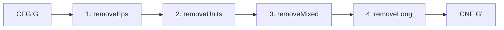

**Notes based off of:** Ch14DecisionProcedures.pdf (Chapter 14 – Algorithms and Decision Procedures for Context-Free Languages)

## Overview

A **decision procedure** is an algorithm that always halts with a yes/no answer. For regular languages almost every reasonable question is decidable. Context-free languages are more powerful, and the price is that several questions become **undecidable**. This chapter covers which questions _can_ be answered (membership, emptiness, finiteness) and lists the ones that can't.

## Membership: is $w \in L$?

Given a CFL $L$ and a string $w$, decide whether $w \in L$. Parsing is essentially a richer version of this question (we also want the parse tree), so solving membership is the foundation of every compiler front end.

### Why the naive approaches fail

**Approach 1 – try derivations in a grammar $G$.** Nothing bounds how long a derivation can be. With $S \rightarrow ST \mid \text{a}$, trying to derive `aaa` can loop forever: $$ S \Rightarrow ST \Rightarrow STT \Rightarrow STTT \Rightarrow \cdots $$ The sentential form keeps growing without ever producing terminals, and a blind search never knows when to give up.

**Approach 2 – run a PDA $M$ on $w$.** A PDA can have $\varepsilon$-transitions that loop without consuming input (e.g. bouncing between two states on $\varepsilon/\varepsilon/\text{a}$, pushing forever). Since PDAs are also nondeterministic, simulating "all branches" may never terminate.

**The fix:** put the grammar into a normal form where derivation length is tied to $|w|$. Then the search space is finite.

## Chomsky Normal Form (CNF)

A grammar is in CNF if every rule is one of:

- $X \rightarrow a$, where $a \in \Sigma$
- $X \rightarrow BC$, where $B, C \in V - \Sigma$ (nonterminals)

No $\varepsilon$-rules are allowed, so a CNF grammar **cannot derive $\varepsilon$** (handle $\varepsilon$ separately if needed).

### Why CNF is useful

- **Parse trees are binary**, which makes parsing algorithms (e.g. CYK) clean.
- **Derivation length is exactly known.** For $|w| = n$:
    - $n - 1$ applications of $X \rightarrow BC$ (each one increases the number of symbols by 1, going from 1 symbol to $n$)
    - $n$ applications of $X \rightarrow a$ (one per terminal)
    - Total: $$ (n-1) + n = 2n - 1 \text{ steps} $$ Example tree for `aabbb` ($n = 5$, so 9 steps): $S \rightarrow AB$, $A \rightarrow AA$, $B \rightarrow BB$, $B \rightarrow BB$, plus five terminal rules.

### Conversion to CNF

**Theorem:** for any CFG $G$ there is a CNF grammar $G'$ with $L(G') = L(G) - {\varepsilon}$.

The conversion is a pipeline of four transformations. **Order matters**: removing $\varepsilon$-rules can create new unit rules, so units must come after; mixed rules are fixed before long rules so that long rules contain only nonterminals.

#### 1. Removing $\varepsilon$-productions (removeEps)

A variable is **nullable** if $X \Rightarrow^{*} \varepsilon$. Compute these iteratively: anything with a rule $X \rightarrow \varepsilon$ is nullable; then any $X$ with a rule whose entire right-hand side is nullable is nullable; repeat until nothing changes.

A rule $P \rightarrow \alpha R \beta$ is **modifiable** if $R$ is nullable and $P \neq \alpha\beta \neq \varepsilon$ (i.e. don't create a new $\varepsilon$-rule, and don't create a useless $P \rightarrow P$).

Idea: since $P \Rightarrow \alpha R \beta \Rightarrow^{*} \alpha\beta$ was possible, add the shortcut $P \rightarrow \alpha\beta$ to simulate $R$ "vanishing". Then delete all $X \rightarrow \varepsilon$ rules.

Algorithm:

1. $G' = G$
2. Find the nullable set $N$.
3. For each modifiable rule $P \rightarrow \alpha R \beta$, add $P \rightarrow \alpha\beta$ (repeat on newly added rules, so every subset of nullable occurrences gets dropped).
4. Delete all $X \rightarrow \varepsilon$.

Result: $L(G') = L(G) - {\varepsilon}$.

**Example.** Nullable: $C$ (via $C \rightarrow \varepsilon$), then $B$ (via $B \rightarrow C$), then $A$ (via $A \rightarrow B$).

|Before|After|
|---|---|
|$S \rightarrow \text{a}AC\text{a}$|$S \rightarrow \text{a}AC\text{a} \mid \text{a}A\text{a} \mid \text{a}C\text{a} \mid \text{aa}$|
|$A \rightarrow B \mid \text{a}$|$A \rightarrow B \mid \text{a}$|
|$B \rightarrow C \mid \text{c}$|$B \rightarrow C \mid \text{c}$|
|$C \rightarrow \text{c}C \mid \varepsilon$|$C \rightarrow \text{c}C \mid \text{c}$|

Note $S \rightarrow \text{aa}$ comes from dropping _both_ $A$ and $C$.

#### 2. Removing unit productions (removeUnits)

A **unit production** is $A \rightarrow B$ (right side is a single nonterminal). These are pure renamings that make derivations longer without producing anything, which breaks the $2n-1$ bound.

Idea: if $X \rightarrow Y$ and $Y \rightarrow \beta$, replace the detour with $X \rightarrow \beta$.

Algorithm: until no unit productions remain, pick $X \rightarrow Y$, remove it, and for every remaining $Y \rightarrow \beta$ add $X \rightarrow \beta$ — **unless that rule was already removed once**. That last condition prevents infinite looping on cycles like $A \rightarrow B$, $B \rightarrow A$.

**Example (continuing):**

- Remove $A \rightarrow B$, add $A \rightarrow C \mid \text{c}$
- Remove $B \rightarrow C$, add $B \rightarrow \text{c}C$ ($B \rightarrow \text{c}$ already present)
- Remove $A \rightarrow C$, add $A \rightarrow \text{c}C$ ($A \rightarrow \text{c}$ already present)

Result: $$ \begin{aligned} S &\rightarrow \text{a}AC\text{a} \mid \text{a}A\text{a} \mid \text{a}C\text{a} \mid \text{aa} \ A &\rightarrow \text{a} \mid \text{c} \mid \text{c}C \ B &\rightarrow \text{c} \mid \text{c}C \ C &\rightarrow \text{c}C \mid \text{c} \end{aligned} $$ (Side note: $B$ is now unreachable from $S$. It's harmless but could be removed as a cleanup step.)

#### 3. Removing mixed rules (removeMixed)

A **mixed rule** has a right side of length > 1 that contains a terminal (e.g. $A \rightarrow \text{a}B$, $A \rightarrow B\text{a}C$). CNF only allows terminals alone.

Fix: create a fresh nonterminal $T_a$ for each terminal $a$, substitute $T_a$ for $a$ inside every long right-hand side, and add $T_a \rightarrow a$. Rules like $A \rightarrow \text{a}$ (length 1) are already fine and stay.

E.g. $A \rightarrow \text{ab}B$ becomes $A \rightarrow T_a T_b B$, with $T_a \rightarrow \text{a}$, $T_b \rightarrow \text{b}$: $$ A \Rightarrow T_a T_b B \Rightarrow \text{a} T_b B \Rightarrow \text{ab}B $$

**Example result:** $$ \begin{aligned} S &\rightarrow T_a A C T_a \mid T_a A T_a \mid T_a C T_a \mid T_a T_a \ A &\rightarrow \text{a} \mid \text{c} \mid T_c C \ B &\rightarrow \text{c} \mid T_c C \ C &\rightarrow T_c C \mid \text{c} \ T_a &\rightarrow \text{a} \ T_c &\rightarrow \text{c} \end{aligned} $$

#### 4. Removing long rules (removeLong)

Now every right side is either one terminal or a string of nonterminals; some may have length > 2. Break $A \rightarrow N_1 N_2 \cdots N_n$ ($n > 2$) into a right-branching chain with fresh nonterminals $M_2, \ldots, M_{n-1}$: $$ A \rightarrow N_1 M_2, \quad M_2 \rightarrow N_2 M_3, \quad \ldots, \quad M_{n-1} \rightarrow N_{n-1} N_n $$ Each $M_i$ stands for "the rest of the string from $N_i$ onward". Simplest case: $A \rightarrow BCD$ becomes $A \rightarrow BX$, $X \rightarrow CD$.

**Final CNF grammar for the example:** $$ \begin{aligned} S &\rightarrow T_a S_1 \mid T_a S_3 \mid T_a S_4 \mid T_a T_a \ S_1 &\rightarrow A S_2 \qquad S_2 \rightarrow C T_a \ S_3 &\rightarrow A T_a \qquad S_4 \rightarrow C T_a \ A &\rightarrow \text{a} \mid \text{c} \mid T_c C \ B &\rightarrow \text{c} \mid T_c C \ C &\rightarrow T_c C \mid \text{c} \ T_a &\rightarrow \text{a} \qquad T_c \rightarrow \text{c} \end{aligned} $$ ($S_2$ and $S_4$ are identical and could be merged; the algorithm doesn't bother.)

**Cost:** CNF conversion can blow up grammar size (removeEps in particular can be exponential if a rule has many nullable symbols), but it is always finite, which is all a decision procedure needs.

### The membership algorithm (decideCFLusingGrammar)

1. If given a PDA $M$, convert it to a grammar $G$ with $L(G) = L(M)$.
2. If $w = \varepsilon$: accept iff $S_G$ is nullable ($S_G \Rightarrow^{*} \varepsilon$).
3. If $w \neq \varepsilon$:
    1. Convert to CNF grammar $G'$, $L(G') = L(G) - {\varepsilon}$.
    2. If $G'$ derives $w$, it does so in exactly $2|w| - 1$ steps. Try **all** derivations of that length (finitely many); accept if any yields $w$, else reject.

This proves decidability but is exponential. In practice, the **CYK algorithm** decides membership for a CNF grammar in $O(n^3)$ time using dynamic programming over substrings, and real compilers use restricted grammar classes (LL, LR) to parse in linear time.

## Emptiness: is $L = \emptyset$?

A nonterminal is **productive** if it can derive some terminal string. Compute productive symbols bottom-up: mark every terminal productive; mark $X$ productive if it has a rule whose right side is entirely productive; repeat until no change.

decideCFLempty($G$):

1. $G' = $ removeunproductive($G$) (delete unproductive nonterminals and every rule mentioning them).
2. If $S$ is gone, $L = \emptyset$ (return True); otherwise return False.

Intuition: $L$ is nonempty exactly when the start symbol can bottom out in terminals.

## Finiteness: is $L$ infinite?

Same strategy as for regular languages, but using the **context-free pumping lemma** constant $k$ (for a CNF grammar with $n$ nonterminals, $k = 2^{n}$ works; generally $k = b^{n}$ where $b$ is the max rule length).

decideCFLinfinite($G$):

1. Enumerate every string in $\Sigma^{*}$ with $k < |w| \le 2k$.
2. If decideCFL($L$, $w$) is True for any of them, $L$ is infinite.
3. If false for all, $L$ is finite.

**Why the window $(k, 2k]$ suffices:**

- If some $w \in L$ has $|w| > k$, the pumping lemma lets us pump it up forever, so $L$ is infinite.
- Conversely, if $L$ is infinite it has arbitrarily long strings. Take the shortest one longer than $k$. If it were longer than $2k$, pumping _down_ (removing $v$ and $y$, which together have length between 1 and $k$) gives a shorter string still longer than $k$ — contradiction. So some string lands in $(k, 2k]$.

**decideCFLempty2** is an alternative emptiness test along the same lines: check every string of length up to $k$. If $L$ is nonempty, its shortest string has length $\le k$ (otherwise you could pump down to get something shorter).

## Undecidable questions about CFLs

No algorithm exists for any of these, for arbitrary CFLs/CFGs:

- Is $L = \Sigma^{*}$?
- Is $\overline{L}$ context-free?
- Is $L$ regular?
- Is $L_1 = L_2$?
- Is $L_1 \subseteq L_2$?
- Is $L_1 \cap L_2 = \emptyset$?
- Is $L$ inherently ambiguous?
- Is $G$ ambiguous?

Contrast with regular languages, where equality, subset, and intersection-emptiness are all decidable (via minimized DFAs and product constructions). Those tricks fail here because **CFLs are not closed under complement or intersection**, so you can't build "$L_1 - L_2$" and test it for emptiness.

These are typically proven undecidable by reduction from the **Post Correspondence Problem** or from the computation histories of Turing machines (covered later with undecidability). A practical consequence: no tool can, in general, tell you whether your grammar is ambiguous or whether two grammars describe the same language — which is why parser generators work with restricted, checkable grammar classes like LL(1) and LALR(1).

### Summary table

|Question|Decidable?|Method|
|---|---|---|
|$w \in L$|Yes|CNF + bounded derivation search (or CYK)|
|$L = \emptyset$|Yes|Remove unproductive symbols|
|$L$ infinite|Yes|Test strings of length in $(k, 2k]$|
|$L = \Sigma^{*}$, $L_1 = L_2$, $L_1 \subseteq L_2$, $L_1 \cap L_2 = \emptyset$|No|—|
|$L$ regular, $\overline{L}$ context-free|No|—|
|$G$ ambiguous, $L$ inherently ambiguous|No|—|