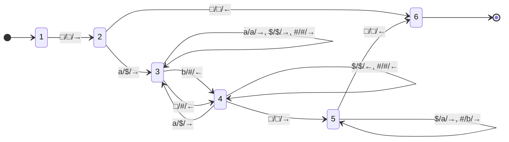

**Notes based off of:** Ch17a Turing Machines (lecture slides, Chapter 17)

## Where Turing Machines Fit

Each machine model we've seen pairs with a grammar formalism and a language class, and each class strictly contains the one before it:

|Language class|Grammar|Machine|
|---|---|---|
|Regular|Regular expressions|FSMs|
|Context-free|CFGs|PDAs|
|**D** (decidable)|—|TMs that always halt|
|**SD** (semidecidable)|Unrestricted grammars|Turing machines|

$$\text{Regular} \subsetneq \text{CF} \subsetneq D \subsetneq SD$$

The goal is a model that is:

- **Powerful** enough to describe _everything computable_ (unlike FSMs and PDAs).
- **Simple** enough to reason about formally (like FSMs and PDAs, unlike real computers).

> [!tip] Heuristic 
> An FSM has no memory beyond its state. A PDA adds a stack, but can only see the top. A TM replaces the stack with a tape it can **read, write, and move around on freely** in both directions. That one change (random-ish access to unbounded rewritable memory) is what jumps us all the way to general computation.

## The Machine

- A **tape**, unbounded in both directions, divided into squares. Only a **finite** portion is ever non-blank. The blank symbol is written $\square$.
- A **read/write head** sitting over one square.
- A **finite state controller** with states $s, q_1, q_2, \dots$ and halting states $h_1, h_2, \dots$

At every step the machine must do all three of:

1. Choose its next state,
2. Write a symbol on the current square (possibly the same one it read),
3. Move the head one square left or right (no "stay put" option).

### Formal Definition

A Turing machine $M$ is a sixtuple $(K, \Sigma, \Gamma, \delta, s, H)$:

| Symbol          | Meaning                                                           |
| --------------- | ----------------------------------------------------------------- |
| $K$             | Finite set of states                                              |
| $\Sigma$        | Input alphabet; $\square \notin \Sigma$                           |
| $\Gamma$        | Tape alphabet; $\square \in \Gamma$ and $\Sigma \subseteq \Gamma$ |
| $s \in K$       | Initial state                                                     |
| $H \subseteq K$ | Halting states                                                    |
| $\delta$        | Transition **function**                                           |

$$\delta : (K - H) \times \Gamma ;\longrightarrow; K \times \Gamma \times {\rightarrow, \leftarrow}$$

Read as: (non-halting state, char under head) $\mapsto$ (next state, char to write, direction).

In a state diagram, an edge $p \xrightarrow{a/b/\rightarrow} q$ means: "in state $p$ reading `a`, write `b`, move right, go to $q$."

> [!note] Why $\Gamma$ is bigger than $\Sigma$ 
> Extra tape symbols (like `$` and `#` below) act as **markers**, letting the machine "check off" characters it has already processed. This is the TM's main trick for keeping track of progress, since the controller itself only has finitely many states.

### Notes on the Definition

1. The tape is infinite in both directions.
2. $\delta$ is a _function_, not a relation, so this defines **deterministic** TMs. (Nondeterministic TMs turn out to be no more powerful, just potentially faster.)
3. $\delta$ must be defined for every (state, symbol) pair, except from halting states. Halting states have no outgoing transitions; that's what makes them halt.
4. TMs **need not halt**. The only way to stop is to enter a state in $H$; otherwise the machine runs forever.
5. TMs leave things on the tape, so they produce **output** and can compute functions, not just accept/reject.

## Worked Example: Padding $a^i b^j$ to $a^i b^i$

**Task:** Given input in ${a^i b^j : 0 \le j \le i}$, add `b`s until the counts match. Input: $\underline{\square}$`aaab` $\to$ Output: $\square$`aaa` `bb`$\underline{\text{b}}$ (head on last `b`).

$K = {1,\dots,6}$, $\Sigma = {a, b}$, $\Gamma = {a, b, \square, \$, \#}$, $s = 1$, $H = {6}$.

**Strategy (pair off `a`s with `b`s):**

- **State 3** – scan right past everything already seen. When it hits a `b`, mark it `#` (matched). If it hits a blank instead, there was no `b` left for this `a`, so it _writes_ a `#` there, which is how new `b`s get added.
- **State 4** – scan back left over markers. If it finds an unmarked `a`, mark it `$` and go back to state 3. If it reaches the leading blank, every `a` is matched.
- **State 5** – cleanup: sweep right turning `$`→`a` and `#`→`b`, then step back onto the last character and halt.
- **State 2 → 6** handles the empty input $\varepsilon$.

> [!example] Quick trace on `aaab` `aaab` → `$aab` → `$aa#` → `$a$#` → `$a$##` (blank became `#`) → `$$$##` → `$$$###` → cleanup → `aaabbb`

## Halting Behaviour Across Models

|Model|Guaranteed to halt?|
|---|---|
|DFSM|Yes, in exactly $\lvert w \rvert$ steps|
|PDA|No (e.g. $\varepsilon$-transitions pushing forever), **but** an equivalent always-halting PDA can always be constructed|
|TM|No, and **no algorithm** can convert an arbitrary TM into an equivalent always-halting one|

That last row is the seed of the **Halting Problem** and the whole theory of undecidability.

## Formalizing the Operation

### Configurations

A **configuration** is a snapshot of everything needed to resume the computation: state, tape contents, head position.
$$K \times \big((\Gamma - {\square})\Gamma^{*} \cup {\varepsilon}\big) \times \Gamma \times \big(\Gamma^{*}(\Gamma - {\square}) \cup {\varepsilon}\big)$$

| Component | Meaning                                                    |
| --------- | ---------------------------------------------------------- |
| $K$       | Current state                                              |
| 2nd       | Tape **left** of the head, starting at the first non-blank |
| $\Gamma$  | The **scanned** square                                     |
| 4th       | Tape **right** of the head, up to the last non-blank       |

The $(\Gamma - {\square})$ restrictions just strip the infinite blank padding at each end so every configuration has a unique finite representation. Blanks _between_ symbols are kept.

**Shorthand:** write the whole visible tape as one string and underline the scanned square.

|4-tuple|Shorthand|
|---|---|
|$(q, \texttt{ab}, \texttt{b}, \texttt{b})$|$(q, \texttt{ab}\underline{\texttt{b}}\texttt{b})$|
|$(q, \varepsilon, \square, \texttt{aabb})$|$(q, \underline{\square}\texttt{aabb})$|
|$(s, \texttt{a}\square\square, \texttt{b}, \square\texttt{cc})$|$(s, \texttt{a}\square\square\underline{\texttt{b}}\square\texttt{cc})$|

> [!important] Initial configuration 
> $(s, \underline{\square}w)$: head on the blank immediately **left** of the input.

### Yields, Paths, Computations

- $C_1 \vdash_M C_2$: $C_2$ follows from $C_1$ in **one** step of $\delta$.
- $\vdash_M^{*}$: reflexive, transitive closure (zero or more steps). $C_1$ **yields** $C_2$ iff $C_1 \vdash_M^{*} C_2$.
- A **path** is a sequence $C_0 \vdash_M C_1 \vdash_M \cdots \vdash_M C_n$ starting from the initial configuration.
- A **computation** is a path that **halts**.
- $C_0 \vdash_M^{n} C_n$ denotes a computation of length $n$.

## Macro Notation

Writing full $\delta$ tables gets painful fast, so we build big machines out of small ones, like subroutines.

### Basic Machines

|Machine|Behaviour|
|---|---|
|$x$ (for $x \in \Gamma$)|Write $x$, halt|
|$R$|Move right one square, halt|
|$L$|Move left one square, halt|
|$h$|Halt|
|$y$|Halt and accept|
|$n$|Halt and reject|

### Combining Machines

- $M_1 M_2$: run $M_1$ until it halts, then start $M_2$. If either never halts, neither does the combination.
- $M_1 \xrightarrow{\text{condition}} M_2$: same, but only take the transition if the condition on the **current square** holds.
- `>` marks the start machine. If a component halts with no applicable outgoing arrow, the whole machine halts.

### Shorthands

| Shorthand                                         | Meaning                                                       |
| ------------------------------------------------- | ------------------------------------------------------------- |
| $M_1 \xrightarrow{a, b} M_2$                      | Two arrows, one on `a` and one on `b`                         |
| $M_1 \longrightarrow M_2$ (unlabeled) or $M_1M_2$ | Transition on any symbol                                      |
| $M_1 \xrightarrow{x \leftarrow \neg a} M_2$       | On anything except `a`; store the symbol read in variable $x$ |
| $M_1 \xrightarrow{x \leftarrow a, b} M_2$         | On `a` or `b`, storing it in $x$                              |
| $M_1 \xrightarrow{x = y} M_2$                     | Only if the two stored values match                           |

E.g. $>\xrightarrow{x \leftarrow \neg\square} Rx$: if the current square is non-blank, move right and write a copy of it.

> [!note] Variables are syntactic sugar 
> A TM controller has no variables. $x \leftarrow a, b$ really means "duplicate the rest of the machine once per possible value of $x$." This works because $\Gamma$ is finite.

### Useful Search Machines

| Name                     | Finds…                                      |
| ------------------------ | ------------------------------------------- |
| $R_\square$              | First blank to the right                    |
| $L_\square$              | First blank to the left                     |
| $R_{\neg\square}$        | First non-blank to the right                |
| $L_{\neg\square}$        | First non-blank to the left                 |
| $L_a$                    | First `a` to the left                       |
| $R_{a,b}$                | First `a` or `b` to the right               |
| $L_{x \leftarrow a,b}$   | First `a` or `b` to the left, stored in $x$ |
| $L_{x \leftarrow a,b}Rx$ | …then move right one and write $x$          |

Each is just a loop: e.g. $R_\square$ is "$>R$ with a self-loop on $\neg\square$". Note that each moves **at least one** square before checking.

### Example: $w \mapsto w^3$ for $w \in {1}^{*}$

$\underline{\square}\texttt{111} \to \underline{\square}\texttt{111111111}$ (unary: triples the number)

$$ \begin{array}{l}> R_{1,\square} \xrightarrow{;1;} \#R_\square\#R\#L_\square ;;(\text{loop back to start}) \ \quad\big\downarrow \square \ ;; L \xrightarrow{;\#;} 1 ;;(\text{loop back to } L) \ \quad\big\downarrow \square \ ;; h \end{array} $$

- **Phase 1:** Find the next unprocessed `1`, mark it `#`, run to the end of the tape and append `##`, return to the left blank. Each original `1` becomes three `#`s.
- **Phase 2:** At the right end, sweep left turning every `#` back into `1`; stop at the leading blank.

### Shifting Machine $S_\leftarrow$

$\square u \underline{\square} w \square ;\to; \square u w \underline{\square}$ (close a gap by shifting $w$ left one square)

$$> R \xrightarrow{x \leftarrow \neg\square} \square L x R ;(\text{loop}), \qquad R \xrightarrow{\square} L$$

Repeatedly: step right, pick up a symbol $x$, blank it out, step left and drop $x$, step right again. Stops when it reads the blank after $w$.

## TMs as Language Recognizers

**Convention:** input is written as $\square w \square$ ($w$ has no blanks), initial configuration $(s, \underline{\square}w)$, and $H = {y, n}$.

- $M$ **accepts** $w$ iff $(s, \underline{\square}w) \vdash_M^{*} (y, w')$ for some $w'$.
- $M$ **rejects** $w$ iff $(s, \underline{\square}w) \vdash_M^{*} (n, w')$ for some $w'$.

What's left on the tape ($w'$) doesn't matter; only the halting state does.

### Deciding (the class D)

$M$ **decides** $L \subseteq \Sigma^{*}$ iff for **every** $w \in \Sigma^{*}$:

- $w \in L \Rightarrow M$ accepts $w$
- $w \notin L \Rightarrow M$ rejects $w$

So $M$ **always halts** with a correct answer. $L$ is **decidable** ($L \in D$) iff such an $M$ exists. Think: "an algorithm that always terminates with yes or no."

#### Example: $A^nB^nC^n = {a^nb^nc^n : n \ge 0}$

Not context-free, but easily decidable. Strategy: repeatedly cross off one `a`, one `b`, one `c` (rewriting them as `1`, `2`, `3`), in order.

1. From the left, skip `1`s and find an `a` → write `1`.
2. Skip `a`s and `2`s, find a `b` → write `2`.
3. Skip `b`s and `3`s, find a `c` → write `3`. Return to the left end ($L_\square$) and repeat.
4. When no `a` remains, verify the rest is only `2`s and `3`s, then accept.
5. Anything out of order (e.g. `c` before `b`, a missing letter) → reject.

`aabbcc` → accept. `aaccb` → reject (a `c` shows up while looking for a `b`).

#### Example: $WcW = {wcw : w \in {a,b}^{*}}$

Strategy: compare the two halves one character at a time.

1. Read the next character of the left half into $x$ and erase it (write $\square$, which also marks our place).
2. Run right to the `c` ($R_{c,\square}$), then to the first un-crossed character of the right half ($R_{y \leftarrow \neg\#}$).
3. If $y \ne x$, reject. If equal, cross it out with `#` and return ($L_\square$) to where we left off.
4. When the left half hits `c`, accept iff the right half has nothing left but `#`s.

### Semideciding (the class SD)

$M$ **semidecides** $L$ iff for every $w \in \Sigma_M^{*}$:

- $w \in L \Rightarrow M$ accepts $w$
- $w \notin L \Rightarrow M$ does **not** accept $w$ (it may reject _or run forever_)

$L$ is **semidecidable** ($L \in SD$) iff such an $M$ exists. Also called _recursively enumerable_.

> [!warning] The asymmetry 
> With a semidecider, if $M$ hasn't halted yet you **can't tell** whether it's about to accept or will loop forever. You only ever get a definite answer for "yes" instances.

#### Example: $L = b^{*}a(a \cup b)^{*}$ ("contains an `a`")

|Semidecider|Decider|
|---|---|
|$>R$, loop on $\square, b$; on `a` → $y$|$>R$, loop on $b$; on `a` → $y$; on $\square$ → $n$|
|On input `bbb`, runs right forever|Rejects at the trailing blank|

The same language can have both. The difference is purely whether the machine bothers to stop on "no" instances. Some languages (like the Halting language) have **only** a semidecider, which is why $D \subsetneq SD$.

> [!tip] Useful fact (comes later) 
> $L \in D \iff L \in SD$ **and** $\overline{L} \in SD$. Intuition: run the two semideciders in parallel (alternating steps); one of them must eventually accept.

## TMs Computing Functions

Let $H = {h}$. Define $M(w) = z$ iff $(s, \underline{\square}w) \vdash_M^{*} (h, \underline{\square}z)$, i.e. the machine halts with output $z$ on the tape and the head just left of it.

$M$ **computes** $f : \Sigma^{*} \to \Sigma'^{*}$ iff $M(w) = f(w)$ for all $w$. Then $f$ is **computable** (or **recursive**). Note $M$ must halt on every input.

#### Example: $f(w) = ww$

1. **Copy machine $C$:** $\underline{\square}w \to \square w \underline{\square} w \square$. Loop: grab next char $x$, blank it out as a placeholder, run right past both blocks ($R_\square R_\square$), write $x$, run back ($L_\square L_\square$), restore $x$.
2. **$S_\leftarrow$** closes the gap: $\square w \underline{\square} w \to \square ww\underline{\square}$.
3. **$L_\square$** returns the head to the start.

$$f = ; >C, S_\leftarrow, L_\square$$

This is the modular style in action: build once, reuse everywhere.

### Numeric Functions

Numbers are encoded as strings in some base $k$; $\text{value}_k(n)$ decodes them.

- $\text{value}_2(\texttt{101}) = 5$
- $\text{value}_8(\texttt{101}) = 64 + 1 = 65$

$M$ computes $f : \mathbb{N}^m \to \mathbb{N}$ iff for some $k$: $$\text{value}_k\big(M(n_1;n_2;\dots;n_m)\big) = f\big(\text{value}_k(n_1), \dots, \text{value}_k(n_m)\big)$$

(Arguments are separated by `;` on the tape.)

#### Example: $\text{succ}(n) = n+1$ in binary

$n \in 0 \cup 1{0,1}^{*}$. Example: $\underline{\square}\texttt{1111} \to \underline{\square}\texttt{10000}$.

$$> R_\square, L \xrightarrow{;1;} 0 ;(\text{back to } L), \qquad L \xrightarrow{;\square,, 0;} 1,L_\square$$

Exactly grade-school binary increment: go to the rightmost digit; while it's `1`, write `0` and carry left; on the first `0` (or the blank past the left end, if all digits were `1`), write `1` and return.

## Not All Functions Are Computable: Busy Beavers

Let $T$ = all TMs with $\Gamma = {\square, 1}$ that halt when started on a blank tape. For $n$ non-halting states:

- $S(n)$: max **steps** any such machine runs before halting.
- $\Sigma(n)$: max number of **`1`s** any such machine leaves on the tape.

|$n$|$S(n)$|$\Sigma(n)$|
|---|---|---|
|1|1|1|
|2|6|4|
|3|21|6|
|4|107|13|
|5|47,176,870|4098|
|6|$\ge 3 \cdot 10^{1730}$ (slides)|$\ge 1.29 \cdot 10^{865}$ (slides)|

> [!note] Update since the slides 
> The slides list $S(5)$ only as a lower bound. In 2024 the collaborative bbchallenge project formally proved $S(5) = 47{,}176{,}870$ exactly. Lower bounds for $n = 6$ have since grown astronomically beyond the slide values.

**Why they're uncomputable (intuition):** If you could compute $S(n)$, you could solve the halting problem for blank-tape $n$-state machines: just run the machine for $S(n)+1$ steps; if it hasn't halted, it never will. Since halting is undecidable, $S$ can't be computable. In fact $S$ and $\Sigma$ eventually outgrow **every** computable function.

## Why Bother With Such a Clumsy Model?

| Pro                                               | Con                                               |
| ------------------------------------------------- | ------------------------------------------------- |
| TMs are more powerful than every formalism so far | TMs are far harder to program than real computers |

The payoff is that **simplicity makes proofs possible**. If we show once that anything a real computer can do can be simulated (slowly, clumsily) by a TM, then every result we prove about TMs, especially _impossibility_ results, applies to real computers too.

> [!important] Church–Turing Thesis 
> Anything that can be computed by any effective, mechanical procedure can be computed by a Turing machine. This isn't a theorem (it's a claim about "effective procedure," an informal notion), but every alternative model ever proposed (lambda calculus, register machines, modern languages) has turned out to be equivalent. That's why "not computable by a TM" is taken to mean "not computable, period."