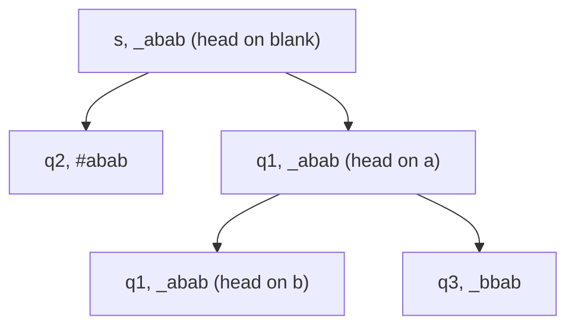
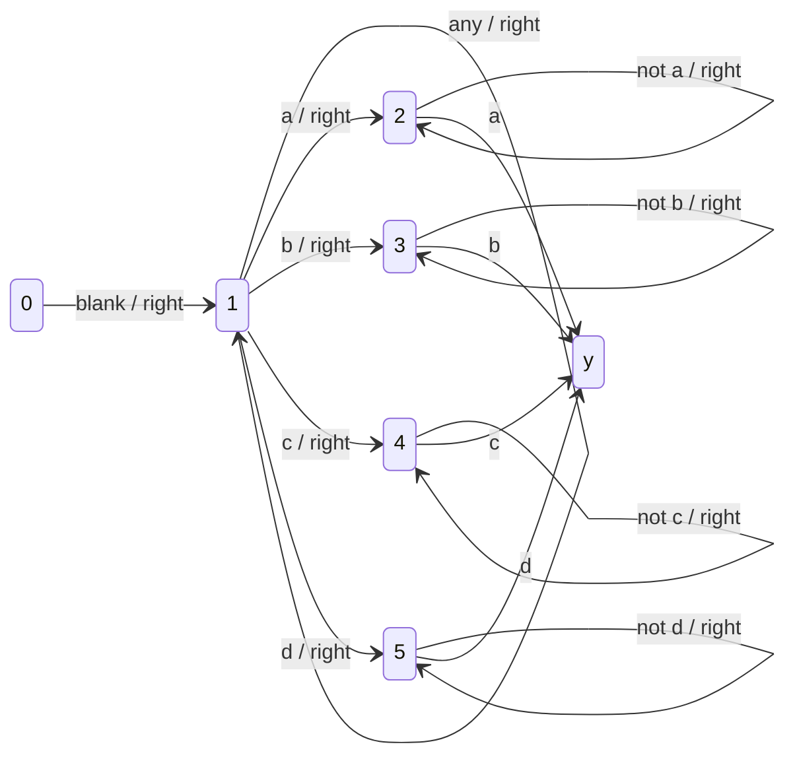
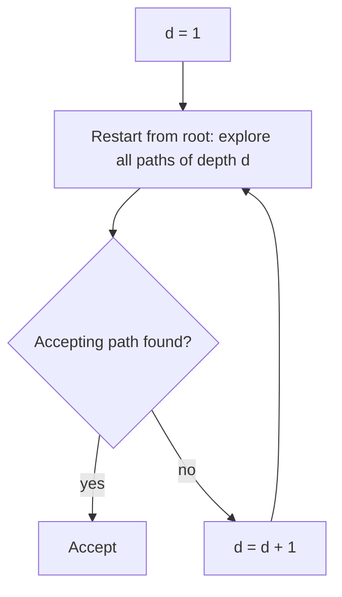

 **Notes based off of:** Ch17b Turing Machine Extensions (Sections 17.3 – 17.5)

## Overview

There are many "upgrades" we might want to give the basic Turing machine: more tapes, nondeterminism, random-access memory, and so on. The central result of this section is that **none of them add computational power**. Every extended machine can be simulated by a standard, single-tape, deterministic TM.

> [!important] The general proof pattern 
> Every result here is a **proof by construction**: given an extended machine $M$, build a standard machine $M'$ that simulates it step by step. The extensions may change _efficiency_ (often only polynomially, sometimes exponentially), but never _what_ can be computed.

This robustness is a big part of why we trust the TM as the definition of "computable". If small changes to the model changed its power, it would be a poor foundation (compare: adding nondeterminism to PDAs _does_ change their power).

## Multiple Tape Turing Machines

### Definition

A $k$-tape TM has $k$ tapes, each with its own independent read/write head. On each step it reads all $k$ symbols at once, then writes to and moves each head independently.

$$ \delta : (K - H) \times \Gamma_1 \times \dots \times \Gamma_k \to K \times (\Gamma_1' \times {\leftarrow, \rightarrow, \uparrow}) \times \dots \times (\Gamma_k' \times {\leftarrow, \rightarrow, \uparrow}) $$

- **Input:** written on tape 1 as usual; all other tapes start blank.
- **Output:** read from tape 1; the other tapes are ignored.
- $\uparrow$ means **stay put**. This is needed since one head will often have to wait while another moves.

### Why Multiple Tapes Are Convenient

Extra tapes act like scratch memory or extra variables, which removes most of the tedious back-and-forth "zig-zagging" a single-tape machine needs.

**Example: copying a string** ($w \to ww$)

1. Move both heads right together, copying tape 1 onto tape 2.
2. Move the tape 2 head back to the start of its copy.
3. Move both heads right together, appending tape 2's contents to the end of tape 1.

This takes $O(|w|)$ steps. A single-tape machine must shuttle back and forth once per character, giving $O(|w|^2)$.

**Example: binary addition** (input `101;110`)

1. Copy the first number onto tape 2, erasing it from tape 1.
2. Position both heads at the rightmost (least significant) digits.
3. Move both heads left together, adding digit by digit and keeping the carry in the finite state.

Result: $101 + 110 = 1011$ (i.e. $5 + 6 = 11$).

### Theorem: Adding Tapes Adds No Power

> [!theorem] Let $M$ be a $k$-tape TM for some $k \geq 1$. Then there is a standard TM $M'$ with $\Sigma \subseteq \Sigma'$ such that:
> 
> - On input $x$, $M$ halts with output $z$ on tape 1 **iff** $M'$ halts in the same state with $z$ on its tape.
> - If $M$ halts in $n$ steps, $M'$ halts in $O(n^2)$ steps.

#### The Representation: Multiple Tracks

The trick is to divide each square of $M'$'s single tape into $2k$ **tracks**: for each of $M$'s tapes, one track holds that tape's symbol, and one track holds a bit marking whether that tape's head is there.

|Track| | | | | | |
|---|---|---|---|---|---|---|
|Tape 1 contents|$\square$|a|b|a|a|$\square$|
|Head 1 marker|1|0|0|0|0|0|
|Tape 2 contents|$\square$|$\square$|$\square$|$\square$|$\square$|$\square$|
|Head 2 marker|1|0|0|0|0|0|

Each multitrack square is just a **single symbol** from a bigger alphabet, a $2k$-tuple:

$$ \Sigma' = \Gamma \cup (\Gamma \times {0, 1})^{k} $$

e.g. $\square$, a, b, $(\square, 1, \square, 1)$, $(\text{a}, 0, \square, 0)$, ...

> [!note] Heuristic 
> "Multiple tracks" is not a new feature; it is just an encoding trick. Any finite amount of structure in one square can be packed into one (larger) alphabet symbol. The alphabet stays finite because $k$ and $\Gamma$ are finite.

#### The Operation of $M'$

1. **Set up** the multitrack tape (convert the input into tuple symbols, place head markers).
2. **Simulate** each step of $M$ until $M$ would halt:
    1. Sweep across the tape, recording in the finite state the $k$-tuple of symbols under the $k$ head markers. Return.
    2. Sweep again, applying $M$'s transition to each track: write the new symbols and shift each head marker. If a head moves onto an unformatted square, subdivide it into tracks. Return.
3. **Clean up:** when $M$ would halt, erase all tracks except track 1, position the head correctly, and enter the matching halt state.

Note that remembering the $k$ symbols is fine since there are finitely many possible $k$-tuples, so $M'$ just needs enough states to "remember" each.

#### Running Time

Let $w$ be the input and $n$ the number of steps $M$ takes.

- **Initialization:** $O(|w|)$
- **Simulation:** $n$ passes. In $n$ steps, a head can travel at most $n$ squares, so the used tape has length at most $|w| + n$. Each pass sweeps it a constant number of times: $O(|w| + n)$ per pass, total $O(n(|w| + n))$.
- **Clean up:** $O(|w| + n)$.

$$ \text{Total} = O(n \cdot (|w| + n)) = O(n^2) \quad \text{assuming } n \geq |w| $$

The assumption $n \geq |w|$ is reasonable because a machine that reads its whole input needs at least $|w|$ steps.

> [!tip] Why this matters 
> A **quadratic** slowdown is polynomial. This means multitape vs. single-tape doesn't affect complexity classes like $\mathsf{P}$. Polynomial-time is "the same" on either model, which is why textbooks freely use multitape machines in complexity proofs.

## Nondeterministic Turing Machines

### Impact of Nondeterminism Across Models

|Model|Does nondeterminism add power?|
|---|---|
|FSMs|No (subset construction)|
|PDAs|**Yes** (e.g. ${ww^R}$ needs nondeterminism)|
|Turing machines|No|

PDAs are the odd one out: the TM's ability to freely reread and rewrite its memory is what lets it simulate all possible guesses.

### Definition

A nondeterministic TM is a sixtuple $(K, \Sigma, \Gamma, \Delta, s, H)$ where the transition **relation** $\Delta$ is a _subset_ of

$$ ((K - H) \times \Gamma) \times (K \times \Gamma \times {\leftarrow, \rightarrow}) $$

So from a given (state, symbol) pair there may be zero, one, or several possible moves. A computation is now a **tree** of configurations rather than a single sequence: each branch is one possible computation path.

### What It Means to Decide, Semidecide, and Compute

#### Deciding

Let $M = (K, \Sigma, \Gamma, \Delta, s, {y, n})$.

- $M$ **accepts** $w$ iff **at least one** computation accepts.
- $M$ **rejects** $w$ iff **all** computations reject.
- $M$ **decides** $L \subseteq \Sigma^{*}$ iff for every $w$:
    - there are finitely many paths $M$ can follow on $w$,
    - all of those paths halt, and
    - $w \in L$ iff $M$ accepts $w$.

> [!note] Asymmetry 
> Acceptance is existential ("some path says yes"), rejection is universal ("every path says no"). Nondeterminism is best thought of as a **lucky guesser**: if there is a right guess, the machine is assumed to make it.

**Example: composite numbers.** $L = {w \in {0,1}^{*} : w \text{ is the binary encoding of a composite number}}$.

1. Nondeterministically guess two binary numbers $p, q$ with $p, q \geq 2$ and $|p|, |q| \leq |w|$. Write them after $w$: `110011;111;1111`
2. Multiply them, replacing $p$ and $q$ with the product $A$.
3. If $A = w$, accept; otherwise reject.

Here $w = 110011 = 51$. The branch shown guesses $7 \times 15$, which does not equal 51 and rejects. But the branch guessing $p = 11$ (3) and $q = 10001$ (17) accepts, so $M$ accepts. The length bound makes the number of branches finite, so this is a decider.

This is the "guess and check" pattern: guessing is free, and checking (multiplying) is easy. It is exactly the intuition behind the class $\mathsf{NP}$.

#### Semideciding

$M$ **semidecides** $L$ iff for all $w \in \Sigma^{*}$:

$$ w \in L \iff (s, \underline{\square}w) \text{ yields at least one accepting configuration} $$

There is no requirement that paths halt. Branches may loop forever, and on strings not in $L$ the machine may never halt at all.

**Example:** $L = {w \in {a, b, c, d}^{*} : \text{some letter appears at least twice}}$.

The machine guesses which letter occurrence is the first of a repeated pair, then scans for a second copy. A wrong guess scans off into the blanks forever (since $\square$ matches "not a"), so this only semidecides.

"We can do better": $L$ is in fact regular, so a deterministic decider exists. (Pigeonhole also helps: any string of length $\geq 5$ over 4 letters must repeat a letter.)

**A harder example:** $L = {\langle M \rangle : M \text{ halts on at least one string}}$.

$S$ semidecides $L$ on input $\langle M \rangle$:

1. Nondeterministically choose a string $w \in \Sigma_M^{*}$ and write it on the tape.
2. Run $M$ on $w$.

If $M$ halts on _some_ string, the branch that guesses that string halts. Unlike the previous example, it will be proven later that semideciding is the **best possible** here: $L$ is semidecidable but not decidable.

#### Computing a Function

$M$ **computes** $f$ iff for all $w \in \Sigma^{*}$:

- all of $M$'s computations halt, and
- all of them produce $f(w)$.

Every path must agree, because otherwise "the output" would be ambiguous.

### Theorem: Nondeterminism Adds No Power

> [!theorem] If a nondeterministic TM $M$ 
> decides or semidecides a language, or computes a function, then there is a standard deterministic TM $M'$ that decides or semidecides the same language, or computes the same function.

Separate constructions are needed for languages and for functions.

> [!note] The function case is easy 
> Since _every_ path halts with the same output $f(w)$, $M'$ can just follow **any single path**, for example always taking the first listed transition. The hard work is entirely in the deciding/semideciding case.

### Simulating Nondeterminism Deterministically

$M'$ must explore the computation tree of $M$ and accept if it finds an accepting path. The question is _how_ to explore it.

#### Attempt 1: Track a Set of States (as with FSMs)

For NFAs we simulated being in a set of states at once. This **doesn't work** for TMs, because a TM's situation is not just its state but its whole **configuration** (state + tape contents + head position). Different branches have different tapes, and there are infinitely many possible configurations, so they can't be packed into a finite set of states.

#### Attempt 2: Try Each Path in Turn (Depth-First)

"Try path 1; if it accepts, accept. Else try path 2..." This **fails** because path 1 might run forever. $M'$ would never get to path 2, even if path 2 accepts after three steps.

#### Solution: Iterative Deepening

Explore the tree level by level, so that no single infinite branch can trap the search:

1. $d = 1$ (initial depth limit)
2. Loop until a solution is found:
    1. Start at the root; explore all paths of length $d$, depth-first.
    2. If an accepting configuration is found, accept.
    3. $d = d + 1$.

It is called **restart** iterative deepening because $M'$ starts over at the root each round instead of storing the frontier. This wastes some repeated work, but storing configurations of every frontier node would be much messier on a tape.

> [!tip] Why restarting isn't wasteful asymptotically 
> In a tree with branching factor $b \geq 2$, the deepest level contains more nodes than all shallower levels combined. So redoing shallower levels at most roughly doubles the work.

#### Implementation: $M'$ Uses Three Tapes

| Tape | Contents                                                                |
| ---- | ----------------------------------------------------------------------- |
| 0    | The original input. Never modified, so each restart can recopy it.      |
| 1    | Working copy of the input, modified as $M$ runs along the current path. |
| 2    | The sequence of choices that determines the current path.               |

The key gap-filler: let $b$ be the **maximum number of choices** $\Delta$ allows from any (state, symbol) pair. This is finite since $\Delta$ is finite. Then any path of length $d$ can be named by a string over ${1, \dots, b}$ of length $d$, such as `2 1 3` meaning "take choice 2, then choice 1, then choice 3". Tape 2 enumerates these strings in order of length (and lexicographically within each length), which is exactly iterative deepening. If a choice number is invalid for the current configuration, that path is simply skipped.

For each choice string: copy tape 0 to tape 1, run $M$ on tape 1 following the choices on tape 2, then advance tape 2 to the next string.

Since this is a 3-tape machine, the previous theorem converts it to a standard single-tape TM.

#### If $M$ Is a Deciding Machine

$M'$ halts as soon as either:

- it finds a path on which $M$ accepts: **$M'$ accepts**, or
- it has explored every path to its halting point and all rejected: **$M'$ rejects**.

The second condition is reachable because a decider has finitely many paths, all of which halt, so there is some depth $d$ by which every branch has ended. $M'$ just has to notice that no path survived past depth $d$. For a mere semidecider, $M'$ only needs the first condition; it may run forever on strings not in $L$, which is allowed.

> [!warning] The cost: exponential slowdown 
> If $M$ accepts in $n$ steps, the search may examine up to about $b^n$ paths, so $M'$ takes roughly $O(b^n)$ time. Unlike the multitape case, this is **not** polynomial. Whether this exponential blowup is ever truly necessary is the $\mathsf{P}$ vs. $\mathsf{NP}$ question.

## Simulating a Real Computer

### The Model

A simplified random-access, stored-program computer has:

- an unbounded number of memory cells, addressed by integers starting at 0
- an instruction set: load, store, add, subtract, jump, conditional jump, halt, etc.
- a program counter, an address register, an accumulator, a few special-purpose registers
- an input file and an output file

Example program:

|Instruction|Meaning|
|---|---|
|`R 10`|read 2 bits from input into accumulator|
|`MIR 10`|move input pointer 2 bits right|
|`CJUMP 1001`|if acc = 0, jump to address 1001|
|`A 10111`|add value at 10111 to accumulator|
|`ST 10111`|store result at 10111|

### Theorem

> [!theorem] A random-access, stored-program computer can be simulated by a Turing machine.

This is the strongest practical evidence for the **Church–Turing thesis**: real computers are no more powerful than TMs, only faster. (Real computers actually have _finite_ memory, so in a strict sense they are just enormous FSMs; the unbounded-memory idealization is what makes them TM-equivalent.)

### The Construction: _simcomputer_ (7 tapes)

| Tape | Role                           |
| ---- | ------------------------------ |
| 1    | Memory                         |
| 2    | Program counter                |
| 3    | Address register               |
| 4    | Accumulator                    |
| 5    | Op code of current instruction |
| 6    | Input file                     |
| 7    | Output file (initially blank)  |

#### Representing Memory

Memory is a sequence of delimited (address, value) pairs:

$$ \#0,val_0\#1,val_1\#10,val_2\#11,val_3\#100,val_4\# \dots \# $$

Instructions are a 4-bit op code followed by an address, e.g. `#0,000110010#1,11111001#10,001110011#...`

Delimiters are required because **words have no bounded length**: addresses grow as more memory is used, and values grow as numbers are added. A real computer uses fixed-width words; the TM must not assume any fixed width.

#### The Fetch–Decode–Execute Loop

1. Move the input string to tape 6.
2. Set the program counter (tape 2) to 0.
3. Loop:
    - **Fetch:** scan tape 1 from the left for the address matching tape 2.
    - **Decode:** copy the op code to tape 5, the address to tape 3, and increment tape 2.
    - **Fetch operand:** scan tape 1 from the left for the address on tape 3.
    - **Execute:**
        - Load: copy operand to tape 4.
        - Add: add operand to tape 4.
        - Jump: copy tape 3 to tape 2.
        - and so on for other operations.

"Random access" is simulated by **linear scanning**, which is slow but still polynomial in the computer's running time. So the computer gains speed but no new problems it can solve.

## Alternative TM Definition: One-Way Tape

### Definition

Some textbooks use a tape that is infinite in **only one direction**. A special left-end marker $\diamond$ acts as a wall:

- if the symbol read is $\diamond$, the move must be $\rightarrow$
- $\diamond$ can never be written

|$\diamond$|$\square$|a|b|b|a|$\square$|$\square$|...|
|---|---|---|---|---|---|---|---|---|

### Does This Difference Matter?

The goal of a TM model is to be powerful enough to describe all computable things while simple enough to reason about formally. Both definitions meet that bar, and details may make particular proofs easier or harder. They **do not differ in power**.

- **One-way simulating two-way:** "fold" the two-way tape at the head's starting position. The right half (a b c d) goes on one tape/track, the left half (e f g, reversed) on another. The simulating machine remembers in its finite state which half the head is currently in; on the folded half, left and right moves are swapped. An extra tape can be used as scratch space. Multiple tapes collapse to one as before.
- **Two-way simulating one-way:** trivial. Just put $\diamond$ on the tape and never move left past it.

## Stacks vs. a Tape

Two natural questions:

1. Did we lose anything by giving up the PDA's stack in favor of a tape?
2. Could we have gotten the TM's power just with stacks?

### A TM Can Simulate a PDA

A PDA consists of a finite state controller, an input stream, and a stack. A two-tape TM handles this directly:

- **Tape 1** holds the input; its head only ever moves right.
- **Tape 2** holds the stack, with a `#` marking the bottom and the head at the top. Push = move right and write; pop = erase and move left.

Nondeterministic PDAs are handled using the nondeterminism simulation above. So nothing was lost.

### Two Stacks Can Simulate a TM

Split the tape at the head:

- **Stack 1** holds everything to the **left** of the head (nearest square on top).
- **Stack 2** holds the square **under** the head and everything to the **right** (head symbol on top).

Moving the head:

- **Right:** pop from stack 2, push onto stack 1.
- **Left:** pop from stack 1, push onto stack 2.
- If a stack hits its bottom `#`, treat it as reading a blank (push a $\square$ as needed).

> [!summary] The memory hierarchy
> 
> - 0 stacks (FSM): regular languages
> - 1 stack (PDA): context-free languages
> - **2 stacks: full Turing power** (and adding more stacks adds nothing)
> 
> The jump from 1 to 2 stacks is the crucial step. One stack can only access its most recent data, while two stacks together act like a tape you can traverse in both directions.

## Summary

| Extension              | Same power? | Simulation cost               |
| ---------------------- | ----------- | ----------------------------- |
| $k$ tapes              | Yes         | $O(n^2)$                      |
| Nondeterminism         | Yes         | Exponential, roughly $O(b^n)$ |
| Random-access computer | Yes         | Polynomial                    |
| One-way tape           | Yes         | Linear-ish (constant factor)  |
| 2-stack PDA            | Yes         | Polynomial                    |
