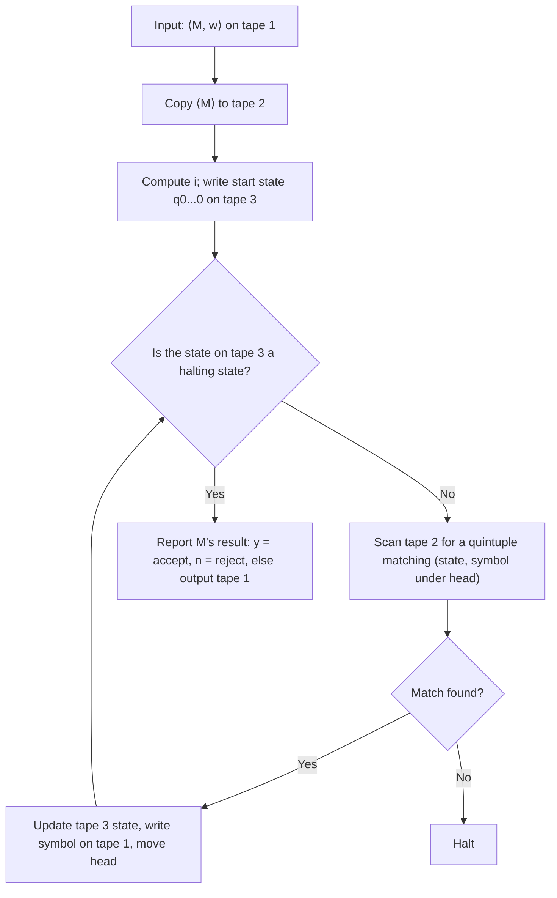

**Notes based off of:** Ch 17c - Universal Turing Machine (Sections 17.6 – 17.7)

## Motivation

Every Turing machine we have built so far is _hard-wired_: one machine, one task. A **Universal Turing Machine** $U$ is a single, fixed TM that is _programmable_. It takes a description of another machine $M$ plus an input $w$, and simulates $M$ running on $w$.

$$U(\langle M, w \rangle) = M(w)$$

> [!info] Why this matters 
> This is the theoretical basis of the **stored-program computer**: the program is just data sitting on the tape, the same way software is just bytes in memory. An interpreter (Python running a `.py` file) or an emulator is a real-world universal machine. It is also what makes self-reference possible later on, since a machine can now be handed a description of itself. That is the core trick behind the undecidability of the halting problem.

To define $U$ formally we need two things:

1. An **encoding** that turns any TM $M$ into a string $\langle M \rangle$.
2. A description of how $U$ operates on the input $\langle M, w \rangle$.

## Encoding a Turing Machine

A TM is the tuple $M = (K, \Sigma, \Gamma, \delta, s, H)$. The problem is that $M$ can have any number of states and tape symbols, but $U$ has one fixed, finite alphabet. The fix is to write every state and every symbol as a **binary index** with a short prefix letter. This gives an arbitrarily large "name space" over a small alphabet.

### Encoding the States

- Let $i = \lceil \log_2 |K| \rceil$, the number of bits needed to number every state.
- Number the states $0$ to $|K|-1$ in $i$-bit binary:
    - The start state $s$ always gets $0$.
    - The rest can be numbered in any order.
- If $t'$ is the binary number given to state $t$:
    - If $t$ is the accepting halting state $y$, encode it as $\texttt{y}t'$.
    - If $t$ is the rejecting halting state $n$, encode it as $\texttt{n}t'$.
    - Otherwise, encode it as $\texttt{q}t'$.

The prefix letter lets $U$ tell at a glance whether a state halts and how, without any lookup table.

> [!example] 9 states 
> $i = \lceil \log_2 9 \rceil = 4$. With $s = 0$, $y = 3$, $n = 4$:
> 
> $s = \texttt{q0000}$, then $\texttt{q0001}, \texttt{q0010}, \texttt{y0011}, \texttt{n0100}, \texttt{q0101}, \texttt{q0110}, \texttt{q0111}, \texttt{q1000}$

### Encoding the Tape Alphabet

Each symbol of $\Gamma$ is encoded as $\texttt{a}x$, where $x \in {0,1}^{+}$ and $|x| = j$, with

$$j = \lceil \log_2 |\Gamma| \rceil$$

(the smallest $j$ with $2^j \geq |\Gamma|$).

> [!example] $\Gamma = {\square, a, b, c}$, so $j = 2$
> 
> |Symbol|Encoding|
> |---|---|
> |$\square$ (blank)|$\texttt{a00}$|
> |$a$|$\texttt{a01}$|
> |$b$|$\texttt{a10}$|
> |$c$|$\texttt{a11}$|

Note that the letter $\texttt{a}$ here is just a prefix meaning "this is a symbol". It has nothing to do with the symbol $a$ in $M$'s alphabet.

### Encoding the Transitions

Each transition is a 5-tuple (a quintuple):

$$(\text{state}, \text{input}, \text{new state}, \text{output}, \text{move})$$

where move is $\rightarrow$ or $\leftarrow$. For example, $(\texttt{q000}, \texttt{a000}, \texttt{q110}, \texttt{a000}, \rightarrow)$ means: 
in state 0 reading symbol 0, go to state 6, write symbol 0, move right.

>[!note] Eric's added context:
>Here's how I think of it with "pythony" syntax:
>```python
>(new_state, write_symbol, direction) = transition(state, tape[head]) 
>tape[head] = write_symbol 
>head += 1 if direction == "R" else -1 state = new_state
>```

$\langle M \rangle$ is just the list of all transitions separated by commas. The alphabet and state set never need to be listed separately, because the widths $i$ and $j$ can be read off the encoded tuples themselves.

### Full Example

$M = (\{s, q, h\}, \{a, b, c\}, \{\square, a, b, c\}, \delta, s, \{h\})$, and recall: $M = (K, \Sigma, \Gamma, \delta, s, H)$

|State|Symbol|$\delta$|
|---|---|---|
|$s$|$\square$|$(q, \square, \rightarrow)$|
|$s$|$a$|$(s, b, \rightarrow)$|
|$s$|$b$|$(q, a, \leftarrow)$|
|$s$|$c$|$(q, b, \leftarrow)$|
|$q$|$\square$|$(s, a, \rightarrow)$|
|$q$|$a$|$(q, b, \rightarrow)$|
|$q$|$b$|$(q, b, \leftarrow)$|
|$q$|$c$|$(h, a, \leftarrow)$|

Encodings: $s = \texttt{q00}$, $q = \texttt{q01}$, $h = \texttt{h10}$, and the symbols as in the table above.

$$ \langle M \rangle = ; (\texttt{q00},\texttt{a00},\texttt{q01},\texttt{a00},\rightarrow), (\texttt{q00},\texttt{a01},\texttt{q00},\texttt{a10},\rightarrow), \\(\texttt{q00},\texttt{a10},\texttt{q01},\texttt{a01},\leftarrow), (\texttt{q00},\texttt{a11},\texttt{q01},\texttt{a10},\leftarrow),  \\(\texttt{q01},\texttt{a00},\texttt{q00},\texttt{a01},\rightarrow), (\texttt{q01},\texttt{a01},\texttt{q01},\texttt{a10},\rightarrow), \\(\texttt{q01},\texttt{a10},\texttt{q01},\texttt{a11},\leftarrow), (\texttt{q01},\texttt{a11},\texttt{h10},\texttt{a01},\leftarrow)$$

> [!warning] Slide inconsistencies
> 
> - The slide's final tuple writes $\texttt{h11}$, but its own table assigns $h = \texttt{h10}$. $\texttt{h10}$ is the consistent choice.
> - $h$ is a plain halting state (this machine computes rather than accepts/rejects), so it uses an $\texttt{h}$ prefix instead of $\texttt{y}$ or $\texttt{n}$.

## Enumerating Turing Machines

> [!abstract] Theorem There exists an infinite lexicographic enumeration of:
> 
> 1. All syntactically valid TMs.
> 2. All syntactically valid TMs with a specific input alphabet $\Sigma$.
> 3. All syntactically valid TMs with a specific input alphabet $\Sigma$ and tape alphabet $\Gamma$.

**Proof idea.** Every $\langle M \rangle$ is a string over the fixed alphabet

$$\Sigma_{enc} = { (, ), \texttt{a}, \texttt{q}, \texttt{y}, \texttt{n}, 0, 1, \text{comma}, \rightarrow, \leftarrow }$$

1. Lexicographically enumerate $\Sigma_{enc}^{*}$ (shortest strings first, then alphabetical within each length).
2. For each string, check whether it is a syntactically valid TM description. If so, output it.

For versions 2 and 3, also check in step 2 that the encoded alphabets have the right sizes.

The syntax check always terminates (it is just parsing), so this procedure really does produce the list. We can therefore talk about **the $i$-th Turing machine** $M_i$.

> [!tip] Why you care 
> Enumerability means there are only **countably many** TMs. But there are uncountably many languages over any alphabet (the power set of $\Sigma^{*}$). So most languages cannot be decided, or even semidecided, by any TM. This counting argument is the first proof that undecidable languages must exist, before we ever name a specific one.

## Operations on Programs

Since TMs are now strings, a TM can take another TM as input and produce a TM as output. In other words, we can write programs that transform programs (much like a compiler does).

> [!example] A transforming TM $T$
> 
> - **Input:** $\langle M_1 \rangle$, a TM that reads its input and performs some operation $P$ on it.
> - **Output:** $\langle M_2 \rangle$, a TM that performs $P$ on an **empty** input tape.
> 
> $T$ just edits the description, for example by adding states at the start that erase the tape before handing control to $M_1$. $T$ itself never runs $M_1$, so $T$ always halts even if $M_1$ would loop.

This idea drives **reductions** in later chapters: to show a problem is undecidable, we build a machine that rewrites $\langle M \rangle$ into some $\langle M' \rangle$ whose behaviour on a new question matches $M$'s behaviour on a known-undecidable one.

### Encoding Multiple Inputs

$\langle x_1, x_2, \ldots, x_n \rangle$ is a single string that encodes the sequence of values $x_1, x_2, \ldots, x_n$. The exact scheme doesn't matter, as long as the pieces can be split apart again without ambiguity (e.g. with a separator symbol not used inside any $x_k$). This is how $U$ receives $\langle M, w \rangle$ on one tape.

## The Universal Turing Machine

### Specification

On input $\langle M, w \rangle$, $U$ must:

- Halt **iff** $M$ halts on $w$.
- If $M$ is a deciding or semideciding machine:
    - If $M$ accepts, accept.
    - If $M$ rejects, reject.
- If $M$ computes a function, then $U(\langle M, w \rangle) = M(w)$.

Note the first point: if $M$ loops on $w$, $U$ **must** loop too. $U$ is a faithful simulator, not an oracle. It cannot "see ahead" and report that $M$ will run forever.

### Tape Layout

$U$ uses 3 tapes:

|Tape|Contents|Analogy|
|---|---|---|
|1|$M$'s tape (holds the encoded $w$, then $M$'s working tape)|Data / RAM|
|2|$\langle M \rangle$, the program being run|Program memory|
|3|$M$'s current state|Program counter|

Using 3 tapes costs nothing in generality: any multi-tape TM can be simulated by a single-tape TM (with at most a polynomial slowdown), so a single-tape $U$ exists too.

### Operation

**Initialization:**

1. Copy $\langle M \rangle$ onto tape 2 (leaving the encoded $w$ on tape 1).
2. Read $\langle M \rangle$ to work out $i$ (the state-number width), and write the encoding of $s$ (i.e. $\texttt{q}0^i$) on tape 3.

**Simulation:**

1. Until $M$ would halt:
    1. Scan tape 2 for a quintuple matching the current (state on tape 3, symbol under tape 1's head) pair.
    2. Perform its action: write the new state to tape 3, write the output symbol on tape 1, and move tape 1's head. Extend the tape if needed.
    3. If no matching quintuple is found, halt. Otherwise loop.
2. Report the same result $M$ would report (accept if the state prefix is $\texttt{y}$, reject if $\texttt{n}$, otherwise leave tape 1 as the output).



> [!note] Symbols are multi-character on tape 1 
> Each of $M$'s symbols takes $j+1$ cells on $U$'s tape 1 (e.g. $\texttt{a01}$). So one "move right" for $M$ is really $j+1$ cell moves for $U$. This is a constant-factor slowdown and does not affect what $U$ can compute.
