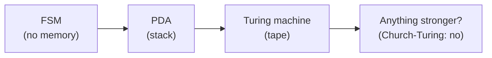
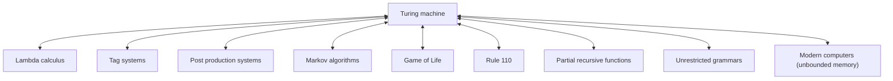
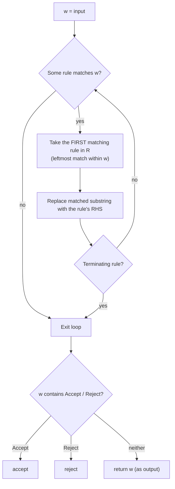

**Notes based off of:** Chapter 18, _The Church-Turing Thesis_ (lecture slides, "Are We Done?")

## Motivation: Is the Turing Machine the End of the Line?

The hierarchy so far is FSM $\subset$ PDA $\subset$ Turing machine, each step adding memory (nothing, a stack, an unbounded tape). The natural question is whether some further machine would be more powerful still. The slides give a counting argument for why there must be problems no Turing machine can solve:

- Every Turing machine has a finite description (a string over some alphabet). Listing all strings in lexicographic order and keeping the ones that are syntactically valid machines gives an enumeration, so there are **countably infinitely many** Turing machines.
- The set of languages over a nonempty alphabet $\Sigma$ is the power set of $\Sigma^{*}$. Since $\Sigma^{*}$ is countably infinite, its power set is **uncountably infinite** (Cantor's diagonal argument).
- Therefore there are strictly more languages than Turing machines, and most languages are not even semidecidable.

> [!note] Heuristic 
> Countable vs. uncountable is the whole argument. Programs are finite strings, so there are only as many of them as there are natural numbers. Problems (languages) are arbitrary subsets of strings, and there are vastly more of those. The counting argument does not name an unsolvable problem; it only shows that one must exist. The halting problem is the standard concrete example.

## What Can Algorithms Do?

Two questions framed the early 20th-century work on the foundations of mathematics:

1. Can we make every true statement a theorem (i.e., is a formal system complete)?
2. Can we decide whether a given statement is a theorem?

### The Entscheidungsproblem

Hilbert (1928) asked whether there is an algorithm that decides, for an arbitrary first-order logic sentence $w$, whether $w$ is valid. The slides give three equivalent-in-spirit phrasings:

- Is $w$ valid?
- Given axioms $A$, is $w$ entailed by $A$?
- Given axioms $A$, can $w$ be proved from $A$?

"Entscheidungsproblem" simply means "decision problem". It is the ancestor of the decidable/undecidable distinction used throughout computability theory.

### Gödel's Incompleteness Theorem (1931)

Gödel showed that no decidable axiomatization of Peano arithmetic can be both **consistent** and **complete**.

> [!note] Which question does this answer? 
> This addresses question 1 above: with any reasonable (decidable) set of axioms for arithmetic, either you can prove false things or there are true statements you cannot prove. It does not by itself settle the Entscheidungsproblem, which asks about _deciding_ theoremhood. That required a precise definition of "algorithm", which is what Church and Turing supplied.

### The Negative Answer: Church and Turing

To say "no algorithm exists" one must first say what an algorithm _is_. Two formalizations appeared independently:

|Year|Person|Formalism|
|---|---|---|
|1935|Church|Lambda calculus|
|1936|Turing|Turing machines|

- Church proved there is no computable function that decides whether two lambda calculus expressions are equivalent.
- Turing **reduced the halting problem to the Entscheidungsproblem**: if validity of first-order sentences were decidable, halting would be too. Since halting is undecidable, so is the Entscheidungsproblem.
- Turing also proved that Turing machines and the lambda calculus are **equivalent in power**.

That last point is the seed of the thesis: two very different-looking definitions of "computable" turned out to coincide.

## The Church-Turing Thesis

> [!important] Statement All formalisms powerful enough to describe everything we think of as a computational algorithm are equivalent.

This is a **thesis, not a theorem**. "Everything we think of as an algorithm" is an informal notion, so it cannot be formally proved. The evidence is empirical and historical: every serious model of computation anyone has proposed is either weaker than a Turing machine or exactly equivalent to it. None has been strictly stronger.

**Why it matters in practice:**

- It justifies treating "decidable by a Turing machine" as the definition of "algorithmically solvable". When we prove a problem undecidable, we are claiming no program in _any_ language can solve it.
- It means language choice does not matter for computability. Any language that can simulate a Turing machine (with unbounded memory) is _Turing complete_. Only efficiency differs.
- To show a new formalism is Turing complete, you show it can simulate a Turing machine (or another known universal formalism); to show it is no stronger, you show a Turing machine can simulate it.

Equivalent formalisms listed in the slides: modern computers (with unbounded memory), lambda calculus, partial recursive functions, tag systems (FSM plus FIFO queue), unrestricted grammars (rules like $aSa \to B$), Post production systems, Markov algorithms, Conway's Game of Life, and one-dimensional cellular automata. The sections below sketch several of them.

## The Lambda Calculus

Lambda calculus is a notation for functions and function application. $(\lambda x.\ x + 1)$ is the successor function, and applying it to 3 gives 4.

Multi-argument functions are built by nesting (currying):

$$(\lambda x.\ \lambda y.\ x + y)\ 3\ 4$$

Evaluation binds $x = 3$, giving the new function $(\lambda y.\ 3 + y)$, which is then applied to 4 to give 7.

In the _pure_ lambda calculus there is no built-in number type, or any data type: everything is a function. Natural numbers can still be encoded as functions (**Church numerals**, where the number $n$ is "apply a function $n$ times"), and arithmetic is then defined on those encodings. This is how a calculus with only function abstraction and application can express all computable numeric functions.

> [!note] Where this shows up Lambda calculus is the theoretical basis of functional programming (Lisp, Haskell, anonymous functions in most modern languages).

## Tag Systems

A **tag system** (or **Post machine**) is a finite state machine augmented with a **FIFO queue**. The slides show tag systems for $WW$ and $WW^{R}$.

**Equivalent to a Turing machine** because the TM's tape can be simulated with the queue.

> [!tip] Idea: treat the queue as a loop Think of the tape as a circular list. Reading removes the symbol at the front; the machine then puts a symbol (the one it writes) at the back. Cycling the queue all the way around brings the "head" back to where it started, which simulates moving along the tape. Moving in one direction is cheap (re-enqueue); moving the other way costs a full rotation. The cost is only efficiency, not power.

## Post Production Systems

A Post system $P$ is a quintuple $(V, \Sigma, X, R, S)$:

- $V$: the rule alphabet
- $\Sigma \subseteq V$: the terminal (input) alphabet
- $X$: a set of variables whose values are strings in $V^{*}$
- $R$: a finite set of rules, each a pair in $(V \cup X)^{*} \times (V \cup X)^{*}$, where **every variable on the right-hand side must also appear on the left**
- $S$: the start symbol, any element of $V - \Sigma$

Differences from an ordinary grammar:

- The LHS can contain multiple symbols, and rules may contain variables.
- The LHS must match the **entire string**. To get the effect of a context-free rule $A \to B$ anywhere in a string, write it as $XAY \to XBY$.

### Example: $WW$

$WW = {ww : w \in {a, b}^{*}}$, with $P = ({S, a, b}, {a, b}, {X, Y}, R, S)$ and rules:

1. $XS \to XaS$ (generate a string in ${a,b}^{*}$ followed by $S$)
2. $XS \to XbS$ (same)
3. $XS \to XX$ (create a second copy of $X$)

Deriving $abbabb$:

$$S \Rightarrow aS \Rightarrow abS \Rightarrow abbS \Rightarrow abbabb$$

using rule 1 with $X = \varepsilon$, rule 2 with $X = a$, rule 2 with $X = ab$, then rule 3 with $X = abb$. The variable is what lets a rule _copy_ an arbitrary string, which a context-free grammar cannot do (and why $WW$ is not context-free).

## Markov Algorithms

A Markov algorithm $M$ is a triple $(V, \Sigma, R)$:

- $V$: alphabet containing working and input symbols. A decider or semidecider also has two special symbols, **Accept** and **Reject**.
- $\Sigma \subseteq V$: input symbols
- $R$: an **ordered** list of rules in $V^{*} \times V^{*}$, which are either
    - _continuing_: $X \to Y$
    - _terminating_: $X \to\bullet Y$ (halt after applying)

There is no start symbol, only an input string, as with Turing machines.

### The Interpreter

Markov algorithms are **deterministic**: rule priority (list order) and leftmost match remove all choice. Programming in one feels like writing a prioritized find-and-replace script.

### Example: $A^{n}B^{n}C^{n}$

Rules (here $e$ denotes the empty string, so rule 11 matches anywhere, i.e. leftmost = the front):

| #   | Rule                    | Role                                             |
| --- | ----------------------- | ------------------------------------------------ |
| 1   | $\#a \to \%$            | marker $\#$ consumes one $a$                     |
| 2   | $\#b \to\bullet$ Reject | $b$ with no $a$ to pair                          |
| 3   | $\#c \to\bullet$ Reject | $c$ with %%no%% $a$ to pair                          |
| 4   | $\%a \to a\%$           | $\%$ skips over remaining $a$'s                  |
| 5   | $\%b \to ?$             | $\%$ consumes one $b$                            |
| 6   | $\% \to\bullet$ Reject  | no $b$ found                                     |
| 7   | $?b \to b?$             | $?$skips over remaining $b$'s                   |
| 8   | $?c \to e$             | $?$ consumes one $c$ and disappears             |
| 9   | $? \to\bullet$ Reject  | no $c$ found                                     |
| 10  | $\# \to\bullet$ Accept  | only $\#$ left (everything consumed)             |
| 11  | $e \to \#$              | start a new round by inserting $\#$ at the front |

Each round deletes one $a$, one $b$ and one $c$ using a marker that sweeps right: $\#$ (eats $a$) becomes $\%$ (skips $a$'s, eats $b$) becomes $?$ (skips $b$'s, eats $c$). Rule 11 fires only when nothing else applies, which restarts the cycle. If all symbols are removed in matched triples, only $\#$ remains and rule 10 accepts. Any mismatch triggers a Reject rule.

Trace on $aabbbccc$ (2 a's, 3 b's, 3 c's, so it should be rejected):

$$aabbbccc \Rightarrow \#aabbbccc \Rightarrow \%abbbccc \Rightarrow a\%bbbccc \Rightarrow a?bbccc \Rightarrow ab?bccc \Rightarrow abb?ccc \Rightarrow abbcc$$

Round 2:

$$abbcc \Rightarrow \#abbcc \Rightarrow \%bbcc \Rightarrow ?bcc \Rightarrow b?cc \Rightarrow bc$$

Round 3: $bc \Rightarrow \#bc$, and rule 2 ($\#b \to\bullet$ Reject) fires. Rejected, because the $a$'s ran out while a $b$ remained.

> [!important] Theorem 
> The Markov algorithm formalism is equivalent in power to the Turing machine. _Proof:_ two constructions, showing each formalism can simulate the other.

## Conway's Game of Life

A grid of cells, each alive or dead. At each step every cell's next state depends on its (up to 8) live neighbors:

- **Birth:** a dead cell with exactly 3 live neighbors becomes alive.
- **Survival:** a live cell with 2 or 3 live neighbors stays alive.
- **Otherwise:** a cell dies or stays dead (overcrowding if too many neighbors, loneliness if too few).

For computability purposes the slides define a game as **halting** iff it reaches a stable configuration.

The Game of Life is Turing complete: with a suitable initial configuration it can simulate a Turing machine. Consequently, "will this starting pattern ever stabilize?" is undecidable, even though the update rule is trivially simple.

## Elementary Cellular Automata

A one-dimensional cellular automaton updates each cell from its own state and its two neighbors. **Wolfram's Rule 110** is a universal computer, provided one can figure out how to encode the program and the input in the initial configuration.

> [!note] Takeaway 
> Universality does not require complex machinery. A one-dimensional row of cells with a tiny local update rule is already as powerful as any computer, which is strong evidence for the Church-Turing thesis: computation seems to be a natural "ceiling" that many unrelated systems reach.