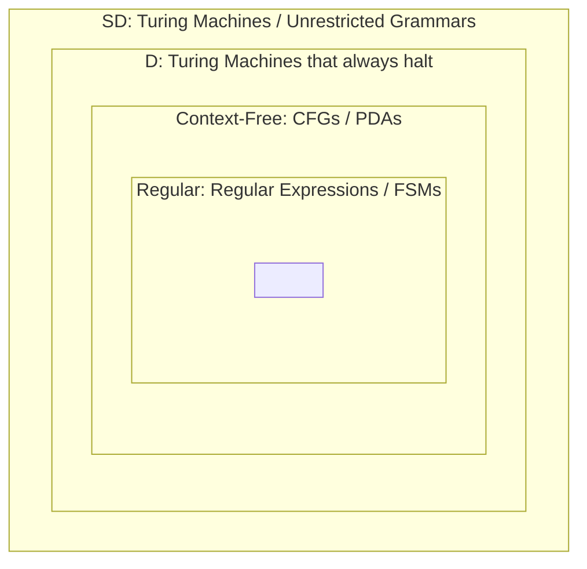
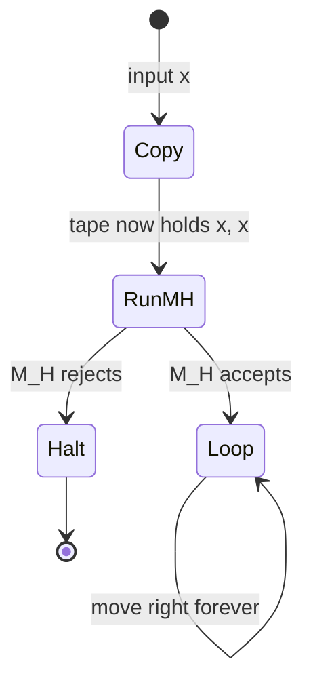

**Notes based off of:** Chapter 19 – The Unsolvability of the Halting Problem (lecture slides)

## The Language Hierarchy So Far

Each class of languages has a machine model and a grammar model that generate or recognize exactly that class. The classes are nested: every regular language is context-free, every context-free language is decidable, and every decidable language is semidecidable.



The new question for this chapter is whether the inclusion $D \subseteq SD$ is strict. The halting problem is the first language we show is in $SD$ but not in $D$.

## D and SD

### Deciding

A TM $M$ with input alphabet $\Sigma$ **decides** a language $L \subseteq \Sigma^{*}$ iff for every $w \in \Sigma^{*}$:

- if $w \in L$, then $M$ accepts $w$
- if $w \notin L$, then $M$ rejects $w$

$L$ is **decidable** ($L \in D$) iff some TM decides it. The key point is that a decider **always halts** with a yes or no answer.

### Semideciding

A TM $M$ **semidecides** $L$ iff for every $w \in \Sigma^{*}$:

- if $w \in L$, then $M$ accepts $w$
- if $w \notin L$, then $M$ does not accept $w$ (it may reject _or loop forever_)

$L$ is **semidecidable** ($L \in SD$) iff some TM semidecides it.

> [!tip] Heuristic 
> A semidecider is a machine that can confirm "yes" but may never get around to saying "no". If you are waiting on it and it hasn't answered, you can't tell whether it is about to accept or will run forever. That uncertainty is exactly what separates $SD$ from $D$.

## Defining the Universe (and the Complement)

Languages like the following take _encodings_ of machines as input:

- $L_1 = {\langle M, w\rangle : \text{TM } M \text{ halts on input string } w}$
- $L_2 = {\langle M\rangle : M \text{ halts on nothing}}$
- $L_3 = {\langle M_a, M_b\rangle : M_a \text{ and } M_b \text{ halt on the same strings}}$

For a string to be in $L_1$, it has to (1) be syntactically well-formed, that is, a valid encoding of a machine and a string, and (2) actually encode an $M$ that halts on $w$.

Under the "naive" definition of complement, $\neg L_1$ would also contain all the garbage strings:

$$\neg L_1 = {x : x \text{ is not a well-formed } \langle M, w\rangle} \cup {\langle M, w\rangle : M \text{ does not halt on } w}$$

**Convention used from now on:** for any language whose strings include TM descriptions, the complement is taken with respect to the universe of strings with the _same syntactic form_. So:

$$\neg L_1 = {\langle M, w\rangle : \text{TM } M \text{ does not halt on input string } w}$$

> [!note] Why this is harmless 
> Checking whether a string is a well-formed encoding is a purely syntactic check (essentially parsing), and the set of well-formed strings is in $D$. Any decider or semidecider can just reject malformed input first. So this convention never changes whether a language is in $D$ or $SD$. It only keeps the complements from being cluttered with junk.

Compare this with an ordinary language like $A^nB^n = {a^nb^n : n \ge 0}$. Its complement is simply every other string over ${a, b}$, and there is no encoding issue.

## The Halting Language $H$

$$H = {\langle M, w\rangle : \text{TM } M \text{ halts on input string } w}$$

**Theorem:** $H$ is semidecidable, but it is not decidable.

### Why This Is Hard: Example Programs

Some programs are obviously halting or obviously non-halting:

1. _Append 0 to the input, then halt._ This one halts.
2. _Append 0, move right, go to step 1._ This one loops forever.

Others are not obvious at all:

```
times3(x: positive integer) =
    while x ≠ 1 do:
        if x is even then x = x/2
        else x = 3x + 1
```

Starting at 25: $25 \to 76 \to 38 \to 19 \to 58 \to 29 \to 88 \to 44 \to 22 \to 11 \to 34 \to 17 \to 52 \to 26 \to 13 \to 40 \to 20 \to 10 \to 5 \to 16 \to 8 \to 4 \to 2 \to 1$.

This is the **Collatz conjecture**. Whether `times3` halts on _every_ positive integer is an open problem in mathematics. It has been checked computationally for enormous ranges, but nobody has a proof. A general halting decider would settle it immediately (and many other open problems along with it). That should already make you suspicious that one can exist.

### $H$ Is Semidecidable

$$M_H(\langle M, w\rangle) = \text{1. Run } M \text{ on } w. \quad \text{2. Accept.}$$

$M_H$ halts (and accepts) exactly when $M$ halts on $w$. If $M$ loops, so does $M_H$, which is allowed for a semidecider. This works because a **universal Turing machine** can simulate any $\langle M\rangle$ on any $w$.

### $H$ Is Not Decidable

**Proof by contradiction.** Suppose some TM $M_H$ decides $H$:

- On input $\langle M, w\rangle$: if the input is malformed, reject. If $M$ halts on $w$, accept. Otherwise reject. **$M_H$ always halts.**

Build a new machine $\textit{Trouble}$ that uses $M_H$ as a subroutine:

```
Trouble(x):
    Run M_H on <x, x>        // C# copies the input so we can feed x as both machine and input
    If M_H accepts, loop forever
    Else halt
```



Now run $\textit{Trouble}(\langle \textit{Trouble}\rangle)$. This asks $M_H$ whether $\textit{Trouble}$ halts on its own description.

1. **If $\textit{Trouble}$ halts on $\langle \textit{Trouble}\rangle$**, then $M_H$ accepts, so $\textit{Trouble}$ loops. That is a contradiction.
2. **If $\textit{Trouble}$ does not halt**, then $M_H$ rejects, so $\textit{Trouble}$ halts. That is also a contradiction.

Both cases are impossible, so $M_H$ cannot exist. $\blacksquare$

> [!important] The core trick 
> $\textit{Trouble}$ is built to _do the opposite of whatever $M_H$ predicts about it_. Any claimed perfect predictor can be turned against itself this way. It's the same self-reference as the liar paradox ("this sentence is false"). The difference is that here the self-reference is legitimate, because a TM really can be given its own encoding as input.

### The Proof as Diagonalization

The same argument can be read as a Cantor-style diagonalization:

- Enumerate all TMs lexicographically: $TM_1, TM_2, TM_3, \dots$
- Enumerate all input strings: $i_1, i_2, i_3, \dots$
- Define $\text{table}[i, j] = 1$ if $TM_i$ halts on $i_j$, and $0$ otherwise.
- If $M_H$ existed, it could fill in **every** cell.

| |$i_1$|$i_2$|$i_3$|$\cdots$|$\langle \textit{Trouble}\rangle$|
|---|---|---|---|---|---|
|$TM_1$|1|||||
|$TM_2$||1||||
|$TM_3$|||||1|
|$\vdots$||||||
|$\textit{Trouble}$|||1||**?**|

$\textit{Trouble}$ behaves by flipping the diagonal. On input $\langle TM_k\rangle$ it halts iff $TM_k$ does _not_ halt on $\langle TM_k\rangle$. So $\textit{Trouble}$'s row differs from every row on the diagonal, including its own. At the cell $[\textit{Trouble}, \langle\textit{Trouble}\rangle]$, a value of 1 forces 0 and a value of 0 forces 1.

## Consequences

### If $H$ Were in $D$, Then $SD = D$

**Theorem:** If $H \in D$, then every $SD$ language would be in $D$.

**Proof:** Let $L \in SD$ be semidecided by $M_L$, and suppose an oracle TM $O$ decides $H$. Build:

```
M'(w):
    1. Run O on <M_L, w>
    2. If O accepts (M_L will halt on w):
           2.1 Run M_L on w        // safe: guaranteed to finish
           2.2 If it accepts, accept; else reject
    3. Else reject                 // M_L loops, so it never accepts w
```

$M'$ always halts and decides $L$. $\blacksquare$

> [!tip] Interpretation 
> The only thing that keeps a semidecider from being a decider is the risk of looping. A halting oracle removes that risk. So $H$ is in a sense the _hardest_ problem in $SD$: solving it would collapse $SD$ into $D$. (This is the idea behind calling $H$ **SD-complete**, which comes up later with reductions.)

### $\neg H$ Is Not Even in $SD$

The slides don't state this, but it follows directly and it matters for the rest of the course. Recall the theorem that **$L \in D$ iff both $L$ and $\neg L$ are in $SD$**: run both semideciders in parallel, and one of them must eventually accept.

Since $H \in SD$ but $H \notin D$, it must be that $\neg H = {\langle M, w\rangle : M \text{ does not halt on } w} \notin SD$. You can confirm "it halted" by watching it halt, but no amount of watching confirms "it will never halt".

### The Entscheidungsproblem Is Unsolvable

Hilbert's _Entscheidungsproblem_ asked for an algorithm that decides whether any given first-order logic sentence is valid. Turing's argument:

1. If we could decide whether a TM ever prints the symbol 0, we could decide whether a TM halts. (Modify $M$ so that it prints 0 exactly when it is about to halt, and never prints 0 otherwise.)
2. We can't decide halting, so we can't decide "ever prints 0" either.
3. Given any TM $M$, we can construct a logical formula $F$ that is true iff $M$ ever prints 0.
4. A solution to the Entscheidungsproblem would decide $F$, and therefore decide "ever prints 0".
5. That is impossible, so the Entscheidungsproblem has no solution. $\blacksquare$

> [!note] Pattern to recognize 
> Steps 1–2 and 3–5 are both **reductions**: "if I could solve $X$, I could solve $H$; I can't solve $H$, so I can't solve $X$." This is the main technique for proving other problems undecidable, and it is the focus of the following chapters.

## Practical Relevance

- **No perfect static analyzer.** No tool can take arbitrary code and always correctly report "this terminates", "this never dereferences null", and so on. Real tools (compilers, linters, type checkers) get around this by being _conservative_. They may reject safe programs or answer "unknown", but they never claim to be both complete and always correct.
- **Timeouts are a semidecision in disguise.** Running code with a time limit can confirm halting but can never confirm non-halting. When the timeout fires, you only know "not yet".
- **Rice's theorem** (coming later) generalizes this result: _every_ nontrivial property of what a program computes is undecidable.

## Language Summary

|Class|How to show a language is **in**|Example|How to show a language is **out**|
|---|---|---|---|
|$SD$|Semideciding TM|$H$|(later: reduction from $\neg H$)|
|$D$|Deciding TM|$A^nB^nC^n$|Diagonalization / reduction from $H$|
|Context-free|CFG, PDA, closure properties|$A^nB^n$|Pumping theorem, closure|
|Regular|Regex, FSM, closure properties|$a^{*}b^{*}$|Pumping theorem, closure|

Each language in the example column sits at the lowest level that contains it. So $A^nB^n$ is context-free but not regular, $A^nB^nC^n$ is decidable but not context-free, and $H$ is semidecidable but not decidable.