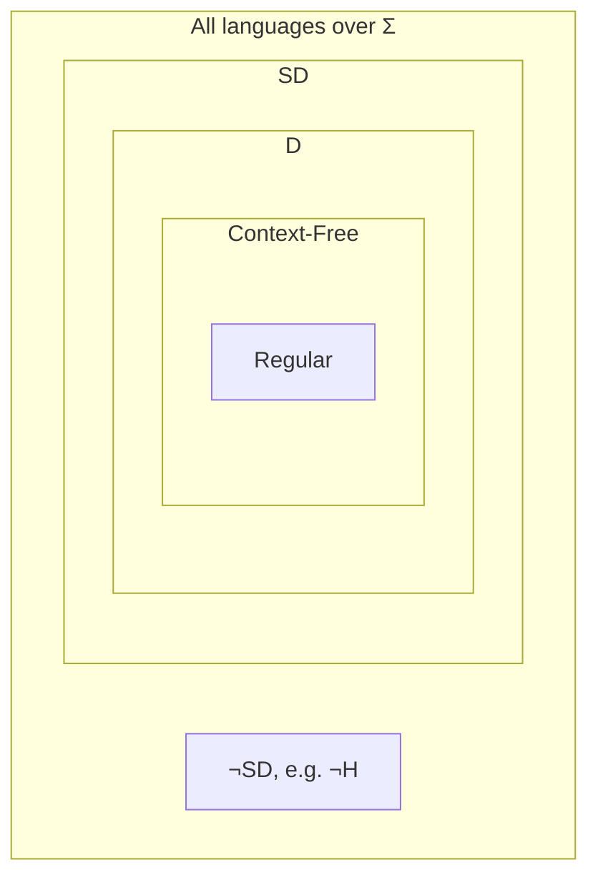
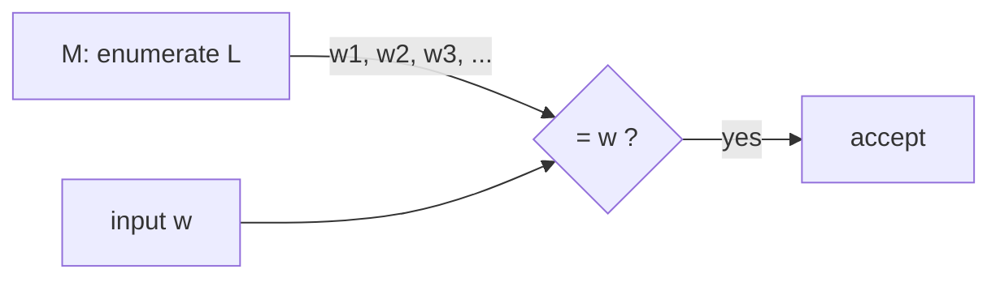
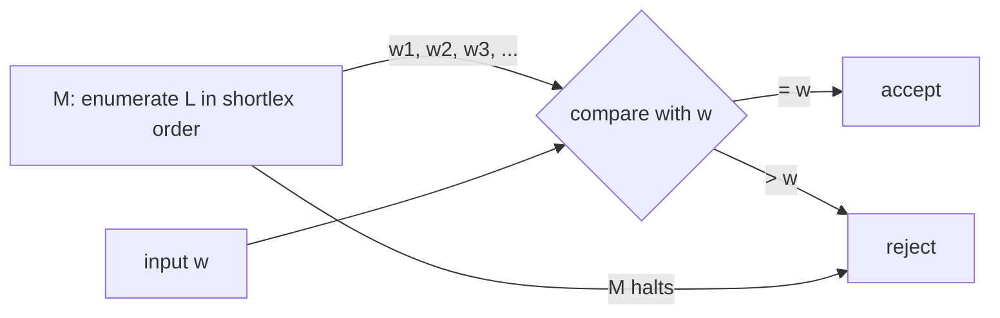

****Notes based off of:** Chapter 20 - Decidable and Semidecidable Languages (lecture slides)

## Overview

This chapter places the two Turing-machine language classes in the language hierarchy and gives several equivalent ways to describe each.

- **D (decidable):** some TM _decides_ $L$. It halts on every input, accepting if $w \in L$ and rejecting if $w \notin L$.
- **SD (semidecidable):** some TM _semidecides_ $L$. It halts and accepts if $w \in L$. If $w \notin L$, it either rejects or runs forever.

> [!tip] Heuristic 
> A decider always gives you an answer. A semidecider only ever confirms "yes". If you are still waiting, you cannot tell whether the answer is "no" or "not yet". Most of this chapter follows from taking that asymmetry seriously.

The hierarchy is strict at every level:

| Inclusion                     | Witness that it is proper                           |
| ----------------------------- | --------------------------------------------------- |
| Regular $\subsetneq$ CF       | $A^nB^n = {a^nb^n : n \ge 0}$                       |
| CF $\subsetneq$ D             | $A^nB^nC^n = {a^nb^nc^n : n \ge 0}$                 |
| D $\subsetneq$ SD             | $H = {\langle M, w\rangle : M \text{ halts on } w}$ |
| SD $\subsetneq$ all languages | $\neg H$                                            |

## Every CF Language is in D

**Theorem:** The context-free languages are a _proper_ subset of D.

- **Subset:** Every CFL is decidable. For example, convert the grammar to Chomsky normal form and run CKY parsing, or bound the derivation length and search. This always terminates.
- **Proper:** $A^nB^nC^n$ is decidable but not context-free. The pumping lemma rules out CF, and a TM can simply cross off one $a$, one $b$ and one $c$ per pass.

## D vs. SD

Almost every "natural" language you can semidecide, you can also decide:

- $A^nB^nC^n$
- ${wcw : w \in {a,b}^{*}}$
- ${ww : w \in {a,b}^{*}}$
- ${x \ast y = z : x, y, z \in {0,1}^{*},\ xy = z \text{ as binary numbers}}$

These are all decidable because you can check a candidate string directly in bounded time. The languages that fall into SD but not D usually ask a question about **the behaviour of another program**, such as $H$. That is the practical lesson: undecidability shows up when you analyse code, not when you check strings against patterns.

The three key facts:

1. $D \subseteq SD$
2. $SD \setminus D \neq \varnothing$ (the "donut", e.g. $H$)
3. $\neg SD \neq \varnothing$ (languages not even semidecidable)

### $D \subseteq SD$

If $M$ decides $L$, then $M$ also semidecides $L$. A decider meets every requirement of a semidecider and adds one more: it must also halt on "no".

### $SD \setminus D$ is nonempty

$H$ is in SD. Simulate $M$ on $w$ and accept if the simulation halts. $H$ is not in D, which is the halting problem (proved by diagonalization in the previous chapter).

### Languages not in SD exist (counting argument)

Fix a nonempty alphabet $\Sigma$.

- Every TM can be encoded as a finite string, so there are **countably** many TMs and therefore countably many SD languages.
- A language is any subset of $\Sigma^{*}$. Since $\Sigma^{*}$ is countably infinite, the set of all languages is $\mathcal{P}(\Sigma^{*})$, which is **uncountable** (Cantor).

There are more languages than machines, so some language has no semideciding TM.

> [!note] This argument is non-constructive. 
> It proves that such languages exist but does not name one. [[#A Concrete Language Not in SD]] gives an explicit example.

## Closure Under Complement

### D is closed under complement

Given a deterministic decider $M$ for $L$, build $M'$ by **swapping the accept and reject states**. Then $M'$ decides $\neg L$.

This works only because $M$ is:

- **deterministic**: each input has exactly one computation, so "rejects" means _every_ path rejects. With nondeterminism, swapping would turn "some path accepts" into "some path rejects", which is a different statement.
- **complete** (always halts): every input ends in either $y$ or $n$, so swapping the two covers every case.

### SD is not closed under complement

Swapping states fails for a semidecider. On inputs $w \notin L$ where $M$ loops, $M'$ also loops, so $M'$ never accepts those strings even though they belong to $\neg L$. There is no "loop" state to swap with "accept".

**Proof by contradiction:** Suppose SD were closed under complement. Then for every $L \in SD$ we would have semideciders $M_L$ and $M_{\neg L}$. Run them in parallel (see below) to decide $L$. That would make $SD = D$, which contradicts $H \in SD \setminus D$.

## The Characterization: $L \in D \iff L, \neg L \in SD$

**Theorem:** $L$ is decidable if and only if both $L$ and $\neg L$ are semidecidable.

**($\Rightarrow$)** If $L \in D$, then $L \in SD$ because $D \subseteq SD$. Also $\neg L \in D$ by closure under complement, so $\neg L \in SD$.

**($\Leftarrow$)** Let $M_1$ semidecide $L$ and $M_2$ semidecide $\neg L$. On input $w$:

- Run $M_1$ and $M_2$ **in parallel**, alternating one step of each.
- Since $w$ is in exactly one of $L$ and $\neg L$, exactly one machine eventually accepts.
- If $M_1$ accepts, accept. If $M_2$ accepts, reject.

This always halts, so it decides $L$.

> [!warning] Why parallel and not sequential? 
> Running $M_1$ to completion and then $M_2$ fails. If $w \notin L$, $M_1$ may loop forever and $M_2$ never gets to run. Interleaving step by step is the standard fix, and it shows up again in [[#Dovetailing]].

> [!tip] Intuition 
> Think of two search parties: one looks for a proof that $w \in L$, the other for a proof that $w \notin L$. Exactly one proof exists, so one party always comes back.

### A Concrete Language Not in SD

$$\neg H = {\langle M, w\rangle : M \text{ does not halt on } w}$$

- $H \in SD$.
- If $\neg H \in SD$, then by the theorem above $H \in D$.
- But $H \notin D$, so $\neg H \notin SD$.

**General recipe:** If $L \in SD \setminus D$, then $\neg L \notin SD$. Complements of "donut" languages are always outside SD. Practically, you can confirm that a program halts by watching it halt, but no amount of watching ever confirms that it runs forever.

## Enumeration

Instead of a TM that _recognizes_ strings, view it as a **generator** that lists them.

$M$ **enumerates** $L$ iff, for some fixed non-halting state $p$, $$L = {w : (s, \varepsilon) \vdash_M^{*} (p, w)}$$

In words: start on a blank tape. Every time $M$ enters the "print" state $p$, the current tape contents are output. $L$ is the set of everything ever printed.

- Strings may be printed in any order, and repeats are allowed.
- If $L$ is infinite, $M$ runs forever. If $L$ is finite, $M$ may eventually halt.
- $L$ is **Turing-enumerable** iff some TM enumerates it.

**Example:** For $L = a^{*}$, one enumerator writes $\varepsilon$, prints, appends an $a$, prints, and repeats. Many different enumerators can produce the same language. The slides show two machines, $M_1$ and $M_2$, that both enumerate $a^{*}$ using a print subroutine $P$ (enter $p$, then return).

### SD $=$ Turing-Enumerable

**Theorem:** $L \in SD$ iff $L$ is Turing-enumerable.

**Enumerable $\Rightarrow$ SD.** Given an enumerator $M$ for $L$, build $M'$:

1. Save the input $w$.
2. Run $M$. Each time it prints some $w_i$, compare it with $w$. If they are equal, accept.

If $w \in L$, it is printed eventually and $M'$ accepts. If not, $M'$ waits forever. That is exactly semidecision.

**SD $\Rightarrow$ Enumerable.** The naive approach is to list $\Sigma^{*}$ in order ($\varepsilon, a, b, aa, ab, \dots$) and run the semidecider $M$ on each string in turn, printing it if $M$ accepts.

> [!warning] This does not work 
> If $M$ loops on some early string $w_i \notin L$, the procedure gets stuck on $w_i$ forever and never reaches later strings that are in $L$.

### Dovetailing

The fix is to interleave all of the computations:

1. Enumerate $\Sigma^{*}$ lexicographically, one new string per round.
2. In round $i$, start a new copy $M_i$ on $w_i$, then run **one step** of every copy started so far that has not already halted.
3. Whenever some $M_i$ accepts, print $w_i$.

|Round|Steps executed|
|---|---|
|1|$M_1$|
|2|$M_1, M_2$|
|3|$M_1, M_2, M_3$|
|$\vdots$|$\vdots$|

Every machine eventually gets an unbounded number of steps, but no single looping machine can block the others. If $w_i \in L$ and $M$ accepts it in $k$ steps, it gets printed by about round $i + k$.

> [!tip] Dovetailing is the same idea as an OS time-sharing scheduler, or the diagonal walk used to show $\mathbb{N} \times \mathbb{N}$ is countable. 
> Use it whenever you have infinitely many possibly non-terminating jobs and need to make progress on all of them.

The enumerator's output order is now essentially arbitrary: strings come out in order of _when their computations finish_, not in alphabetical order. That gap leads to the next section.

## Lexicographic Enumeration

$M$ **lexicographically enumerates** $L$ iff it enumerates the elements of $L$ in lexicographic order. $L$ is **lexicographically Turing-enumerable** iff some TM does this.

> [!note] "Lexicographic" here means shortlex 
> Strings are ordered **first by length, then alphabetically** within the same length: $\varepsilon, a, b, aa, ab, ba, bb, aaa, \dots$. Pure dictionary order would not work. With $a < b$, the strings $a, aa, aaa, \dots$ would all come before $b$, so $b$ would never be reached.

**Example:** $A^nB^nC^n$ in lexicographic order is $\varepsilon,\ abc,\ aabbcc,\ aaabbbccc,\ \dots$

### Lexicographically Enumerable $=$ D

**Theorem:** $L \in D$ iff $L$ is lexicographically Turing-enumerable.

**D $\Rightarrow$ lexicographically enumerable.** Let $M$ decide $L$. $M'$ generates $\Sigma^{*}$ in shortlex order, runs $M$ on each string, and prints it if $M$ accepts. Dovetailing is not needed because $M$ always halts, so no string can block the ones after it. The output comes out in order automatically.

**Lexicographically enumerable $\Rightarrow$ D.** Let $M$ lexicographically enumerate $L$. On input $w$, $M'$ runs $M$ and waits until one of:

- $M$ prints $w$: **accept**.
- $M$ prints a string that comes **after** $w$ in shortlex order: **reject**, because $w$ would have appeared already.
- $M$ halts: **reject**, because $L$ is finite and $w$ was never printed.

One of these must happen. Either $L$ is infinite, so the printed strings eventually pass $w$ (there are only finitely many strings shorter than or equal in length to $w$), or $L$ is finite and $M$ halts. So $M'$ always halts and decides $L$.

> [!tip] Why order matters 
> With an ordered list, you know when to stop looking. With an unordered list, a missing string might still show up later, so you can only ever say "yes". This is the D vs. SD distinction in one sentence.

## Summary

|Class|Ways to show **in**|Example|Ways to show **out**|
|---|---|---|---|
|Regular|Regular expression, FSM, closure|$a^{*}b^{*}$|Pumping, closure|
|Context-Free|CF grammar, PDA, closure|$A^nB^n$|Pumping, closure|
|D|Deciding TM, lexicographic enumerator, $L$ and $\neg L$ both in SD|$A^nB^nC^n$|Diagonalization, reduction|
|SD|Semideciding TM, enumerator|$H$|Reduction (or complement of a language in $SD \setminus D$)|

**Equivalences to remember:** $$L \in SD \iff L \text{ is Turing-enumerable}$$ $$L \in D \iff L \text{ is lexicographically Turing-enumerable} \iff L \in SD \text{ and } \neg L \in SD$$