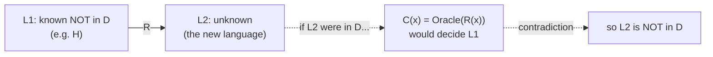

**Notes based off of:** Ch21a Undecidability (Sections 21.1 – 21.3)

## Problems vs. Languages

Every decision problem about Turing machines can be rephrased as a language: the set of encodings for which the answer is "yes". Asking "is this problem solvable?" is the same as asking "is this language in D?" (decidable).

|Problem view|Language view|
|---|---|
|Does TM $M$ halt on $w$?|$H = {\langle M, w\rangle : M \text{ halts on } w}$|
|Does $M$ _not_ halt on $w$?|$\neg H = {\langle M, w\rangle : M \text{ does not halt on } w}$|
|Does $M$ halt on the empty tape?|$H_\varepsilon = {\langle M\rangle : M \text{ halts on } \varepsilon}$|
|Is there any string on which $M$ halts?|$H_{ANY} = {\langle M\rangle : \exists w,\ M \text{ halts on } w}$|
|Does $M$ accept all strings?|$A_{ALL} = {\langle M\rangle : L(M) = \Sigma^{*}}$|
|Do $M_a$ and $M_b$ accept the same language?|$EqTMs = {\langle M_a, M_b\rangle : L(M_a) = L(M_b)}$|
|Is $L(M)$ regular?|$TM_{REG} = {\langle M\rangle : L(M) \text{ is regular}}$|

> [!note] Reminder of the classes
> 
> - **D** (decidable): some TM always halts and correctly accepts/rejects.
> - **SD** (semidecidable): some TM accepts every member, but may loop forever on non-members.
> - $H$ is in SD but not in D (proved by diagonalization in the previous chapter). $\neg H$ is not even in SD.

$H$ is the "seed" result. Everything in this chapter is proved undecidable by leaning on $H$, directly or indirectly, rather than by doing a new diagonalization each time.

## Reduction

### The Intuition

A reduction turns one problem into another. The everyday example:

```
multiply(x, y):
  1. answer := 0
  2. for i := 1 to y: answer := sum(answer, x)
  3. return answer
```

_Computing multiply reduces to computing sum_: if we can do `sum`, we can do `multiply`. Reduction transfers **solvability forward** ($L_2$ solvable $\Rightarrow$ $L_1$ solvable), and by contrapositive transfers **unsolvability backward** ($L_1$ unsolvable $\Rightarrow$ $L_2$ unsolvable).

The geometric example makes the contrapositive use clear. Claim: no straightedge-and-compass procedure divides an angle into sixths. Suppose `sixth` existed. Then `trisect(a)` = run `sixth(a)` and ignore every other line. But angle trisection is known to be impossible, so `sixth` cannot exist.

### Turing Reduction

> [!definition] Turing reduction ($L_1 \le L_2$) 
> A reduction $R$ from $L_1$ to $L_2$ is one or more TMs such that, if some TM **Oracle** decides (or semidecides) $L_2$, then $R$ composed with Oracle decides (or semidecides) $L_1$.
> 
> $L_1 \leq L_2$ means that $L_1$ is **reducible** to $L_2$


The logic used to prove undecidability:

$$(L_1 \le L_2) \land (L_2 \in D) \rightarrow (L_1 \in D)$$

So if $L_1 \le L_2$ and we already know $L_1 \notin D$, then $L_2 \notin D$.



> [!tip] Hard vs. Harder 
> If $L_1 \le L_2$, then $L_2$ is _at least as hard_ as $L_1$. Think of "$\le$" as "is no harder than". Reducing a known-hard problem to the new one shows the new one is also hard. (It may be equally hard, not strictly harder.)

### Mapping Reductions

> [!definition] Mapping reduction ($L_1 \le_M L_2$) 
> There exists a computable function $f$ such that $$\forall x \in \Sigma^{*}\ (x \in L_1 \leftrightarrow f(x) \in L_2)$$

To decide $x \in L_1$: transform $x$ with $f$, ask Oracle about $f(x)$, and return Oracle's answer **unchanged**. A mapping reduction is a special, restricted case of a Turing reduction: Oracle is called exactly once, at the very end, and its answer is final. Almost every proof in this chapter is a mapping reduction.

### The Recipe

0. Assume an Oracle that decides $L_2$ exists.
1. Choose $L_1$ that is already known not to be in D and can be reduced to $L_2$.
2. Define the reduction $R$.
3. Describe the composition $C(x) = \text{Oracle}(R(x))$.
4. Show $C$ correctly decides $L_1$:
    - $R$ can be implemented by a TM (it must be computable and always halt);
    - if $x \in L_1$, $C$ accepts;
    - if $x \notin L_1$, $C$ rejects.
5. Conclude: since no decider for $L_1$ exists, Oracle cannot exist, so $L_2 \notin D$.

> [!important] What a full proof must contain
> 
> - A clear statement of the "from" and "to" languages.
> - A clear description of $R$.
> - If $R$ does anything nontrivial, an argument that it is implementable as a TM.
> - Both the accepting **and** rejecting cases of the correctness argument.
> - An explicit conclusion that the "to" language is not in D.

> [!warning] The most common mistake: reducing in the wrong direction To show $L_2 \notin D$, reduce the **known** hard language **to** $L_2$ ($L_1 \le L_2$): show how to solve the known one _using_ the unknown one.
> 
> Wrong: "If $M_H$ decides $H$, then we can decide $H_\varepsilon$ by returning $M_H(\langle M, \varepsilon\rangle)$." This reduces $H_\varepsilon$ to $H$, which only says $H_\varepsilon$ is no harder than $H$. It is an argument of the form "if False then ...", and proves nothing.
> 
> Heuristic: the Oracle is always for the language you are trying to prove undecidable.

## The Standard Trick: The Input-Ignoring Machine $M\#$

Nearly every reduction from $H$ builds the same kind of machine. Given $\langle M, w\rangle$, $R$ constructs $M\#$ which, on any input $x$:

1. Erases its tape (ignores $x$).
2. Writes $w$ on the tape.
3. Runs $M$ on $w$.

> [!tip] Why this works 
> $M\#$ behaves **identically on every input**, so it halts on _everything_ (if $M$ halts on $w$) or on _nothing_ (if it doesn't). This converts a question about one specific computation, "does $M$ halt on $w$?", into a question about the whole behaviour of a machine. Any property that distinguishes "halts on everything" from "halts on nothing" can then be used to answer $H$.

Note that $R$ never _runs_ $M$. It only _writes down a description_ of a machine that would run $M$. That is why $R$ always halts even though $M$ might not, which is essential: the reduction itself must be computable.

**$R$ is implementable as a TM.** To build $\langle M\#\rangle$ for, say, $w = aba$: write a sequence of states that erases the tape, then for each character $c$ of $w$ write "write $c$" followed by "move right" (except after the last character), then "move left to the blank, then start $M$". This is a simple mechanical loop over $w$, so $R$ is clearly computable.

## $H_\varepsilon$: Halting on the Empty Tape

$$H_\varepsilon = {\langle M\rangle : M \text{ halts on } \varepsilon}$$

**$H_\varepsilon \in SD$.** $T(\langle M\rangle)$: run $M$ on $\varepsilon$; accept. $T$ accepts exactly when $M$ halts on $\varepsilon$.

**$H_\varepsilon \notin D$**, by $H \le_M H_\varepsilon$:

- $R(\langle M, w\rangle)$ returns $\langle M\#\rangle$ (the input-ignoring machine above).
- $\langle M, w\rangle \in H$: $M$ halts on $w$, so $M\#$ halts on everything, in particular on $\varepsilon$. Oracle accepts.
- $\langle M, w\rangle \notin H$: $M\#$ halts on nothing, so not on $\varepsilon$. Oracle rejects.

So $C = \text{Oracle}(R(\langle M, w\rangle))$ would decide $H$, which is impossible.

> [!note] Why this is surprising 
> Intuitively $H_\varepsilon$ looks _easier_ than $H$, since it asks about one fixed input. The reduction shows that a decider for this special case would solve the general case. Since $H_\varepsilon$ is also trivially a special case of $H$ ($H_\varepsilon \le H$), the two are **equally hard**.

## $H_{ANY}$: Halting on Some String

$$H_{ANY} = {\langle M\rangle : \exists w \in \Sigma^{*},\ M \text{ halts on } w}$$

### $H_{ANY} \in SD$ (via dovetailing)

Naively trying $\varepsilon$, then $a$, then $b$, ... fails: if $M$ loops on $\varepsilon$, we never get to try anything else. **Dovetailing** fixes this by interleaving: in round $i$, run one more step on each of the first $i$ strings.

|Round|Steps run|
|---|---|
|1|$\varepsilon[1]$|
|2|$\varepsilon[2]$, $a[1]$|
|3|$\varepsilon[3]$, $a[2]$, $b[1]$|
|4|$\varepsilon[4]$, $a[3]$, $b[2]$, $aa[1]$|
|5|$\varepsilon[5]$, $a[4]$, $b[3]$, $aa[2]$, $ab[1]$|

If any instance halts, accept. Every string eventually gets arbitrarily many steps, so if $M$ halts on some $w$ after $k$ steps, $T$ finds it in finite time.

> [!tip] When to reach for dovetailing Whenever a semidecider must search an infinite space of candidates, each of which might loop. It is the standard way to prove an "there exists ..." language about TMs is in SD.

### $H_{ANY} \notin D$

Two reductions from $H$ both work:

- **Version 1**: $M\#(x)$: if $x = w$, run $M$ on $w$; otherwise loop. The only string $M\#$ can halt on is $w$, so $M\#$ halts on some string iff $M$ halts on $w$.
- **Version 2**: the standard input-ignoring $M\#$. It halts on everything or nothing, so "halts on at least one string" iff $M$ halts on $w$.

The second is reusable; the first shows there is often more than one valid construction.

## $H_{ALL}$: Halting on All Inputs

$$H_{ALL} = {\langle M\rangle : M \text{ halts on all inputs}}$$

**$H_{ALL} \notin D$**, by $H_\varepsilon \le_M H_{ALL}$ (reductions can start from any known-undecidable language, not just $H$):

- $R(\langle M\rangle)$ builds $M\#(x)$: erase the tape, run $M$.
- $\langle M\rangle \in H_\varepsilon$: $M\#$ halts on all inputs. Oracle accepts.
- $\langle M\rangle \notin H_\varepsilon$: $M\#$ halts on nothing. Oracle rejects.

> [!note] Practical meaning $H_{ALL}$ is the question "is this program total (does it always terminate)?". Its undecidability is why no compiler or static analyser can guarantee to detect every possible infinite loop.

## The Acceptance Family: $A$, $A_\varepsilon$, $A_{ANY}$, $A_{ALL}$

$$A = {\langle M, w\rangle : M \text{ accepts } w} = {\langle M, w\rangle : w \in L(M)}$$

This is the **membership question** for TMs. It differs from $H$ because a TM can halt and _reject_.

**$A \notin D$**, by $H \le_M A$: $M\#$ erases its tape, writes $w$, runs $M$ on $w$, then **accepts**. $R$ returns $\langle M\#, w\rangle$.

- $M$ halts on $w$: $M\#$ reaches the accept step on every input, including $w$. Oracle accepts.
- $M$ doesn't halt on $w$: $M\#$ gets stuck in step 3 and accepts nothing. Oracle rejects.

The added "accept" step is the general trick for converting _halting_ questions into _acceptance_ questions: it erases the difference between "halt-and-accept" and "halt-and-reject".

By the same constructions, with "accept" added at the end:

|Language|Proof analogous to|
|---|---|
|$A_\varepsilon = {\langle M\rangle : M \text{ accepts } \varepsilon}$|$H_\varepsilon$|
|$A_{ANY} = {\langle M\rangle : M \text{ accepts at least one string}}$|$H_{ANY}$|
|$A_{ALL} = {\langle M\rangle : L(M) = \Sigma^{*}}$|$H_{ALL}$|

All are not in D.

## $EqTMs$: Language Equivalence

$$EqTMs = {\langle M_a, M_b\rangle : L(M_a) = L(M_b)}$$

**$EqTMs \notin D$**, by $A_{ALL} \le_M EqTMs$:

- $R(\langle M\rangle)$ builds $M\#$ that immediately accepts everything ($L(M\#) = \Sigma^{*}$), and returns $\langle M, M\#\rangle$.
- $L(M) = \Sigma^{*}$ iff $L(M) = L(M\#)$, so Oracle's answer is exactly the answer to $A_{ALL}$.

> [!note] Why it matters This is the formal reason there is no general tool to check that a refactored program is equivalent to the original. Equivalence checking in practice works only on restricted models (e.g. DFAs, where equivalence _is_ decidable) or uses testing/proofs that may fail to conclude.

The pattern here, reducing "is $L(M)$ everything" to "are two languages equal" by fixing one side to a known machine, is a common way to handle problems with two machine inputs.

## When a Mapping Reduction Is Not Enough

Consider $L_2 = {\langle M\rangle : M \text{ accepts no even-length strings}}$.

Using the usual $M\#$ (erase, write $w$, run $M$, accept):

- $M$ halts on $w$: $M\#$ accepts everything, including even-length strings, so Oracle **rejects**.
- $M$ doesn't halt on $w$: $M\#$ accepts nothing, so Oracle **accepts**.

The answers are flipped. A plain mapping reduction must return Oracle's answer as-is, so it doesn't work directly. The fix is a Turing reduction that post-processes the answer:

$$C = \neg,\text{Oracle}(R(\langle M, w\rangle))$$

Since $\neg$ is trivially implementable (swap accept/reject, which is safe because Oracle is a _decider_ and always halts), $C$ decides $H$, so $L_2 \notin D$.

> [!warning] Negation only works for D, not SD Flipping the answer is fine when Oracle always halts. If Oracle were only a _semi_decider, "reject" might actually be "loop forever", and $\neg$ could not be computed. This is why proving languages are not in SD needs more care, and is handled separately.

## Are All Questions About TMs Undecidable?

No. The key distinction is whether the question is about the machine's **description** or a **bounded** amount of behaviour (often decidable), versus its **language / unbounded behaviour** (usually undecidable).

- ${\langle M\rangle : M \text{ has an even number of states}}$: **decidable**. Just count the states in the encoding. This is a syntactic property of the description, not of $L(M)$.
- ${\langle M, w\rangle : M \text{ halts on } w \text{ within 3 steps}}$: **decidable**. Simulate $M$ for at most 3 steps; the simulation is bounded so it always halts.
- $L_q = {\langle M, q\rangle : \text{some configuration } (p, uav) \text{ with } p \ne q \text{ yields a configuration in state } q}$: **decidable**. "Yields" means in one step, so just scan $M$'s transition table for any transition from a state $p \ne q$ into $q$. (Note this asks whether such a move is _possible_ from some configuration, not whether $q$ is _reachable_ from the start, which would be undecidable.)

> [!tip] Heuristic (Rice's theorem, preview) Any nontrivial property of the **language** a TM accepts (true of some TMs' languages, false of others) is undecidable. Properties of the machine's **structure**, or of a **bounded** number of steps, can be decidable. This explains why $A_\varepsilon$, $A_{ANY}$, $A_{ALL}$, $TM_{REG}$, etc. all fall, while counting states does not.

## Summary

| Language                                                        | In SD?            | In D? | Reduced from              |
| --------------------------------------------------------------- | ----------------- | ----- | ------------------------- |
| $H$                                                             | Yes               | No    | (diagonalization)         |
| $H_\varepsilon$                                                 | Yes               | No    | $H$                       |
| $H_{ANY}$                                                       | Yes (dovetailing) | No    | $H$                       |
| $H_{ALL}$                                                       |                   | No    | $H_\varepsilon$           |
| $A$                                                             |                   | No    | $H$                       |
| $A_\varepsilon$, $A_{ANY}$, $A_{ALL}$                           |                   | No    | analogous to $H$ versions |
| $EqTMs$                                                         |                   | No    | $A_{ALL}$                 |
| ${\langle M\rangle : M \text{ accepts no even-length strings}}$ |                   | No    | $H$ (with negation)       |