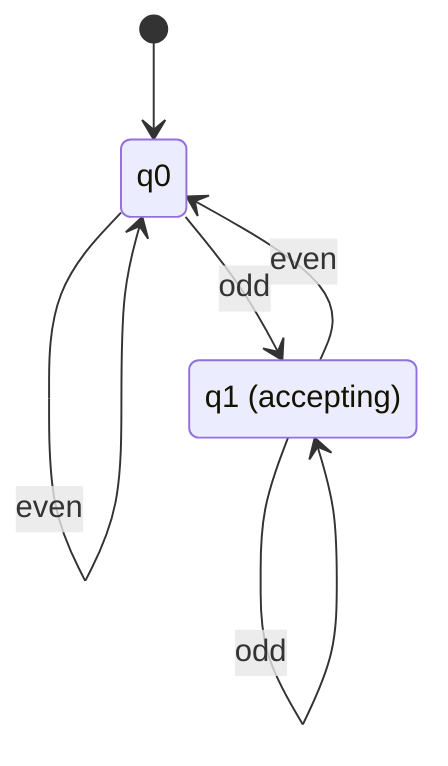
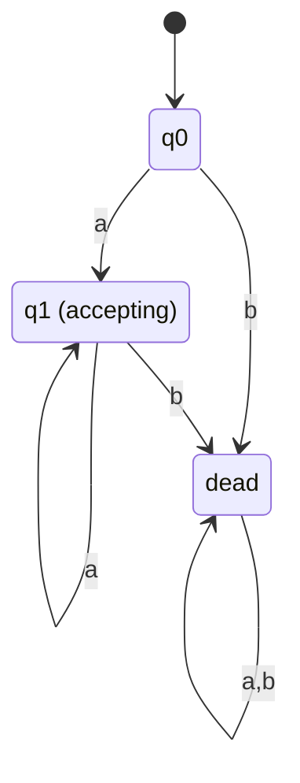
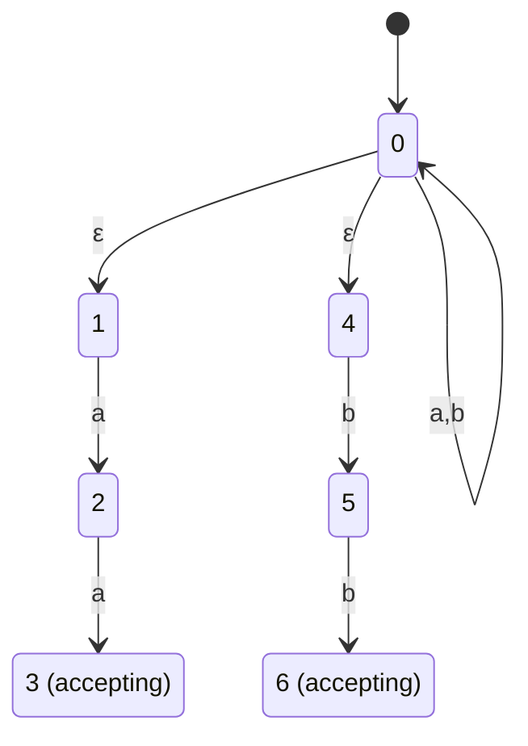
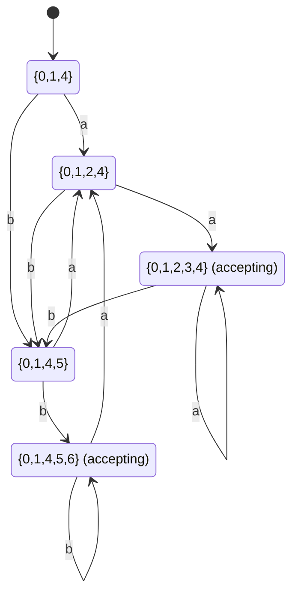

**Notes based off of:** Ch05aFSM.pdf (Chapter 5, "Finite State Machines")

## Languages and Machines

### The Regular Language Triangle

There are three equivalent ways to describe the same object, a **regular language** $L$:

- A **regular expression** — a compact algebraic pattern that _generates_ the strings in $L$.
- A **finite state machine (FSM)** — a mechanical device that _accepts_ the strings in $L$.
- The language $L$ itself — the set of strings.

The slides draw this as a triangle: regular expression → generates → $L$ ← accepts ← finite state machine. The deep result underlying this whole chapter (formalized later as the Kleene/Myhill-Nerode-style equivalences you'll see in Ch05b/Ch06) is that these three views are interchangeable: anything one can describe, the other two can describe as well. FSMs are the "machine" side of that triangle — this chapter is about what they are, how to design them, and what happens when you let them behave nondeterministically.

## Deterministic Finite State Machines (DFSMs)

### Formal Definition

A deterministic FSM is a 5-tuple: $$ M = (K, \Sigma, \delta, s, A) $$ where:

- $K$ is a finite set of **states**,
- $\Sigma$ is an **alphabet**,
- $s \in K$ is the **initial state**,
- $A \subseteq K$ is the set of **accepting (final) states**, and
- $\delta$ is the **transition function**, mapping $K \times \Sigma \to K$.

Informally, $M$ **accepts** a string $w$ iff, starting in $s$ and consuming $w$ symbol by symbol according to $\delta$, $M$ ends up in some state in $A$. The **language accepted by $M$**, written $L(M)$, is the set of all strings $M$ accepts.

### Notation Reference

A quick lookup for every symbol used across this note — the DFSM 5-tuple, the configuration machinery, and (further down) the NDFSM and subset-construction notation:

|Symbol|Meaning|
|---|---|
|$M$|The machine itself (DFSM or NDFSM)|
|$K$|Finite set of **states**|
|$\Sigma$|The input **alphabet** (finite set of symbols)|
|$s$|The **initial (start) state**, $s \in K$|
|$A$|Set of **accepting (final) states**, $A \subseteq K$|
|$\delta$|DFSM **transition function**: $K \times \Sigma \to K$ — exactly one next state per (state, symbol) pair|
|$\Delta$|NDFSM **transition relation**: a subset of $(K \times (\Sigma \cup {\varepsilon})) \times K$ — zero, one, or many next states per (state, symbol) pair|
|$q, q', p, r$|Generic/placeholder state names|
|$w$|An input string, $w \in \Sigma^{*}$|
|$a$|A single input symbol, $a \in \Sigma$|
|$\varepsilon$|The empty string (no symbols) — also used to label $\varepsilon$-transitions that consume no input|
|$(q, w)$|A **configuration**: current state $q$ plus remaining input $w$|
|$\vdash_M$|**Yields-in-one-step**: one configuration steps to the next by consuming one symbol|
|$\vdash_M^{*}$|**Yields** (reflexive, transitive closure of $\vdash_M$): zero or more steps|
|$C_0, C_1, \dots, C_n$|The sequence of configurations making up one **computation**|
|$L(M)$|The **language accepted by $M$** — the set of all strings $M$ accepts|
|$L$|A language in general (a set of strings)|
|$\mathrm{eps}(q)$|The **$\varepsilon$-closure** of state $q$ — every state reachable from $q$ using only $\varepsilon$-transitions|
|$K', \delta', s', A'$|The states, transition function, start state, and accepting states of the **DFSM built from an NDFSM** via the subset construction|
|$\mathcal{P}(K)$|The **power set** of $K$ (all subsets of $K$) — the candidate state space for $K'$|
|$Q$|A single state of $M'$ — i.e., a _subset_ of $K$, since subset-construction states are sets of original NDFSM states|

### Configurations, Yields, and Computations

To reason formally about "running" a machine, the slides introduce a bookkeeping device: the **configuration**. A configuration is a pair $$ (q, w) \in K \times \Sigma^{*} $$ capturing the only two things that can affect $M$'s future behavior — its current state $q$ and the input $w$ it has left to read. (Note this deliberately throws away everything already consumed: what mattered from the past is fully summarized by which state you're in now — that's the whole point of a _finite_ state machine.) The initial configuration on input $w$ is $(s, w)$.

The **yields-in-one-step** relation $\vdash_M$ steps a configuration forward by consuming exactly one symbol: $$ (q, w) \vdash_M (q', w') \iff w = aw' \text{ for some } a \in \Sigma, \text{ and } \delta(q,a) = q' $$ $\vdash_M^{*}$ is its reflexive, transitive closure — "yields in zero or more steps."

A **computation** is a finite chain of configurations $C_0, C_1, \dots, C_n$ where $C_0$ is an initial configuration, $C_n$ has the form $(q, \varepsilon)$ (input fully consumed), and each consecutive pair is linked by $\vdash_M$.

- $M$ **accepts** $w$ iff $(s, w) \vdash_M^{*} (q, \varepsilon)$ for some $q \in A$.
- $M$ **rejects** $w$ iff $(s, w) \vdash_M^{*} (q, \varepsilon)$ for some $q \notin A$.

**Theorem:** every DFSM $M$, on any input $w$, halts in exactly $|w|$ steps. This is a direct consequence of $\delta$ being a _total_ function on $K \times \Sigma$ (see "Dead States" below) — there's always exactly one legal move, so the machine can never get stuck early and never loop forever; it consumes one symbol per step until the input is gone.

### Example: Accepting Odd Integers



Reading a digit-string like `235` left to right, the machine just tracks the parity of the _last digit seen so far_: `q0` means "even digit last," `q1` means "odd digit last." On input `235`: $(q_0,235)\vdash_M (q_0,35)\vdash_M (q_1,5)\vdash_M (q_1,\varepsilon)$, and since $q_1\in A$, the string is accepted (235 is odd). This is the prototypical FSM design idea: **a state is a summary of everything about the prefix read so far that could still matter**.

## Designing DFSMs

### Clustering Strings by Shared "Future"

The slides frame FSM design as a language problem, not a graph-drawing problem: **group input prefixes that share the same future** — i.e., prefixes $x$ and $y$ such that, for every possible suffix $z$, $xz \in L \iff yz \in L$ — into a single state. Two prefixes that would behave identically on every possible continuation can be merged; they are indistinguishable to the language, so the machine doesn't need to distinguish them either. (This idea is exactly the Myhill–Nerode equivalence that later chapters make precise, and it's the practical heuristic for figuring out the _minimum_ number of states a DFSM needs.)

Worked example: $L = \{w \in \{a,b\}^{\{*\}} : w$ has an even number of $a$'s and an odd number of $b$'s$\}$. Since only the _parities_ of the two counts matter (not the exact counts), 4 states suffice — one per combination of (even/odd $a$-count, even/odd $b$-count) — rather than infinitely many.

### Dead States and Transition Completeness

Because $\delta$ is required to be a **total function**, a DFSM's transition table must specify a next state for _every_ state/symbol pair, even the ones that "shouldn't" happen. Symbols that don't lead anywhere useful are routed to a non-accepting **dead state** that loops to itself on every symbol — once you're in it, you can never reach an accepting state again, no matter what remains of the input.



_(Illustrative example — a machine for "strings over {a,b} with no b," completed with a dead state.)_ In the slides' own example, the language of floating-point numbers (`+3.0`, `0.3E1`, `-3E8`, …) is drawn exactly this way: a "backbone" of states for the digits/decimal-point/exponent pattern, plus every illegal symbol at every state routed down into one shared dead state. In practice, textbooks and diagrams almost always **omit the dead state and its edges for clarity** — any transition not drawn is implicitly "go to dead state, then reject." When you build a transition _table_ (as opposed to a diagram) for a DFSM, you must still fill in those entries explicitly.

### A Gallery of Typical Design Patterns

The deck works through many small target languages over ${a,b}$ or ${0,1}$ to build design intuition; the recurring techniques are worth naming explicitly:

- **Local pattern / lookback:** "every $a$ is immediately followed by a $b$," "no two consecutive characters are the same" — one state remembers "what I just saw," transitions check whether the next symbol violates the rule.
- **Parity / counting mod $k$:** "$w$ has odd parity," "even number of $a$'s" — states are counters reduced modulo some small number (never an _unbounded_ count — FSMs can't count arbitrarily high, only track finitely many residues/situations).
- **Bounded lookahead from the end:** "the fourth-to-last character is $a$" — surprisingly, this only needs a _constant_ number of states (16, since you track the last 4 symbols as a sliding window), even though it superficially sounds like it requires "memory" of position.
- **Substring / keyword matching:** "$w$ contains `abcabb`," "matches `abbaa` or `baba`" — states track _how much of the keyword has been matched so far_; this is the finite-automaton core of algorithms like Knuth–Morris–Pratt string search.
- **Complementation:** build an FSM for $\lnot L$ first, then **swap accepting and non-accepting states** to get $L$ — this only works because DFSMs are _complete_ (every string leads to exactly one state), so "not accepted by the complement" and "accepted by the original" line up perfectly. (This trick fails for NDFSMs, see below.)
- **Union of sublanguages ("or" conditions):** e.g. "$w = aba$ or $|w|$ is even" — track both conditions in parallel using a _product_ state (one component per sub-condition), and accept when either component says yes.

## Real-World and Historical FSMs

### Applications

The slides gesture at how widely this model applies beyond formal language theory: a **vending machine** (states = accumulated credit, transitions = coins inserted/dispense/return), a **communication protocol** (states = handshake stage), and a **soccer-playing robot's controller** (states = behavior mode) are all naturally modeled as FSMs. A recurring point: in the vending-machine diagram, several states loop to themselves on certain symbols (e.g., inserting a nickel that would exceed the max credit "does nothing") — a good reminder that a self-loop is a legitimate, often important, transition, not just a degenerate case.

### FSMs Predate Computers

The deck makes a historical point worth remembering conceptually: finite-state control is an old idea, realized mechanically long before electronic computers — the **Antikythera mechanism** (Greece, ~80 BC, an astronomical calculator), the **Prague Orloj** (1410 astronomical clock), the **abacus**, and the **Jacquard loom** (1801, which used punched cards to mechanically control weaving patterns — arguably a direct ancestor of programmable computation). The takeaway: an FSM is a _mathematical abstraction of "a system with finitely many internal configurations and deterministic rules for moving between them,"_ and that abstraction shows up anywhere such a system exists, not just in software.

## Nondeterministic Finite State Machines (NDFSMs)

### Formal Definition

A nondeterministic FSM is also a 5-tuple, $M = (K, \Sigma, \Delta, s, A)$, with $K$, $\Sigma$, $s$, $A$ as before, but now: $$ \Delta \subseteq (K \times (\Sigma \cup \{\varepsilon\})) \times K $$ is a **transition relation**, not a function. $M$ **accepts** $w$ iff _there exists some path_ through $\Delta$ that drives $M$ from $s$ to some state in $A$ while consuming exactly $w$ — other paths may fail; only one needs to succeed.

### Why Nondeterminism Arises

Three features distinguish $\Delta$ from a DFSM's $\delta$, and each is a distinct "source" of nondeterminism:

1. **Missing transitions** — a state may have no outgoing edge for some symbol (unlike a DFSM, this is allowed and just means that path dies).
2. **Multiple transitions on the same symbol** — a state may have several edges labeled with the same symbol, forcing a _choice_ of which to follow.
3. **$\varepsilon$-transitions** — edges that change state _without consuming any input symbol at all._

### Analyzing NDFSMs: Two Approaches

Because "does $M$ accept $w$" now means "does _some_ path work," there are two standard ways to check it:

- **Explore a search tree:** branch at every nondeterministic choice, and accept if _any_ leaf reaches an accepting state on $\varepsilon$ input remaining. Conceptually simple, but potentially expensive (the tree can be exponential in $|w|$) and needs backtracking.
- **Follow all paths in parallel:** at each step, track the _set_ of all states reachable so far, rather than a single state. This is the practical simulation strategy, and it's exactly what the eps-closure / subset-construction machinery below formalizes and makes efficient.

## Epsilon-Closure and Simulation

### Epsilon-Closure, $\mathrm{eps}(q)$

$$ \mathrm{eps}(q) = {p \in K : (q, w) \vdash_M^{*} (p, w)} $$ i.e., every state reachable from $q$ using _only_ $\varepsilon$-transitions (zero or more), without consuming any input. Computing it is a simple closure/reachability algorithm:

```
Compute eps(q: state)
  result = {q}
  While there exists p in result and r not in result
        and a transition (p, ε, r) in Δ:
      insert r into result
  Return result
```

### Simulating an NDFSM (the "parallel paths" idea, made concrete)

```
ndfsmsimulate(M: NDFSM, w: string) =
  1. current-state = eps(s)
  2. For each symbol c of w:
       next-state = ∅
       For each state q in current-state:
         For each state p such that (q, c, p) ∈ Δ:
           next-state = next-state ∪ eps(p)
       current-state = next-state
  3. If current-state contains a state in A, accept; else reject.
```

This is a direct DFSM-style simulation running over _sets_ of NDFSM states instead of single states — start at the $\varepsilon$-closure of $s$, and after each input symbol, move to the union of $\varepsilon$-closures of everywhere a single-symbol move could take you. This is precisely the algorithmic seed of the subset construction below.

**Worked example** (from the slides): an NDFSM over ${a,b}$ with $\varepsilon$-transitions splitting into two branches, one that accepts strings ending `aa` and one that accepts strings ending `bb`:



Here $\mathrm{eps}(0) = {0,1,4}$ and $\mathrm{eps}(i) = {i}$ for every other state (no outgoing $\varepsilon$-edges from them). Simulating on $w = abb$: start at ${0,1,4}$; on $a$ move to ${0,1,2,4}$; on $b$ move to ${0,1,4,5}$; on the final $b$ move to ${0,1,4,5,6}$ — which contains accepting state $6$, so `abb` is accepted.

## Equivalence of NDFSMs and DFSMs

### Theorem 5.3 and the Subset ("Powerset") Construction

Trivially, every DFSM is a (degenerate) NDFSM, so $\{L : L$ accepted by a DFSM$\} \subseteq \{L : L$ accepted by an NDFSM$\}$. The nontrivial direction — the reason nondeterminism doesn't actually add expressive power — is:

> **Theorem 5.3.** For every NDFSM, there is an equivalent DFSM.

**Proof idea (by construction).** Given $M = (K, \Sigma, \Delta, s, A)$, build $M' = (K', \Sigma, \delta', s', A')$ where each DFSM state is a _set_ of NDFSM states — literally the sets the parallel-simulation algorithm above tracks: $$ K' = \mathcal{P}(K), \qquad s' = \mathrm{eps}(s), \qquad A' = {Q \subseteq K : Q \cap A \neq \emptyset} $$ $$ \delta'(Q, a) = \bigcup {, \mathrm{eps}(p) : q \in Q \text{ and } (q,a,p) \in \Delta ,} $$ A subset $Q$ is accepting in $M'$ iff it contains _at least one_ accepting state of $M$ — matching "some path reaches an accepting state." The full algorithm (`ndfsmtodfsm`) only ever computes the subsets that are actually _reachable_ from $s'$, not the full power set, by maintaining an `active-states` worklist and expanding it lazily as new reachable subsets appear.

### Worked Example: Running the Construction

Continuing the $w = abb$ example above, running the subset construction to completion (not just simulating one string) produces this DFSM, whose 5 reachable states are exactly the 5 distinct subsets the simulation ever visits:



Note both accepting subsets, ${0,1,2,3,4}$ (contains $3$) and ${0,1,4,5,6}$ (contains $6$), correctly correspond to "some branch of the original NDFSM has reached its own accept state."

### State Explosion

The subset construction's state space is $\mathcal{P}(K)$, so it is only bounded by $2^{|K|}$ — and the slides show this bound can actually be _achieved_: with $|\Sigma| = n$, the number of genuinely new, distinguishable subsets reachable after $k$ input characters can grow like $\binom{n}{k}$, summing to a **total of $2^{n-1}$ reachable states after $n-1$ characters** in the worst case. This is the standard cautionary fact underlying real-world automata tooling: an NDFSM (or an equivalent regex/NFA) can be exponentially more _compact_ to write down than the DFSM it corresponds to, which is why practical tools (e.g., regex engines) often simulate the NDFSM directly (tracking a state _set_, as in `ndfsmsimulate`) rather than pre-building the full DFSM, trading a bit of per-step work for avoiding a potential blow-up in machine size.

**Prev:** [[3. The Big Picture]]