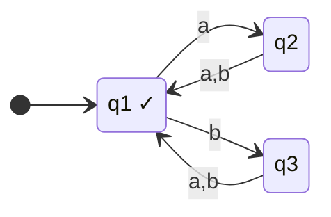
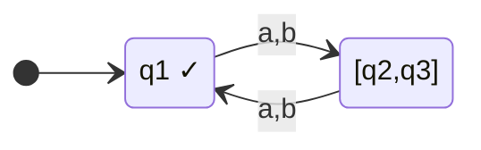
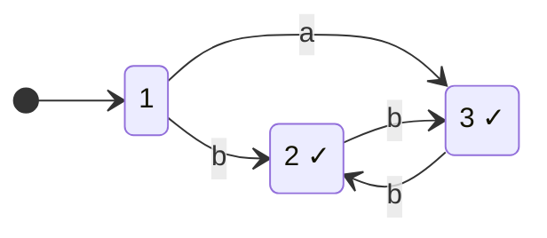
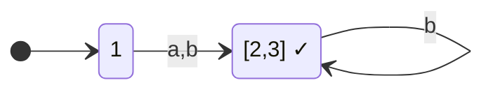
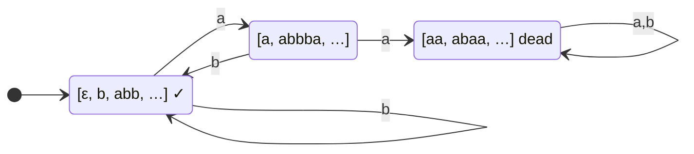
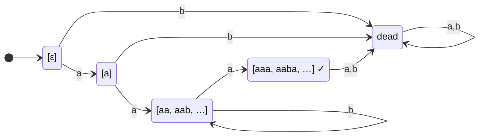
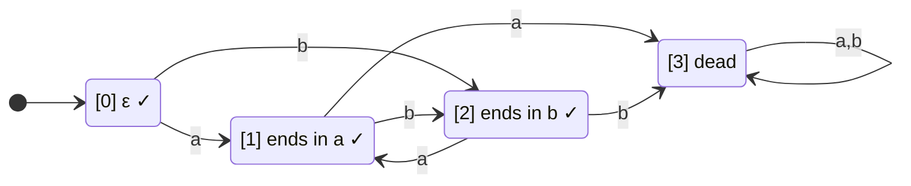
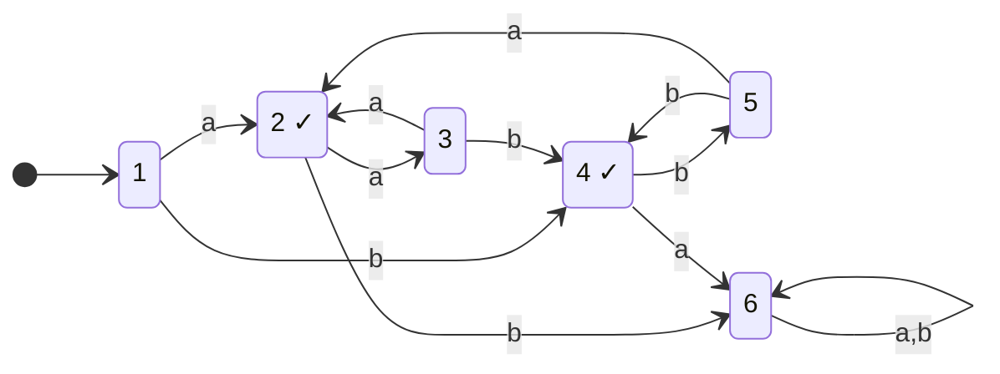
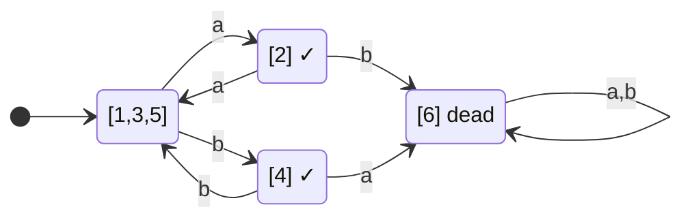
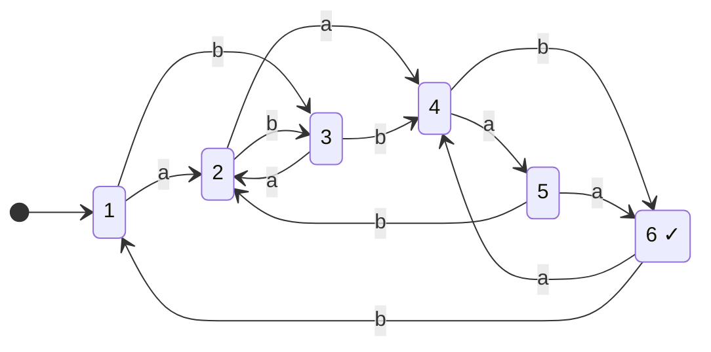

**Notes based off of:** Chapter 5 — Finite State Machines: State Minimization (Ch05bMinimization.pdf)

## Motivation

Two DFSMs can accept exactly the same language while having very different numbers of states. A _minimal_ DFSM for $L$ is one with the fewest possible states among all DFSMs accepting $L$. Minimization matters in practice: lexers generated from regular expressions (e.g. by `flex`), hardware controllers, and protocol verifiers all benefit from fewer states (smaller tables, fewer flip-flops, faster equivalence checks). It also gives us a _canonical form_: two DFSMs accept the same language iff their minimized versions are identical up to state names.

Minimization happens in two steps:

1. **Remove unreachable states** — states that no input string can drive the machine to from the start state.
2. **Merge redundant (equivalent) states** — states from which every string has the same fate (accept/reject).

### Step 1: Unreachable States

It is hard to identify unreachable states directly, so instead compute the **reachable** set and take the complement. This is just a graph search (BFS/DFS) from the start state $s$:

- Start with $R = {s}$.
- Repeatedly add any state $\delta(q, c)$ for $q \in R$, $c \in \Sigma$ until nothing new is added.
- Every state not in $R$ is unreachable and can be deleted (along with its outgoing transitions).

Example from the slides: states $1 \xrightarrow{a} 2$, $2 \xrightarrow{b} 1$, and $3 \xrightarrow{a} 2$. Nothing enters state 3, so it's unreachable — even though it's accepting, it contributes nothing to $L(M)$.

> [!warning] Order matters 
> The _MinDFSM_ algorithm below only merges states — it never deletes them. If unreachable states are left in, they may survive as extra classes and the result will not be minimal. Always remove unreachable states first.

### Step 2: Redundant States

Intuitively, two states are **equivalent** if every string in $\Sigma^*$ has the same fate whether the machine starts reading from one or the other.

**Easy case:** two states have _identical_ outgoing transitions and the same accept status. E.g. for $L = {w : |w| \text{ even}}$ below, $q_2$ and $q_3$ both go to $q_1$ on every symbol, so $q_2 \equiv q_3$:



Merged:



**Hard case:** transitions aren't identical but behaviour still is. Accepting states 2 and 3 point at _each other_ on $b$ (not at a common state), and neither has an $a$-transition (so $a$ leads to an implicit dead state from both). From either one, exactly the strings in $b^*$ are accepted:



Merged — a single accepting state with a $b$-self-loop:



Detecting this in general needs the systematic method below.

## Two Problems

1. **Given a regular language $L$**, find a minimal DFSM for it → use equivalence classes of _strings_ ($\approx_L$).
2. **Given a DFSM $M$**, find a minimal equivalent DFSM → use equivalence of _states_ ($\equiv$) via the _MinDFSM_ algorithm.

## Indistinguishable Strings: $\approx_L$

Two strings are equivalent (indistinguishable) with respect to $L$ if no suffix can tell them apart: $$ \forall x, y \in \Sigma^*: \quad x \approx_L y \iff \forall z \in \Sigma^* ; (xz \in L \iff yz \in L) $$ Why this is the right notion: after reading a prefix, a DFSM only "remembers" which state it is in. If $x$ and $y$ are distinguishable (some $z$ puts exactly one of $xz, yz$ in $L$), the machine _must_ be in different states after $x$ and after $y$. So the classes of $\approx_L$ are precisely the things a recognizer is forced to remember.

A string $z$ with $xz \in L$ but $yz \notin L$ (or vice versa) is called a **distinguishing suffix** for $x$ and $y$.

### Worked Check

Strings (1) `ababab` and (2) `baabab`:

- $L_1 = {w \in {a,b}^* : |w| \text{ even}}$: **equivalent**. Both have length 6, so $|xz|$ and $|yz|$ always have the same parity.
- $L_2 = {w : \text{every } a \text{ is immediately followed by } b}$: **not equivalent**. Take $z = \varepsilon$: `ababab` $\in L_2$ but `baabab` $\notin L_2$ (it contains `aa`).

### $\approx_L$ Is an Equivalence Relation

- **Reflexive:** $xz \in L \iff xz \in L$ trivially.
- **Symmetric:** "$\iff$" is symmetric.
- **Transitive:** if $x \approx_L y$ and $y \approx_L w$, then for every $z$: $xz \in L \iff yz \in L \iff wz \in L$, so $x \approx_L w$. _(The slide quantifies over $x, y, z$ but uses $w$ as the third string; $z$ is really the suffix variable.)_

Consequences — $\approx_L$ **partitions** $\Sigma^*$:

- No class is empty.
- Every string lies in exactly one class.

Each class is either **entirely inside $L$ or entirely outside $L$** (take $z = \varepsilon$). So $L$ is a union of some of the classes.

### Right-Invariance (Key Property)

If $x \approx_L y$ then for any symbol $a$, $xa \approx_L ya$. _Proof:_ for any $z$, apply the definition with suffix $az$: $x(az) \in L \iff y(az) \in L$. This is exactly what makes transitions between classes well-defined later.

## Examples of $\approx_L$ Classes

### Even Length

$\Sigma = {a,b}$, $L = {w : |w| \text{ even}}$. Two classes:

- $[\varepsilon, aa, ab, ba, bb, aaaa, \dots]$ — even length (all in $L$)
- $[a, b, aaa, aab, \dots]$ — odd length

### Every $a$ Immediately Followed by $b$

$L = {w : \text{every } a \text{ is immediately followed by } b}$. Three classes:

- $[\varepsilon, b, abb, \dots]$ — all strings in $L$.
- $[a, abbba, \dots]$ — strings ending in $a$ with no earlier "bad" $a$ (still recoverable: appending $b$ puts them in $L$).
- $[aa, abaa, \dots]$ — strings containing an $a$ not followed by $b$ (since an $a$ can only be followed by $a$ or $b$, this means `aa` appears somewhere). No suffix can save them — a **dead** class.

Distinguishing suffixes: $\varepsilon$ vs $a$ by $z = ab$ ($ab \in L$ but $aab \notin L$); $a$ vs $aa$ by $z = b$ ($ab \in L$, $aab \notin L$); $\varepsilon$ vs $aa$ by $z = \varepsilon$.

The resulting minimal DFSM (states named by class):



### $L = aab^*a$

(Left blank on the slide.) Five classes:

- $[\varepsilon]$ — still need $aab^*a$.
- $[a]$ — still need $ab^*a$.
- $[aa, aab, aabb, \dots] = aab^*$ — need $b^*a$.
- $[aaa, aaba, aabba, \dots] = aab^*a$ — exactly $L$; only $z = \varepsilon$ works.
- $[b, ab, aaaa, \dots]$ — everything else: dead, no suffix leads into $L$.

Each pair is distinguishable, e.g. $\varepsilon$ vs $a$ by $z = aa$ ($aa \notin L$ but $aaa \in L$).

The resulting minimal DFSM:



### More Than One Accepting Class

$L = {w : \text{no two adjacent characters are the same}}$. Four classes:

- $[0]$: $[\varepsilon]$ — in $L$, anything may follow.
- $[1]$: $[a, ba, aba, baba, \dots]$ — in $L$, ends in $a$ (next char must be $b$).
- $[2]$: $[b, ab, bab, abab, \dots]$ — in $L$, ends in $b$ (next char must be $a$).
- $[3]$: $[aa, bb, abaa, ababb, \dots]$ — dead; $[3] \cap L = \emptyset$.

Three classes lie inside $L$, which shows $L$ need not be a single class. ($\varepsilon$ vs $a$: $z = a$ gives $a \in L$ but $aa \notin L$.) _(Slide 15 lists $[1]$ and $[2]$ slightly off — e.g. $ba$ belongs in $[1]$ and $bb$ in $[3]$; slide 22 has the corrected lists above.)_

### Infinitely Many Classes: $a^nb^n$

$L = {a^nb^n : n \geq 0}$. For $i \neq j$, $a^i$ and $a^j$ are distinguished by $z = b^i$: $a^ib^i \in L$ but $a^jb^i \notin L$. So $[\varepsilon], [a], [a^2], [a^3], \dots$ are all distinct → **infinitely many classes**. By Myhill–Nerode (below) this proves $L$ is **not regular**.

## Theorem 5.4 — Lower Bound

> **Theorem 5.4:** If DFSM $M$ accepts regular $L$, then $|K_M| \geq$ number of classes of $\approx_L$.

_Proof (pigeonhole):_ Say a string $x$ "lands in" state $q$ if $M$ reading $x$ from $s$ ends in $q$. Suppose there are fewer states than classes. Then some state $q$ has strings $x, y$ from two _different_ classes landing in it. But from $q$, $M$'s behaviour on any suffix $z$ is fixed, so $xz \in L \iff yz \in L$ for all $z$ — meaning $x \approx_L y$. Contradiction.

## Theorem 5.5 — The Minimal DFSM Exists and Is Unique

> **Theorem 5.5:** For regular $L$ with $n$ classes of $\approx_L$, there is a DFSM with exactly $n$ states accepting $L$; any other DFSM accepting $L$ has more states or is identical up to renaming states.

**Construction** $M = (K, \Sigma, \delta, s, A)$:

- $K$ — one state per class of $\approx_L$.
- $s = [\varepsilon]$.
- $A = {[x] : x \in L}$.
- $\delta([x], a) = [xa]$ — "if I'm in the class containing $x$ and read $a$, go to the class containing $xa$."

**Proof obligations:**

- **$K$ is finite:** $L$ is regular, so some DFSM with $m$ states accepts it; by Thm 5.4, $n \leq m$.
- **$\delta$ is a function (well-defined):** $\delta([x], a)$ must not depend on which representative $x$ we pick. By right-invariance, $x \approx_L y \Rightarrow xa \approx_L ya$, so $[xa] = [ya]$.
- **$L(M) = L$:** by induction on $|w|$, $([\varepsilon], w) \vdash_M^* ([w], \varepsilon)$ — reading $w_1 w_2 \dots w_m$ walks through $[w_1], [w_1w_2], \dots, [w]$. Then $M$ accepts $w$ iff $[w] \in A$ iff $w \in L$ (classes are wholly in or out of $L$).
- **Nothing smaller:** direct from Thm 5.4.
- **Unique:** (slide leaves this unproved) Let $M^#$ also have $n$ states and accept $L$. With no unreachable states, every state has strings landing in it, and by the Thm 5.4 argument all strings landing in one state are in the same class. $n$ states and $n$ classes means each state corresponds to exactly one class — a bijection. Transitions are forced: if $x$ lands in $q$, then $xa$ lands in $\delta^#(q, a)$, which must be the state for $[xa]$. So $M^#$ is $M$ with renamed states.

### Example Construction

For "no two adjacent characters the same":

|State|$a$|$b$|Accepting?|
|---|---|---|---|
|$[0] = [\varepsilon]$ (start)|$[1]$|$[2]$|yes|
|$[1]$ (ends in $a$)|$[3]$|$[2]$|yes|
|$[2]$ (ends in $b$)|$[1]$|$[3]$|yes|
|$[3]$ (dead)|$[3]$|$[3]$|no|

E.g. $\delta([\varepsilon], a) = [a] = [1]$, and $\delta([a], b) = [ab] = [2]$.

As a diagram:



## Theorem 5.6 — Myhill–Nerode

> **Theorem 5.6 (Myhill–Nerode):** $L$ is regular $\iff$ $\approx_L$ has finitely many equivalence classes.

- **($\Rightarrow$)** A DFSM with $m$ states accepts $L$; by Thm 5.4 the number of classes is $\leq m$.
- **($\Leftarrow$)** If finitely many classes, the Thm 5.5 construction builds a (finite) DFSM for $L$.

**Practical use:** this is an alternative to the pumping lemma for proving non-regularity. Find an infinite set of strings that are **pairwise distinguishable** (as with $a^i$ for $a^nb^n$), and you are done. Often it gives cleaner proofs than pumping.

## Minimizing an Existing DFSM (Without Knowing $\approx_L$)

In practice we usually have a machine, not a neat description of $\approx_L$. E.g. the 6-state machine from the start of the slides: is it minimal? We need an algorithm that works on the states directly. Two approaches:

- **Collapsing:** start with $M$ and merge redundant states one pair at a time.
- **Overclustering (used here):** start with just two groups — accepting and non-accepting — and repeatedly _split_ groups until every distinction $L$ requires has been made.

### State Equivalence $\equiv$

$q \equiv p$ iff for every $w \in \Sigma^*$, reading $w$ from $q$ and from $p$ either both end in accepting states or both end in rejecting states. Equivalent states are **mergeable**. (This is the state-level analogue of $\approx_L$: $x \approx_L y$ iff the states they land in are $\equiv$.)

### Building $\equiv$ as a Limit of $\equiv_n$

$\equiv_n$ means "no string of length $\leq n$ distinguishes them":

- $p \equiv_0 q$ iff both accepting or both rejecting (they agree on $\varepsilon$).
- $p \equiv_1 q$ iff $p \equiv_0 q$ and each single symbol sends them to $\equiv_0$ states.
- In general, for $n \geq 1$: $$ q \equiv_n p \iff q \equiv_{n-1} p ;\text{ and }; \forall a \in \Sigma ; \big(\delta(p, a) \equiv_{n-1} \delta(q, a)\big) $$ Each $\equiv_n$ refines $\equiv_{n-1}$ (classes only split, never merge). Since there are at most $|K|$ classes, the process **stabilises** after at most $|K| - 2$ refinement rounds; once $\equiv_{n} = \equiv_{n-1}$ it will never change again, and that fixed point is $\equiv$.

### Algorithm _MinDFSM_

```
MinDFSM(M: DFSM) =
1. classes := {A, K - A}                      -- accepting / non-accepting
2. while ∃ E ∈ classes, p,q ∈ E, c ∈ Σ with [δ(p,c)] ≠ [δ(q,c)] do
3.     split E so that [p] ≠ [q]              -- by where each state goes on c
4.     remove E from classes
5.     add the subclasses of E to classes
6. return M* = (classes, Σ, δ*, [s], {[q] : q ∈ A})
       where if δ(q, c) = p then δ*([q], c) = [p]
```

- In words: a group is split when two of its members go to **different** groups on the same symbol.
- At the end, all states in the same class are merged into one state.
- **Preconditions:** the input DFSM must be **complete** (every state has a transition on every symbol — add an explicit dead state if needed), and unreachable states should already be removed.
- $\delta^*$ is well-defined because, when the loop stops, all states in a class go to the same class on each symbol.
- Complexity: naive refinement is polynomial (roughly $O(|\Sigma| \cdot |K|^2)$ per round, $O(|K|)$ rounds). Hopcroft's algorithm does it in $O(|\Sigma| \cdot |K| \log |K|)$. The "table-filling" (pair-marking) algorithm often taught elsewhere computes the same $\equiv$ from the opposite direction, marking distinguishable pairs.

### Worked Example

$\Sigma = {a, b}$, accepting states ${2, 4}$:

| State     | $a$ | $b$ |
| --------- | --- | --- |
| 1 (start) | 2   | 4   |
| 2 ✓       | 3   | 6   |
| 3         | 2   | 4   |
| 4 ✓       | 6   | 5   |
| 5         | 2   | 4   |
| 6         | 6   | 6   |

Original machine (compare with the 4-state result below — 1, 3 and 5 all behave identically):



**$\equiv_0 = {[1,3,5,6], [2,4]}$** — non-accepting vs accepting.

**$\equiv_1$:** in $[1,3,5,6]$, on $a$: $1, 3, 5 \to 2$ (accepting) but $6 \to 6$ (non-accepting). Split off 6. In $[2,4]$, on both $a$ and $b$ everything goes to non-accepting states — no split. $\equiv_1 = {[1,3,5], [6], [2,4]}$

**$\equiv_2$:** in $[2,4]$, on $a$: $2 \to 3 \in [1,3,5]$ but $4 \to 6 \in [6]$. Split. (Distinguishing string: $aa$ — from 2 it ends in accepting 2; from 4 it ends in dead 6.) In $[1,3,5]$: all go to 2 on $a$ and 4 on $b$ — cannot split. $\equiv_2 = {[1,3,5], [2], [4], [6]}$

**$\equiv_3 = \equiv_2$** — no more splits, so $\equiv = \equiv_2$.

**Result (4 states):**



Reading off the language: from the start, $aa$ or $bb$ returns to the start, and a single final $a$ or $b$ accepts. So $L = (aa \cup bb)^*(a \cup b)$.

### Answer to the Opening Question

The machine from the opening slide:



The 6-state machine at the start (accepting state 6) is in fact **already minimal**:

- $\equiv_0 = {[1,2,3,4,5], [6]}$
- $\equiv_1 = {[1,2,3], [4], [5], [6]}$ — 4 reaches 6 on $b$, 5 reaches 6 on $a$, the others reach 6 on neither.
- $\equiv_2$: 1 goes to $[1,2,3]$ on both symbols, 2 goes to $[4]$ on $a$, 3 goes to $[4]$ on $b$ — all three split, giving six singleton classes.

No two states are equivalent, so no merging is possible. The point of the example: you can't tell by eye — you need the algorithm.

## Summary

- Every regular $L$ has a minimal DFSM, with exactly as many states as $\approx_L$ has classes.
- That minimal DFSM is **unique up to state names** (a canonical form for regular languages).
- $L$ is regular iff $\approx_L$ has finitely many classes (Myhill–Nerode) — also a tool for proving non-regularity.
- Given any DFSM, remove unreachable states, make it complete, then run _MinDFSM_ (partition refinement) to get the minimal equivalent DFSM.

**Prev: [[4. Languages and Machines]], **Next:** [[6. State Tansducers]]