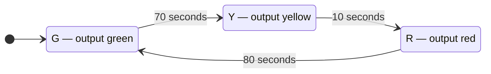
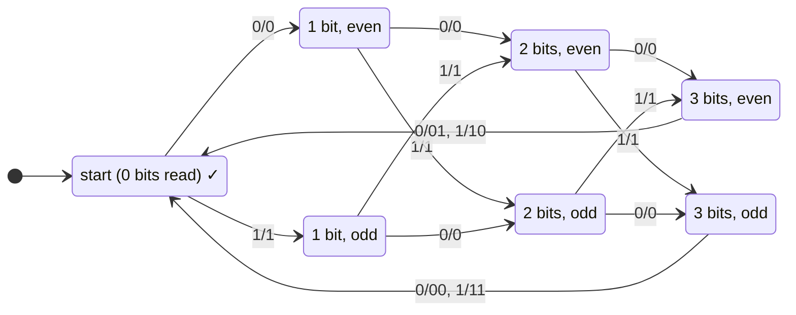
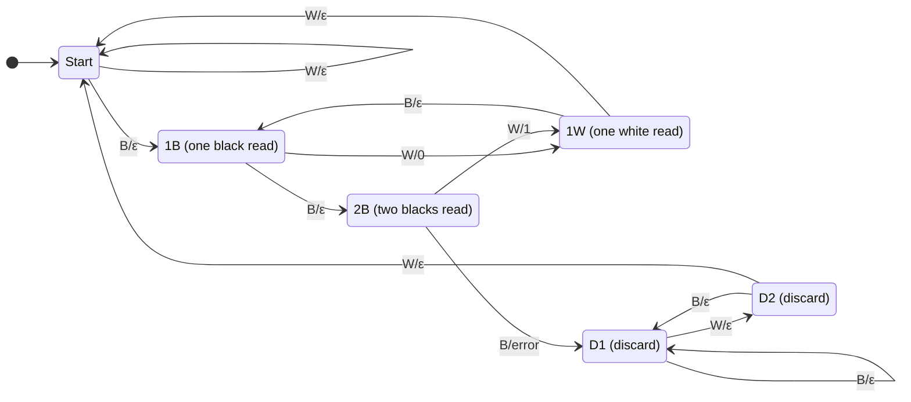
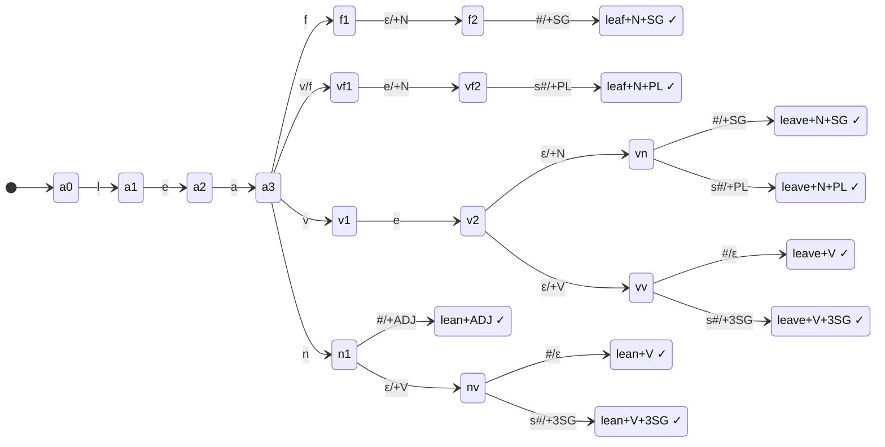

**Notes based off of:** Chapter 5 — Finite State Machines: Transducers (Ch05cTransducers.pdf)

## From Acceptors to Transducers

Every machine so far has been an **acceptor**: it reads a string and gives a yes/no answer (accept/reject). A **finite state transducer (FST)** also _produces output_ while it reads. Instead of deciding membership in a language, it computes a **function** from input strings to output strings, $f : \Sigma^* \to O^*$.

A transducer is a DFSM with one extra ingredient — an output alphabet $O$ plus a rule for when to emit output. There are two classic choices for _where_ output is attached:

- **Moore machine:** output is attached to **states**.
- **Mealy machine:** output is attached to **transitions**.

In both, a machine $M$ **computes a function** $f(w)$ iff the output sequence it produces while reading $w$ is exactly $f(w)$.

## Moore Machines

A **Moore machine** is $M = (K, \Sigma, O, \delta, D, s, A)$ where:

- $K$ — finite set of states
- $\Sigma$ — input alphabet
- $O$ — output alphabet
- $s \in K$ — initial state
- $A \subseteq K$ — accepting states
- $\delta : K \times \Sigma \to K$ — transition function (exactly as in a DFSM)
- $D : K \to O^*$ — the **output function**: each state has an output string

**$M$ outputs $D(q)$ each time it lands in state $q$.** The first six components are just a DFSM; $D$ is the only addition.

So on input $w = w_1 w_2 \dots w_n$, visiting states $q_1, q_2, \dots, q_n$ after each symbol, the output is $$ D(q_1), D(q_2) \cdots D(q_n) $$ _(Conventions differ on whether the start state also emits $D(s)$ before any input is read. If it does, the output has one more piece than the input has symbols — watch for this in exam questions.)_

Because $D$ maps to $O^*$ rather than $O$, a state may output a whole string, or nothing ($\varepsilon$).

### Example: A Simple US Traffic Light Controller

Three states, each of which _is_ its output (the colour of the light):

- The output depends only on the current state, not on how we got there, so this is naturally a **Moore** machine.
- The edge labels are a simplification: the "input" is really a timer-expiry event. If the input were raw one-second clock ticks, a pure FSM would need a separate state for every second (160 states in one cycle) — in practice a timer/counter is used alongside the FSM.
- Real controllers add inputs such as a pedestrian button or a car sensor on the cross street, which make transitions conditional (e.g. stay green on the main road until a car is detected).

## Mealy Machines

A **Mealy machine** is $M = (K, \Sigma, O, \delta, s, A)$ where $K, \Sigma, O, s, A$ are as before and:

- $\delta : K \times \Sigma \to K \times O^*$ — each transition produces **both** a next state and an output string.

**$M$ outputs each time it takes a transition.** There's no separate $D$; output lives on the edges. A transition from $p$ to $q$ on input $c$ that outputs $w$ is drawn with the label $c/w$ (read "on $c$, output $w$"): $$ \delta(p, c) = (q, w) \quad \text{drawn as} \quad p \xrightarrow{c/w} q $$ Since each input symbol produces one output chunk, a Mealy machine's output is naturally aligned with its input: $n$ input symbols → $n$ output chunks.

## Moore vs. Mealy

|                           | Moore                                                   | Mealy                                                       |
| ------------------------- | ------------------------------------------------------- | ----------------------------------------------------------- |
| Output attached to        | states                                                  | transitions                                                 |
| Output depends on         | current state only                                      | current state **and** current input                         |
| Formal addition to a DFSM | $D : K \to O^*$                                         | $\delta : K \times \Sigma \to K \times O^*$                 |
| Typically needs           | more states                                             | fewer states                                                |
| Hardware behaviour        | output changes only on clock edge (stable, glitch-free) | output reacts immediately to input (faster, but can glitch) |

**They are equally expressive** (up to the start-state output convention):

- **Moore → Mealy:** put each state's output on every transition _entering_ it: if $\delta(p, c) = q$, the Mealy transition becomes $p \xrightarrow{c/D(q)} q$. Same number of states.
- **Mealy → Moore:** a Moore state can only have one output, but different transitions into the same Mealy state may output different things. Fix: split each state $q$ into copies $(q, w)$, one per distinct output $w$ on its incoming edges. This can multiply the number of states.

This is why hardware and protocol designers pick whichever is more convenient: Moore for clean "status" outputs (a light colour), Mealy when the output is a reaction to an input (the parity bit below).

## Example: An Odd Parity Generator

**Task:** read bits in groups of four; after each group, emit a fifth bit so that each 5-bit block (4 data bits + 1 parity bit) has **odd parity**, i.e. an odd number of 1s. _(The slide says "each group of four bits has odd parity" — it means the group together with its added parity bit.)_

Parity bits are a simple error-detecting code: if any single bit gets flipped in transmission, the block's parity becomes even and the receiver knows something went wrong. (It cannot detect two flipped bits, or say which bit flipped.)

**Design idea:** the machine only needs to remember two things — _how many bits of the current group it has read_ (0–3) and _whether the number of 1s so far is even or odd_. That's $1 + 2 + 2 + 2 = 7$ states. Every data bit is copied straight to the output ($0/0$, $1/1$); the 4th bit of each group outputs itself **plus** the parity bit, which is why those edges output 2-symbol strings like $0/01$ (this is where $O^*$ is needed rather than $O$).

Reading the last edges: from **E3** (even count after 3 bits), a final $0$ leaves the count even, so the parity bit must be $1$ → output $01$; a final $1$ makes it odd, so parity bit $0$ → output $10$. From **O3** it's the reverse.

Worked input `0010 1100 0000 1111`:

|Group|# of 1s|Parity bit|Output block|
|---|---|---|---|
|0010|1 (odd)|0|00100|
|1100|2 (even)|1|11001|
|0000|0 (even)|1|00001|
|1111|4 (even)|1|11111|

Only the start state is accepting, so the machine accepts exactly when the input is a whole number of 4-bit groups.

This is a **Mealy** machine: the parity bit depends on the last input bit, so it's naturally attached to the transition.

## Example: A Bar Code Scanner

The slide shows a UPC-A bar code (`0 12345 67890 5`). The scanner reads the code as a sequence of equal-width **modules**, each either black ($B$) or white ($W$), and translates bar widths into bits.

**Check digit aside:** the last digit (5) is a check digit. Triple the sum of digits in odd positions and add the sum of digits in even positions: $3(0+2+4+6+8+0) + (1+3+5+7+9) = 60 + 25 = 85$; the check digit brings this to a multiple of 10, giving $5$. Like the parity bit, it's an error-detection device.

The slide's transducer uses a simplified encoding: **a single-width black bar = 0, a double-width black bar = 1, a triple-width black bar = error**, with bars separated by white.

- **Start:** skip leading white space; a black module starts a bar.
- **1B / 2B:** count how wide the black bar is. The bit is only known once a white module _ends_ the bar, so the output happens on the $W$ transition out of 1B ($W/0$) or 2B ($W/1$). A third black means an invalid bar → output `error`.
- **1W:** after one white, another black starts the next bar; a second white means the code has ended (return to Start).
- **D1/D2:** after an error, swallow everything until two consecutive whites, then restart. This is a simple **error-recovery** strategy — the same idea compilers use to skip to a safe point after a syntax error.

_(The slide's "IB" state is 1B — one black module read.)_ Real UPC scanning is more involved: each digit is 7 modules as two bars and two spaces of varying widths, left and right halves use different encodings so the code can be read upside down, and scanners must cope with varying print width and distance. But the core idea — a transducer turning a stream of light/dark samples into symbols — is the same.

## Example: English Morphology

**Morphology** is how words are built from smaller units (_morphemes_): a stem plus affixes like plural _-s_. **Morphological analysis** maps a surface word to its stem and grammatical features, e.g.

- `leaves` → `leaf +N +PL` (noun, plural)
- `leaves` → `leave +V +3SG` (verb, 3rd person singular: "she leaves")

The slide's transducer analyses words starting with `lea`: _leaf_, _leave(s)_, _lean(s)_. Conventions:

- An edge with a single symbol like `l` means `l/l` — copy the input to the output.
- `#` marks the **end of the word**.
- `ε/+N` reads nothing and outputs a feature tag — an **ε-transition**.
- `v/f` reads `v` but outputs `f` — this is how `leaves` is mapped back to the stem _leaf_ (the English f→v spelling change).

|Input|Analyses (output)|
|---|---|
|`leaf#`|leaf+N+SG|
|`leaves#`|leaf+N+PL, leave+N+PL, leave+V+3SG|
|`leave#`|leave+N+SG, leave+V|
|`lean#`|lean+ADJ, lean+V|
|`leans#`|lean+V+3SG|

### This Transducer Is Nondeterministic

Unlike the earlier examples, this one has several edges leaving the same state that can read the same input (from the `lea` state, both `v/f` and `v` read `v`), plus ε-transitions. So it is a **nondeterministic FST**, and one input can have **several outputs** — `leaves` is genuinely ambiguous in English. Strictly, it computes a **relation** between input and output strings, not a function. Choosing the right analysis needs context (e.g. "the leaves fall" vs. "she leaves early"), which is handled by later stages such as a part-of-speech tagger.

Important contrast with acceptors: every NDFSM can be converted to an equivalent DFSM, but **not every nondeterministic transducer can be made deterministic** — a DFST outputs exactly one string per input, so it can't represent a relation where one input has several outputs.

## Where Transducers Are Used

- **Digital hardware:** Moore/Mealy machines are the standard model for sequential circuits (controllers, protocol handlers); they're written directly in Verilog/VHDL.
- **Error detection/encoding:** parity generators, check digits, serial line encoders.
- **Compilers:** a lexer is a transducer from characters to tokens.
- **Natural language processing:** morphological analysers, spell-checkers, stemmers, text-to-speech rules, and speech recognition pipelines are built from FSTs (e.g. two-level morphology, OpenFst). A key property is that FSTs can be **composed**: chaining two transducers gives another transducer, so complex systems are built from small, simple stages.

**Prev:** [[CS3331A/5. State Minimization|5. State Minimization]], **Next:** [[CS3331A/7. Regular Expressions|7. Regular Expressions]]