**Notes based off of:** Ch06RegularExpressions.pdf (Chapter 6 lecture slides, _Regular Expressions_)

## Overview

Regular expressions are a third way of describing **regular languages**, alongside finite state machines (FSMs). The relationship is:

- A regular expression $\alpha$ **defines** a language $L(\alpha)$.
- An FSM $M$ **accepts** a language $L(M)$.
- **Kleene's Theorem** says these two descriptions pick out _exactly the same class_ of languages: the regular languages.

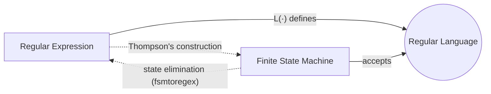

Why have both? FSMs are a _machine_ model (good for implementing recognizers and for proofs about computation), while regular expressions are a _declarative, textual_ model (good for humans to write patterns, and the basis of tools like `grep`, Perl, Python's `re`, lexers in compilers, etc.).

## Syntax: What Is a Regular Expression?

The regular expressions over an alphabet $\Sigma$ are all and only the strings obtainable by these rules (an inductive definition):

1. $\varnothing$ is a regular expression.
2. $\varepsilon$ is a regular expression.
3. Every $a \in \Sigma$ is a regular expression.
4. If $\alpha, \beta$ are regular expressions, so is $\alpha\beta$ (concatenation).
5. If $\alpha, \beta$ are regular expressions, so is $\alpha \cup \beta$ (union).
6. If $\alpha$ is a regular expression, so is $\alpha^{*}$ (Kleene star).
7. If $\alpha$ is a regular expression, so is $\alpha^{+}$.
8. If $\alpha$ is a regular expression, so is $(\alpha)$.

> [!note] Notation 
> Union $\cup$ is also commonly written as $+$ or $|$. So $a \cup b$, $a + b$ and `a|b` all mean the same thing. The lecture annotations use $+$.

> [!info] Rules 2 and 7 are redundant 
> They are greyed out on the slide because they are conveniences, not necessities:
> 
> - $\varepsilon$ can be written as $\varnothing^{*}$ (since $L(\varnothing^{*}) = {\varepsilon}$).
> - $\alpha^{+}$ can be written as $\alpha\alpha^{*}$.
> 
> A minimal definition only needs $\varnothing$, symbols, concatenation, union, star, and parentheses.

### Examples over $\Sigma = {a, b}$

$\varnothing$, $;\varepsilon$, $;a$, $;(a \cup b)^{*}$, $;abba \cup \varepsilon$

Note that a regular expression is just a _string_ (syntax). It only means something once we interpret it, which is the next section.

## Semantics: The Language $L(\alpha)$

The language expressed by a regular expression is defined by structural recursion, mirroring the syntax rules:

1. $L(\varnothing) = \varnothing$ (the empty set; no strings at all)
2. $L(\varepsilon) = {\varepsilon}$ (the set containing only the empty string; **not** the same as $\varnothing$)
3. $L(c) = {c}$ for $c \in \Sigma$
4. $L(\alpha\beta) = L(\alpha),L(\beta)$ (language concatenation)
5. $L(\alpha \cup \beta) = L(\alpha) \cup L(\beta)$
6. $L(\alpha^{*}) = (L(\alpha))^{*}$
7. $L(\alpha^{+}) = L(\alpha\alpha^{*}) = L(\alpha)(L(\alpha))^{*}$. If $L(\alpha) = \varnothing$ then $L(\alpha^{+}) = \varnothing$; otherwise it is all concatenations of **one or more** strings from $L(\alpha)$.
8. $L((\alpha)) = L(\alpha)$

Quick reminder of the difference between the two closures:

- $\alpha^{*}$: **zero** or more repetitions, so always contains $\varepsilon$
- $\alpha^{+} = \alpha\alpha^{*}$: **one** or more repetitions

> [!warning] Common trap: 
> $\varnothing$ vs $\varepsilon$ $\varnothing$ concatenated with anything is $\varnothing$ (there is nothing to pick from the first set). $\varepsilon$ concatenated with anything leaves it unchanged. Also $\varnothing^{*} = {\varepsilon}$, _not_ $\varnothing$, because the star always allows zero repetitions. But $\varnothing^{+} = \varnothing$.

### Worked Derivation

$$ \begin{aligned} L((a \cup b)^{*}b) &= L((a \cup b)^{*}),L(b) \ &= (L((a \cup b)))^{*},L(b) \ &= (L(a) \cup L(b))^{*},L(b) \ &= ({a} \cup {b})^{*},{b} \ &= {a,b}^{*}{b} \end{aligned} $$ In words: all strings over ${a, b}$ that **end in $b$**.

The lecture annotation shows the bottom-up view of the same thing: build $a$, $b$, then $a+b$, then $(a+b)$, then $(a+b)^{*}$, then concatenate with $b$. That bottom-up order is exactly how Thompson's construction (later) builds an NFA.

### More Examples (Regex → Language)

|Regular expression|Language|
|---|---|
|$a^{*}b^{*}$|${a^n b^m \mid n, m \ge 0}$: some $a$'s followed by some $b$'s|
|$(a \cup b)^{*}$|${a, b}^{*}$: every string|
|$(a \cup b)^{*}a^{*}b^{*}$|${a, b}^{*}$, since $a^{*}b^{*}$ can match $\varepsilon$ and add nothing|
|$(a \cup b)^{*}abba(a \cup b)^{*}$|${w \mid w \text{ contains } abba \text{ as a substring}}$|
|$(aa^{*}) \cup \varepsilon$|$a^{*}$ (one-or-more $a$'s, or none)|
|$(a \cup \varepsilon)^{*}$|$a^{*}$ (choosing $\varepsilon$ in an iteration contributes nothing)|

The pattern $(a \cup b)^{*},x,(a \cup b)^{*}$ is the standard idiom for "contains $x$ as a substring". It reappears in pattern matching at the end of this chapter as $\Sigma^{*}p,\Sigma^{*}$.

## Going the Other Way (Language → Regex)

This direction is harder because there is no mechanical recipe from an English description; you have to find structure in the language. Useful strategy: **decompose a typical string into repeated chunks**.

### Even-length strings

$L = {w \in {a,b}^{*} : |w| \text{ is even}}$

Every even-length string is a sequence of length-2 blocks: $$ ((a \cup b)(a \cup b))^{*} \quad\text{or equivalently}\quad (aa \cup ab \cup ba \cup bb)^{*} $$ Both are correct. Many different regexes can describe the same language, so **regex equality is not syntactic**.

### Odd number of $a$'s

$L = {w \in {a,b}^{*} : w \text{ contains an odd number of } a\text{'s}}$

Idea: an odd number is $1 + 2k$. Match one $a$ (with any $b$'s around it), then any number of _pairs_ of $a$'s (with any $b$'s around them): $$ b^{*}ab^{*}(ab^{*}ab^{*})^{*} \quad\text{or}\quad b^{*}(ab^{*}ab^{*})^{*}ab^{*} $$ The $b^{*}$ scattered everywhere is what allows $b$'s to appear anywhere in the string.

### At most one $b$

$L = {w \in {a,b}^{*} : w \text{ has no more than one } b}$

Split into cases "zero $b$'s" and "exactly one $b$": $$ a^{*} \cup a^{*}ba^{*} $$ (Can also be compressed to $a^{*}(b \cup \varepsilon)a^{*}$.)

### No two consecutive letters equal

$L = {w \in {a,b}^{*} : \text{no two consecutive letters are the same}}$

Such strings strictly alternate: $abab\ldots$ or $baba\ldots$. Optionally start with an $a$, repeat $ba$, optionally end with a $b$: $$ (\varepsilon \cup a)(ba)^{*}(b \cup \varepsilon) $$ Each piece can be $\varepsilon$, so $\varepsilon$, $a$, $b$, $ab$, $ba$, $aba$, ... are all covered. Sanity checks: $a$ (first factor $a$, rest $\varepsilon$), $b$ (last factor), $ab$ (first $a$, last $b$), $bab$ ($(ba)$ once, then $b$).

## Operator Precedence

|Precedence|Regular expressions|Arithmetic analogue|
|---|---|---|
|Highest|Kleene star $^{*}$|exponentiation|
|Middle|concatenation|multiplication|
|Lowest|union $\cup$|addition|

So $ab^{*} \cup cd^{*}$ parses as $(a(b^{*})) \cup (c(d^{*}))$, exactly as $xy^2 + ij^2$ parses as $(x \cdot y^2) + (i \cdot j^2)$.

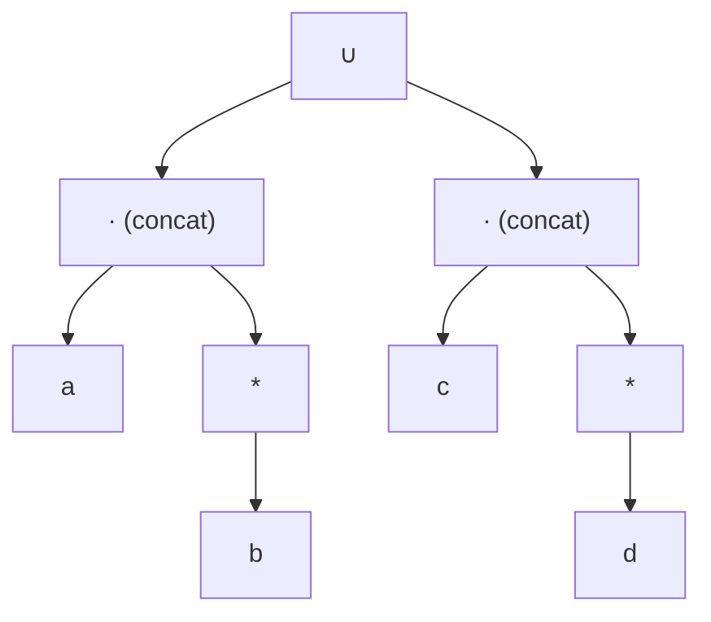

The star applies only to the **single symbol (or parenthesised group) directly before it**. $ab^{*}$ is $a$ followed by any number of $b$'s, not any number of $ab$'s.

## The Details Matter

Two classic non-equalities, each with a counterexample string:

- $a^{*} \cup b^{*} \neq (a \cup b)^{*}$. The left side is "all $a$'s _or_ all $b$'s"; the right is every string. Counterexample: $ab$ is in the right but not the left.
- $(ab)^{*} \neq a^{*}b^{*}$. The left is $\varepsilon, ab, abab, \ldots$; the right is $a^n b^m$. Counterexamples: $aab$ (in the right only) and $abab$ (in the left only).

To prove two regexes differ, **one counterexample string is enough**. To prove they are equal you need an argument (or the algebraic laws below).

### Regular vs. non-regular

**$L_1 = {w \in {a,b}^{*} : \text{every } a \text{ is immediately followed by a } b}$**

Think of the string as built from the "safe" chunks $b$ and $ab$: $$ (b \cup ab)^{*} $$

> [!warning] Check the annotated answer The handwritten answer on the slide is $(b^{*}abb^{*})^{*}$. Every iteration of that loop must contain an $a$, so it **cannot generate** $b$, $bb$, etc., even though those strings are in $L_1$ (they have no $a$ at all, so the condition is vacuously true). It also misses nothing else, so a correct fix is $b^{*}(abb^{*})^{*}$ or simply $(b \cup ab)^{*}$.

An FSM for $L_1$ needs just a "last char was $a$, owe a $b$" state:

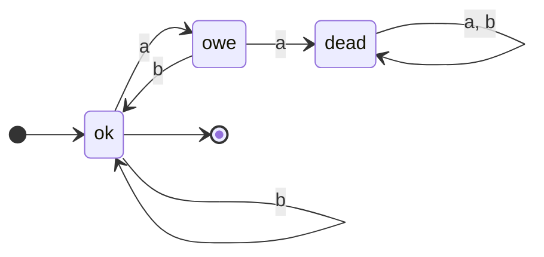

(`ok` is accepting; `dead` is a trap state.)

**$L_2 = {w \in {a,b}^{*} : \text{every } a \text{ has a matching } b \text{ somewhere}}$**

**Not possible**: no regex and no FSM exists. "Matching" means we must pair each $a$ with a distinct $b$, i.e. count. An FSM has finitely many states, so it cannot remember an unbounded number of unmatched $a$'s. (Formally this is shown with the Pumping Theorem in a later chapter.) This is the key lesson of the slide: a tiny change in the English description can push a language from regular to non-regular.

## Kleene's Theorem

> **Theorem 6.3 (Kleene):** The class of languages that can be defined with regular expressions is exactly the class of regular languages (those accepted by some FSM).

The proof has two directions, each by construction:

1. **Regex → FSM**: Thompson's construction.
2. **FSM → Regex**: state elimination (`fsmtoregex`).

Because both directions are _algorithms_, we can freely convert between representations, e.g. a regex engine can compile a pattern into an NFA, convert it to a DFA (subset construction) and minimize it.

## Regex → FSM: Thompson's Construction

Proof by **structural induction** on the regex. We build an NDFSM (NFA) for every regex that satisfies two invariants:

- the **start state has no incoming edges**
- there is **exactly one accepting state, with no outgoing edges**

These invariants are what make the pieces snap together safely: you can attach things to the start or the accept state without accidentally creating extra paths.

### Base cases

**$\varnothing$:** a start state and an accepting state with **no edge** between them; nothing is accepted.

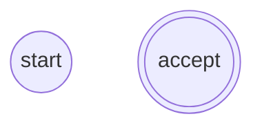

**$\varepsilon$:** (not on the slide, but needed for completeness)

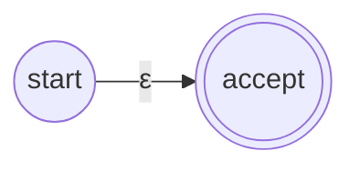

**A single symbol $a \in \Sigma$:**

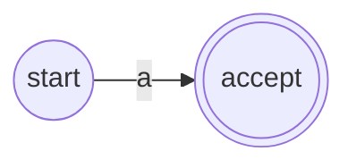

### Inductive cases

Assume we already have machines $M_\beta$ and $M_\gamma$ for $\beta$ and $\gamma$ (induction hypothesis).

**Concatenation $\alpha = \beta\gamma$:** link the accept state of $M_\beta$ to the start of $M_\gamma$ with an $\varepsilon$-transition; $M_\beta$'s old accept state stops accepting.

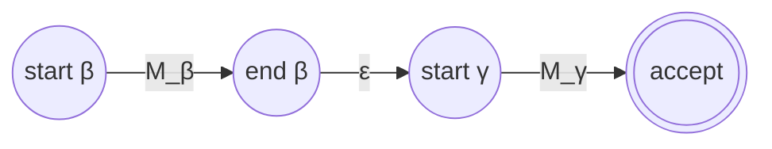

Alternative (lecture annotation): **merge** $M_\beta$'s accept state with $M_\gamma$'s start state into one state. This is safe precisely because of the invariants: $M_\beta$'s accept has no outgoing edges and $M_\gamma$'s start has no incoming edges, so merging creates no new loops.

**Union $\alpha = \beta \cup \gamma$:** new start state with $\varepsilon$-edges into both machines ("OR"), and both old accept states $\varepsilon$-edge into a new single accept state.

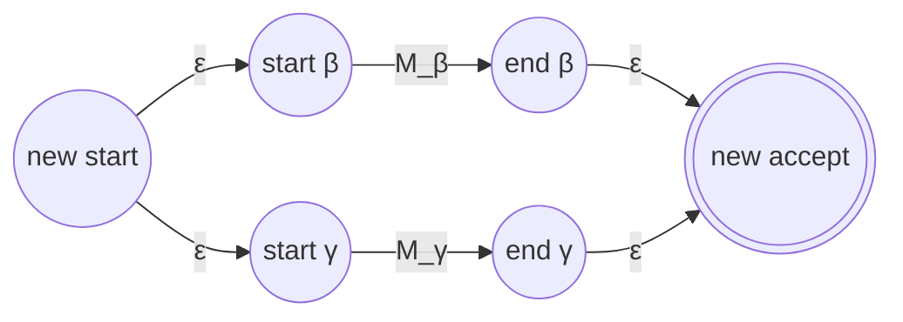

**Kleene star $\alpha = \beta^{*}$:** new start and new accept; four $\varepsilon$-edges:

- new start → start of $M_\beta$ (do at least one iteration)
- end of $M_\beta$ → start of $M_\beta$ (repeat)
- end of $M_\beta$ → new accept (stop)
- new start → new accept (zero iterations, i.e. $\varepsilon$)

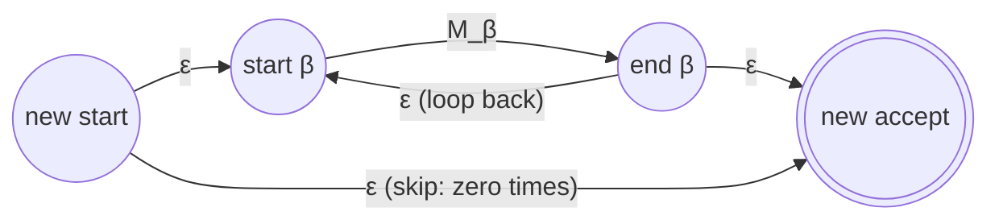

This realises $\beta^{*} = \varepsilon \cup \beta \cup \beta^2 \cup \cdots$.

> [!tip] Why the fresh start/accept states for star? It might seem simpler to just make $M_\beta$'s start state accepting and add a loop. But that would give the start state incoming edges and break the invariant, and in combination with other operators can make the machine accept strings it shouldn't. The fresh states keep every sub-machine "sealed".

### Example: $(aa \cup b)^{*}$

Build bottom-up: $a$, $a$, $aa$ (concatenation), $b$, $aa \cup b$ (union), then the star.

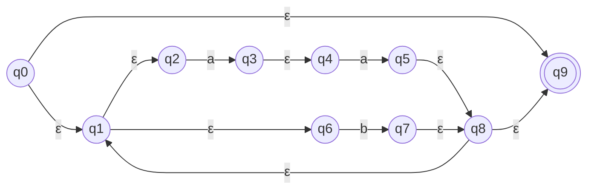

Size property: Thompson's construction adds at most 2 states per operator, so the NFA has $O(|\alpha|)$ states. That is why it is used in practice. (The resulting NFA is full of $\varepsilon$-moves; it is usually then converted to a DFA and minimized.)

## FSM → Regex: State Elimination

**Key idea:** generalise FSMs so that transitions may be labelled with **arbitrary regular expressions**, not just single symbols. Then repeatedly **rip out** a state and patch the remaining transitions with bigger regexes so the machine still accepts the same strings. When only the start and the accepting state are left, the label on the single edge between them is the answer.

### Simple example

A machine $q_1 \xrightarrow{a} q_2 \xrightarrow{a} q_3$ with a $b$ self-loop on $q_2$. Ripping out $q_2$: you go in on $a$, loop on $b$ any number of times, leave on $a$. So the new edge $q_1 \to q_3$ is labelled $ab^{*}a$.

### The rip rule

After removing state $rip$, a path from $p$ to $q$ either went directly, or went $p \to rip$, looped at $rip$ zero or more times, then $rip \to q$: $$ R'(p,q) = R(p,q) \cup R(p,rip),R(rip,rip)^{*},R(rip,q) $$

|Piece|Meaning|
|---|---|
|$R(p,q)$|go directly from $p$ to $q$ (old label)|
|$R(p,rip)$|go from $p$ into $rip$|
|$R(rip,rip)^{*}$|loop on $rip$ any number of times|
|$R(rip,q)$|leave $rip$ for $q$|

This must be applied to **every** pair $(p, q)$ of remaining states, including $p = q$ (which produces self-loops).

> [!warning] Typo on slide 36 The first line of slide 36 writes the rule ending in $R(p, rip)$. It should end in $R(rip, q)$, as in slide 35 and as actually used in the worked calculation on the same slide.

### The algorithm `fsmtoregexheuristic`

1. Remove unreachable states from $M$.
2. If $M$ has no accepting states, return $\varnothing$.
3. If the start state is part of a loop (has incoming edges), create a new start state $s$ with an $\varepsilon$-transition to the old start.
4. If there is more than one accepting state, or any accepting state has outgoing transitions, create a new single accepting state; connect each old accepting state to it via $\varepsilon$. The old ones no longer accept.
5. If $M$ has only one state, return $\varepsilon$.
6. Until only the start and accepting state remain:
    1. Select $rip$ (not $s$, not the accepting state).
    2. Remove $rip$.
    3. Modify the transitions among remaining states (rip rule) so $M$ accepts the same strings.
7. Return the regex labelling the one remaining transition from start to accept.

Steps 3 and 4 enforce the _same_ invariants as Thompson's construction (start has no incoming edges; single accept has no outgoing edges). They ensure the start and accept states never need to be ripped and never pick up loops.

### Worked example (slides 26–30)

Original machine: states 1 (start, accepting), 2 (accepting), 3. Transitions: $1 \xrightarrow{a} 2$, $2 \xrightarrow{b} 1$, $2 \xrightarrow{a} 3$, $3 \xrightarrow{a} 3$, $3 \xrightarrow{b} 1$.

**Step 1: new start and accept.** State 1 is in a loop and there are two accepting states, so add start 4 ($4 \xrightarrow{\varepsilon} 1$) and accept 5 ($1 \xrightarrow{\varepsilon} 5$, $2 \xrightarrow{\varepsilon} 5$).

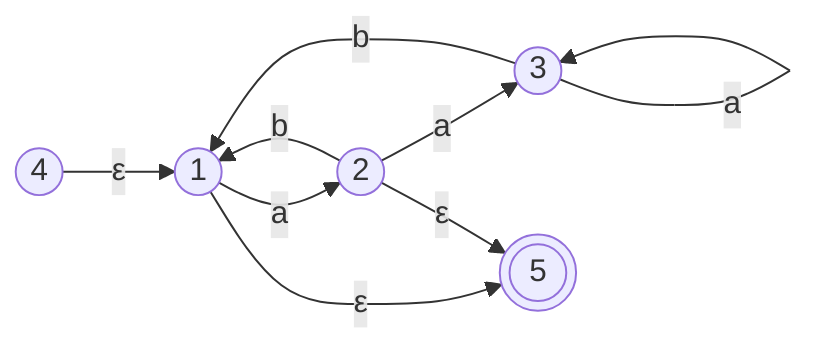

**Rip 3.** The only path through 3 is $2 \xrightarrow{a} 3 \xrightarrow{a^{*}} 3 \xrightarrow{b} 1$, so add $2 \xrightarrow{aa^{*}b} 1$. Edge $2 \to 1$ now has two labels, $b$ and $aa^{*}b$.

**Rip 2.** Paths through 2, starting from 1:

- $1 \xrightarrow{a} 2 \xrightarrow{b} 1$ gives $ab$
- $1 \xrightarrow{a} 2 \xrightarrow{aa^{*}b} 1$ gives $aaa^{*}b$
- $1 \xrightarrow{a} 2 \xrightarrow{\varepsilon} 5$ gives $a$

Result: self-loop on 1 labelled $ab \cup aaa^{*}b$, and $1 \to 5$ labelled $\varepsilon \cup a$.

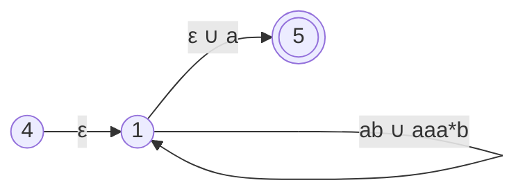

**Rip 1.** $$ R'(4,5) = \varnothing \cup \varepsilon,(ab \cup aaa^{*}b)^{*}(a \cup \varepsilon) = (ab \cup aaa^{*}b)^{*}(a \cup \varepsilon) $$ **Simplification (bonus).** $ab \cup aaa^{*}b = a(\varepsilon \cup aa^{*})b = aa^{*}b = a^{+}b$, so the answer is equivalently $$ (a^{+}b)^{*}(a \cup \varepsilon) $$ Different rip orders give different-looking (but equivalent) regexes. The _order_ is a heuristic choice; a good rule of thumb is to rip states with few in/out edges first to keep expressions small.

### The formal version: `fsmtoregex`

To make the proof clean, the formal algorithm first **standardizes** $M$ so that between every pair of (relevant) states there is _exactly one_ transition.

**`standardize(M)`:**

1. Remove unreachable states.
2. If necessary, create a new start state.
3. If necessary, create a new accepting state.
4. If there is more than one transition between $p$ and $q$, **collapse** them into one labelled with their union (e.g. edges $a$ and $b$ become $a \cup b$).
5. If any transitions are missing, **create** them with label $\varnothing$.

Required shape: from every state except the accepting state there is exactly one transition to every state except the start state; into every state except the start there is exactly one transition from every state except the accepting state.

**`buildregex(M)`:**

1. If $M$ has no accepting states, return $\varnothing$.
2. If $M$ has only one state, return $\varepsilon$.
3. Until only start and accepting states remain:
    1. Select some state $rip$.
    2. For every transition $p \to q$ with $p, q \neq rip$, compute $R'(p,q) = R(p,q) \cup R(p,rip)R(rip,rip)^{*}R(rip,q)$.
    3. Remove $rip$ and all transitions into and out of it.
4. Return the label on the transition from start to accept.

`fsmtoregex(M)` = `buildregex(standardize(M))`.

> [!note] Why add $\varnothing$ 
> edges at all? (step 5) As the lecture annotation says, it is for **completeness, not needed in practice**. The $\varnothing$ edges let the rip formula be written uniformly for every pair $(p,q)$ without case-splitting on "is there an edge?". Since $\varnothing$ is a zero for concatenation and the identity for union, any term involving a missing edge simply vanishes. When doing it by hand, just ignore missing edges.

### Worked example with $\varnothing$ edges (slides 32–36)

Machine: $1 \xrightarrow{a} 2$, $1 \xrightarrow{b} 4$, $4 \xrightarrow{b} 2$, $2 \xrightarrow{b} 2$, $2 \xrightarrow{a} 3$; start 1, accept 3. Standardizing adds $\varnothing$ edges $1 \to 3$, $2 \to 4$, $4 \to 4$, $4 \to 3$.

**Rip 2** (from the slide): $$ R'(1,3) = R(1,3) \cup R(1,2)R(2,2)^{*}R(2,3) = \varnothing \cup ab^{*}a = ab^{*}a $$ The slide stops there, but the other pairs must be updated too:

- $R'(4,3) = \varnothing \cup b,b^{*}a = bb^{*}a$
- $R'(1,4) = b \cup a,b^{*}\varnothing = b$
- $R'(4,4) = \varnothing \cup b,b^{*}\varnothing = \varnothing$

**Rip 4:** $$ R'(1,3) = ab^{*}a \cup b,\varnothing^{*},bb^{*}a = ab^{*}a \cup bbb^{*}a = (a \cup bb)b^{*}a $$ (using $\varnothing^{*} = \varepsilon$). Sanity check against the original machine: either $a$ straight to 2, or $bb$ via 4 to 2; then loop on $b$; then $a$ to 3. ✓

## Simplifying Regular Expressions

Because regexes denote **sets**, they obey algebraic laws. These are what you use to clean up the messy output of state elimination.

**Union** (behaves like set union):

- Commutative: $\alpha \cup \beta = \beta \cup \alpha$
- Associative: $(\alpha \cup \beta) \cup \gamma = \alpha \cup (\beta \cup \gamma)$
- Identity is $\varnothing$: $\alpha \cup \varnothing = \varnothing \cup \alpha = \alpha$
- Idempotent: $\alpha \cup \alpha = \alpha$

**Concatenation:**

- Associative: $(\alpha\beta)\gamma = \alpha(\beta\gamma)$
- Identity is $\varepsilon$: $\alpha\varepsilon = \varepsilon\alpha = \alpha$
- Zero is $\varnothing$: $\alpha\varnothing = \varnothing\alpha = \varnothing$
- **Not** commutative: $ab \neq ba$

**Distributivity** (concatenation over union):

- $(\alpha \cup \beta)\gamma = \alpha\gamma \cup \beta\gamma$
- $\gamma(\alpha \cup \beta) = \gamma\alpha \cup \gamma\beta$

**Kleene star:**

- $\varnothing^{*} = \varepsilon$
- $\varepsilon^{*} = \varepsilon$
- $(\alpha^{*})^{*} = \alpha^{*}$
- $\alpha^{*}\alpha^{*} = \alpha^{*}$
- $(\alpha \cup \beta)^{*} = (\alpha^{*}\beta^{*})^{*}$

Useful extras that follow from these (often used in exams):

- $\alpha\alpha^{*} = \alpha^{*}\alpha = \alpha^{+}$
- $\varepsilon \cup \alpha\alpha^{*} = \alpha^{*}$ (this is the $L((aa^{*}) \cup \varepsilon) = a^{*}$ example)
- $(\alpha \cup \varepsilon)^{*} = \alpha^{*}$

The analogy with arithmetic: $\cup$ is like $+$ (identity $\varnothing$ like $0$), concatenation is like $\times$ (identity $\varepsilon$ like $1$, zero $\varnothing$ like $0$). The big difference is that union is idempotent ($x + x \neq x$ in arithmetic) and concatenation is not commutative.

## Regular Expressions in Practice (Perl-style)

Real-world regex libraries extend the theoretical syntax with lots of shorthand. Most of it is **syntactic sugar** that can be rewritten with $\cup$, concatenation and $^{*}$.

### Operators

|Syntax|Name|Meaning|
|---|---|---|
|`abc`|Concatenation|$a$ then $b$ then $c$|
|`a\|b\|c`|Union|$a \cup b \cup c$|
|`a*`|Kleene star|0 or more|
|`a+`|At least one|1 or more ($aa^{*}$)|
|`a?`|Optional|0 or 1 ($a \cup \varepsilon$)|
|`a{n,m}`|Replication|at least $n$, at most $m$ copies|
|`a*?`, `a+?`|Parsimonious / lazy|shortest match instead of longest (greedy)|
|`.`|Wild card|any character except newline|
|`^` / `$`|Anchors|start / end of line or string|
|`[a-z]`|Character class|any single char in the range|
|`[^a-z]`|Negated class|any single char _not_ in the range|
|`(a)`|Store / capture|match $a$ and save the matched text|
|`\1`, `\2`, ...|Backreference|match exactly what group 1, 2, ... matched|

### Escapes and classes

|Syntax|Meaning|
|---|---|
|`\d` / `\D`|digit `[0-9]` / non-digit|
|`\w` / `\W`|word char / non-word char|
|`\s` / `\S`|whitespace (space, tab, newline, ...) / non-whitespace|
|`\b`|word boundary (outside `[]`); backspace (inside `[]`)|
|`\B`|non-word boundary|
|`\n`, `\r`, `\t`, `\f`|newline, return, tab, formfeed|
|`\0`, `\nnn`, `\xnn`, `\cX`|null, octal, hex, control character|
|`\char`|literal `char` (escape special symbols like `.` and `\`)|

> [!note] Small correction to the slide table In Perl (and most modern engines) `\w` is `[a-zA-Z0-9_]`, i.e. it **includes the underscore**, not just alphanumerics.

**Greedy vs lazy**: matching `<.*>` against `<b>hi</b>` greedily grabs the whole string; `<.*?>` grabs just `<b>`. This only matters for _finding_ matches inside text, not for whether a whole string is in the language.

### Real-world examples (from Friedl, _Mastering Regular Expressions_)

**Numbers** (optional sign; digits with optional fractional part, or a leading-dot decimal):

```
-?([0-9]+(\.[0-9]*)?|\.[0-9]+)
```

Matches `42`, `-3.14`, `7.`, `.5`.

**IP addresses** (four dot-separated groups of 1–3 digits):

```
([0-9]{1,3}(\.[0-9]{1,3}){3})
```

Note this is a _syntactic_ check only: it also accepts `999.999.999.999`. Restricting each group to $0$–$255$ is still regular but makes the regex much longer, which is a common practical trade-off.

**Doubled words** (e.g. "the the"):

```
([A-Za-z]+)\s+\1
```

> [!important] Backreferences are not regular Everything in the operator table can be translated to a theoretical regex **except backreferences** (`\1`, `\2`, ...). With them you can express e.g. ${ww \mid w \in {a,b}^{*}}$ via `^(.*)\1$`, which is **not** a regular language (an FSM can't remember an arbitrarily long $w$). So "regexes" in Perl/Python are strictly more powerful than regular expressions in this course, and matching them can take exponential time in the worst case. Kleene's Theorem applies only to the backreference-free subset.

## Application: Pattern Matching and Searching

### Pattern matching (does $p$ occur in $T$?)

Build a DFSM $M$ for $$ L(\Sigma^{*},p,\Sigma^{*}) $$ ($p$ with anything before and after). Then $p$ occurs in $T$ **iff** $M$ accepts $T$. Pipeline: regex → NFA (Thompson) → DFA (subset construction) → minimize.

Example $p = abcabb$, $\Sigma = {a, b, c}$. State $q_i$ means "the longest suffix read so far that is a prefix of $p$ has length $i$":

|State|prefix matched|on $a$|on $b$|on $c$|
|---|---|---|---|---|
|$q_0$|$\varepsilon$|$q_1$|$q_0$|$q_0$|
|$q_1$|$a$|$q_1$|$q_2$|$q_0$|
|$q_2$|$ab$|$q_1$|$q_0$|$q_3$|
|$q_3$|$abc$|$q_4$|$q_0$|$q_0$|
|$q_4$|$abca$|$q_1$|$q_5$|$q_0$|
|$q_5$|$abcab$|$q_1$|$q_6$|$q_3$|
|$q_6$ (accept)|$abcabb$|$q_6$|$q_6$|$q_6$|

Interesting entry: from $q_5$ (read $abcab$) on $c$ we go to $q_3$, not $q_0$, because $abcabc$ ends in $abc$, which is still a valid prefix of $p$. These "fall-back" transitions are exactly the failure function of the **Knuth–Morris–Pratt (KMP)** algorithm. Once built, the DFA scans $T$ in $O(|T|)$ time, one transition per character.

### Pattern searching (find all occurrences)

Build a DFSM for $$ L(\Sigma^{*},p) $$ (no trailing $\Sigma^{*}$) and run it over $T$. **Every time** the machine enters an accepting state, an occurrence of $p$ has just **ended** at that position. The only change from the table above is the row for $q_6$: instead of looping forever, it continues like $q_0$ would after a match: on $a$ go to $q_1$; on $b, c$ go to $q_0$. (For a pattern with self-overlap, the post-match transitions would fall back to the longest proper border instead.)

### Multiple patterns

- **Multi-pattern matching** (does _any_ $p_i$ occur in $T$?): DFSM for $$ L(\Sigma^{*}(p_1 \cup p_2 \cup \cdots \cup p_k)\Sigma^{*}) $$
- **Multi-pattern searching** (find all occurrences of all $p_i$): DFSM for $$ L(\Sigma^{*}(p_1 \cup p_2 \cup \cdots \cup p_k)) $$ This is the idea behind the **Aho–Corasick** algorithm (used in `fgrep`, antivirus signature scanning, intrusion detection), which searches for thousands of patterns in a single linear pass over the text.

## Summary

- Regular expressions are built from $\varnothing$, $\varepsilon$, symbols, concatenation, union and star; $L(\cdot)$ gives their meaning recursively.
- Precedence: star > concatenation > union.
- To go from a language to a regex, decompose strings into repeating chunks; verify with edge cases ($\varepsilon$, single symbols).
- **Kleene's Theorem**: regexes and FSMs describe exactly the regular languages.
    - Regex → NFA: **Thompson's construction** (structural induction, sealed start/accept states).
    - FSM → regex: **state elimination** using $R'(p,q) = R(p,q) \cup R(p,rip)R(rip,rip)^{*}R(rip,q)$.
- Algebraic laws simplify regexes; $\varnothing$ is the union identity and concatenation zero, $\varepsilon$ is the concatenation identity.
- Practical regex engines add sugar (`+`, `?`, `{n,m}`, classes); backreferences go **beyond** regular languages.
- Substring matching/searching reduces to running a DFA for $\Sigma^{*}p\Sigma^{*}$ or $\Sigma^{*}p$ in linear time.