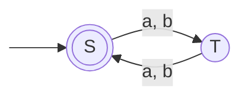
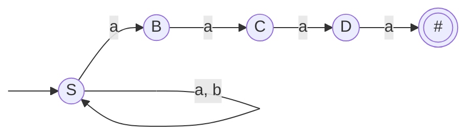
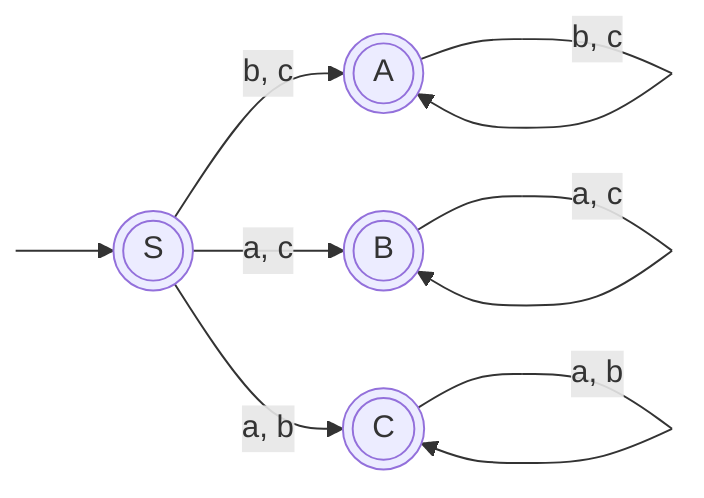
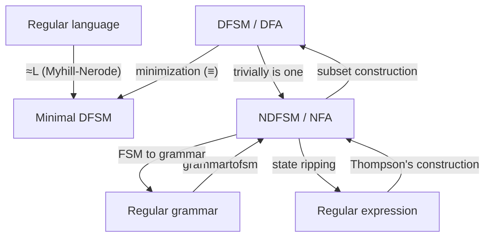

**Notes based off of:** Ch07 Regular Grammars (lecture slides, Chapter 7)

## Grammars in General

A **grammar** is a _rewriting system_: instead of describing a language by a machine that _recognizes_ strings (an FSM) or a pattern that _matches_ them (a regular expression), a grammar describes a language by _generating_ every string in it.

### Formal Definition

A grammar $G$ is a quadruple: $$ G = (V, \Sigma, R, S) $$ where:

- $V$ is the **rule alphabet**, containing both nonterminals and terminals.
    - **Nonterminals** (written uppercase: $S, T, A, B, \dots$) "do the work": they are placeholders that get rewritten.
    - **Terminals** (written lowercase: $a, b, c, \dots$) form the final strings; once produced, they are never rewritten.
- $\Sigma \subseteq V$ is the set of terminals, so the nonterminals are $V - \Sigma$.
- $R$ is a finite set of **rules** (productions) of the form $X \rightarrow Y$ with $X, Y \in V^{*}$, read as "$X$ can be rewritten as $Y$".
- $S \in V - \Sigma$ is the **start symbol**.

### Deriving Strings

To generate a string:

1. Start with $S$.
2. Repeatedly apply a rule: find an occurrence of some rule's left-hand side (LHS) and replace it with that rule's right-hand side (RHS).
3. Stop when the working string (the _sentential form_) contains only terminals.

The symbol $\Rightarrow$ means "derives in one step", and $\Rightarrow^{*}$ means "derives in zero or more steps".

#### Example

Rules: (1) $S \rightarrow Sa$, (2) $S \rightarrow \varepsilon$. Nonterminal: $S$. Terminal: $a$. $$ S \overset{1}{\Rightarrow} Sa \overset{1}{\Rightarrow} Saa \overset{1}{\Rightarrow} Saaa \overset{2}{\Rightarrow} aaa $$ This grammar generates $a^{*}$. Note that $S \rightarrow Sa$ puts the nonterminal on the _left_ of the terminal, so this grammar is a valid general grammar but **not** a regular grammar under the definition below (it is _left-linear_; see the aside further down).

## Regular Grammars

### Rule Restrictions

In a **regular grammar**, every rule in $R$ must:

- have a LHS that is a **single nonterminal**, and
- have a RHS that is one of:
    - $\varepsilon$,
    - a single terminal, or
    - a single terminal followed by a single nonterminal.

In shorthand, every rule looks like one of: $$ X \rightarrow \varepsilon \qquad X \rightarrow a \qquad X \rightarrow aY $$

|Rule|Legal?|Why|
|---|---|---|
|$S \rightarrow a$|✅|single terminal|
|$S \rightarrow \varepsilon$|✅|empty string|
|$T \rightarrow aS$|✅|terminal then nonterminal|
|$S \rightarrow aSa$|❌|RHS has a terminal _after_ the nonterminal|
|$aSa \rightarrow T$|❌|LHS is not a single nonterminal|

### The Language of a Grammar

The **language** defined by $G$ is the set of all terminal strings derivable from $S$: $$ L(G) = { w \in \Sigma^{*} : S \Rightarrow^{*} w } $$

### Key Intuition: Nonterminal = State

Because of the restricted rule shapes, every sentential form in a derivation looks like $$ (\text{terminals}) ; (\text{at most one nonterminal, at the right end}) $$ That is exactly the information an FSM carries while reading input:

- the terminals generated so far ↔ the input consumed so far,
- the single trailing nonterminal ↔ the current state.

Applying $X \rightarrow aY$ is the same as the FSM taking a transition from state $X$ to state $Y$ on input $a$. Applying $X \rightarrow \varepsilon$ is the same as "stop here and accept". This one-to-one correspondence is why regular grammars generate exactly the regular languages.

### Aside: Right-Linear vs. Left-Linear

The form used in this course ($X \rightarrow aY$) is called **right-linear** (nonterminal on the right). A **left-linear** grammar uses $X \rightarrow Ya$ instead, like the $S \rightarrow Sa$ example above. Both forms generate exactly the regular languages, **but you may not mix them** in one grammar: mixing $X \rightarrow aY$ and $X \rightarrow Ya$ can produce non-regular languages such as ${a^n b^n : n \geq 0}$ (e.g. $S \rightarrow aT$, $T \rightarrow Sb$, $S \rightarrow \varepsilon$).

Regular grammars are the most restricted level (Type 3) of the **Chomsky hierarchy**. Loosening the restriction to "LHS is a single nonterminal, RHS is anything" gives context-free grammars (Type 2), the subject of later chapters.

## Example 1: Even-Length Strings

$$ L = { w \in {a, b}^{*} : |w| \text{ is even} } = ((aa) \cup (ab) \cup (ba) \cup (bb))^{*} $$

### FSM

State $S$ means "even number of characters read so far"; state $T$ means "odd".

### Grammar

Each FSM transition becomes a rule (e.g. the transition from $S$ to $T$ on $a$ becomes $S \rightarrow aT$), and the accepting state $S$ gets $S \rightarrow \varepsilon$: $$ \begin{aligned} S &\rightarrow \varepsilon \mid aT \mid bT \ & T \rightarrow a \mid b \mid aS \mid bS \end{aligned} $$ (The bar $\mid$ is shorthand for "or": $S \rightarrow aT \mid bT$ means the two rules $S \rightarrow aT$ and $S \rightarrow bT$.)

### Sample Derivations

$$ S \Rightarrow bT \Rightarrow bb $$ $$ S \Rightarrow aT \Rightarrow abS \Rightarrow abbT \Rightarrow abbaS \Rightarrow abba $$ $$ S \Rightarrow \varepsilon $$ Note that the rules $T \rightarrow a$ and $T \rightarrow b$ are redundant: $T \Rightarrow aS \Rightarrow a$ produces the same thing. They just let derivations finish one step sooner (compare $abbaS \Rightarrow abba$ vs. ending directly with $T \rightarrow a$).

## Theorem: Regular Grammars ≡ Regular Languages

> **Theorem:** The class of languages that can be defined with regular grammars is exactly the regular languages.

**Proof:** By two constructions: one turning any regular grammar into an FSM accepting the same language, and one turning any FSM into a regular grammar generating the same language.

### Construction 1: Regular Grammar → FSM (grammartofsm)

Given $G = (V, \Sigma, R, S)$, build FSM $M$:

1. Create in $M$ a separate state for each nonterminal in $V$.
2. The start state is the state corresponding to $S$.
3. If there are any rules of the form $X \rightarrow a$ (for some $a \in \Sigma$), create a new state labeled $\#$.
4. For each rule $X \rightarrow aY$, add a transition from $X$ to $Y$ labeled $a$.
5. For each rule $X \rightarrow a$, add a transition from $X$ to $\#$ labeled $a$.
6. For each rule $X \rightarrow \varepsilon$, mark state $X$ as accepting.
7. Mark state $\#$ as accepting.

| Rule                        | FSM piece                                              |
| --------------------------- | ------------------------------------------------------ |
| $X \rightarrow aY$          | transition $X \xrightarrow{a} Y$                       |
| $X \rightarrow a$           | transition $X \xrightarrow{a} \#$, with $\#$ accepting |
| $X \rightarrow \varepsilon$ | $X$ is accepting                                       |

**Why the $\#$ state?** A rule $X \rightarrow a$ ends the derivation after emitting $a$, so the machine needs somewhere to go after reading $a$ that is accepting and has no outgoing transitions (nothing may follow). $\#$ is exactly that "done" state. Equivalently, you could replace every $X \rightarrow a$ with $X \rightarrow a\#$ and add $\# \rightarrow \varepsilon$.

**The result is generally an NDFSM.** Nothing stops a grammar from having two rules like $S \rightarrow aS$ and $S \rightarrow aB$, which become two transitions out of $S$ on the same symbol. Use the subset construction afterwards if a DFSM is needed.

Applying the construction literally to Example 1 gives a $\#$ state reachable from $T$ on $a$ or $b$. The machine is still correct; it is just not minimal, since $\#$ behaves like a stripped-down copy of $S$.

### Construction 2: FSM → Regular Grammar

The slides say "similarly". Filling in the details, given an FSM $M = (K, \Sigma, \Delta, s, A)$:

1. Create a nonterminal for each state in $K$; the nonterminal for the start state $s$ is the start symbol.
2. For each transition from $p$ to $q$ labeled $a$, add the rule $p \rightarrow aq$.
3. For each accepting state $p \in A$, add the rule $p \rightarrow \varepsilon$.

One catch: an $\varepsilon$-transition from $p$ to $q$ would need the rule $p \rightarrow q$, which is not allowed in our definition of a regular grammar. So first remove $\varepsilon$-transitions (e.g. convert to a DFSM, which has none) and then apply the construction.

No $X \rightarrow a$ rules are ever needed in this direction; they are a convenience for writing grammars by hand.

## Example 2: Strings That End with aaaa

$$ L = { w \in {a, b}^{*} : w \text{ ends with } aaaa } $$

### Grammar

$$ \begin{aligned} S &\rightarrow aS \mid bS \mid aB \ & B \rightarrow aC \ & C \rightarrow aD \ & D \rightarrow a \end{aligned} $$ How to read it: $S$ generates an arbitrary prefix (anything in ${a, b}^{*}$), then "guesses" that the final $aaaa$ has begun by switching to $B$. $B$, $C$ and $D$ count off the remaining three $a$'s, and $D \rightarrow a$ ends the string.

### FSM (from grammartofsm)

This is **nondeterministic**: on input $a$, state $S$ can either stay in $S$ or move to $B$. The grammar is equally "nondeterministic", since at each step it may choose between $S \rightarrow aS$ and $S \rightarrow aB$. Only derivations that guess correctly reach an all-terminal string.

Example derivation of $baaaa$: $$ S \Rightarrow bS \Rightarrow baB \Rightarrow baaC \Rightarrow baaaD \Rightarrow baaaa $$

## Example 3: One Character Missing

$$ L = { w \in {a, b, c}^{*} : \text{at least one of } a, b, c \text{ does not occur in } w } $$ (The slide gives only the grammar and machine; the language above is what they define.)

### Grammar

$$ \begin{aligned} S &\rightarrow \varepsilon \mid aB \mid aC \mid bA \mid bC \mid cA \mid cB \ A &\rightarrow bA \mid cA \mid \varepsilon \ B &\rightarrow aB \mid cB \mid \varepsilon \ C &\rightarrow aC \mid bC \mid \varepsilon \end{aligned} $$ Meaning of each nonterminal:

- $A$: "we have committed to $a$ being the missing letter", so it only generates $b$'s and $c$'s.
- $B$: $b$ is missing, so only $a$'s and $c$'s.
- $C$: $c$ is missing, so only $a$'s and $b$'s.

From $S$, the first character rules out one choice: after reading $a$, the missing letter must be $b$ or $c$, so $S \rightarrow aB \mid aC$. The grammar guesses which one; the string is generated if _some_ guess works.

### FSM

Every state is accepting because every nonterminal has an $\varepsilon$-rule. This is a nice illustration of why nondeterminism is convenient: a DFSM for the same language has to track the full _set_ of letters seen so far (up to $2^3 = 8$ states before minimizing), while the grammar/NDFSM just commits to a guess about the missing letter.

Example derivation of $acca$ (the missing letter is $b$): $$ S \Rightarrow aB \Rightarrow acB \Rightarrow accB \Rightarrow accaB \Rightarrow acca $$

## The Big Picture: Conversions Between Representations

All of these describe exactly the same class of languages, the regular languages, and each can be converted into the others:

- **Subset construction:** NDFSM → DFSM, with each DFSM state being a set of NDFSM states.
- **Minimization ($\equiv$):** merges equivalent states of a DFSM.
- **$\approx_L$:** builds the minimal DFSM directly from the language's equivalence classes.
- **Thompson's construction:** regular expression → NDFSM, built piece by piece from the regex structure.
- **Rip (state elimination):** NDFSM → regular expression, removing states one at a time and relabeling edges with regexes.
- **Regular grammars** connect to the rest of the diagram only through NDFSMs, via the two constructions above.

The practical takeaway is that you can choose whichever representation is most natural for a problem: a grammar when you think "generatively" (how to build strings), a regex for compact patterns, an FSM for recognition. Then convert as needed.

## Why This Matters in Practice

- **Lexical analysis in compilers:** token definitions (identifiers, numbers, keywords) are regular. They are typically written as regexes, but the same structure can be described as a regular grammar, and tools convert them to DFAs for fast scanning.
- **Stepping stone to context-free grammars:** the derivation machinery here ($\Rightarrow$, sentential forms, $L(G)$) is used unchanged for context-free grammars, which describe programming-language syntax. Regular grammars are the simplest case to learn it on.
- **Proving regularity:** showing a language has a regular grammar is a valid proof that it is regular, sometimes easier than drawing a machine directly.

**Prev:** [[CS3331A/7. Regular Expressions|7. Regular Expressions]], **Next:** [[CS3331A/9. Regular and Nonregular Languages|9. Regular and Nonregular Languages]]