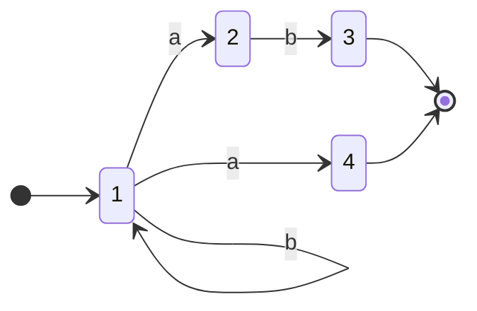
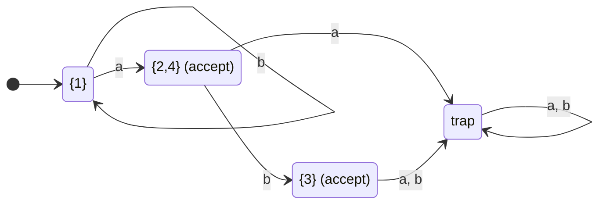
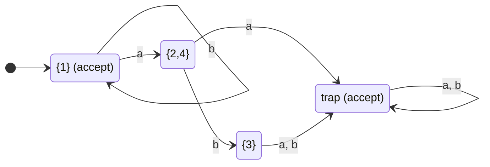
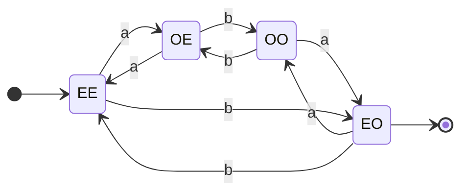
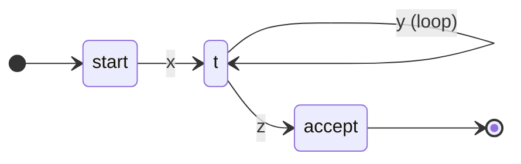
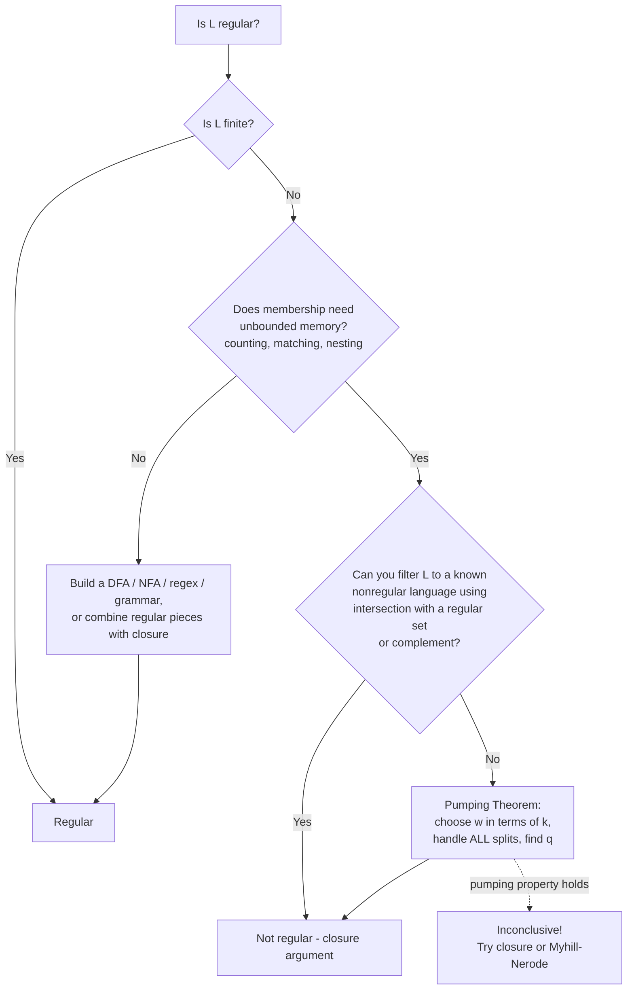

**Notes based off of:** Ch08Regornot.pdf (Chapter 8 — Regular and Nonregular Languages, lecture slides)

## Overview: Regular or Not?

The central question of this chapter is: given a language $L$, can it be recognized by a finite state machine? Some quick contrasts:

- $a^{*}b^{*}$ **is regular** — a machine only needs to remember "have I seen a `b` yet?"
- ${a^nb^n : n \geq 0}$ **is not regular** — a machine would need to remember _exactly how many_ `a`s it has seen, which is unbounded.
- ${w \in {a,b}^{*} : \text{every } a \text{ is immediately followed by } b}$ **is regular** — only local information (the previous character) matters.
- ${w \in {a,b}^{*} : \text{every } a \text{ has a matching } b \text{ somewhere}}$ **is not regular** — "matching" requires counting/pairing, which is global and unbounded.

The intuition to carry through the whole chapter: **regular = finite memory**. If deciding membership requires remembering an unbounded quantity (a count, a whole prefix, a nesting depth), the language is almost certainly not regular.

The chapter has two halves:

1. Techniques for **showing a language is regular**.
2. Techniques for **showing a language is not regular** (Pumping Theorem, closure arguments).

## How Many Regular Languages Are There?

**Theorem 8.1:** There is a countably infinite number of regular languages.

### Proof

- **Upper bound (at most countable):** Every regular language is described by at least one FSM (or regular expression). Each FSM / regex is a finite string over a finite alphabet, and the set of all finite strings over a finite alphabet is countable. So there are at most countably many regular languages.
- **Lower bound (at least countably infinite):** The languages ${a}, {aa}, {aaa}, {aaaa}, \dots$ are all distinct and each is regular (each is finite). So there are infinitely many.

### Consequence

For any nonempty alphabet $\Sigma$, $\Sigma^{*}$ is countably infinite, so the set of _all_ languages over $\Sigma$ is $$ \mathcal{P}(\Sigma^{*}), \quad \lvert \mathcal{P}(\Sigma^{*}) \rvert = 2^{\aleph_0} $$ which is **uncountable** (Cantor's theorem). Countable minus uncountable leaves uncountable, so there are _vastly_ more nonregular languages than regular ones. "Most" languages are not regular — regular languages are the special, well-behaved case.

## Showing That a Language Is Regular

### Every Finite Language Is Regular

If $L = {w_1, w_2, \dots, w_n}$, then the regular expression $w_1 \cup w_2 \cup \dots \cup w_n$ describes it. (Equivalently, build a DFA that is a tree of the strings.) This is often a surprisingly useful shortcut:

- **Example 1:** $L = L_1 \cap L_2$ where $L_1 = {a^nb^n : n \geq 0}$ and $L_2 = {b^na^n : n \geq 0}$. Neither $L_1$ nor $L_2$ is regular, but the only string that is both "`a`s then `b`s" and "`b`s then `a`s" with equal counts is the empty string: $$ L = {\varepsilon} $$ This is finite, hence regular. (This also previews the warning later: you cannot reason backwards from the parts.)
- **Example 2:** $L = {w \in {0\text{–}9}^{*} : w \text{ is the SSN of the current US president}}$. We may not _know_ which string it is, but it is a single 9-digit string, so $L$ is finite and therefore regular. Regularity is a property of the set, not of our knowledge of it.

### General Techniques

To show $L$ is regular, do any one of:

1. **Construct an FSM** (DFA or NFA) for $L$.
2. **Construct a regular grammar** for $L$.
3. **Construct a regular expression** for $L$.
4. **Show that $\approx_L$ has finitely many equivalence classes** (Myhill–Nerode). Two strings $x, y$ are equivalent under $\approx_L$ if for every suffix $z$, $xz \in L \iff yz \in L$. Finitely many classes $\iff$ $L$ is regular; the number of classes equals the number of states in the minimal DFA.
5. **Use closure theorems** — build $L$ out of known regular languages using operations that preserve regularity.

Since DFAs, NFAs, regular expressions, and regular grammars are all equivalent in power, pick whichever is easiest for the language at hand.

## Closure Properties of Regular Languages

If $L_1$ and $L_2$ are regular, then so are:

| Operation     | Result                        | Why                                       |
| ------------- | ----------------------------- | ----------------------------------------- |
| Union         | $L_1 \cup L_2$                | By definition of regular expressions      |
| Concatenation | $L_1 L_2$                     | By definition of regular expressions      |
| Kleene star   | $L_1^{*}$                     | By definition of regular expressions      |
| Complement    | $\neg L_1 = \Sigma^{*} - L_1$ | Flip accepting states of a complete DFA   |
| Intersection  | $L_1 \cap L_2$                | De Morgan's law (or product construction) |
| Difference    | $L_1 - L_2$                   | $L_1 \cap \neg L_2$                       |
| Reverse       | $L_1^{R}$                     | Reverse all arrows of an FSM              |

Union, concatenation, and Kleene star come "for free": regular expressions are _defined_ as being built from these operators, so if $\alpha$ and $\beta$ describe $L_1$ and $L_2$, then $\alpha \cup \beta$, $\alpha\beta$, and $\alpha^{*}$ describe the combined languages.

### Closure Under Complement

Procedure:

1. Construct a **DFSM** for $L$ (if you have an NFA, convert it via the subset construction).
2. **Complete** the DFSM — every state must have an outgoing transition on every symbol. Add a dead/trap state if needed.
3. **Flip** accepting and non-accepting states. The result accepts exactly $\neg L$.

#### Why both steps 1 and 2 matter

- **Must be deterministic:** In an NFA, a string is accepted if _some_ path accepts. Flipping states in an NFA does not give the complement, since a string could have one path ending in an accepting state and another ending in a non-accepting one — it would be accepted both before and after the flip.
- **Must be complete:** If a DFA simply "gets stuck" (no transition) on some input, that string is rejected. After flipping, it is _still_ rejected, because it still gets stuck — but it should now be accepted. Adding the trap state makes the rejection explicit so it can be flipped.

#### Worked Example (from slide)

Original NFA: state 1 is the start, loops on `b`; on `a` it can go to 2 or to 4. State 2 goes to 3 on `b`. Accepting states are 3 and 4.

This accepts $L = b^{*}(a \cup ab)$.

**Step 1–2: Convert to a complete DFA** (subset construction, plus trap state). The state ${2,4}$ is accepting because it contains 4.

**Step 3: Flip accepting states.** Now ${1}$ and trap are accepting; ${2,4}$ and ${3}$ are not.

This accepts $\neg L$: strings of only `b`s (including $\varepsilon$), plus anything that "falls off" into the trap.

### Closure Under Intersection

Write intersection in terms of operations we already have closure for (De Morgan's law): $$ L_1 \cap L_2 = \neg(\neg L_1 \cup \neg L_2) $$ Since regular languages are closed under complement and union, they are closed under intersection.

In practice, the more efficient construction is the **product construction**: given DFAs $M_1 = (K_1, \Sigma, \delta_1, s_1, A_1)$ and $M_2 = (K_2, \Sigma, \delta_2, s_2, A_2)$, build a DFA with states $K_1 \times K_2$ that simulates both at once: $$ \delta((p, q), c) = (\delta_1(p, c), \delta_2(q, c)), \quad A = A_1 \times A_2 $$ It accepts only when _both_ machines would accept. (Using $A = {(p,q) : p \in A_1 \text{ or } q \in A_2}$ instead gives union.)

### Closure Under Difference

$$ L_1 - L_2 = L_1 \cap \neg L_2 $$ Strings in $L_1$ but not in $L_2$ are exactly those in $L_1$ and in the complement of $L_2$. Closed under intersection and complement $\Rightarrow$ closed under difference.

### Closure Under Reverse

$L^{R} = {w^{R} : w \in L}$. Take an FSM for $L$, reverse every transition, make the old accepting states the new start states (via a new start state with $\varepsilon$-transitions to each), and make the old start state the only accepting state. The result is an NFA for $L^{R}$. (Alternatively, reverse a regular expression recursively: $(\alpha\beta)^{R} = \beta^{R}\alpha^{R}$, etc.)

### Using Closure to Build a Machine — Example

Let $$ L = {w \in {a,b}^{*} : w \text{ has an even number of } a\text{'s, an odd number of } b\text{'s, and all } a\text{'s come in runs of three}} $$ Designing a single DFA for all three conditions at once is error-prone. Instead decompose: $L = L_1 \cap L_2$, where

- $L_1 = {w : w \text{ has an even number of } a\text{'s and an odd number of } b\text{'s}}$ — a 4-state DFA tracking (parity of `a`, parity of `b`).
- $L_2 = {w : \text{all } a\text{'s come in runs of three}}$ — e.g. regex $(b \cup aaab)^{*}(\varepsilon \cup aaa)$, which forces every maximal block of `a`s to be exactly `aaa`.

Both are regular, so $L$ is regular by closure under intersection. The product construction then gives a DFA for $L$ mechanically.

DFA for $L_1$ (state names: first letter = parity of `a`s, second = parity of `b`s):

Accepting state: EO (even `a`s, odd `b`s).

**Practical takeaway:** this "divide into simple conditions, then intersect" approach mirrors how real regex/lexer engines and input validators are built — several simple checks composed together.

### Don't Try to Use Closure Backwards

The closure theorem says: $$ L_1, L_2 \text{ regular} \Rightarrow L_1 \cap L_2 \text{ regular} $$ The **converse is false**. If $L = L_1 \cap L_2$ is regular, we can conclude **nothing** about $L_1$ or $L_2$.

- $ab = ab \cap (a \cup b)^{*}$ — here both pieces are regular.
- $ab = ab \cap {a^nb^n : n \geq 0}$ — here the result is regular but ${a^nb^n}$ is not.

So the same regular language can be an intersection of regular languages or of a regular and a nonregular language. The same goes for union, concatenation, etc. (Recall the ${a^nb^n} \cap {b^na^n} = {\varepsilon}$ example — two nonregular languages intersecting to a regular one.)

This is a common exam error: "$L$ is the intersection of a nonregular language with something, so $L$ is nonregular" is **not valid reasoning**.

## Showing That a Language Is Not Regular

### The Finite-Memory Intuition

Every regular language is accepted by some FSM, and an FSM can only use a **finite amount of memory** (its states) to record the essential properties of the input read so far.

- ${a^nb^n : n \geq 0}$ is not regular: after reading $a^n$, the machine must "remember" $n$ to check the `b`s, but $n$ is unbounded while the number of states is fixed.

### Where Infinite Languages Come From

The only way a finite description can generate/accept an _infinite_ language is through:

- **Kleene star** (in regular expressions), or
- **cycles** (in automata).

This forces long strings in a regular language to contain some **simple repetitive section** — a part that can be repeated (or removed) without the machine noticing.

**Fact (pigeonhole):** If a DFSM $M = (K, \Sigma, \delta, s, A)$ accepts a string of length $\lvert K \rvert$ or greater, then that string forces $M$ to visit some state more than once, thus traversing at least one loop.

Reason: reading a string of length $n$ visits $n + 1$ states (including the start). If $n \geq \lvert K \rvert$, then $n + 1 > \lvert K \rvert$, so by the pigeonhole principle some state repeats.

### The Pumping Theorem for Regular Languages

**Theorem 8.6 (Pumping Theorem / Pumping Lemma):** If $L$ is regular, then there exists $k \geq 1$ such that any $w \in L$ with $\lvert w \rvert \geq k$ can be written as $w = xyz$, for some $x, y, z \in \Sigma^{*}$, such that:

- $\lvert xy \rvert \leq k$,
- $y \neq \varepsilon$,
- $\forall q \geq 0, ; xy^{q}z \in L$.

Note in particular the case $q = 0$ ("**pumping out**"): $xz \in L$.

#### Proof sketch

Let $M$ be a DFSM for $L$ and choose $k = \lvert K \rvert$. Take any $w \in L$ with $\lvert w \rvert \geq k$ and trace $M$ on the first $k$ characters. By the pigeonhole fact, some state repeats among the first $k + 1$ states visited. Let $t$ be the **first** repeated state.

- $x$ = the input read from the start until $t$ is first reached (no repeated states along the way),
- $y$ = the input read from the first visit of $t$ until the second visit of $t$ — a loop, so $y \neq \varepsilon$,
- $z$ = the rest of the input, which leads from $t$ to an accepting state.

Because the repeat happens within the first $k$ characters, $\lvert xy \rvert \leq k$.

Since $y$ takes $t$ back to $t$, the machine cannot tell how many times the loop was traversed: $xz$ (skip the loop), $xyz$, $xyyz$, ..., $xy^{q}z$ all end in the same accepting state.

#### Logical structure (important!)

The theorem has the form: $$ L \text{ regular} \Rightarrow \exists k ; \forall w \in L, \lvert w \rvert \geq k ; \exists x,y,z ; \forall q \geq 0 : xy^{q}z \in L $$ To prove $L$ is **not** regular, use the contrapositive and negate the quantifiers. It's often framed as a game against an adversary:

1. The adversary picks $k$ (you don't know it, so work symbolically).
2. **You** pick $w \in L$ with $\lvert w \rvert \geq k$.
3. The adversary picks _any_ split $w = xyz$ satisfying $\lvert xy \rvert \leq k$ and $y \neq \varepsilon$ — you must handle **all** possible splits.
4. **You** pick a $q$ such that $xy^{q}z \notin L$.

If you can always win, $L$ is not regular.

### Using the Pumping Theorem

If $L$ is regular, every "long" string in $L$ is pumpable. To show $L$ is not regular, find one long string that isn't. Steps:

1. Choose a string $w$ with $\lvert w \rvert \geq k$. Since we don't know $k$, $w$ must be stated **in terms of $k$**.
2. Consider **all** possibilities for $y$ (using $\lvert xy \rvert \leq k$ to restrict where $y$ can be).
3. In each case choose a $q$ such that $xy^{q}z \notin L$.

### Choosing $w$ and $q$ Effectively

**To choose $w$:**

- Choose a $w$ in the part of $L$ that makes it **not** regular (e.g., the part where counts must match).
- Choose a $w$ that is only **barely** in $L$ (so any small change knocks it out).
- Choose a $w$ with as **homogeneous** an initial region of length at least $k$ as possible (e.g., start with $a^k$). Since $\lvert xy \rvert \leq k$, $y$ is then forced to consist only of that one symbol, which collapses the case analysis to a single case.

**To choose $q$:**

- Try $q = 0$ (pump out) or $q = 2$ (pump in once) first.
- If neither works, analyze $L$ for some other specific value that will (see the primes and $i \neq j$ examples below).

## Pumping Theorem Examples

### Example: $L = {a^nb^n : n \geq 0}$

Choose $w = a^kb^k$ (so $\lvert w \rvert = 2k \geq k$). Since $\lvert xy \rvert \leq k$, both $x$ and $y$ lie entirely within the first $k$ characters, which are all `a`s: $$ x = a^m ;(m \geq 0), \quad y = a^n ;(n \geq 1), \quad z = a^{k-m-n}b^k $$ Pumping with arbitrary $q$: $$ xy^{q}z = a^m a^{nq} a^{k-m-n} b^k = a^{k + (q-1)n} b^k $$ For $q = 2$: $a^{k+n}b^k$. Since $n \geq 1$, there are more `a`s than `b`s, so $xy^2z \notin L$. Contradiction — $L$ is not regular.

### Example: $\text{Bal} = {w \in {(, )}^{*} : \text{the parens are balanced}}$

E.g. `(())()((()())())` $\in$ Bal.

Choose $w = (^{k} )^{k}$, i.e. $k$ open parens followed by $k$ close parens. This is in Bal and has length $2k \geq k$. Since $\lvert xy \rvert \leq k$, $y$ consists only of open parens: $y = (^{p}$ with $p \geq 1$.

Pump with $q = 2$: $(^{k+p})^{k}$, which has more `(` than `)` and is not balanced. So Bal is not regular.

This is essentially the $a^nb^n$ proof in disguise. **Practical relevance:** this is why regular expressions famously cannot match nested structures like balanced parentheses, nested HTML tags, or arithmetic expressions — parsers for programming languages need context-free grammars (Chapter 11+) instead.

### Example: $\text{PalEven} = {ww^{R} : w \in {a,b}^{*}}$

E.g. `abba` $\in$ PalEven (reads the same forwards and backwards, even length).

Choosing $w$ requires care:

- A bad choice is $w = a^{2k}$: it's in PalEven, but the adversary can pick $y = aa$, and $a^{2k + 2(q-1)}$ is always an even-length palindrome — no contradiction.
- A good choice is $w = a^kbba^k$. Since $\lvert xy \rvert \leq k$, $y = a^p$ with $p \geq 1$, lying in the first block of `a`s.

Pump with $q = 2$: $a^{k+p}bba^k$. The `bb` is no longer in the middle, so the string is not a palindrome and $\notin$ PalEven. Hence PalEven is not regular.

The `bb` acts as a "marker" that pins the middle — this is the "barely in $L$" heuristic at work.

### Example: $L = {a^nb^m : n > m}$

Choose $w = a^{k+1}b^k$ — barely in $L$, with just one extra `a`. Then $y = a^p$ with $p \geq 1$.

Pumping **in** doesn't help ($q = 2$ gives even more `a`s, still in $L$). Instead pump **out** with $q = 0$: $$ xz = a^{k+1-p}b^k $$ Since $p \geq 1$, $k + 1 - p \leq k$, so the number of `a`s is no longer strictly greater than the number of `b`s. $xz \notin L$, so $L$ is not regular.

Lesson: when $L$ is defined by an inequality, pick $w$ on the edge of the inequality and pump in the direction that crosses it.

### Example: $L = {a^n : n \text{ is prime}}$

Here strings have only one symbol, so "$y$ is in the `a` region" is automatic; the challenge is choosing $q$.

Let $w = a^j$ where $j$ is a prime number with $j \geq k + 2$ (primes are infinite, so one exists). Write $w = xyz$ with $y = a^{\lvert y \rvert}$, $\lvert y \rvert \geq 1$. The pumping theorem would require all of these to be prime: $$ \lvert x \rvert + \lvert z \rvert + q\lvert y \rvert \quad \text{for every } q \geq 0 $$ Choose $q = \lvert x \rvert + \lvert z \rvert$. Then $$ \lvert x \rvert + \lvert z \rvert + q\lvert y \rvert = (\lvert x \rvert + \lvert z \rvert) + (\lvert x \rvert + \lvert z \rvert)\lvert y \rvert = (\lvert x \rvert + \lvert z \rvert)(1 + \lvert y \rvert) $$ This is a product of two factors. Both are at least 2:

- $1 + \lvert y \rvert \geq 2$ since $y \neq \varepsilon$.
- $\lvert x \rvert + \lvert z \rvert = j - \lvert y \rvert \geq (k + 2) - k = 2$, since $\lvert y \rvert \leq \lvert xy \rvert \leq k$. _(This is exactly why $j$ must exceed $k + 1$.)_

So the length is composite, not prime, a contradiction. $L$ is not regular.

Note $q = 0$ and $q = 2$ don't obviously work here — this is the "analyze $L$ for some other specific value" case.

## Using Closure Properties to Prove Nonregularity

The two most useful closure properties for this purpose are **intersection** and **complement**. The proof pattern is by contradiction:

Assume $L$ is regular. Then

- $L \cap R$ is regular for any known regular $R$ — so if $L \cap R$ is a known nonregular language, contradiction; or
- $\neg L$ is regular — so if $\neg L$ (or something derived from it) is known nonregular, contradiction.

Intersecting with a regular language $R$ is a way of **filtering** $L$ down to the shape you want, discarding the parts that complicate the argument. Note that this is closure used _forwards_ (regular + regular ⇒ regular), so it's valid — unlike the backwards misuse warned about earlier.

### Example: $L = {w \in {a,b}^{*} : \#_a(w) = \#_b(w)}$

Pumping directly is messy since `a`s and `b`s can be interleaved. Instead, if $L$ were regular, then $$ L' = L \cap a^{*}b^{*} = {a^nb^n : n \geq 0} $$ would also be regular (since $a^{*}b^{*}$ is regular). But it isn't. So $L$ is not regular.

### Example: $L = {a^ib^j : i, j \geq 0 \text{ and } i \neq j}$

#### Attempt 1: $w = a^{k+1}b^k$ (doesn't work)

Then $y = a^p$ for some $1 \leq p \leq k$, but we don't control $p$. Pumping out gives $a^{k+1-p}b^k$, which equals $a^kb^k$ (not in $L$) only if $p = 1$. For $p \geq 2$ it's still in $L$, and pumping in keeps $i > j$. Since the adversary picks the split, we can't win with this $w$.

#### Attempt 2: $w = a^kb^{k+k!}$ (works, but clever)

Then $y = a^p$ for some nonzero $p$, with $p \leq k$. Since $1 \leq p \leq k$, $p$ divides $k!$, so $k!/p$ is an integer. _(The slide says $p < k$; it's really $p \leq k$, which still guarantees divisibility.)_

Let $q = (k!/p) + 1$, i.e. pump in $k!/p$ extra copies of $y$. The number of `a`s becomes $$ k + \frac{k!}{p} \cdot p = k + k! $$ So the new string is $a^{k+k!}b^{k+k!}$, which has equal numbers of `a`s and `b`s and is not in $L$. Contradiction.

The trick: we needed a single target number of `a`s reachable **regardless of $p$**, and $k!$ is divisible by every possible $p$.

#### An easier way: complement + intersection

If $L$ is regular, then so is $\neg L$. The complement contains two kinds of strings: $$ \neg L = {a^nb^n : n \geq 0} \cup {\text{strings out of order, i.e. not of the form } a^{*}b^{*}} $$ Intersect with $a^{*}b^{*}$ to remove the out-of-order strings: $$ L' = \neg L \cap a^{*}b^{*} = {a^nb^n : n \geq 0} $$ If $L$ were regular, $L'$ would be too (complement, then intersection with a regular language). It isn't, so $L$ is not regular.

Here complement flips the condition $i \neq j$ into $i = j$, and intersection fixes the "shape" of the strings. Much less work than the $k!$ argument.

## When the Pumping Theorem Fails: $L = {a^ib^jc^k : i, j, k \geq 0 \text{ and } (i \neq 1 \text{ or } j = k)}$

This language is **not regular**, yet **every string in $L$ of length at least 1 is pumpable** (with pumping constant 1). Consider the possibilities for $w = a^ib^jc^k$:

- **If $i = 0$:** let $y$ be the first character, `b` or `c`. Pumping changes the number of `b`s or `c`s but $i$ stays 0, so the condition $i \neq 1$ still holds.
- **If $i = 1$ or $i > 2$:** let $y = a$.
    - For $i = 1$: pumping gives $i = 0$ ($q = 0$), $i = 1$ (original, already in $L$ so $j = k$ holds), or $i \geq 2$ — all in $L$.
    - For $i > 2$: pumping gives $i - 1 \geq 2$ or more, never 1.
- **If $i = 2$:** let $y = aa$. Pumping gives $i \in {0, 2, 4, 6, \dots}$ — never 1.

So the Pumping Theorem **cannot** be used to prove this $L$ is not regular.

### The key logical lesson

The Pumping Theorem is only an implication: $$ L \text{ regular} \Rightarrow L \text{ satisfies the pumping property} $$ The converse does **not** hold: satisfying the pumping property does not make a language regular. Therefore:

- You can use pumping to prove a language is **not** regular (when it fails the property).
- You **cannot** use pumping to prove a language **is** regular.

(The Myhill–Nerode theorem, by contrast, is an "if and only if", so it can always settle the question in principle.)

### Closure saves the day

Suppose we force $i = 1$. If $L$ is regular, then so is $$ L' = L \cap ab^{*}c^{*} $$ With $i = 1$, the condition "$i \neq 1$ or $j = k$" reduces to $j = k$: $$ L' = {ab^jc^k : j, k \geq 0 \text{ and } j = k} = {ab^nc^n : n \geq 0} $$ Now pump $L'$ with $w = ab^kc^k$. Since $\lvert xy \rvert \leq k$, $y$ lies in the prefix $ab^{k-1}$. Two cases:

- **$y$ contains the `a`:** pump out ($q = 0$). The result has no `a`, so it's not of the form $ab^{*}c^{*}$ and $\notin L'$.
- **$y$ is all `b`s ($y = b^p$, $p \geq 1$):** pump in ($q = 2$). The result is $ab^{k+p}c^k$, with unequal `b`s and `c`s, so $\notin L'$.

Either way, $L'$ is not regular, so $L$ is not regular.

## Summary: Decision Strategy

### Key points to remember

- Regular $\iff$ finite memory $\iff$ finitely many Myhill–Nerode classes.
- Regular languages are closed under union, concatenation, star, complement, intersection, difference, and reverse.
- Closure works **forwards only**: a regular result says nothing about the pieces.
- Complementing a machine requires a **complete DFA**, not an NFA.
- Pumping Theorem: you choose $w$ and $q$; the adversary chooses $k$ and the split. Handle every split.
- Pumping can prove **nonregularity** only; passing the pumping test proves nothing.
- Often the slickest nonregularity proof is: intersect (or complement and intersect) down to ${a^nb^n}$.