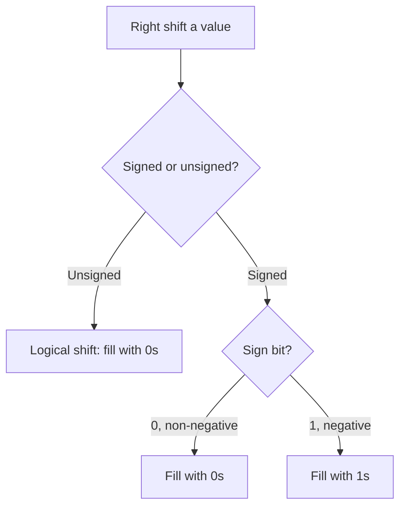

**Notes based off of:** CS3350B Computer Organization, _Chapter 2: Synchronous Circuits, Prelude_ (Marc Moreno Maza, Western University, Sept 25, 2025), file L5-LogicPrelim.pdf

## Big Idea: Everything on a Computer is a Number

Hardware only stores and manipulates **bits** (0/1, i.e. low/high voltage). Text, images, instructions, and addresses are all bit patterns, and _what they mean_ depends entirely on how the bit pattern is **interpreted**. This prelude covers the interpretation that matters most for the rest of the course (ALUs, adders, registers, MIPS/RISC-V instructions): **integers**, in unsigned and signed form, plus the operations (sign extension, shifts) that hardware provides on them.

## Radix Representations

A **radix** (base) $r$ is the number of distinct digits in a positional numbering system. In radix $r$, each digit $d_i$ comes from ${0, 1, \dots, r-1}$ and the value is $$ x = d_{n-1} r^{n-1} + d_{n-2} r^{n-2} + \dots + d_1 r^1 + d_0 r^0 $$ Common radices:

|Radix $r$|Name|Digits|
|---|---|---|
|10|decimal|0-9|
|2|binary|0, 1|
|8|octal|0-7|
|16|hexadecimal|0-9, a-f|

### Refresher: Binary to Decimal

$$ (1101)_2 = 1 \cdot 2^3 + 1 \cdot 2^2 + 0 \cdot 2^1 + 1 \cdot 2^0 = 8 + 4 + 0 + 1 = (13)_{10} $$

### Gap fill: Decimal to Binary and Hex Shortcuts

- **Decimal to binary** (repeated division by 2, read remainders bottom-up): $13 \to 6,r1 \to 3,r0 \to 1,r1 \to 0,r1$, so remainders read upward give $1101$.
- **Hex is a shorthand for binary**: one hex digit = exactly 4 bits (a "nibble"). So $(1001\ 1010)_2 = (9A)_{16}$ ($9 = 1001$, $A = 1010$). Octal is 3 bits per digit.
- Because hardware is binary, hex is how humans usually write bit patterns compactly (e.g., `0xFFFF0000`).

## Unsigned Binary Integers

The "normal" representation. An $n$-bit number $x_{n-1} x_{n-2} \dots x_1 x_0$ has value $$ x = x_{n-1} 2^{n-1} + x_{n-2} 2^{n-2} + \dots + x_1 2^1 + x_0 2^0 $$

- Highest term is $2^{n-1}$.
- Range: $0$ to $2^n - 1$.
- With 32 bits: $0$ to $4{,}294{,}967{,}295$.

**Example:** $0000\ 0000\ 0000\ 0000\ 0000\ 0000\ 0000\ 1011_2 = 8 + 2 + 1 = 11_{10}$.

Terminology: **MSB** = most significant bit ($x_{n-1}$, leftmost), **LSB** = least significant bit ($x_0$, rightmost).

## Signed Binary Integers

**Problem:** how do we encode negative numbers using only bits? The idea in both schemes below is to let the leading bit act as a sign indicator (1 = negative), but they differ in how the remaining bits are read.

### One's Complement

- Leading bit says whether the number is negative.
- Non-negative numbers look identical to unsigned.
- To get the value of a negative number: **invert all bits**, read as unsigned, multiply by $-1$.

4-bit examples:

|Bits|Reading|Value|
|---|---|---|
|0101|positive|5|
|1101|invert to 0010, times $-1$|-2|
|0000|positive|0|
|1111|invert to 0000, times $-1$|**-0**|

**Why it is rarely used:**

- It has **two zeros** (+0 = 0000 and -0 = 1111), which wastes an encoding and complicates equality checks.
- Addition needs an "end-around carry" (the carry out of the MSB must be added back in), which is awkward in hardware.

### Two's Complement

This is what virtually every modern CPU uses.

- Leading bit gives the sign (1 = negative).
- Non-negative numbers: same as unsigned.
- Negative numbers: the **MSB has negative weight**. Equivalently, invert the leading bit, read the result as a non-negative integer, and add $-2^{n-1}$.

> [!warning] Typo in the slides 
> The slide writes "add $-2^n$". For an $n$-bit number the correct term is $-2^{n-1}$, and the worked 4-bit examples ($-1 \times 2^3$) confirm this.

So the value of an $n$-bit two's complement number is $$ x = -x_{n-1} 2^{n-1} + x_{n-2} 2^{n-2} + \dots + x_1 2^1 + x_0 2^0 $$ 4-bit examples:

- $(0101)_2 = 5$
- $(1101)_2 = -1 \times 2^3 + (0101)_2 = -8 + 5 = -3$
- $(0000)_2 = 0$
- $(1111)_2 = -8 + 7 = -1$

**Full 4-bit table** (useful to memorize the pattern):

|Bits|Unsigned|Two's complement|
|---|---|---|
|0000|0|0|
|0001|1|1|
|0010|2|2|
|0011|3|3|
|0100|4|4|
|0101|5|5|
|0110|6|6|
|0111|7|7|
|1000|8|-8|
|1001|9|-7|
|1010|10|-6|
|1011|11|-5|
|1100|12|-4|
|1101|13|-3|
|1110|14|-2|
|1111|15|-1|

### Advantages of Two's Complement

1. **Same adder for signed and unsigned.** The hardware adds bit patterns identically; only the interpretation differs. Example (4 bits), throwing away the carry-out:
    - $0101 + 1101 = 1,0010 \to 0010$, i.e. $5 + (-3) = 2$. ✅
2. **No signed zero.** Only one encoding of 0.
3. **One extra value**: the range is asymmetric.

For an $n$-bit two's complement number: $$ -2^{n-1} \le x \le 2^{n-1} - 1 $$ For 32 bits: $-2{,}147{,}483{,}648$ to $2{,}147{,}483{,}647$.

### Gap fill: Overflow

Fixed width means results can fall outside the representable range and silently **wrap around**.

- $0111 + 0001 = 1000$: $7 + 1 = -8$ in 4-bit two's complement (signed overflow).
- Rule of thumb for detecting signed overflow when adding: the two operands have the **same sign** but the result has the **opposite sign** (equivalently, the carry into the MSB differs from the carry out of the MSB).
- Note that $-(-2^{n-1})$ overflows too, because $+2^{n-1}$ is not representable. In 4 bits, negating $1000$ gives $1000$ again.

## Same Bits, Different Numbers

A bit pattern has **no inherent meaning**; the interpretation does.

$(1001\ 1010)_2 =$

- $154_{10}$ interpreted as **unsigned**
- $-102_{10}$ interpreted as **two's complement** ($-128 + 26 = -102$)

This can be disastrous in programming:

```c
unsigned int a = (1 << 31); // a = 2147483648
int b = a;                  // b = -2147483648
```

The same 32 bits (`0x80000000`) are read two different ways.

### Gap fill: Real-world pitfalls

- **Mixed comparisons.** In C, when a signed and unsigned value are compared, the signed one is converted to unsigned. So `-1 < 0u` is **false**, because $-1$ becomes $4{,}294{,}967{,}295$.
- **Technicality:** `1 << 31` shifts a _signed_ `int`, which is undefined/implementation-dependent behavior in C. Writing `1u << 31` is the safe way to get the slide's intended result.
- The conversion `int b = a` is implementation-defined in the C standard, but on essentially all real machines it simply reinterprets the bits.

## Computing the Opposite (Signed Negation)

In two's complement: **bitwise complement, then add 1.**

Example: negate $6$ in 4 bits.

- $6 = (0110)_2$
- Complement: $(1001)_2 = -8 + 1 = -7$
- Add one: $(1001)_2 + (0001)_2 = (1010)_2 = -8 + 2 = -6$ ✅

It also works in reverse (negative to positive): $-6 = (1010)_2 \to (0101)_2 + 1 = (0110)_2 = 6$.

### Why it works (professor's intuition)

Adding any $n$-bit number $x$ to its bitwise complement $\overline{x}$ gives all ones, which is $-1$ in two's complement: $$ x + \overline{x} = 11\dots1_2 = -1 \quad \Rightarrow \quad -x = \overline{x} + 1 $$ This is why **subtraction** in hardware is done as $a - b = a + \overline{b} + 1$: the same adder is reused, with inverters on $b$ and a carry-in of 1.

## Sign Extension

**Goal:** represent the same number using more bits while keeping its numerical value.

In two's complement it is easy: **copy the sign bit to the left** until you reach the desired width.

8-bit to 16-bit examples:

- $2$: `0000 0010` $\Rightarrow$ `0000 0000 0000 0010`
- $-2$: `1111 1110` $\Rightarrow$ `1111 1111 1111 1110`
- $-10$: `1111 0110` $\Rightarrow$ `1111 1111 1111 0110`

**Why it works:** when a new leading 1 (weight $-2^{n}$) is added, the old sign bit changes from weight $-2^{n-1}$ to $+2^{n-1}$, and $-2^n + 2^{n-1} = -2^{n-1}$, which is exactly the old weight. The value is unchanged.

**Contrast:** for _unsigned_ values you use **zero extension** (pad with 0s). Using the wrong one is a classic bug. In architecture context, this appears when loading a byte into a wider register (e.g., `lb` vs `lbu` in MIPS/RISC-V) and when an instruction's small immediate field is widened to the full register width.

## Shifts

Shifting moves all bits left or right by a specified count, discarding bits that fall off the end. Vacated positions are filled according to the type of shift.

### Logical Shift

- Shift left **and** shift right both fill vacancies with **0s**.
- Corresponds to `<<` and `>>` in C on **unsigned** values.

8-bit examples:

- $2 \ll 3$: `0000 0010` $\to$ `0001 0000` $= 16$
- $8 \gg 2$: `0000 1000` $\to$ `0000 0010` $= 2$
- $-4 \gg 1$ (logical): `1111 1100` $\to$ `0111 1110` $= 126$

The last result is **not** what we expect from "divide $-4$ by 2". That is why signed values need a different right shift.

### Arithmetic Shift

- **Shift left:** fill with 0s. This is multiplication by a power of 2 ($x \ll k = x \cdot 2^k$, as long as no overflow occurs).
- **Shift right:** fill with a copy of the **sign bit** (1s if negative, 0s if positive). This is integer division by a power of 2.
- Corresponds to `<<` and `>>` in C on **signed** values (in practice; see below).

8-bit examples:

- $2 \ll 3 = 16$
- $8 \gg 2 = 2$
- $-4 \gg 1$: `1111 1100` $\to$ `1111 1110` $= -2$ ✅

Notice that arithmetic right shift is really **sign extension in disguise**: the vacated MSBs are filled by replicating the sign bit.



### Gap fill: Shift vs Division Subtleties

- Arithmetic right shift rounds **toward negative infinity** (floor), while C integer division `/` **truncates toward zero**. For $-3$: `-3 >> 1` gives $-2$ (`1111 1101` $\to$ `1111 1110`), whereas `-3 / 2` gives $-1$.
- In C, right-shifting a negative signed integer is technically **implementation-defined** (nearly all compilers use arithmetic shift), and left-shifting a negative value or shifting past the type width is **undefined behavior**.
- Compilers routinely replace multiplication/division by powers of 2 with shifts because shifts are far cheaper in hardware.

## Quick Reference

|Concept|Key fact|
|---|---|
|Unsigned $n$-bit range|$0$ to $2^n - 1$|
|Two's complement $n$-bit range|$-2^{n-1}$ to $2^{n-1} - 1$|
|Negate (two's complement)|invert all bits, add 1|
|Sign extend|replicate the sign bit leftward|
|Logical shift right|fill with 0s (unsigned)|
|Arithmetic shift right|fill with sign bit (signed)|
|Shift left by $k$|multiply by $2^k$|
|Arithmetic shift right by $k$|floor-divide by $2^k$|
|One's complement|two zeros; rarely used|

## Self-Check Questions

1. What are the unsigned and two's complement values of `1000 0001` (8-bit)? _(129 and -127)_
2. What is $-7$ in 8-bit two's complement? _(`1111 1001`)_
3. Sign-extend `1010` (4-bit) to 8 bits. _(`1111 1010`, i.e. -6 stays -6)_
4. What does `0xF0 >> 2` give in 8 bits as an unsigned (logical) shift versus a signed (arithmetic) shift? _(`0011 1100` = 60 versus `1111 1100` = -4)_
5. Why can a single binary adder serve both signed and unsigned addition?

**Prev:** [[CS3350A/Chapter 1/4. Cache Implementations|4. Cache Implementations]], **Next:** [[CS3350A/Chapter 2/6. Gates, Switches, and Boolean Algebra|6. Gates, Switches, and Boolean Algebra]]