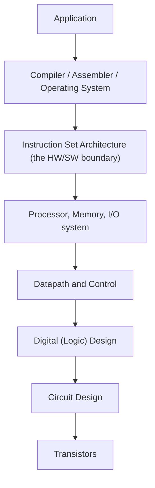
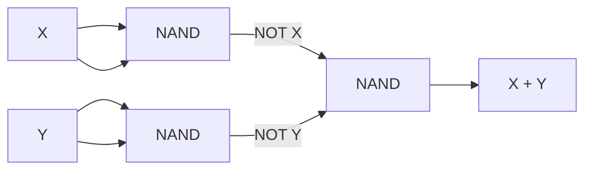

**Notes based off of:** CS3350B Computer Organization, Chapter 2: Synchronous Circuits, Part 1: Gates, Switches, and Boolean Algebra (Marc Moreno Maza, Western University), lecture slides _L6-SimpleCircuits.pdf_

## Where This Fits

Up to now the course looked at the CPU and memory at a high level. This chapter drops down to the lowest level we care about: **circuits built from transistors**.

- **Circuit design**: design of individual circuits (e.g. how one gate is built from transistors).
- **Digital (logic) design**: using circuits as building blocks to implement some logic.

### Why Care?

- Appreciate the limitations of hardware, and understand why some things are fast and others are slow.
- Circuit design is needed to understand logic design, and logic design is needed to understand the **CPU datapath** (coming up next).
- Anyone working with assembly/ISAs, embedded systems, or specialized logic systems will need this.

## Digital Signals

- Everything is **digital**: represented by discrete values, with no gray areas or ambiguity.
- The underlying physical signal is analog (a continuously varying **voltage**), so it must be converted to digital:
    - "High" voltage ⇒ `1` (true)
    - "Low" voltage ⇒ `0` (false)
- In practice, hardware defines a _range_ of voltages that counts as 0 and a range that counts as 1, with a forbidden gap between them. This gap (the **noise margin**) is what lets small electrical noise be ignored, and it is why digital hardware is so reliable.

## Switches and Transistors

### Everything Is a Switch

A battery, a switch with input $A$, and a lamp with output $Z$:

- $A = 0$ (false): switch open, lamp **off** ($Z = 0$).
- $A = 1$ (true): switch closed, lamp **on** ($Z = 1$).

This circuit just implements $A \equiv Z$ (a plain "wire"/buffer). Everything else is built by arranging switches cleverly.

### Transistors: Electrically Controlled Switches

A moving mechanical switch is slow and needs a human (or a motor). A **transistor** is a switch controlled by a voltage, and it flips _much_ faster. The **switching speed of transistors is directly tied to the speed of a CPU**.

**MOSFET** = Metal-Oxide-Semiconductor Field-Effect Transistor. It has three terminals:

- **Source (S)**
- **Drain (D)**
- **Gate (G)**: the control input. A voltage on G decides whether current can flow between S and D.

|Type|Gate LOW|Gate HIGH|
|---|---|---|
|**n-channel** (nMOS)|switch open|switch **closed**|
|**p-channel** (pMOS)|switch **closed**|switch open|

The little circle ("bubble") on the gate of the p-channel symbol means "inverted control".

### CMOS (Complementary MOS)

Real transistors, logic gates, and SRAM all use **CMOS**: each gate is built from _both_ nMOS and pMOS transistors arranged as complements. The course does not go deeper into transistors, but the idea is useful intuition.

- A **pull-up network** (pMOS) connects the output to the high voltage when the output should be 1.
- A **pull-down network** (nMOS) connects the output to ground when the output should be 0.
- Exactly one network conducts at a time, so (ideally) no current flows straight from supply to ground except while switching, which is why CMOS is power-efficient.

Example, the **NOT gate** (inverter): one pMOS from supply to output, one nMOS from output to ground, both gates tied to the input. Input high ⇒ nMOS closed, pMOS open ⇒ output pulled to 0.

> [!note] Why NAND and NOR matter in hardware A CMOS NAND gate is naturally 4 transistors (2 pMOS in parallel, 2 nMOS in series). An AND gate is a NAND followed by a NOT, i.e. 6 transistors. Inverting gates (NAND, NOR, NOT) are the _cheapest_ and fastest gates in CMOS, which is why functional completeness of NAND/NOR (see the end of this note) is practically important and not just a curiosity.

## Logic Gates

### Logic as Circuits

- **Propositional logic**: a set of propositions (mathematical sentences with a truth value) combined by logical connectives.
    - Each proposition is represented by a **binary digital signal**.
    - Each logical connective is represented by a **logic gate**.
- **Logic gate**: a circuit mapping a number of propositions (inputs) to one (sometimes more) proposition (output).
- The basics: **AND** ($\wedge$), **OR** ($\vee$), **NOT** ($\neg$).
- **Arity** of a function/gate = the number of input signals (AND/OR are binary, arity 2; NOT is unary, arity 1).

### Gates as Switches

How the basic gates look at switch level:

- **AND**: two switches in **series**. Both $A$ and $B$ must be 1 for the circuit to be complete.
- **OR**: two switches in **parallel**. Either $A$ or $B$ being 1 completes the circuit.

Rule of thumb: **series = AND, parallel = OR**.

### The Basic Gates

|Gate|Math notation|Boolean algebra notation|Meaning|
|---|---|---|---|
|AND|$A \wedge B \equiv C$|$A \cdot B \equiv C$|1 only if both inputs are 1|
|OR|$A \vee B \equiv C$|$A + B \equiv C$|1 if at least one input is 1|
|NOT|$\neg A \equiv C$|$\bar{A} \equiv C$|flips the input|

### The "More Interesting" Gates

|Gate|Expression|Notes|
|---|---|---|
|NAND|$\neg(A \wedge B) \equiv \overline{A \cdot B} \equiv A \mid B$|AND followed by NOT. The vertical bar is the _Sheffer stroke_.|
|NOR|$\neg(A \vee B) \equiv \overline{A + B}$|OR followed by NOT. Sometimes written $A \downarrow B$ (_Peirce arrow_).|
|XOR|$A \oplus B$|"Exclusive OR": 1 when the inputs **differ**.|

### Truth Tables (All Gates)

|A|B|AND|OR|NAND|NOR|XOR|
|---|---|---|---|---|---|---|
|0|0|0|0|1|1|0|
|0|1|0|1|1|0|1|
|1|0|0|1|1|0|1|
|1|1|1|1|0|0|0|

NOT: $0 \to 1$, $1 \to 0$.

> [!info] Extra context
> 
> - XOR can be written $A \oplus B \equiv \bar{A}B + A\bar{B}$. It is the "difference detector", and it is the **sum bit** of a one-bit adder (the carry bit is $A \cdot B$). We will see this when building the ALU.
> - A truth table for $n$ inputs has $2^n$ rows, so there are $2^{2^n}$ distinct $n$-input Boolean functions. For $n = 2$ that is 16 functions; AND, OR, NAND, NOR, XOR are just 5 of them.
> - These gates are exactly the **bitwise operators** in programming: `&` (AND), `|` (OR), `~` (NOT), `^` (XOR).

## Boolean Algebra

Because truth values and binary digital signals are equivalent, Boolean algebra is the standard tool for reasoning about circuits. Here $+$ is OR, $\cdot$ is AND, and the bar is NOT.

### Operator Precedence

NOT binds tightest, then AND, then OR (just like $\times$ before $+$ in ordinary arithmetic). So $x y \bar{z} + w$ means $\big(x \cdot y \cdot (\bar{z})\big) + w$.

### Basic Laws

|Law|OR form|AND form|
|---|---|---|
|**Associativity**|$(A + B) + C \equiv A + (B + C)$|$(A \cdot B) \cdot C \equiv A \cdot (B \cdot C)$|
|**Commutativity**|$A + B \equiv B + A$|$A \cdot B \equiv B \cdot A$|
|**Distributivity**|$A + (B \cdot C) \equiv (A + B) \cdot (A + C)$|$A \cdot (B + C) \equiv (A \cdot B) + (A \cdot C)$|
|**Identity**|$A + 0 \equiv A$|$A \cdot 1 \equiv A$|
|**Annihilation**|$A + 1 \equiv 1$|$A \cdot 0 \equiv 0$|
|**Idempotence**|$A + A \equiv A$|$A \cdot A \equiv A$|

> [!warning] Watch out
>  The first distributive law ($+$ distributing over $\cdot$) has **no analogue in ordinary arithmetic**. $2 + (3 \times 4) \neq (2+3)(2+4)$, but in Boolean algebra it holds.

### More Interesting Laws

|Law|OR form|AND form|
|---|---|---|
|**Absorption**|$A + (A \cdot B) \equiv A$|$A \cdot (A + B) \equiv A$|
|**Complementation**|$A + \bar{A} \equiv 1$|$A \cdot \bar{A} \equiv 0$|
|**Double negation**|$\overline{\overline{A}} \equiv A$||
|**De Morgan's laws**|$\overline{A + B} \equiv \bar{A} \cdot \bar{B}$|$\overline{A \cdot B} \equiv \bar{A} + \bar{B}$|

De Morgan's laws should look familiar: they are the **definitions of NOR and NAND**. NOR is "NOT-A AND NOT-B", and NAND is "NOT-A OR NOT-B".

> [!tip] Duality Every law comes in pairs. Swap $+ \leftrightarrow \cdot$ and $0 \leftrightarrow 1$ in a true law and you get another true law (the **principle of duality**). That is why every row above has an OR form and an AND form, and it means you only need to memorize half of them.

Handy extra identities (not on the slides, but derived from the laws above):

$$ A + \bar{A}B \equiv A + B \qquad\qquad A \cdot (\bar{A} + B) \equiv A \cdot B $$

Proof of the first: $A + \bar{A}B \equiv (A + \bar{A})(A + B) \equiv 1 \cdot (A + B) \equiv A + B$ (distributivity, then complementation, then identity).

### Proving De Morgan's Laws: Proof by Exhaustion

The easiest way to prove an identity with few variables is to write both sides' truth tables and compare them. Here is $\overline{A + B} \equiv \bar{A} \cdot \bar{B}$:

|A|B|$A + B$|$\overline{A + B}$|$\bar{A}$|$\bar{B}$|$\bar{A} \cdot \bar{B}$|
|---|---|---|---|---|---|---|
|0|0|0|1|1|1|1|
|0|1|1|0|1|0|0|
|1|0|1|0|0|1|0|
|1|1|1|0|0|0|0|

The columns $\overline{A + B}$ and $\bar{A} \cdot \bar{B}$ are identical in every row, so the two expressions are equivalent. The other law follows by duality (or by building its table the same way).

### Simplifying Expressions

#### Example 1: Using the laws

$$ xy\bar{z} + xyz $$

$$ \begin{aligned} xy\bar{z} + xyz &\equiv xy(\bar{z} + z) && \text{Factor out } xy \ &\equiv xy(1) && \text{Complementation of } z \ &\equiv xy && \text{Identity} \end{aligned} $$

Check by exhaustion: the expression is 1 exactly in the rows where $x = y = 1$, which is exactly $xy$.

|x|y|z|$xy\bar{z} + xyz$|$xy$|
|---|---|---|---|---|
|0|0|0|0|0|
|0|0|1|0|0|
|0|1|0|0|0|
|0|1|1|0|0|
|1|0|0|0|0|
|1|0|1|0|0|
|1|1|0|1|1|
|1|1|1|1|1|

#### Example 2: When a truth table is too big

With $v$ variables a truth table has $2^v$ rows. The expression below has 6 variables ($a, b, c, d, x, z$), so 64 rows. Algebra is much quicker:

$$ \overline{(\bar{x} + \bar{z})},(abcd + xz) $$

$$ \begin{aligned} \overline{(\bar{x} + \bar{z})},(abcd + xz) &\equiv \overline{\bar{x}} \cdot \overline{\bar{z}},(abcd + xz) && \text{De Morgan's law} \ &\equiv xz,(abcd + xz) && \text{Double negation of } x \text{ and } z \ &\equiv xz && \text{Absorption (with } A = xz\text{)} \end{aligned} $$

#### Example 3: Simplifying a circuit

Original circuit (3 gates):

$$ y = ((ab) + a) + c $$

$$ \begin{aligned} y &\equiv (ab + a) + c \ &\equiv a(b + 1) + c && \text{Factor } a \ &\equiv a(1) + c && \text{Annihilation} \ &\equiv a + c && \text{Identity} \end{aligned} $$

The AND gate and one OR gate disappear: the circuit becomes a single OR gate, and the output **does not depend on $b$ at all**. (You can also see this in one step by absorption: $ab + a \equiv a$.)

> [!info] Why simplify? Fewer gates means less chip area, less power, and fewer gate delays between input and output, so the circuit can be clocked faster. Boolean algebra lets you remove variables the output does not actually depend on and strip out needless gates ("space and time complexity improved").

## Canonical Forms

Every Boolean expression can be converted into a standard (canonical) form.

|Form|Structure|Nickname|
|---|---|---|
|**CNF**: Conjunctive Normal Form|AND of ORs|"product of sums"|
|**DNF**: Disjunctive Normal Form|OR of ANDs|"sum of products"|

Example: XOR in both forms.

$$ \text{DNF: } \bar{a}b + a\bar{b} \qquad\qquad \text{CNF: } (a + b)(\bar{a} + \bar{b}) $$

**DNF is the more practical** one because it can be read straight off a truth table.

### From a Truth Table to DNF

Algorithm (inputs $a, b, c$, output $f$):

1. Create **one product term for every row where $f = 1$**.
2. In that row's product, include $\bar{x}$ if $x$ is **0** in that row, and $x$ if $x$ is **1**.
3. **OR** all the products together.

|a|b|c|f|Product term|
|---|---|---|---|---|
|0|0|0|1|$\bar{a}\bar{b}\bar{c}$|
|0|0|1|0||
|0|1|0|1|$\bar{a}b\bar{c}$|
|0|1|1|0||
|1|0|0|1|$a\bar{b}\bar{c}$|
|1|0|1|0||
|1|1|0|0||
|1|1|1|1|$abc$|

$$ f \equiv \bar{a}\bar{b}\bar{c} + \bar{a}b\bar{c} + a\bar{b}\bar{c} + abc $$

Each product term is a row that "turns on" the output, and exactly one product term can be 1 for any given input combination. This DNF is **directly implementable**: an AND gate per term feeding one big OR gate.

> [!info] Going further The raw DNF is correct but rarely minimal. Merging terms with the laws above gives, for example, $f \equiv \bar{a}\bar{c} + \bar{b}\bar{c} + abc$. Hand-minimizing larger functions is usually done with **Karnaugh maps** (K-maps) or the Quine-McCluskey algorithm, and CAD tools do this automatically.

## Functional Completeness

**Functional completeness**: a set of operators is functionally complete if it can express every Boolean function.

- The classical set ${+, \cdot, \neg}$ is functionally complete but **not minimal**.
- By De Morgan's laws, you only need one of AND/OR:
    - $A \cdot B \equiv \overline{\bar{A} + \bar{B}}$
    - $A + B \equiv \overline{\bar{A} \cdot \bar{B}}$
- So ${+, \neg}$ and ${\cdot, \neg}$ are both functionally complete **and minimal** (removing any operator breaks completeness).
- Even better: **NAND alone** is functionally complete, and so is **NOR alone**.

### NAND Is Functionally Complete

To prove it, show that NAND can mimic each of ${\neg, \cdot, +}$. Write $\mid$ for NAND:

|Target|Built from NAND only|NAND gates used|
|---|---|---|
|$\neg X$|$X \mid X$|1|
|$X \cdot Y$|$(X \mid Y) \mid (X \mid Y)$|2|
|$X + Y$|$(X \mid X) \mid (Y \mid Y)$|3|

Derivations:

- NOT: $X \mid X \equiv \overline{X \cdot X} \equiv \bar{X}$ (idempotence).
- AND: $X \cdot Y \equiv \overline{\overline{X \cdot Y}} \equiv \neg(X \mid Y)$, and NOT is NAND with its inputs tied together.
- OR: $X + Y \equiv \overline{\overline{X + Y}} \equiv \overline{\bar{X} \cdot \bar{Y}} \equiv \bar{X} \mid \bar{Y} \equiv (X \mid X) \mid (Y \mid Y)$ (De Morgan's law).

The slides verify these with truth tables (e.g. for $X \cdot Y$, define $A \equiv X \mid Y$ and tabulate $A \mid A$).

### NOR Is Functionally Complete Too

By the dual argument, writing $\downarrow$ for NOR:

- $\neg X \equiv X \downarrow X$
- $X + Y \equiv (X \downarrow Y) \downarrow (X \downarrow Y)$
- $X \cdot Y \equiv (X \downarrow X) \downarrow (Y \downarrow Y)$

> [!note] Why this matters A chip manufacturer can build an entire processor from a _single_ kind of gate, which simplifies fabrication, layout, and design libraries. Combined with the CMOS point above (NAND/NOR are the cheapest gates), this is why NAND-only or NOR-only implementations show up in real designs.

## Summary

- Digital circuits represent 1 and 0 as high and low voltage. Transistors (nMOS/pMOS, combined as CMOS) are the electrically controlled switches that build gates; series = AND, parallel = OR.
- Basic gates: AND, OR, NOT. Derived gates: NAND, NOR, XOR.
- Boolean algebra (associativity, commutativity, distributivity, identity, annihilation, idempotence, absorption, complementation, double negation, De Morgan's laws) lets us **simplify expressions, and therefore circuits**: fewer gates, less area, less delay.
- Small expressions can be checked with truth tables (proof by exhaustion); larger ones are handled with the algebraic laws.
- A truth table converts directly to **DNF** (sum of products): one AND term per row with output 1, all ORed together.
- ${+, \cdot, \neg}$ is functionally complete, but ${+, \neg}$, ${\cdot, \neg}$, NAND alone, and NOR alone are complete too.

Truth table generator mentioned in the slides: [https://web.stanford.edu/class/cs103/tools/truth-table-tool/](https://web.stanford.edu/class/cs103/tools/truth-table-tool/)

## Check Yourself

1. Simplify $\bar{a}b + ab + a\bar{b}$ to a single OR of two variables. _(Hint: factor, then use complementation. Or use $A + \bar{A}B \equiv A + B$.)_
2. Build XOR using only NAND gates. How many gates do you need? _(The known minimum is 4.)_
3. Write the DNF for the truth table of $f(a, b, c) = 1$ only when exactly one input is 1.
4. Why can a 20-variable expression not realistically be verified by exhaustion, and what would you do instead?

**Prev:** [[CS3350A/Chapter 2/5. Logic Prelims|5. Logic Prelims]]