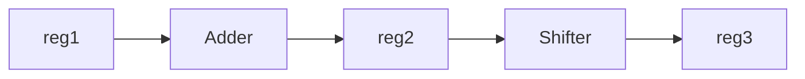

**Notes based off of:** CS3350B Computer Organization, L12: Chapter 4, Instruction-Level Parallelism, Part 1: Pipelining (Marc Moreno Maza, Western University, Oct 21, 2025)

## Instruction-Level Parallelism (ILP)

**ILP** measures how many instructions an architecture can perform simultaneously. It is usually achieved _dynamically_, after compile time, by the processor itself rearranging and overlapping the execution of a program. This costs extra circuitry and control signals.

### Techniques for achieving ILP

|Technique|Idea|
|---|---|
|Pipelining|Overlap several instructions inside a **single** execution unit (this note)|
|Superscalar|Several execution units run several instructions in parallel|
|VLIW|The program explicitly says which instructions run in parallel (e.g. one add, one multiply, two loads per "word")|
|Register renaming|Removes _false_ data dependencies to expose more parallelism|
|Branch prediction|Guess the outcome of a branch before it is known so the pipeline stays full|

> [!info] Lesson goals
> 
> - Compare single-cycle, multi-cycle and pipelined datapaths.
> - See how registers between stages enable multi-cycle datapaths, which in turn enable pipelining and a shorter clock cycle.
> - Know the metrics: latency, throughput, ideal speedup, actual speedup.

## Pipelining: The Concept

### Where the word comes from

- **Unix pipe**: `ls -la | grep "foo.txt"` passes the output of one program to the next.
- **Data pipeline**: a series of processing elements where each output feeds the next input. **Buffer storage** is needed between elements.
- **Pipelining (in ILP)**: each stage of the datapath is kept busy at all times, and instructions are **overlapped**.

### Link to combinational circuits

Pipelining a combinational circuit is the same idea: split a long circuit (e.g. adder followed by shifter) into pieces and put a **register** between them to store intermediate results. Each piece has a shorter propagation delay, so the **clock frequency can increase**.

The clock now only has to cover `max(adder, shifter)` instead of `adder + shifter`. The processor does the same thing with its datapath.

### Analogy: doing laundry

Four loads (A, B, C, D), four stages (wash, dry, fold, put away), 30 minutes per stage.

| |Time for 4 loads|
|---|---|
|Sequential|$4 \times 2\text{ h} = 8\text{ h}$|
|Pipelined|$(4 + 4 - 1) \times 30\text{ min} = 3.5\text{ h}$|

Pipelining works because there is **no dependency** between drying load A and washing load B. Each stage still handles loads one at a time, but different loads occupy different stages.

| Laundry term                        | Meaning             | Pipelining term   |
| ----------------------------------- | ------------------- | ----------------- |
| Time for one load (2 h)             | Does **not** change | **Latency**       |
| Loads finished per hour             | **Increases**       | **Throughput**    |
| Number of stages (4)                | Upper bound on gain | **Ideal speedup** |
| Early on, only some machines busy   |                     | **Fill time**     |
| At the end, only some machines busy |                     | **Drain time**    |

> [!warning] Actual speedup never equals ideal speedup 
> Here the actual speedup is $8 / 3.5 \approx 2.29$, below the ideal 4, because of fill and drain time. It approaches 4 as the number of loads grows.

> [!example] A faster washer does not help 
> Suppose a new washer takes 20 minutes. The dryer still takes 30, so the washer just waits for the dryer to free up. **The slowest stage sets the pace of the whole pipeline.** The same holds for the CPU clock cycle.

## The RISC Datapath

### The five stages

|Stage|Name|Work done|Typical resource|
|---|---|---|---|
|IF|Instruction Fetch|Read instruction at PC; compute PC + 4|Instruction memory|
|ID|Decode / Register Read|Decode, read source registers, sign-extend immediate|Register file|
|EX|Execute|ALU operation or address calculation|ALU|
|MEM|Memory Access|Load or store data|Data memory|
|WB|Write Back|Write result to the register file|Register file|

With 5 stages, up to **5 different instructions** are in flight at once, one per stage.

### Single-cycle datapath

- One clock cycle must be long enough for the **critical path**, i.e. the time for data to pass through the whole datapath.
- Every instruction takes that long, even if it uses fewer stages.

### Multi-cycle (pipelined) datapath

- **Pipeline registers** (IFetch/Dec, Dec/Exec, Exec/Mem, Mem/WB) are inserted between stages.
- Each stage has one cycle, so the clock only has to be long enough for the **slowest stage**.
- Each instruction now takes several cycles. Pipelining then overlaps many instructions.

> [!tip] Heuristic 
> Multi-cycle _enables_ pipelining. Pipeline registers hold each instruction's partial results (and control signals) so the next instruction can safely use the stage behind it.

### Timing example

Assume memory access = 200 ps, ALU = 200 ps, register access = 100 ps.

| Instr. | IF  | ID  | EX  | MEM | WB  | Total  |
| ------ | --- | --- | --- | --- | --- | ------ |
| R-type | 200 | 100 | 200 | -   | 100 | 600 ps |
| Branch | 200 | 100 | 200 | -   | -   | 500 ps |
| `sw`   | 200 | 100 | 200 | 200 | -   | 700 ps |
| `lw`   | 200 | 100 | 200 | 200 | 100 | 800 ps |

- **Single-cycle** clock: must fit the longest instruction (`lw`): $200+100+200+200+100 = 800$ ps.
- **Multi-cycle / pipelined** clock: must fit the slowest stage: **200 ps**.

Note that the stages are **unbalanced** (ID and WB take only 100 ps). That imbalance will cost us some speedup below.

### Why not just add more stages?

Cutting the datapath into ever more stages to raise the clock is limited by:

- **Energy / power**: higher clock frequency is limited by energy issues.
- **More registers** and more complex datapath and control design (overhead).
- The **slowest stage** (memory) still bounds the clock cycle.

So instead we exploit the **parallelism** that pipelining provides, which lowers CPI.

## Pipelining and Performance

### The classic performance equation

$$\text{CPU time} = \text{IC} \times \text{CPI} \times \text{clock cycle} = \frac{\text{IC} \times \text{CPI}}{\text{clock rate}}$$

- Multi-cycle design shortens the **clock cycle**.
- Overlapping instructions lowers **CPI**: once the pipeline is full, one instruction completes per cycle, so CPI approaches 1.

### Overlapped execution

|       | C1  | C2  | C3  | C4  | C5  | C6     | C7  |
| ----- | --- | --- | --- | --- | --- | ------ | --- |
| `lw`  | IF  | ID  | EX  | MEM | WB  |        |     |
| `sw`  |     | IF  | ID  | EX  | MEM | (idle) |     |
| `add` |     |     | IF  | ID  | EX  | (idle) | WB  |

In practice some instructions **waste a slot** as they pass through a stage they do not need (e.g. `sw` has no real write-back work). They still flow through every stage.

> [!note] Why every instruction takes all five slots 
> Keeping every instruction on the same 5-stage schedule keeps the control simple and avoids two instructions wanting the same stage (e.g. the register file write port) in the same cycle. Skipping stages would create conflicts. This anticipates the hazards discussed in Part 2.

### Latency vs throughput

| Metric                                       | Effect of pipelining                                                                            |
| -------------------------------------------- | ----------------------------------------------------------------------------------------------- |
| **Latency** (time to finish one instruction) | Does **not** decrease; may increase slightly because every stage is padded to the slowest stage |
| **Throughput** (instructions per unit time)  | **Increases**                                                                                   |
| **CPI**                                      | Approaches 1 once the pipeline is full                                                          |

Concrete case from the slides: `lw` latency is 800 ps single-cycle but $5 \times 200 = 1000$ ps pipelined. Yet pipelined, a new instruction finishes every 200 ps instead of every 800 ps.

### Pipeline parallelism, fill and drain

- A pipeline is **full** when every stage holds an instruction (a stage need not be doing useful work).
- **Fill time**: cycles before the first instruction completes and the pipeline is full.
- **Drain time**: cycles after the last instruction enters, while the pipeline empties.
- Both reduce actual speedup.

## Quantifying Speedup

### Formulas

$$\text{Ideal speedup} = \text{number of stages}$$

This holds only if all stages take equal time **and** enough instructions are executed that fill time is negligible.

$$\text{Actual speedup} = \frac{T_{\text{single-cycle}}}{T_{\text{pipelined}}}$$

Pipelined execution time, assuming **no stalls or hazards**:

$$T_{\text{pipelined}} = \text{Fill time} + \left(\text{IC} \times \text{clock cycle}\right)$$

$$\text{Fill time} = \text{Drain time} = (\text{number of stages} - 1) \times \text{clock cycle}$$

(assuming IC > number of stages)

> [!warning] Do not add drain time separately 
> The formula already counts the pipeline's total length. Total cycles $= (S - 1) + \text{IC}$. Fill and drain are two views of the same overhead.

> [!note] Single-cycle vs pipelined latency A single-cycle datapath always has latency less than or equal to that of a multi-cycle or pipelined datapath.

### Worked example: 3 `lw` instructions

- Single-cycle: $3 \times 800 = 2400$ ps
- Pipelined: fill $= 4 \times 200 = 800$ ps, plus $3 \times 200 = 600$ ps, giving $1400$ ps

$$\text{Speedup} = \frac{2400}{1400} \approx 1.714$$

### Worked example: 1,000,000 `lw` instructions

$$\text{Speedup} = \frac{10^{6} \times 800}{10^{6} \times 200 + 800} \approx 4$$

> [!important] Why 4 and not 5 
> With many instructions fill time vanishes, so speedup tends to $\dfrac{T_{c,\text{single}}}{T_{c,\text{pipe}}} = \dfrac{800}{200} = 4$. The ideal factor of 5 would require perfectly balanced stages (a 160 ps clock). Because the slowest stage is 200 ps, the extra 40 ps in each short stage (ID, WB) is wasted every cycle. **Balancing stages is a core design goal.**

## Summary

- Pipelining executes multiple instructions at once, each in a different datapath stage.
- A multi-cycle datapath with pipeline registers raises the clock frequency; the clock is limited by the **slowest stage**.
- Throughput rises and CPI approaches 1, while single-instruction latency stays the same or grows slightly.
- Speedup must account for **fill and drain time** and for **unbalanced stages**.
- Everything above assumed **no conflicts** between instructions. Real pipelines suffer **hazards** (structural, data, control) that stall the pipeline and cut speedup. Covered in **Chapter 4, Part 2: Pipeline Hazards**.