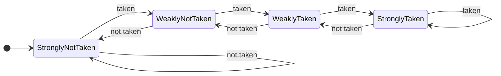

**Notes based off of:** CS3350B Computer Organization, Chapter 4: Instruction-Level Parallelism, Part 2: Pipeline Hazards (L13-PipelineHazards.pdf), Marc Moreno Maza, Western University

## Context: Why Hazards Exist

Pipelining overlaps instructions so that every stage of the datapath (IF, ID/RF, EX, MEM, WB) is busy every cycle.

- Improves **throughput**, not latency. Latency of a single instruction can actually get worse (stage registers, clock set by slowest stage).
- Ideal speedup equals the number of stages $k$. For $n$ instructions the pipeline needs $k + n - 1$ cycles instead of $kn$, so fill and drain time always eat into the ideal.
- The ideal is never reached because of **hazards**: situations where the next instruction cannot execute in the next cycle without producing a wrong result.

> [!note] Sanity check on cycle counts 
> A 5-stage pipeline running 7 instructions with no stalls takes $5 + 7 - 1 = 11$ cycles. Every stall adds exactly one cycle. This is how the "13 cycles vs 11 cycles" example later in these notes comes about.

### The Three Hazard Types

| Type       | Cause                                                      | Typical fix                              |
| ---------- | ---------------------------------------------------------- | ---------------------------------------- |
| Structural | Two instructions need the same hardware in the same cycle  | Duplicate or split the hardware          |
| Data       | An instruction needs a result that is not ready yet        | Forwarding, stall, reordering            |
| Control    | Next instruction depends on a branch outcome not yet known | Early comparator, delay slot, prediction |

### Stalling: The Universal (and Bad) Fix

Any hazard can be solved by waiting. The problem is that stalls:

- Increase CPI: $\text{CPI} = 1 + \text{average stall cycles per instruction}$
- Destroy the speedup that justified pipelining. With enough stalls a pipeline is slower than a single-cycle datapath, since latency per instruction is higher.

Stalling is the fallback when nothing cleverer is possible (e.g. load-use). Everything below is about avoiding it where we can.

## Structural Hazards

Two instructions (in different stages) want the same piece of hardware in the same cycle.

- Combinational hardware (adders, ALUs) can simply be duplicated.
- **State elements** (memory, register file) are the real problem. Duplicating memory creates a consistency problem, so we get around the conflict differently.

The two classic conflicts: **IF vs MEM** (memory) and **ID vs WB** (register file).

### Memory: IF vs MEM

With a single _unified_ L1 cache, an instruction fetch in IF can collide with a `lw`/`sw` data access in MEM in the same cycle.

**Fix:** separate instruction and data memory, i.e. a banked (split) L1 cache: I$ and D$.

### Register File: ID vs WB

ID reads source registers while WB of an older instruction writes a destination register, in the same cycle.

**Fix:** register file with independent read and write ports. In practice the register file is very fast, so the clock period is long enough to do the **write in the first half of the cycle and the read in the second half**. A read in the same cycle as the write therefore sees the new value.

> [!tip] Why this matters later 
> This half-cycle trick is exactly why the `or` instruction in the data hazard example below needs no extra help: it reads `$t0` in the same cycle `add` writes it back.

## Data Hazards

Caused by **dependencies** between the result of one instruction and the operand of a later one.

|Dependency|Meaning|Hazard in our in-order pipeline?|
|---|---|---|
|RAW (Read After Write)|Later instruction reads what an earlier one writes|Yes, the only true dependency|
|WAR (Write After Read)|Later instruction writes a register an earlier one reads|No, only with out-of-order execution|
|WAW (Write After Write)|Both write the same register|No, only with out-of-order execution|

WAR and WAW come back in Lecture 14 (out-of-order execution). For now, **data hazard means RAW**.

Two key observations:

- A dependency is only a hazard if the two instructions are close enough together in the pipeline. Far apart, the value has already been written back.
- Data hazards are the most common kind. Programs reuse recently computed registers (locality), so the hardware should handle them efficiently. This is "make the common case fast", and the mechanism is **forwarding**.

### Running Example

```asm
add $t0, $t1, $t2
sub $t4, $t0, $t3
and $t5, $t0, $t6
or  $t7, $t0, $t8
xor $t9, $t0, $t10
```

Every instruction after `add` reads `$t0`. `add` writes `$t0` in WB (cycle 5).

|Instruction|Reads `$t0` in|Problem?|
|---|---|---|
|`sub`|ID, cycle 3|Yes, `$t0` not written until cycle 5|
|`and`|ID, cycle 4|Yes|
|`or`|ID, cycle 5|No, write-then-read within one cycle (structural fix above)|
|`xor`|ID, cycle 6|No, far enough away|

### Solution 1: Stall

Insert bubbles so `sub` does not read until `$t0` has been written. This costs 2 stall cycles and every later instruction is delayed too. It works but is slow.

### Solution 2: Forwarding (Bypassing)

The value of `add` is actually _computed_ at the end of EX in cycle 3. It just has not been _written back_ yet. Forwarding routes it directly from an inter-stage register to the ALU input where it is needed, with no stall.

- Implemented with the **inter-stage registers** plus a MUX in front of each ALU input.
- A **forwarding unit** compares source registers of the instruction in EX with destination registers of instructions in MEM and WB, and drives the MUX select lines.

There are two kinds of forwarding into the ALU:

|Name|Source|Used for|
|---|---|---|
|**ALU-ALU**|Instruction currently in MEM (ALU/MEM register)|Dependent instruction immediately after (`add` then `sub`)|
|**MEM-ALU**|Instruction currently in WB (MEM/WB register)|Dependent instruction two after (`add` then `and`)|

When both match (e.g. `add $1,$1,$2` / `add $1,$1,$3` / `add $1,$1,$4`), the **most recent** value must win, which is why the extra control logic and MUX inputs are needed.

### MEM-MEM Forwarding

Forwards from the MEM/WB register into the data memory write input.

- Targets memory copy patterns (`lw $1, 4($2)` followed by `sw $1, 4($3)`), which are extremely common. With MEM-MEM forwarding there are **no stalls**; without it, two would be needed.
- Also covers forwarding an ALU result into the data of a `sw` (e.g. `add $t0, $t1, $t4` then `sw $t0, 0($t2)`).

### Load-Use Hazard

A special RAW hazard where the producer is a **load**.

```asm
lw  $t0, 0($t1)
sub $t3, $t0, $t2
```

The loaded value only exists at the end of MEM, but `sub` needs it at the start of EX, which is the _same cycle_ or earlier. Forwarding would have to send the data **backwards in time**, so it is impossible.

> [!important] Rule 
> Load-use always costs one stall cycle (even with forwarding). After the stall, MEM-ALU forwarding delivers the value, so one stall is enough.

The empty slot is called the **load delay slot**. There must be at least one instruction between a `lw` and the use of the loaded word.

### Implementing a Stall: Interlock vs NOP

|                | Pipeline interlock                                      | NOP                                                          |
| -------------- | ------------------------------------------------------- | ------------------------------------------------------------ |
| Who handles it | **Hardware** detects the hazard at run time             | **Compiler/assembler/programmer** inserts it at compile time |
| Mechanism      | Locks writes to inter-stage registers, injects a bubble | Special "no operation" instruction in the instruction stream |
| Cost           | Extra circuitry (hazard detection unit)                 | Larger code, more compile-time analysis                      |
| Datapath       | More complex                                            | Simpler (possibly faster clock)                              |

The name **MIPS** itself stands for _Microprocessor without Interlocked Pipelined Stages_, reflecting the original philosophy of pushing hazard handling onto software. Both approaches can be combined with forwarding (the NOP version in the lecture still uses MEM-ALU forwarding).

### Code Reordering: Filling the Load Delay Slot

Some hazards are "fake": caused only by instruction _order_, not by true dependencies. A compiler can move an independent instruction into the delay slot instead of wasting it on a NOP.

```asm
# Original: 13 cycles (2 stalls)        # Reordered: 11 cycles (0 stalls)
lw  $t1, 0($t0)                         lw  $t1, 0($t0)
lw  $t2, 4($t0)                         lw  $t2, 4($t0)
# stall                                 lw  $t4, 8($t0)      # moved up
add $t3, $t1, $t2                       add $t3, $t1, $t2
sw  $t3, 12($t0)                        sw  $t3, 12($t0)
lw  $t4, 8($t0)                         add $t5, $t1, $t4
# stall                                 sw  $t5, 16($t0)
add $t5, $t1, $t4
sw  $t5, 16($t0)
```

Moving `lw $t4` earlier gives both `add` instructions a buffer after their loads. Check: 7 instructions, $5 + 7 - 1 = 11$ cycles, plus 2 stalls for the original gives 13.

> [!tip] Heuristic To reorder safely, the instruction you move must not depend on anything between its old and new position, and nothing between those positions may depend on it.

## Control Hazards

Caused by instructions that change control flow: branches (`beq`, `bne`), loops, `if` statements. Also called **branch hazards**.

The branch condition is not known until after EX, but the pipeline has already started fetching the following instructions. Which instruction should be fetched next?

### Resolution 1: Wait

Stall until the condition is computed (end of EX). Costs **2 stall cycles** per branch. Branches are roughly 15 to 20 percent of instructions in typical code, so this is expensive.

### Resolution 2: Branch Comparator in ID

Add dedicated hardware (an equality comparator on the register outputs, plus a target-address adder) in the **ID stage**, so the outcome is known one stage earlier.

- Stalls drop from 2 to **1**.
- The remaining slot is the **branch delay slot**, analogous to the load delay slot.

### Resolution 3: Delayed Branching

The instruction in the delay slot (immediately after the branch) is **always executed**, whether or not the branch is taken. The compiler fills it with a useful instruction.

```asm
# Before                      # After (delay slot filled)
addi $v0, $0, 1               add  $t0, $s0, $s1
add  $t0, $s0, $s1            add  $t1, $s2, $s3
add  $t1, $s2, $s3            beq  $t0, $t1, L
beq  $t0, $t1, L              addi $v0, $0, 1     # executed regardless
...                           ...
L: ...                        L: ...
```

- Works because `addi $v0, $0, 1` is independent of the branch condition.
- The slot **cannot** be filled with an instruction that influences the branch condition (here `add $t0` / `add $t1`).
- If nothing suitable exists, use a NOP.
- Jumps also have a delay slot.
- Needs the ID-stage comparator to be useful.

### Resolution 4: Branch Prediction

The hardware **guesses** the outcome and fetches speculatively. If wrong, the speculatively fetched instructions are **flushed** (turned into bubbles).

- With the ID-stage comparator: a misprediction flushes only **one** instruction.
- Without it (branch resolved in EX): more instructions must be flushed.
- A correct prediction costs nothing.

**Static prediction:** MIPS statically predicts branches as **not taken**, i.e. keep fetching sequentially.

**Dynamic prediction:** uses run-time branch history to change the prediction.

- Simplest approach: a **saturating counter**. Increment when the branch is taken, decrement when not taken, and predict from the current count.
- More advanced predictors look at _patterns_ in the history.
- Baseline for comparison: random prediction is 50 percent correct.

#### Two-Bit Saturating Counter



Predict **taken** in the two "taken" states and **not taken** in the two "not taken" states.[
]()
> [!tip] Why two bits instead of one? 
> Consider a loop branch taken 99 times then not taken once, repeatedly. A 1-bit predictor mispredicts twice per loop execution (the exit, then the first iteration of the next run). A 2-bit predictor needs two consecutive surprises to flip its prediction, so it mispredicts only once (at the exit). Hysteresis makes it robust against a single anomaly.

## Putting It Together: The Full Datapath

The final pipelined datapath adds the following to the basic one:

- **Forwarding unit** controlling MUXes at the ALU inputs (ALU-ALU and MEM-ALU).
- **Hazard detection unit** that detects load-use hazards and stalls (holds the PC and IF/ID register, injects a bubble into ID/EX).
- **Flush signals** (IF.Flush, ID.Flush, EX.Flush) that zero out control signals so squashed instructions do nothing.
- **Branch comparator** (the "=" circle) in ID.

## Summary

|Hazard|Cause|Mechanisms|
|---|---|---|
|Structural|Hardware conflict|Register read/write in one cycle; banked (split) L1 cache|
|Data (RAW)|Operand not yet produced|ALU-ALU forwarding, MEM-ALU forwarding, MEM-MEM forwarding, stall plus forwarding for load-use, reordering|
|Control|Unknown branch outcome|ID-stage comparator, branch delay slot, branch prediction and flush|

- **Compiler** handles hazards by inserting NOPs and reordering code.
- **Hardware** handles hazards with a pipeline interlock.

> [!warning] Exam strategy 
> Many datapath configurations are possible: with or without split caches, forwarding, a load-use slot, an ID-stage comparator, a branch delay slot, or branch prediction. In exercises, **read the stated assumptions about the datapath carefully**, because the number of stalls depends entirely on which features are present.

### Quick Stall Reference

|Situation|Stalls|
|---|---|
|RAW, no forwarding, consumer immediately after producer|2|
|RAW, with forwarding, ALU producer|0|
|Load followed immediately by use, with forwarding|1|
|Branch resolved in EX (no comparator)|2|
|Branch resolved in ID (comparator)|1|
|Correctly predicted branch|0|