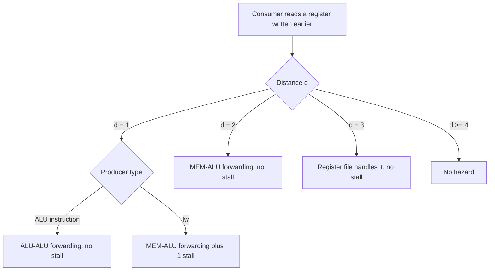

**Notes based off of:** CS3350B Computer Organization, Chapter 4: Instruction-Level Parallelism, _Hazard Examples_ (L13-HazardExamples.pdf), Marc Moreno Maza, Western University

## Setup and Conventions

All examples assume the "basic" 5-stage MIPS datapath (IF, ID, EX, ME, WB) from the end of Lecture 11. What that baseline already includes:

- Structural hazards are already solved (separate instruction/data memory access, register file written in the first half of a cycle and read in the second half).
- No forwarding, no branch comparator in ID, no delay slots. Every optimization must be added explicitly in your answer.

Optimizations that the examples may add:

| Optimization            | What it does                                                              |
| ----------------------- | ------------------------------------------------------------------------- |
| ALU-ALU forwarding      | EX/MEM result goes straight back to the ALU input of the next instruction |
| MEM-ALU forwarding      | MEM/WB value (a loaded word or an older ALU result) goes to the ALU input |
| MEM-MEM forwarding      | Loaded value goes directly to the data input of a following `sw`          |
| Fill load delay slot    | Put an independent instruction after `lw` instead of a `nop`              |
| Branch comparator in ID | Branch resolved in ID instead of EX, so 1 bubble after `beq` instead of 2 |
| Delayed branching       | Instruction after the branch always executes (branch delay slot)          |

> [!info] Terminology 
> "nop" here means a pipeline bubble inserted by the programmer/hardware to resolve a hazard. It occupies an instruction slot, so it counts toward the cycle total.

## Dependencies Versus Hazards

A **dependency** is a property of the code. A **hazard** exists only if the pipeline would actually execute the dependent instructions in a way that gives a wrong result.

| Type                    | Meaning                                            | Hazard in this pipeline?                          |
| ----------------------- | -------------------------------------------------- | ------------------------------------------------- |
| RAW (true dependency)   | Later instruction reads what an earlier one writes | Yes, this is the one that matters                 |
| WAR (anti-dependency)   | Later instruction writes what an earlier one reads | No (reads happen early, writes late)              |
| WAW (output dependency) | Two instructions write the same register           | No (in-order writeback), but it limits reordering |

> [!tip] Why WAR and WAW matter anyway 
> They are not hazards in an in-order 5-stage pipeline, but they constrain **code reordering**. You cannot move an instruction across another one it has a WAR or WAW relation with. This is the same reasoning used to decide what can fill a delay slot.

### How far apart must a producer and consumer be?

Define the distance $d$ as 1 when the consumer immediately follows the producer. Bubbles count as instructions when measuring distance.

|$d$|No forwarding|ALU result, with forwarding|`lw` result, with forwarding|
|---|---|---|---|
|1|2 nops|0 nops (ALU-ALU)|1 nop (MEM-ALU)|
|2|1 nop|0 nops (MEM-ALU)|0 nops (MEM-ALU)|
|3|0 nops (register file write-then-read)|0|0|
|$\geq 4$|0|0|0|



## Cycle Counting Shortcut

For a 5-stage pipeline the first instruction takes 5 cycles and every following slot adds one cycle:

$$\text{cycles} = (\text{instructions} + \text{nops}) + 4$$

This reproduces every total in the lecture and is much faster than drawing the full diagram. Use the diagram only to check where forwards happen.

## Example 1: Load-Use Chain

```
lw   $t0, 0($s1)
addu $t0, $t0, $s2
subu $t4, $t0, $t3
addi $s1, $s1, -4
add  $t1, $t1, $t2
```

### Dependencies

- **RAW** `lw` to `addu` on `$t0` (a load-use dependency).
- **WAW** `lw` and `addu` both write `$t0`. Harmless here, but it means `addu` cannot be moved above `lw`.
- **RAW** `addu` to `subu` on `$t0`. `subu` depends on `addu`, not on `lw`, since `addu` overwrites `$t0` first.
- **WAR** `lw` reads `$s1`, `addi` writes `$s1`. Not in the slide, but it is why `addi` must stay _after_ `lw` when reordering.

### Baseline: 13 cycles

Without forwarding, a consumer's ID must be no earlier than the producer's WB (register file writes in the first half of the cycle, reads in the second).

- `lw` to `addu` ($d = 1$): 2 nops.
- `addu` to `subu` ($d = 1$): 2 nops.
- Slots: `lw`, 2 nops, `addu`, 2 nops, `subu`, `addi`, `add` = 9 slots, so $9 + 4 = 13$ cycles.

### With forwarding: 10 cycles

- **MEM-ALU forwarding** for the load-use: the loaded word is available at the end of `lw`'s ME stage and is forwarded to `addu`'s EX. One bubble remains, because the data does not exist until the end of ME.
- **ALU-ALU forwarding** from `addu` to `subu`: no bubbles.
- Slots: `lw`, 1 nop, `addu`, `subu`, `addi`, `add` = 6 slots, so $6 + 4 = 10$ cycles.

### With forwarding and reordering: 9 cycles

Move `addi` (or `add`) into the **load delay slot**, replacing the remaining nop. Either instruction is independent of the `lw` result. `addi` is safe here because the WAR on `$s1` is respected: `lw` still comes first and reads `$s1` in ID long before `addi` writes it.

```
lw   $t0, 0($s1)
addi $s1, $s1, -4     # fills the load delay slot
addu $t0, $t0, $s2
subu $t4, $t0, $t3
add  $t1, $t1, $t2
```

|Instruction|1|2|3|4|5|6|7|8|9|
|---|---|---|---|---|---|---|---|---|---|
|`lw`|IF|ID|EX|ME|WB|||||
|`addi`||IF|ID|EX|ME|WB||||
|`addu`|||IF|ID|EX (a)|ME|WB|||
|`subu`||||IF|ID|EX (b)|ME|WB||
|`add`|||||IF|ID|EX|ME|WB|

- (a) MEM-ALU forward from `lw` (ME in cycle 4, used in EX in cycle 5).
- (b) ALU-ALU forward from `addu` (EX in cycle 5, used in EX in cycle 6).

> [!tip] Lower bound 
> 5 instructions with no nops gives $5 + 4 = 9$, which is the minimum for this code on this pipeline. Once nops reach zero, nothing more can be gained.

## Example 2: Chain Off a Single Producer

```
sub $t2, $t1, $t3
and $t7, $t2, $t5
or  $t8, $t6, $t2
add $t9, $t2, $t2
sw  $t5, 12($t2)
```

### Dependencies

Every dependency is a **RAW on `$t2`** produced by `sub`, consumed by `and`, `or`, `add`, and `sw` (as the base address).

### With ALU-ALU and MEM-ALU forwarding: 9 cycles

|Consumer|Distance|How it is resolved|
|---|---|---|
|`and`|1|ALU-ALU forward (`sub` EX to `and` EX)|
|`or`|2|MEM-ALU forward (`sub` ME to `or` EX)|
|`add`|3|Register file: `sub` WB and `add` ID are in the same cycle|
|`sw`|4|No hazard (`sw` reads `$t5` as data, no dependency)|

No nops are needed, so $5 + 4 = 9$ cycles.

|Instruction|1|2|3|4|5|6|7|8|9|
|---|---|---|---|---|---|---|---|---|---|
|`sub`|IF|ID|EX|ME|WB|||||
|`and`||IF|ID|EX (ALU-ALU)|ME|WB||||
|`or`|||IF|ID|EX (MEM-ALU)|ME|WB|||
|`add`||||IF|ID|EX|ME|WB||
|`sw`|||||IF|ID|EX|ME|WB|

> [!info] Note on the slide 
> The last row of the lecture's diagram is labeled `and` but it is the `add` instruction.

> [!tip] Practical reading of this example 
> A one-producer, many-consumers pattern is very common (a computed value feeds the next several instructions). It shows that forwarding on its own is enough here, since an ALU producer never forces a stall.

## Example 3: Loop and Control Hazards

```
for: beq  $t6, $t7, end
     add  $t0, $t0, $t1
     addi $t6, $t6, 1
     j    for
end: sub  $t1, $t6, $0
```

Equivalent high-level code: `while ($t6 != $t7) { $t0 += $t1; $t6++; }` followed by `$t1 = $t6`. "Two loops" means two iterations of the body, so the final `sub` is excluded.

### Hazards to find

- **Control hazard after `beq`**: on the basic datapath the branch is resolved in EX, so 2 nops follow it.
- **Control hazard after `j`**: the target is known in ID, so 1 nop follows it.
- **Loop-carried RAW**: `addi` writes `$t6`, which `beq` reads in the _next_ iteration. Distance across the back-edge: `addi`, `j`, nop, `beq` gives $d = 3$, which the register file resolves. No extra stall.

> [!warning] Easy to miss 
> Check dependencies across the loop back-edge, and remember the bubbles after `j` count toward the distance.

### Baseline: 18 cycles

Per iteration the slots are `beq`, 2 nops, `add`, `addi`, `j`, 1 nop = 7 slots. For two iterations: $14 + 4 = 18$ cycles.

The lecture splits this as first loop $5 + 2 + 3 + 1 = 11$ and second loop $1 + 2 + 3 + 1 = 7$. The first iteration pays the pipeline fill (the extra 4); the second iteration's `beq` overlaps with the previous iteration's tail.

### Optimized: 16 cycles

Add a **branch comparator in the ID stage**. The branch is now resolved a stage earlier, so only 1 nop follows `beq`. The jump already resolved in ID, so it gains nothing.

Per iteration: `beq`, 1 nop, `add`, `addi`, `j`, 1 nop = 6 slots. For two iterations: $12 + 4 = 16$ cycles.

The earlier RAW still works: `beq` needs `$t6` in ID, and with $d = 3$ the `addi` WB is in that same cycle.

### Why the branch delay slot cannot be filled

Delayed branching would let an instruction after `beq` always execute, replacing the nop. No candidate works:

- `addi $t6, ...` would also run on the exit path and change `$t6`, which `sub` uses after the loop.
- `add $t0, ...` would also run once too often on exit and corrupt `$t0`.
- `j for` is itself control flow and cannot be moved into the slot.

> [!info] Extra check (my own reasoning, not in the slides) 
> Moving `addi` into the delay slot of `j` removes the bubble after `j`, but `beq` then immediately follows `addi` and needs `$t6` in ID. That introduces new stalls of the same size, so there is no net gain without more hardware.

### Branch prediction (mentioned in the slides)

With a predict-not-taken scheme the bubbles after `beq` disappear while the loop keeps iterating, since the branch is correctly predicted not taken each time. By the same counting that leaves 5 slots per iteration (`j` still has its bubble), so $10 + 4 = 14$ cycles. A misprediction on loop exit would cost the penalty again, but that is outside "two loops".

## Summary

|Case|Slots|Cycles|
|---|---|---|
|Ex. 1 baseline|9|13|
|Ex. 1 with ALU-ALU and MEM-ALU forwarding|6|10|
|Ex. 1 with forwarding and `addi` in load delay slot|5|9|
|Ex. 2 with ALU-ALU and MEM-ALU forwarding|5|9|
|Ex. 3 baseline (2 iterations)|14|18|
|Ex. 3 with comparator in ID (2 iterations)|12|16|

## Method Checklist

1. List every RAW dependency, and note the distance $d$ (counting bubbles).
2. Resolve each one using the distance table: forwarding where available, otherwise stalls.
3. Count the slots including nops, then add 4.
4. For optimizations, look for an independent instruction to fill load or branch delay slots, checking RAW, WAR, and WAW before moving anything.
5. For loops, check the dependency across the back-edge and ask whether the delay-slot instruction would change behavior on the exit path.