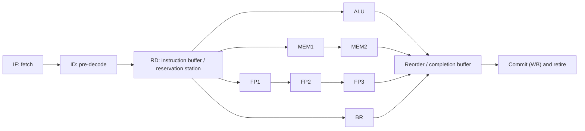
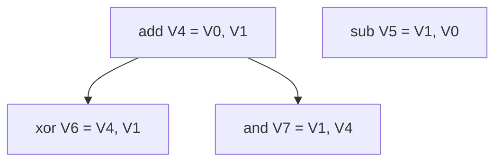

**Notes based off of:** CS3350B Computer Organization, Chapter 4: Instruction-Level Parallelism, Part 3: Beyond Pipelining (Marc Moreno Maza, L14)

## Overview

Pipelining overlaps instructions, but a single pipeline can at best finish one instruction per cycle ($\text{CPI} \geq 1$). To go further, the processor (or the compiler) must exploit **instruction-level parallelism (ILP)** by executing several instructions at the same time. This lecture covers the techniques used to do so:

| Technique             | Idea                                                                 |
| --------------------- | -------------------------------------------------------------------- |
| Pipelining            | Overlap the stages of consecutive instructions                       |
| Branch prediction     | Guess a branch outcome early so the pipeline keeps fetching          |
| Superscalar execution | Execute several instructions in parallel on multiple execution units |
| VLIW                  | The program explicitly says which instructions run in parallel       |
| Loop unrolling        | Remove loop-control overhead and expose independent work             |
| Register renaming     | Remove false (name) dependencies so more instructions can overlap    |

> [!note] Big picture 
> Every technique here attacks one of two limits: **structural/control overhead** (branches, loop bookkeeping) or **dependencies** between instructions. The only dependency that cannot be removed is a true data (RAW) dependency; everything else is an artifact of reusing names.

## Multiple Issue Processors

A **multiple issue processor** issues (starts executing) more than one instruction per clock cycle, aiming for $\text{CPI} < 1$. Three flavours:

- VLIW processors
- Static superscalar processors (essentially the same as VLIW)
- Dynamic superscalar processors

All of them have **multiple execution units (ALUs)** in the datapath, and other parts of the datapath may be duplicated or made more capable depending on the design.

> [!note] Multiple issue and pipelining are separate concepts, but in practice every multiple issue processor is also pipelined, since pipelining came first and works so well.

For a $k$-issue machine, the best possible CPI is $1/k$ (equivalently, an IPC of $k$). Real code rarely reaches it because of dependencies and slots that cannot be filled.

### Static vs dynamic scheduling

The key question is **who decides which instructions run together**.

|                 | VLIW                           | Static superscalar                                   | Dynamic superscalar                                  |
| --------------- | ------------------------------ | ---------------------------------------------------- | ---------------------------------------------------- |
| Scheduling      | Static (compiler)              | Static (compiler)                                    | Dynamic (hardware)                                   |
| Execution order | In-order                       | In-order                                             | Out-of-order                                         |
| Fetch           | One IF unit, one long word     | Many IF units (or one fetching several instructions) | One IF unit, possibly several instructions per cycle |
| Grouping        | Compiler packs an issue packet | Compiler schedules each "route" through the datapath | Hardware picks ready instructions from a buffer      |

Heuristic: static scheduling moves complexity into the compiler (simple hardware, but the compiler must know latencies in advance), while dynamic scheduling moves it into hardware (complex circuitry, but it adapts to what actually happens at run time).

## VLIW

### Structure

A VLIW (very long instruction word) processor encodes several instructions in one wide instruction memory word called an **issue packet**. The simplest scheme just concatenates instructions, for example two 32-bit instructions in one 64-bit word. Consequently, instruction word size $\neq$ data memory word size.

In the pipeline:

- **IF:** one fetch unit fetches the whole long word.
- **ID:** must decode several instructions and read several register operands at once.
- **EX:** each instruction in the packet is _issued_ to a different execution unit.
- **MEM:** there is only one data memory, so a packet usually holds at most one `lw`/`sw`.
- **WB:** the register file must support multiple simultaneous writes (to different registers).

Typical packing restrictions: only one load/store, only one branch, the rest arithmetic. If the compiler cannot find an instruction for a slot, it inserts a `nop` (similar in spirit to filling a load-delay or branch-delay slot).

> [!tip] Why restrictions exist 
> Each slot needs its own hardware (ALU, register ports, memory port). Allowing "any instruction in any slot" would require duplicating the expensive parts (such as data memory ports) in every slot, so designers dedicate slots to instruction types.

### Example: 2-issue MIPS

Machine: slot 1 holds an arithmetic (R-/I-type) instruction or a branch; slot 2 holds a `lw` or `sw`. Assume perfect branch prediction and full forwarding, but load-use and RAW dependencies must still be respected (one instruction between a load and its use), and instructions in the same packet must be independent.

Source loop and its MIPS code:

```c
for (int i = n; i > 0; --i) {
    A[i] += s2;
}
```

```mips
loop: lw   $t0, 0($s1)     # $t0 = array element
      addu $t0, $t0, $s2   # add scalar in $s2
      sw   $t0, 0($s1)     # store result
      addi $s1, $s1, -4    # decrement pointer
      bne  $s1, $0, loop   # branch if $s1 != 0
```

Scheduled for the 2-issue machine:

| |ALU or branch|Data transfer|Cycle|
|---|---|---|---|
|loop:|`nop`|`lw $t0, 0($s1)`|1|
||`addi $s1, $s1, -4`|`nop`|2|
||`addu $t0, $t0, $s2`|`nop`|3|
||`bne $s1, $0, loop`|`sw $t0, 4($s1)`|4|

- The `addi` is moved up to fill the gap between `lw` and `addu` (the load-use slot).
- Because `$s1` has already been decremented when `sw` executes, its offset is **adjusted** from `0` to `4`. Whenever you reorder around a pointer update, you must fix offsets.
- 5 instructions in 4 cycles:

$$\text{CPI} = \frac{4}{5} = 0.8$$

The lecture's convention is that `nop`s do not count as useful instructions. Slot utilization is $5/8 = 62.5\%$. 

## Static Superscalar Processors

The name "static" means **code scheduling is done by the compiler**. Conceptually these are side-by-side datapaths executing instructions simultaneously, with the compiler responsible for dependencies and hazards so that instructions on different datapaths never conflict. The example pipeline in the slides has parallel IF/ID front ends feeding functional units (integer+branch, FP, vector, load/store) and then MEM/WB.

Since this is nearly identical to VLIW, the lecture skips the details.

## Loop Unrolling

**Loop unrolling** replaces the loop body with several copies of itself (still inside a loop), so the loop runs fewer iterations.

```c
// Original
for (i = 0; i < n; i++) {
    A[i] += 10;
}

// Unrolled 4 times (note i += 4)
for (i = 0; i < n; i += 4) {
    A[i]   += 10;
    A[i+1] += 10;
    A[i+2] += 10;
    A[i+3] += 10;
}
```

Benefits:

- Fewer branch instructions and branch delay slots per element of work.
- Fewer pointer updates and loop-end tests.
- A larger block of straight-line code, so the scheduler has more independent instructions to fill load-use slots and issue slots.

### Unrolling the MIPS loop

```mips
loop: lw   $t0,  0($s1)
      lw   $t1, -4($s1)
      lw   $t2, -8($s1)
      lw   $t3, -12($s1)
      addu $t0, $t0, $s2
      addu $t1, $t1, $s2
      addu $t2, $t2, $s2
      addu $t3, $t3, $s2
      sw   $t0,  0($s1)
      sw   $t1, -4($s1)
      sw   $t2, -8($s1)
      sw   $t3, -12($s1)
      addi $s1, $s1, -16
      bne  $s1, $0, loop
```

The body is **not** a verbatim copy:

- **Offsets change** (`0`, `-4`, `-8`, `-12`) so one pointer update (`-16`) covers all four elements.
- **Static register renaming:** `$t0` becomes `$t1`, `$t2`, `$t3` in successive copies. If every copy used `$t0`, the copies would be tied together by WAR/WAW dependencies and could not be overlapped.

> [!warning] Practical caveats (not on the slides)
> 
> - The example assumes the trip count is a multiple of 4. In general the compiler adds a short **cleanup loop** for the leftover iterations.
> - Unrolling increases code size and register pressure. Past a point, more unrolling gives diminishing returns.

### Combining loop unrolling with VLIW

Using the same 2-issue machine (slot 1 ALU/branch, slot 2 data transfer), full forwarding, one instruction required between a load and its use:

| |ALU or branch|Data transfer|Cycle|
|---|---|---|---|
|loop:|`addi $s1,$s1,-16`|`lw $t0,0($s1)`|1|
||`nop`|`lw $t1,12($s1)` (was -4)|2|
||`addu $t0,$t0,$s2`|`lw $t2,8($s1)` (was -8)|3|
||`addu $t1,$t1,$s2`|`lw $t3,4($s1)` (was -12)|4|
||`addu $t2,$t2,$s2`|`sw $t0,16($s1)` (was 0)|5|
||`addu $t3,$t3,$s2`|`sw $t1,12($s1)` (was -4)|6|
||`nop`|`sw $t2,8($s1)` (was -8)|7|
||`bne $s1,$0,loop`|`sw $t3,4($s1)` (was -12)|8|

- The offsets are adjusted by $+16$ for every access that executes after the `addi` has changed `$s1`.
- 14 instructions in 8 cycles:

$$\text{CPI} = \frac{8}{14} \approx 0.57$$

- Slot utilization is $14/16 = 87.5%$, versus $62.5%$ without unrolling.
- Per array element, the loop costs $8/4 = 2$ cycles instead of 4, a 2x improvement from unrolling plus VLIW scheduling on the same hardware.

> [!tip] Why it works The single-iteration loop is a serial chain (`lw` $\to$ `addu` $\to$ `sw`) with almost nothing independent to put in the second slot. Unrolling creates four independent chains, so loads, adds and stores from different elements can be interleaved to hide latency and fill both slots.

## Dynamic Superscalar Processors

"Dynamic" means the **hardware** schedules code. Because of this, **out-of-order (OoO) execution** can occur: instructions execute in a different order than they were fetched.

Why this is useful:

- It supports execution paths with different latencies (normal ALU, floating point unit, memory load/store path).
- It is especially good at **overcoming unpredictable stalls**, such as cache misses, because independent instructions behind a stalled one can keep going.
- The cost is much more complex hardware. The classic algorithm is **Tomasulo's algorithm**.

### Pipeline organization



1. **Fetch** one instruction per cycle as normal (superscalar machines are usually augmented to fetch several per cycle).
2. **Pre-decode** the instruction and add it to the **instruction buffer** in the RD stage. Since execution is out of order, each instruction must wait until the updated values of its operands are available.
3. Once the operands are ready, the **dispatcher** sends the instruction to one of the execution units. This is where out-of-order execution is introduced.
4. Before WB, a **reorder buffer** (completion stage) ensures results are written back **in program order**. This is called **committing**.
5. Finally the instruction is **retired** and leaves the datapath.

Terminology:

- **Issue:** add the instruction to the buffer.
- **Dispatch:** send the instruction to an execution unit.
- A **centralized reservation station** acts as both dispatcher and issuer.

> [!warning] Naming caveat 
> "Issue" and "dispatch" are sometimes swapped (IBM vs Intel/AMD). What matters is that there are **two steps between fetch and execution**.

The invariant to remember: **fetched in order, executed out of order, committed in order.** In-order commit is what makes the machine look sequential to the programmer (and makes exceptions precise).

### Pros and cons

| Pros                                                                                                                                 | Cons                                                          |
| ------------------------------------------------------------------------------------------------------------------------------------ | ------------------------------------------------------------- |
| Handles unpredictable stalls (cache misses)                                                                                          | Complex circuitry                                             |
| Hardware sees actual memory addresses, whereas the compiler only sees pointers, so it can resolve memory hazards the compiler cannot | Out-of-order execution makes WAR and WAW dependencies matter  |
| More aggressive overlap, since operand values are read and queued in reservation stations                                            | Needs extra structures (reservation stations, reorder buffer) |

> [!tip] Context 
> This is why general-purpose CPUs (desktop, server, phone) are dynamic superscalar: run-time behaviour like cache misses cannot be known at compile time. VLIW-style designs (Itanium is the well-known general-purpose attempt) survive mostly in embedded and DSP processors, where latencies are predictable and low power and simple hardware matter more.

## Data Dependencies

In-order pipelines mostly worry about RAW. Out-of-order execution adds two more hazards, collectively "write-after-X" dependencies.

|Type|Meaning|Example|
|---|---|---|
|**RAW** (read after write)|An instruction reads a value an earlier instruction writes. A **true** dependency.|`add $t1,...` then `sub $t2,$t1,...`|
|**WAR** (write after read)|A later instruction writes a register an earlier instruction still needs to read.|`addi $t0,$t1,2` then `add $t1,$t3,$0`: `add` cannot write `$t1` until `addi` has read it|
|**WAW** (write after write)|Two instructions write the same destination. The final value must come from the later one.|`addi $t1,$t4,12` then `add $t1,$t3,$0`: if `add` finishes first, `$t1` ends up with the wrong value|

**WAR and WAW are false dependencies:** no value flows between the instructions. They exist only because the same register name is reused.

Example of a false dependency in C-like form:

```c
t0 = A[4];   t0 = t0 + 3;   A[4] = t0;
t0 = A[64];  t0 = t0 + 5;   A[64] = t0;
```

The second group cannot start before the first (WAR between `A[4] = t0` and `t0 = A[64]`) purely because both use `t0`. Rewriting the second group to use `t1` makes the two groups independent and parallelizable.

## Register Renaming

**Register renaming** removes WAR and WAW dependencies by giving every write a fresh destination. It is both a static technique (the compiler, as in unrolling) and a dynamic one (hardware).

Procedure:

1. For every instruction that writes a register, create a **new value name** (logical destination) for that destination.
2. Source operands are rewritten to the value name that currently holds the register's latest value.
3. In dynamic renaming, hardware keeps a **mapping from register names to value names** to find the true operands of incoming instructions. Reservation stations provide the buffering for logical destinations.

### Worked example

```mips
add $t6, $t0, $t2
sub $t4, $t2, $t0
xor $t0, $t6, $t2
and $t2, $t2, $t6
```

Dependencies before renaming:

- RAW: `$t6` from `add` to `xor` (and also to `and`, which reads `$t6`).
- WAR: `$t0` between `add` and `xor`, and between `sub` and `xor`.
- WAR: `$t2` between `add`/`sub`/`xor` and the later write by `and`.

> [!note] Slide discrepancy The slide's dependency list repeats some entries and omits the RAW from `add` to `and`. The list above is the complete set for these four instructions.

Initial mapping: `$t0`=V0, `$t2`=V1, `$t4`=V2, `$t6`=V3. Each write allocates the next free value name:

|Instruction|Allocated name|Renamed instruction|
|---|---|---|
|`add $t6, $t0, $t2`|V4|`add V4, V0, V1`|
|`sub $t4, $t2, $t0`|V5|`sub V5, V1, V0`|
|`xor $t0, $t6, $t2`|V6|`xor V6, V4, V1`|
|`and $t2, $t2, $t6`|V7|`and V7, V1, V4`|

Final mapping: `$t0`=V6, `$t2`=V7, `$t4`=V5, `$t6`=V4.

> [!note] Slide typo The last row of the slide's final table shows `add V7, V1, V4`; it should be `and V7, V1, V4`, matching the original instruction.

After renaming, only true (RAW) dependencies remain:



`sub` is fully independent, and `xor` and `and` can run in parallel once `add` finishes. Before renaming, the WAR hazards would have forced a much more serialized order.

## Summary

- Multiple issue processors execute several instructions per cycle, aiming for $\text{CPI} < 1$.
- VLIW uses statically scheduled issue packets built by the compiler; empty slots are filled with `nop`.
- Loop unrolling exposes more parallelism and removes branching and pointer-update overhead. It relies on static register renaming and offset adjustment.
- Dynamic superscalar processors schedule in hardware and allow out-of-order execution (in-order fetch, out-of-order execute, in-order commit), which hides unexpected stalls such as cache misses.
- Register renaming fixes WAR and WAW dependencies.
- RAW is the only true dependency, and it must always be respected by the schedule.