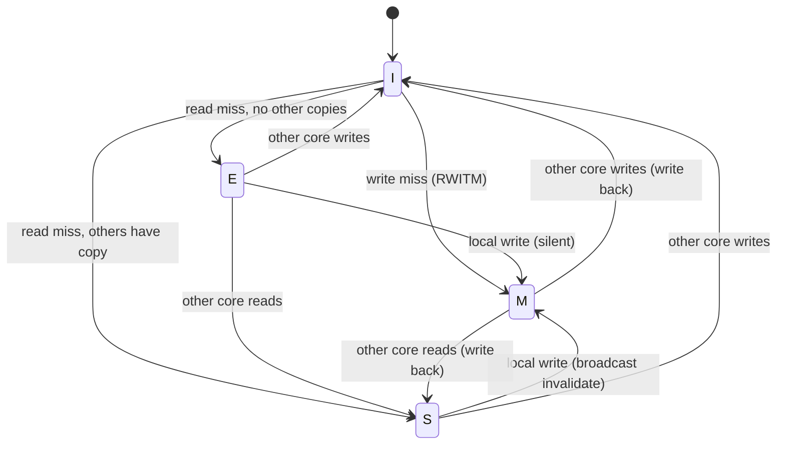
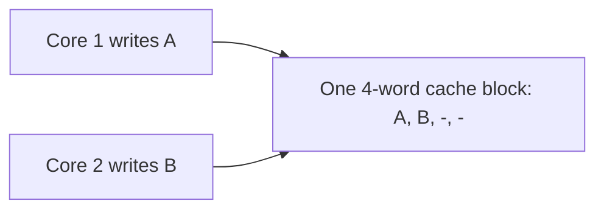
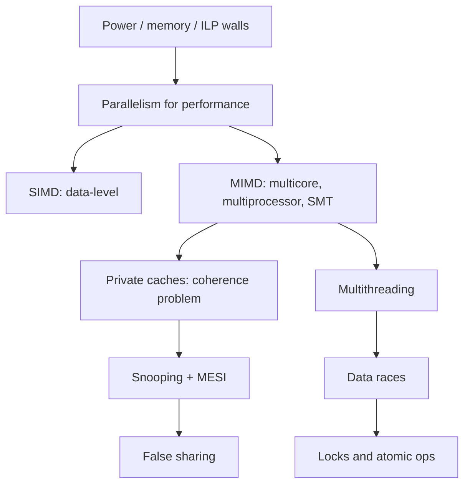

**Notes based off of:** CS3350B Chapter 5: Parallel Architectures (Marc Moreno Maza, UWO), slide deck "L15 - ParallelArch"

## Why Parallel Hardware?

Single-thread performance stopped scaling for three reasons that earlier chapters already covered:

- **Power wall**: raising clock frequency raises power (roughly $P \propto C V^{2} f$) faster than the chip can dissipate heat.
- **Memory wall**: the processor-memory speed gap keeps widening.
- **ILP wall**: superscalar and out-of-order tricks have hit diminishing returns within thermal limits.

The industry response was to spend the extra transistors (Moore's law) on _more cores_ instead of a _faster core_. The catch is that hardware no longer gives speed for free: software must expose parallelism.

> [!note] Heuristic 
> Serial performance came "for free" from hardware. Parallel performance must be _programmed_. Every topic below (coherence, false sharing, data races) is a consequence of several execution units sharing one memory.

## SIMD and Flynn's Taxonomy

### SIMD / vector processing

**SIMD** applies a _single instruction_ to _multiple data elements_ at once. On x86 this is SSE (and later AVX): a 128-bit register holds four 32-bit ints, so one instruction does four additions.

```c
for (i = 0; i < n; i++) A[i] += 10;
// vectorized view: each iteration handles A[i..i+3] in one 128-bit op
for (i = 0; i < n; i += 4) { A[i]+=10; A[i+1]+=10; A[i+2]+=10; A[i+3]+=10; }
```

- Strictly, a _vector processor_ requires adjacent data; not every SIMD machine is a vector processor.
- Limitation: it only parallelizes the **same operation** over regular data. It cannot run unrelated tasks.
- In practice the compiler auto-vectorizes simple loops (plus a scalar cleanup loop when $n$ is not a multiple of 4).

### Flynn's taxonomy

Classifies architectures by number of instruction streams and data streams.

| |Single Instruction Stream|Multiple Instruction Streams|
|---|---|---|
|**Single Data Stream**|SISD|MISD|
|**Multiple Data Streams**|SIMD|MIMD|

- **SISD**: classic von Neumann, one instruction on one datum (even a superscalar core is still SISD).
- **SIMD**: vector units, GPUs (conceptually).
- **MISD**: rare; essentially a fixed pipeline where each stage does a different operation to the same stream.
- **MIMD**: multiprocessors and multicore chips. Independent processors fetch _different instructions_ and work on _different data_. This is the general-purpose parallel machine and the focus of the rest of the note.

## Multiprocessors, Multi-core, and SMT

|Term|What it is|
|---|---|
|**Multiprocessor**|A computer with several separate processor chips (MIMD).|
|**Multi-core** (chip-level multiprocessor)|Multiple cores on one chip; each core can run a completely different instruction stream (MIMD).|
|**SMT** (simultaneous multithreading; Intel "hyperthreading")|One core with partially duplicated state (registers, etc.) that presents itself as multiple logical processors.|

- The two compose: each processor in a multiprocessor can itself be multi-core, and each core can be SMT.
- To the OS, every core (or SMT thread) looks like an independent processor.
- Cores on one chip typically **share some cache** (e.g. L2 or L3) while keeping private L1s. Shared cache makes communication between threads of the same process cheaper.
- SMT is "superscalar for threads": when one thread stalls (cache miss), the idle functional units can issue instructions from another thread. It gives much less than 2x speedup because the datapath is shared.

**Pros**: large throughput gains, enables multitasking, sidesteps the power wall.

**Cons**: a single sequential program does not automatically use multiple cores; parallel programming is hard (explicit thread-level parallelism, TLP); there is still _one global memory_, which is a bottleneck and the source of the coherence problem. Tools that help: compiler vectorization, OpenMP, Cilk.

## Cache Coherence

### The problem

Each core has a private L1, so each holds its **own copy** of memory contents. If core A writes to its copy, how does core B (holding a stale copy) find out?

- Writing back to a shared lower level (L2/memory) is **not enough**; the other cores' private copies must also be updated or discarded.
- Coherence is tracked **per cache block**, not per word.

### Coherence vs. consistency

- **Coherency**: _what value_ is read. If P1 reads an address after P2 wrote it (and no other writes intervene), P1 must see P2's value.
- **Consistency**: _when/in what order_ writes become visible; all writes to an address occur in some sequential order.

A coherence solution needs two properties:

1. **Write propagation**: a write to a block must reach other cached copies of that block.
2. **Transaction serialization**: all processors see reads/writes to a given address in the **same order**.

### Snooping

All cores watch ("snoop", or "bus-sniff") a shared bus carrying every read/write that reaches the lower cache level. Serialization comes for free from the bus: only one transaction at a time, and a core stalls if the bus is busy.

Two flavours on seeing a write:

- **Write-invalidate**: other copies are marked invalid.
- **Write-update**: other copies are overwritten with the new value.

> [!tip] Why invalidate wins 
> Consider repeated writes to the same address (temporal locality) or to adjacent words in one block (spatial locality). Update sends a bus message with data _per write_; invalidate sends **one** signal, after which the writer owns the block and writes silently. Bus bandwidth is scarce, so modern CPUs use invalidate protocols.

(Snooping relies on a broadcast bus and scales poorly past a modest core count; large systems use _directory-based_ coherence instead. Not covered in this deck.)

### The MESI protocol

MESI is an invalidate snooping protocol. Standard write-back caches only distinguish valid/dirty; MESI adds states so a core can tell whether it is the _only_ holder, avoiding unnecessary broadcasts.

|State|Meaning|Matches memory?|Other copies?|
|---|---|---|---|
|**M**odified|Owned exclusively, dirty|No|None|
|**E**xclusive|Owned exclusively, clean|Yes|None|
|**S**hared|Clean, possibly in several caches|Yes|Maybe|
|**I**nvalid|Contents no longer valid|n/a|n/a|

The key optimization is **E**: a core holding E can write with _no bus traffic_ (E to M silently).



#### Read hit

State is M, E, or S: just return the value; no state change (a dirty M block is fine for the owner).

#### Read miss

|Situation|What happens|Resulting states|
|---|---|---|
|No copies anywhere|Fetch from lower memory|Requester **E**|
|One cache has **E**|Snooper supplies block on bus, memory access abandoned|Both **S**|
|Several caches have **S**|One snooper supplies block|All **S**|
|One cache has **M**|Snooper supplies block _and_ writes back to memory|Both **S**|

#### Write hit

|State|Action|New state|
|---|---|---|
|M|Update locally|M|
|E|Update locally, no broadcast|M|
|S|Broadcast invalidate; other S copies go to I; then update|M|

#### Write miss

Must read _then_ write, so it issues a **Read With Intent To Modify (RWITM)**:

- No other copies: read from memory, write, state **M**.
- Others hold E or S: snoopers supply data and go to **I**; requester writes, state **M**.
- Another holds M: that cache supplies data, writes back to memory, goes to **I**; requester state **M**.

#### Worked example (3 processors, one block)

| Request   | P1  | P2  | P3  | Data supplier                  |
| --------- | --- | --- | --- | ------------------------------ |
| Initially | -   | -   | -   | -                              |
| P1 Read   | E   | -   | -   | Main memory                    |
| P1 Write  | M   | -   | -   | -                              |
| P3 Read   | S   | -   | S   | P1 cache (P1 also writes back) |
| P3 Write  | I   | -   | M   | -                              |
| P1 Read   | S   | -   | S   | P3 cache (P3 also writes back) |
| P3 Read   | S   | -   | S   | - (hit)                        |
| P2 Read   | S   | S   | S   | P1 or P3 cache                 |

## False Sharing

Coherence works on whole **blocks**, and a write invalidates the _entire_ block. So two cores writing to **different variables that sit in the same block** keep invalidating each other, even though they share no data.



- **True sharing**: threads genuinely communicate through a word. The miss would still happen with 1-word blocks.
- **False sharing**: no word is actually shared, only the block. The miss would vanish with 1-word blocks. The block "ping-pongs" between caches (**thrashing**), each write causing the other core a miss.
- It is a pure performance bug: the program is correct but can run many times slower than expected.
- Not an issue when cores share the same cache, but each core normally has its own L1.

### Classifying misses (slide example)

Block holds $x_1$ and $x_2$; both processors start with the block cached. The slide's processor columns were lost in extraction; the reconstruction below is consistent with the stated reasons (P1 works on $x_1$, P2 on $x_2$ except for the last read).

|Time|Operation|Result|Why|
|---|---|---|---|
|1|P1 writes $x_1$|Hit|Invalidates block in P2|
|2|P2 reads $x_2$|**False miss**|P2's block was invalidated only because of $x_1$|
|3|P1 writes $x_1$|Hit|P1 has the block|
|4|P2 writes $x_2$|**False miss**|$x_1$ write invalidated P2's block again|
|5|P1 reads $x_2$|**True miss**|P2 really did write $x_2$|

### Fixing it

- **Change the algorithm**: change loop stride or partitioning so threads work on distant regions of memory (e.g. give each thread a large contiguous chunk rather than interleaving elements).
- **Change the data structure**: **pad** or align per-thread data so each thread's hot variables occupy their own cache line (typically 64 bytes on x86).

> [!example] Classic case 
> An array `counter[NUM_THREADS]` of ints where thread $i$ increments `counter[i]`. All counters fit in one or two cache lines, so threads thrash. Padding each to 64 bytes (or accumulating into a thread-local variable and writing once at the end) can give an order-of-magnitude speedup.

## Multithreading

### Concepts

- **Process**: a running program instance; heavyweight to create, has its own address space. May contain many threads.
- **Thread**: the smallest unit the OS schedules. Has private **context** (PC, registers, stack, local variables) but **shares the heap/address space** with other threads of its process.
- Some languages let you split memory into thread-private and shared regions.

Multithreading is a _programming model_, separate from multi-core hardware, but the two together give performance.

### Threads without multiple cores

One core can run many threads by **time-division multiplexing**, using **context switches**: save the current thread's registers, PC, stack pointer (e.g. into a process control block in OS memory), then load the next thread's.

- Context switching is expensive, especially between threads of _different_ processes.
- With multiple cores, threads truly run simultaneously, each with its own register file; context switching only occurs when threads outnumber cores.
- **Preemptive scheduling**: OS forces switches. **Cooperative (non-preemptive)**: threads yield voluntarily. Scheduling is mostly handled by OS and hardware and is outside the deck's scope.

### Data races

When two threads access the same location and at least one writes, without synchronization, the outcome depends on scheduling: **non-determinism**.

```cpp
void setAddress(int* addr, int val) { *addr = val; }
// t1 sets *p = 1, t2 sets *p = 2  -> final value is 1 or 2
```

Coherence guarantees a serial order for the writes, but not _which_ order.

The more insidious case is **read-modify-write**:

```cpp
void incrAddr(int* address) {
    int val = *address;   // read
    val++;                // modify
    *address = val;       // write
}
// two threads run incrAddr on *p = 0
```

Possible results: **1 or 2**.

| Step | Interleaving A (result 2) | Interleaving B (result 1)       |
| ---- | ------------------------- | ------------------------------- |
| 1    | T1: `val = *addr` (0)     | T1: `val = *addr` (0)           |
| 2    | T1: `val++`               | T1: `val++`                     |
| 3    | T1: `*addr = val` (1)     | T2: `val = *addr` (**still 0**) |
| 4    | T2: `val = *addr` (1)     | T1: `*addr = val` (1)           |
| 5    | T2: `val++`               | T2: `val++`                     |
| 6    | T2: `*addr = val` (2)     | T2: `*addr = val` (1)           |

In B, both threads read 0 and both write 1: one increment is **lost**.

> [!warning] Data races are bugs even if they "usually work". 
> They can hide for millions of runs, then appear under a different load or core count.

### Fixing races: mutual exclusion

Make the read-modify-write a **critical section** that only one thread may execute at a time, guarded by a **lock** (mutex).

```cpp
std::mutex m;
void incrAddr(int* address) {
    m.lock();            // blocks until acquired
    int val = *address; val++; *address = val;
    m.unlock();
}
```

A thread that finds the lock held waits, then retries.

### Implementing a lock

A lock is built from a **binary semaphore** (0 = free, 1 = held). The simplest is a **spinlock**: loop ("spin") until the lock is free.

The naive version is broken:

```cpp
while (semaphore == 1) { ++spins; }   // test
semaphore = 1;                        // set
```

The _test_ and the _set_ are separate steps, so two threads can both see 0 and both set 1; both think they own the lock. The check-then-act is itself a race.

**Test-and-set** fixes this using an **atomic** operation: it writes a new value and returns the old one as a single indivisible step (not interruptible by a context switch or another core). The thread that gets back 0 won the lock; one that gets back 1 lost and retries.

```cpp
void spinlock::lock() {
    while (semaphore == 1) { ++spins; }     // cheap read-only spin
    int oldVal = setSemaphore(1);           // atomic test-and-set
    if (oldVal == 1) lock();                // someone beat us; retry
}
```

> [!tip] Link back to MESI 
> The outer read-only spin is deliberate: while the lock is held, each waiting core spins on a **Shared** copy in its own cache, generating _no bus traffic_. Only the atomic test-and-set (a write) needs exclusive ownership and invalidates other copies. This "test, then test-and-set" pattern reduces coherence traffic. Real hardware provides the atomic primitive as an instruction (e.g. x86 `xchg`/`lock`-prefixed ops, or load-linked/store-conditional on ARM/RISC-V).

Spinlocks burn CPU while waiting, so they suit short critical sections; longer waits should put the thread to sleep (OS-level blocking).

### Automatic parallelization

Tools such as **OpenMP** and **Cilk** let the programmer annotate code and have the runtime distribute work:

```cpp
cilk_for (int i = 0; i < n; ++i) a[i] += 10;   // iterations run in parallel
```

They are convenient but do not replace hand-tuned code; writing _efficient_ parallel code (right granularity, no false sharing, low synchronization cost) is harder than writing _correct_ parallel code.

## Summary

- Serial speedups hit the power, memory, and ILP walls, so performance now comes from parallelism.
- SIMD gives data-level parallelism within one core; MIMD (multi-core, multiprocessor, SMT) gives thread-level parallelism.
- Private caches create the coherence problem; solved with snooping protocols, in practice **write-invalidate MESI**.
- Block-granularity coherence causes **false sharing**; fix by changing access patterns or padding data.
- Multithreading exploits MIMD hardware but introduces **data races**, solved with locks built on **atomic** operations.

