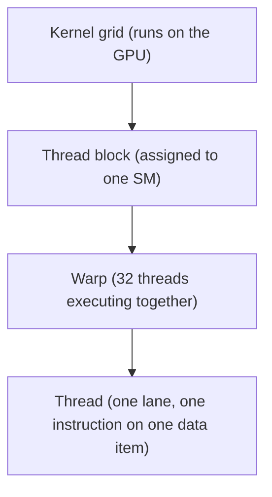
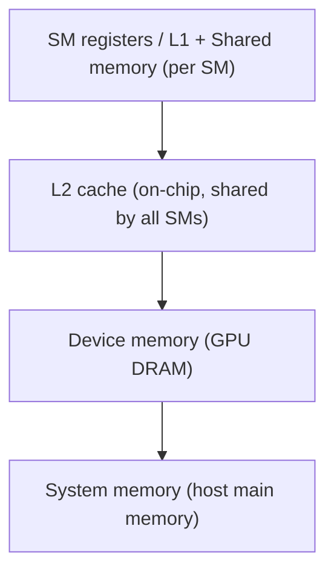

**Notes based off of:** CS3350B Computer Organization, Chapter 5: Parallel Architectures, Part 2: GPU Architectures (Marc Moreno Maza), L16 slides

Builds on: [[15. Parallel Architectures, Cache Coherency and Multithreading]]

## Hardware Accelerators and Heterogeneous Computing

Multicore CPUs are general-purpose. Once that is not fast enough, designers add **hardware accelerators**: specialized hardware that does certain operations far more efficiently.

- **GPU**: Graphics Processing Unit.
- **FPGA**: Field Programmable Gate Array (reconfigurable logic).
- **ASIC**: Application-Specific Integrated Circuit (fixed function, e.g. a TPU-style AI chip).

> [!note] Core trade-off: efficiency vs flexibility 
> CPU is the most flexible and least efficient per operation; ASIC is the least flexible and most efficient; FPGA and GPU sit in between.

**Heterogeneous computing** pairs a general-purpose CPU (the **host**) with an accelerator (the **device**) in one system. The host runs the serial and control parts and offloads the data-parallel work.

### GPGPU

From the mid-2000s, GPUs were used for more than graphics. Their hardware is tuned for **matrix and vector** operations, which makes them useful for scientific computing, AI and machine learning, and cryptography.

### GPU flavours (NVIDIA examples)

Different datapath organizations suit different work (floating point vs integer; half, single or double precision).

- **GeForce**: consumer graphics and games.
- **Quadro/RTX**: workstations, digital media, scientific computing.
- **Tesla / Data Center GPUs**: no graphics output; HPC, supercomputers.

### CPU vs GPU Organization

|                     | CPU                                   | GPU                                                           |
| ------------------- | ------------------------------------- | ------------------------------------------------------------- |
| Parallelism         | SMT, superscalar, a few cores         | dozens to hundreds of functional units                        |
| Memory goal         | minimize **latency**                  | maximize **bandwidth**                                        |
| Working set         | ~10s of MB (cache-sized)              | hundreds of MB to GB                                          |
| Hiding memory delay | multi-level cache hierarchy, low AMAT | massive parallelism: run other independent work while waiting |

> [!tip] Heuristic 
> A CPU is a few very smart workers that avoid waiting; a GPU is thousands of simple workers where someone is always ready to run while others wait on memory. GPUs win when there is a huge amount of independent, regular work.

## GPU Microarchitecture

### SIMT

**Single Instruction, Multiple Threads** = SIMD datapath + hardware multithreading.

- At the lowest level a GPU datapath looks like a SIMD/vector unit with many **lanes**.
- Unlike plain SIMD, SIMT lets the programmer write per-thread scalar code and allows:
    - operating on **non-contiguous** data (each thread computes its own address);
    - **branching** through **masking** (see [[#Divergence]]).
- Context switching is extremely fast and frequent, possibly after every instruction. It is cheap because registers are never saved to memory (see below).

### Streaming Multiprocessor (SM)

An **SM** is one SIMD processor of the many on a GPU. Its lanes are called **streaming processors**, **CUDA cores** or SIMD lanes.

Fermi-generation SM:

- 32 cores/lanes, organized as 2 groups of 16 cores, 1 group of 16 load/store units, and 4 **special function units (SFUs)** (sin, cos, log, etc.).
- **32,768 registers** per SM (1024 per core). Each resident thread keeps its registers on-chip, so switching threads is just selecting a different register set. This is what makes context switching so fast.
- Not everything runs at once: only 16 load/store units and 4 SFUs limit how many such operations proceed per cycle.

### Threading Model



- **Thread**: one lane in an SM; one instruction on one data item.
- **Warp**: a group of **32 threads** executing in lockstep on an SM.
- **Thread block**: a set of warps assigned to one SM.
- **Kernel grid**: all the blocks of a launched kernel across the GPU.
- The **warp scheduler** switches among resident warps to **hide memory latency** with computation. It is the same idea as dynamic scheduling in a superscalar CPU, but across warps.

> [!tip] Heuristic 
> When a warp issues a load that takes hundreds of cycles, the scheduler simply runs another warp. This is why GPUs want many more resident threads than cores ("occupancy").

### Warp Scheduling

- **Fermi**: a scheduler issued a half-warp per cycle.
- **Post-Fermi**: each scheduler issues one full warp instruction per cycle.
- **Maxwell**: up to 2 warp instructions dispatched per cycle.

#### Instruction replay

A warp has 32 threads but a given unit type may have fewer than 32 lanes, so the warp instruction is **replayed** (issued over several cycles).

|Operation|Calculation (slide)|Cycles|
|---|---|---|
|Load / store|32 threads / 8 units|4|
|SFU (log, sin, cos)|32 threads / 8 units|4|
|Double-precision FP|32 threads / 16 units|2 (cores are 32 bits wide, so two are paired per DP op)|

> [!warning] Slide inconsistency 
> The earlier SM slide lists 16 load/store units and 4 SFUs, which would give 2 and 8 cycles respectively. The replay slide uses 8 units for both, so treat those numbers as illustrative; the principle is `cycles = threads / units`.

### Divergence

SIMD lanes share one instruction. If threads in a warp take **different branches**, the hardware applies a **warp mask**: lanes not on the current path do nothing.

```c
if (threadIdx.x < 4) { A; B; }
else                 { X; Y; }
Z;
```

- **Pre-Volta**: the warp **diverges**, runs the `if` path (A, B) with the other lanes masked, then runs the `else` path (X, Y), then **reconverges** for Z. The two paths are **serialized**.
- **Post-Volta** (independent thread scheduling): divergent threads can interleave and make progress separately (each path has its own program counter state), and reconvergence is flexible. Helpful for fine-grained synchronization between divergent threads, though paths are still not truly simultaneous.

> [!note] Performance rule 
> Divergence costs time: effective work per cycle drops by the fraction of masked lanes. In the worst case (32 different paths) a warp is 32 times slower. Prefer branches that are uniform across a warp (e.g. depending on `threadIdx / 32` rather than `threadIdx`).

### Architecture history

NVIDIA generations referenced in the slides are Fermi, Kepler, Maxwell, Pascal, Volta, Turing and Ampere; the slide plots their peak Tflops/s growth. Maxwell is shown as a whole-chip floorplan: several GPC blocks, each with multiple SMs, a shared **L2 cache** in the middle, and memory controllers around the edge.

## GPU Memory Organization

### Hierarchy



| Level             | Scope                                                       |
| ----------------- | ----------------------------------------------------------- |
| **L1 cache**      | on-chip, per SM, shared by all active warps                 |
| **Shared memory** | carved out of L1, shared by threads of one **thread block** |
| **L2 cache**      | on-chip, shared by all SMs                                  |
| **Device memory** | DRAM on the GPU card                                        |
| **System memory** | the computer's main memory (across the host link)           |

### L1 and Shared Memory

Programs can reserve part of L1 as **shared memory**: a software-managed scratchpad for fast **inter-thread communication** within a block, allocated in contiguous cache lines.

- L1 read/write ports are organized as **banks** that can be accessed **simultaneously**.
- Two accesses to the **same bank** in the same cycle must be **serialized**: a **bank conflict**.
- Bandwidth is 32 bits per bank per clock.

> [!tip] Heuristic 
> Threads of a warp should hit different banks (e.g. consecutive threads read consecutive 32-bit words). A common bug is a stride of 32 words, which sends every thread to the same bank.

### Coalesced Memory Transactions

Transfers between device memory and L2 are **wide**: 48 bytes pre-Pascal and 512 bytes post-Pascal (as given on the slide).

- If the 32 threads of a warp access **contiguous, aligned** data, they are served by one (or a few) wide transaction: **coalesced**.
- If addresses are scattered, the worst case is **one serialized transaction per thread**.
- This is **inter-thread spatial locality**: the GPU analogue of spatial locality in a CPU cache, but measured across threads of a warp rather than across consecutive accesses by one thread.

```c
// coalesced: consecutive threads read consecutive elements
x = a[blockIdx.x * blockDim.x + threadIdx.x];
// uncoalesced: strided access wastes most of each wide transaction
x = a[threadIdx.x * 32];
```

> [!note] Contrast with the CPU 
> On a CPU, coherence and false sharing are the multi-core worries ([[15. Parallel Architectures, Cache Coherency and Multithreading#False Sharing]]). On a GPU the equivalent concerns are bank conflicts and uncoalesced access.

## Recent Advancements: Tensor Cores

Added from **Volta** to directly accelerate **deep learning**, whose core operation is matrix multiply-accumulate.

- Each tensor core holds **64 FMA** (fused multiply-add) units, each limited to **16-bit floating point** inputs.
- Logically the FMAs form a **4 x 4 x 4 grid** that computes a **4 x 4 matrix FMA** in one operation: $D = A B + C$ with $A, B, C, D$ each $4 \times 4$. That is $4^3 = 64$ multiply-adds, matching the 64 FMA units.
- **Warp-level** operations build a **16 x 16 x 16** matrix FMA by repeating the 4 x 4 x 4 instruction: $16^3 / 4^3 = 64$ tensor-core operations.
- A Volta SM has four processing blocks, each containing tensor cores alongside the regular cores.

> [!note] Mixed precision 
> In practice products are 16-bit but accumulation is often done in higher precision (FP32) to preserve accuracy. Neural-network training tolerates low precision, which is why it can be traded for throughput.

### Later generations

- **Turing**: adds **INT8 and INT4** modes. Lower precision means more operations per cycle, which suits inference.
- **Ampere**: supports more formats (FP16, TF32, INT8, INT4, and others) and doubles throughput with **sparsity** (see below).

### Sparse Tensor Cores

Trained networks can be **pruned** so many weights are zero. Ampere uses **2:4 structured sparsity**: in every group of 4 weights, at most 2 are non-zero.

1. Train a dense network.
2. Prune with the 2:4 pattern and fine-tune.
3. **Compress**: store only the non-zero values plus small **indices**.
4. The sparse tensor core uses the indices to **select** the matching input activations, skipping the zeros. This is done by hardware, with no software intervention, giving up to about 2x throughput.

## Summary

- Accelerators trade flexibility for efficiency; GPUs pair with a CPU host for heterogeneous computing.
- CPUs minimize **latency** with caches; GPUs maximize **bandwidth** and **hide latency** with massive multithreading.
- **SIMT** = SIMD lanes + very cheap thread switching. Hierarchy: thread, warp (32), block, grid.
- Performance pitfalls: **divergence**, **bank conflicts**, **uncoalesced** access.
- Modern GPUs add **tensor cores** (small matrix FMAs at low precision) and **sparsity** support to accelerate deep learning.
- Slide references: NVIDIA Volta, Turing and Ampere white papers; fabiensanglard.net/cuda.