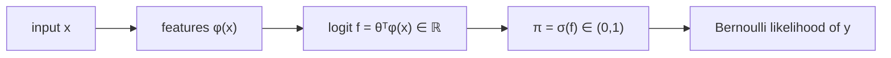
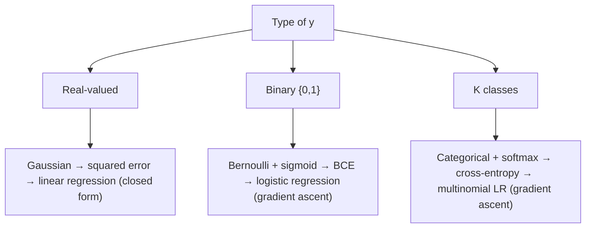

**Notes based off of:** DS 3000/9000 Lecture 4 — Classification (Western University, [https://ds3000cs.pages.dev](https://ds3000cs.pages.dev/))

## Recap and Motivation

Last lecture set up the probabilistic view of learning:

- A **likelihood function** $p(y \mid \boldsymbol{x}; \boldsymbol{\theta})$ says how likely a target $y$ is under parameters $\boldsymbol{\theta}$.
- **Maximum likelihood estimation (MLE)** picks the $\boldsymbol{\theta}$ that makes the observed dataset most likely.
- Linear regression with a Gaussian likelihood is _equivalent_ to minimizing squared error.

The key idea this lecture builds on: **the choice of likelihood is an assumption about what kind of value $y$ is.** Change the type of $y$, and you need a different distribution, which gives a different loss. The recipe (model → likelihood → maximize log-likelihood) stays the same.

## Classification Problems

### Assumptions on $y$ ("data types")

Previously $y \in \mathbb{R}$ (e.g. height in cm, `y: float = 190.2`). A Gaussian is a sensible likelihood because its domain is all of $\mathbb{R}$.

In classification, $y \in S$ where $S$ is a **discrete** set, e.g. $S = {0, 1}$ or $S = {1, 2, 3, 4, 5, 6}$. A Gaussian puts probability density on values like $0.37$ or $-4.2$, which are meaningless labels, so we need a distribution defined only on $S$ (a **PMF**, not a PDF).

### Definitions

- **Classification:** assigning an input $\boldsymbol{x}$ to one of several possible **classes**.
- Each class is represented by a **label** $y \in S$. The numbers are just names: "0 = cat, 1 = dog, 2 = owl" has no ordering or arithmetic meaning (dog is not "halfway" between cat and owl).
- $|S| = 2$: **binary classification** (e.g. "cat or not?").
- $|S| > 2$: **multi-class classification** (e.g. "cat, dog, or owl?").

> [!tip] Why not just use linear regression on the labels? 
> You could regress on $y \in {0,1}$ with squared error, but predictions are unbounded (you'd get outputs like $1.7$ or $-0.4$), squared error heavily penalizes points that are "too correct," and for multi-class it would impose a fake ordering on the labels. The probabilistic approach below fixes all three.

## Logistic Regression (Binary Classification)

### The Bernoulli Distribution

A random variable $Y : \Omega \to {0, 1}$ is **Bernoulli** with parameter $\pi \in [0, 1]$ if its PMF is: $$ p(y \mid \pi) = \text{Ber}(y \mid \pi) = \begin{cases} \pi & \text{if } y = 1 \ 1 - \pi & \text{if } y = 0 \end{cases} $$ Equivalently, in a single expression (useful because it makes taking logs easy): $$ \text{Ber}(y \mid \pi) = \pi^{y}(1 - \pi)^{1 - y}, \quad y \in {0, 1} $$ Plugging in $y = 1$ leaves $\pi$; plugging in $y = 0$ leaves $1 - \pi$. Here $\pi$ is simply "the probability the label is 1."
![[Screenshot 2026-10-03 at 1.17.40 PM.png|325]]
### Parametrizing the Bernoulli with a Linear Model

Linear regression gives $f(\boldsymbol{x}; \boldsymbol{\theta}) = \boldsymbol{\theta}^\top \phi(\boldsymbol{x}) \in \mathbb{R}$, where $\phi(\boldsymbol{x})$ is the **feature vector** of $\boldsymbol{x}$ (e.g. raw features plus a constant $1$ for the bias, or polynomial features).

Problem: $\pi$ must lie in $[0, 1]$, but $f$ can be any real number. Feeding it straight in fails:

```python
def bernoulli_pmf(y: int, pi: float) -> float:
    assert y in [0, 1]
    assert 0 <= pi <= 1
    if y == 1:
        return pi
    else:
        return 1 - pi

bernoulli_pmf(y=1, pi=1000)  # Error!
```

We need a "squashing" function $\mathbb{R} \to [0, 1]$ (or $(0, 1)$).

### The Logistic (Sigmoid) Function

$$ \sigma(z) = \frac{1}{1 + \exp(-z)}, \qquad \sigma : \mathbb{R} \to (0, 1) $$ Useful properties (not all on the slides, but used constantly):

- $\sigma(0) = 0.5$; $\sigma(z) \to 1$ as $z \to \infty$; $\sigma(z) \to 0$ as $z \to -\infty$.
- Symmetry: $1 - \sigma(z) = \sigma(-z)$.
- Derivative: $\sigma'(z) = \sigma(z),(1 - \sigma(z))$. This is what makes the gradient below so clean.
- Inverse: $\sigma^{-1}(p) = \log \frac{p}{1 - p}$, the **log-odds** or **logit**.

So we set $\pi = \sigma(f(\boldsymbol{x}; \boldsymbol{\theta}))$.
![[Screenshot 2026-10-03 at 1.21.46 PM.png|357]]
### The Model

- $f(\boldsymbol{x}; \boldsymbol{\theta}) = \boldsymbol{\theta}^\top \phi(\boldsymbol{x})$ is called the **logit**. Since $\sigma^{-1}$ is the log-odds, logistic regression is literally "linear regression on the log-odds of class 1."
- Likelihood of one example: $$ p(y \mid \boldsymbol{x}; \boldsymbol{\theta}) = \text{Ber}\big(y \mid \sigma(f(\boldsymbol{x}; \boldsymbol{\theta}))\big) = \sigma(f(\boldsymbol{x}; \boldsymbol{\theta}))^{y},\big(1 - \sigma(f(\boldsymbol{x}; \boldsymbol{\theta}))\big)^{1 - y} $$
- Log-likelihood of one example (using $\log(ab) = \log a + \log b$ and $\log a^b = b \log a$): $$ \log p(y \mid \boldsymbol{x}; \boldsymbol{\theta}) = y \log \sigma(f(\boldsymbol{x}; \boldsymbol{\theta})) + (1 - y)\log\big(1 - \sigma(f(\boldsymbol{x}; \boldsymbol{\theta}))\big) $$



### Learning (MLE)

Given an i.i.d. dataset $\mathcal{D} = {(\boldsymbol{x}_n, y_n)}_{n=1}^{N}$ with $y_n \in {0, 1}$, i.i.d. means the likelihood factorizes: $$ p(\mathcal{D} \mid \boldsymbol{\theta}) = \prod_{n=1}^{N} p(y_n \mid \boldsymbol{x}_n; \boldsymbol{\theta}) $$ so the log-likelihood is a sum: $$ \log p(\mathcal{D} \mid \boldsymbol{\theta}) = \sum_{n=1}^{N} y_n \log \sigma(f(\boldsymbol{x}_n; \boldsymbol{\theta})) + (1 - y_n)\log\big(1 - \sigma(f(\boldsymbol{x}_n; \boldsymbol{\theta}))\big) $$

> [!note] Connection to "binary cross-entropy" 
> The **negative** of this log-likelihood (usually averaged over $N$) is the **binary cross-entropy (BCE) loss** / **log loss** used in scikit-learn, PyTorch, etc. Maximizing the Bernoulli log-likelihood and minimizing BCE are the same thing, exactly as Gaussian MLE and minimizing squared error were the same thing last lecture.

#### Gradient (derivation filled in)

Write $\sigma_n = \sigma(z_n)$ with $z_n = \boldsymbol{\theta}^\top \phi(\boldsymbol{x}_n)$, so $\nabla_{\boldsymbol{\theta}} z_n = \phi(\boldsymbol{x}_n)$. Using $\sigma'(z) = \sigma(z)(1 - \sigma(z))$: $$ \nabla_{\boldsymbol{\theta}} \log \sigma_n = \frac{\sigma_n (1 - \sigma_n)}{\sigma_n}\phi(\boldsymbol{x}_n) = (1 - \sigma_n),\phi(\boldsymbol{x}_n) $$ $$ \nabla_{\boldsymbol{\theta}} \log (1 - \sigma_n) = \frac{-\sigma_n (1 - \sigma_n)}{1 - \sigma_n}\phi(\boldsymbol{x}_n) = -\sigma_n,\phi(\boldsymbol{x}_n) $$ Combining, $y_n(1 - \sigma_n) - (1 - y_n)\sigma_n = y_n - \sigma_n$, giving: $$ \nabla_{\boldsymbol{\theta}} \log p(\mathcal{D} \mid \boldsymbol{\theta}) = \sum_{n=1}^{N} \big(y_n - \sigma(f(\boldsymbol{x}_n; \boldsymbol{\theta}))\big),\phi(\boldsymbol{x}_n) $$ Interpretation: each example pushes $\boldsymbol{\theta}$ in the direction of its features, weighted by its **prediction error** $y_n - \sigma_n$. Well-classified points contribute almost nothing. This has the same form as the linear regression gradient $\sum (y_n - \boldsymbol{\theta}^\top\phi_n)\phi_n$, with the prediction passed through $\sigma$.

#### Why "linear algebra won't work"

For linear regression, setting the gradient to zero gave a linear system (the normal equations) with a closed-form solution. Here, setting $\sum_n (y_n - \sigma(\boldsymbol{\theta}^\top \phi_n))\phi_n = \boldsymbol{0}$ is **nonlinear** in $\boldsymbol{\theta}$ because of $\sigma$. There is no closed form, so we optimize iteratively.

Good news the slides don't mention: the log-likelihood is **concave** in $\boldsymbol{\theta}$, so there are no bad local maxima and gradient ascent heads to the global maximum. Caveat: if the data are **perfectly linearly separable**, the likelihood keeps increasing as $|\boldsymbol{\theta}| \to \infty$ (the sigmoid gets ever steeper), so the MLE doesn't exist. In practice this is handled with regularization (scikit-learn's `LogisticRegression` regularizes by default) or early stopping.

### Gradient Ascent

The gradient points in the direction of steepest ascent, so to maximize a function we repeatedly step along it.

**Algorithm: Gradient Ascent**

1. Pick a learning rate $\alpha > 0$ and a number of iterations $T \in \mathbb{N}_{>0}$.
2. Initialize $\boldsymbol{\theta}_0$ randomly.
3. For $t = 0, \dots, T - 1$:
    1. Compute $\nabla_{\boldsymbol{\theta}} \log p(\mathcal{D} \mid \boldsymbol{\theta}_t)$.
    2. Update $\boldsymbol{\theta}_{t+1} = \boldsymbol{\theta}_t + \alpha, \nabla_{\boldsymbol{\theta}} \log p(\mathcal{D} \mid \boldsymbol{\theta}_t)$.
4. Return $\boldsymbol{\theta}_T$.

If instead we have a **loss** (e.g. BCE = negative log-likelihood), we minimize it by stepping along the **negative** gradient: **gradient descent**. Same algorithm, flipped sign.

Practical notes:

- $\alpha$ too large → overshooting / divergence; too small → very slow progress. It's a hyperparameter you tune.
- Using the _average_ instead of the _sum_ over $N$ makes a good $\alpha$ less sensitive to dataset size.
- Feature scaling (standardizing each feature) makes the contours rounder and gradient ascent much faster.

Minimal NumPy sketch (assumes `Phi` is the $N \times D$ matrix of feature vectors):

```python
import numpy as np

def sigmoid(z):
    return 1.0 / (1.0 + np.exp(-z))

def fit_logreg(Phi, y, alpha=0.1, T=1000):
    theta = np.random.randn(Phi.shape[1]) * 0.01
    for _ in range(T):
        grad = Phi.T @ (y - sigmoid(Phi @ theta))   # sum_n (y_n - sigma_n) phi_n
        theta = theta + alpha * grad / len(y)       # averaged ascent step
    return theta
```

## Evaluating Binary Classifiers

### From Probabilities to Labels

After training we have $\boldsymbol{\theta}^{*}$. For a new input $\boldsymbol{x}_{\text{new}}$ the model outputs a _probability_: $$ p(y \mid \boldsymbol{x}; \boldsymbol{\theta}^{*}) = \begin{cases} \sigma(f(\boldsymbol{x}; \boldsymbol{\theta}^{*})) & \text{if } y = 1 \ 1 - \sigma(f(\boldsymbol{x}; \boldsymbol{\theta}^{*})) & \text{if } y = 0 \end{cases} $$ To get a hard label, pick a **threshold** $\tau \in (0, 1)$: $$ y_{\text{new}} = \begin{cases} 1 & \text{if } \sigma(f(\boldsymbol{x}_{\text{new}}; \boldsymbol{\theta}^{*})) \geq \tau \ 0 & \text{otherwise} \end{cases} $$ Example: image → logit $3.27$ → $\sigma(3.27) \approx 0.963$ → $\geq \tau$ → label $1$.

**Decision boundary.** Since $\sigma$ is monotonic, $\sigma(f) \geq \tau$ is the same as $f \geq \log\frac{\tau}{1 - \tau}$. With the default $\tau = 0.5$ this is just $\boldsymbol{\theta}^\top \phi(\boldsymbol{x}) \geq 0$. So the boundary is a **hyperplane in feature space**: logistic regression is a _linear classifier_ (though it can be curved in the original input space if $\phi$ is nonlinear, e.g. polynomial features).

### Dataset Splitting

- Always evaluate on a **test set** $\mathcal{D}_{\text{test}} = {(\boldsymbol{x}_m, y_m)}_{m=1}^{M}$.
- If none is provided, split $\mathcal{D}$ into $\mathcal{D}_{\text{train}}$ and $\mathcal{D}_{\text{test}}$ (e.g. 80% / 20%).
- The split must be **random** to preserve the i.i.d. assumption (e.g. if data are sorted by class or date, taking the last 20% gives a test set from a different distribution).

> [!warning] Caution 
> $\mathcal{D}_{\text{test}}$ must **not** be used for training (getting $\boldsymbol{\theta}^{*}$). This also covers choosing hyperparameters such as $\alpha$, $T$, or $\tau$: if you tune them by looking at test performance, the test score is no longer an honest estimate. Use a separate **validation set** (or cross-validation) for tuning; more on this next week under generalization.

For imbalanced data, a **stratified** split (keeping class proportions equal in train and test) is common, e.g. `train_test_split(..., stratify=y)` in scikit-learn.

### Accuracy

Predict each $\boldsymbol{x}_m$ to get $\hat{y}_m$. Then: $$ \text{Accuracy} = \frac{1}{M}\sum_{m=1}^{M} \mathbb{1}[\hat{y}_m = y_m] $$ Often reported as a percentage. Accuracy on $\mathcal{D}_{\text{train}}$ is **train accuracy**; on $\mathcal{D}_{\text{test}}$ it is **test accuracy**.

Example: true $(0, 1, 1, 0, 1)$, predicted $(0, 1, 0, 1, 1)$ → $\frac{1}{5}(1 + 1 + 0 + 0 + 1) = 60\%$

## Imbalanced Datasets

### Why accuracy can mislead

Suppose $\mathcal{D}_{\text{test}}$ has 99 examples with label 0 and 1 with label 1. A classifier that **always** predicts $\hat{y} = 0$ scores 99% accuracy while being useless for detecting the rare class. Realistic cases: fraud detection, rare disease screening, defect detection, where the rare class is precisely the one you care about.

Rule of thumb: always compare against the **majority-class baseline**. 99% accuracy is only impressive if the baseline is well below that.

### Confusion Matrix

Rows are the true label $y$, columns the predicted label $\hat{y}$:

| |$\hat{y} = 0$|$\hat{y} = 1$|
|---|---|---|
|$y = 0$|True Negative (TN)|False Positive (FP)|
|$y = 1$|False Negative (FN)|True Positive (TP)|

Memory aid: the second word (Positive/Negative) is what the model _predicted_; the first word (True/False) says whether that prediction was right. The "always 0" classifier gives TN = 99, FP = 0, FN = 1, TP = 0.

Conventions vary: scikit-learn's `confusion_matrix` uses this same layout (rows = true, columns = predicted), but some textbooks transpose it. Always check the axes.

### Metrics Derived from the Confusion Matrix

$$ \text{Accuracy} = \frac{TP + TN}{TP + TN + FP + FN} $$ $$ \text{Precision} = \frac{TP}{TP + FP} $$ $$ \text{Recall} = \frac{TP}{TP + FN} $$ $$ \text{Specificity} = \frac{TN}{TN + FP} $$ $$ F_1 = 2 \times \frac{\text{Precision} \times \text{Recall}}{\text{Precision} + \text{Recall}} $$ What each one asks:

- **Precision:** of everything I _flagged_ as positive, what fraction really was? (Cost of false alarms.)
- **Recall** (a.k.a. sensitivity, true positive rate): of all the _actual_ positives, what fraction did I catch? (Cost of misses.)
- **Specificity** (true negative rate): recall for the negative class.
- **F1:** the _harmonic_ mean of precision and recall. Unlike the arithmetic mean, it is dragged down by whichever is smaller, so you can't get a good F1 by maxing one and ignoring the other.

Worked example (the 5-point accuracy example above): TP = 2, TN = 1, FP = 1, FN = 1, so precision $= 2/3$, recall $= 2/3$, specificity $= 1/2$, $F_1 = 2/3$.

For the "always 0" classifier: recall $= 0/1 = 0$, precision $= 0/0$ (undefined; libraries usually report 0 with a warning), $F_1 = 0$. These metrics immediately expose what 99% accuracy hid.

Note that precision, recall and F1 all focus on the **positive class**, so label your rare / important class as 1.

### Effect of the Threshold $\tau$

$\tau$ controls the **precision–recall tradeoff**:

- **High $\tau$:** predict 1 only when very confident → few false positives → **high precision, low recall**.
- **Low $\tau$:** predict 1 liberally → few misses → **high recall, low precision**.

The right choice depends on the cost of each error type:

- **Cancer screening:** missing a case (FN) is very costly → low $\tau$, favour recall; false alarms get resolved by follow-up tests.
- **Spam filter** (positive = spam): sending an important email to spam (FP) is costly → high $\tau$, favour precision.

$\tau = 0.5$ is only the default. It is often a poor choice for imbalanced data, where predicted probabilities for the rare class tend to be low.

### Precision–Recall Curve

- Sweeping $\tau$ over $(0, 1)$ and plotting (recall, precision) at each value traces the **precision–recall curve (PRC)**. High $\tau$ sits at the top-left (high precision, low recall); low $\tau$ at the bottom-right.
- Summarized by the **area under the PRC (AUPRC)**, a threshold-free score.
- AUPRC $= 1$ means some $\tau$ achieves perfect precision _and_ perfect recall (the two classes' scores are perfectly separated).
- A random classifier's AUPRC is about the **positive class prevalence** (e.g. $0.01$ in the 99/1 example), not $0.5$. Judge AUPRC relative to that baseline.
- Other curves come from the confusion matrix too, most notably the **ROC curve** (true positive rate vs. false positive rate $= 1 -$ specificity) and its area **AUROC**. On heavily imbalanced data, AUPRC is usually more informative, because ROC can look optimistic when negatives vastly outnumber positives.

## Multi-Class Classification

### Categorical Variables and One-Hot Vectors

- Binary: $y \in {0, 1}$. **Categorical:** $y \in {0, \dots, K - 1}$ ($K$ classes).
- **One-hot vector:** represent $y$ as $\boldsymbol{y} \in \mathbb{R}^{K}$ with a 1 at position $y$ and 0 elsewhere. For $y \in {0, 1, 2, 3}$:
    - $y = 2 \implies \boldsymbol{y} = [0, 0, 1, 0]^\top$
    - $y = 0 \implies \boldsymbol{y} = [1, 0, 0, 0]^\top$
- One-hot avoids implying an order or distance between classes.
- Examples: handwritten digit recognition ($K = 10$), classifying article type.

> [!note] Indexing Slide 25 writes $y \in {0, \dots, K}$, but that would be $K + 1$ classes and wouldn't match $\boldsymbol{y} \in \mathbb{R}^{K}$. The consistent convention (used from slide 26 on, and here) is $y \in {0, \dots, K - 1}$.

### The Categorical Distribution

Generalizes the Bernoulli to $K$ outcomes. With parameter $\boldsymbol{\pi} \in \Delta^{K-1}$: $$ p(y \mid \boldsymbol{\pi}) = \text{Cat}(y \mid \boldsymbol{\pi}) = \pi_y, \quad y \in {0, \dots, K - 1} $$ $\boldsymbol{\pi}$ is a **probability vector**: $0 \le \pi_y \le 1$ for every $y$ and $\sum_{y=0}^{K-1} \pi_y = 1$. The set of all such vectors is the **probability simplex** $\Delta^{K-1}$; for $K = 3$ it is a triangle with corners $[1,0,0]^\top$, $[0,1,0]^\top$, $[0,0,1]^\top$ (the corners are exactly the one-hot vectors, i.e. certainty about one class). It is $(K-1)$-dimensional because the sum-to-one constraint removes one degree of freedom. The Bernoulli is the case $K = 2$ with $\boldsymbol{\pi} = [1 - \pi, \pi]^\top$.

### Categorical Log-Likelihood

Compact form (analogous to $\pi^{y}(1-\pi)^{1-y}$): $$ p(y \mid \boldsymbol{\pi}) = \prod_{k=0}^{K-1} \pi_k^{\mathbb{1}[y = k]} $$ Only the factor with $k = y$ survives (every other exponent is 0). $\mathbb{1}[y = k]$ is exactly the $k$-th entry of the one-hot vector of $y$. Taking logs: $$ \log p(y \mid \boldsymbol{\pi}) = \sum_{k=0}^{K-1} \mathbb{1}[y = k] \log \pi_k $$ which simply equals $\log \pi_y$: the log-probability assigned to the correct class.

### Multi-Class (Multinomial) Logistic Regression

- Dataset $\mathcal{D} = {(\boldsymbol{x}_n, y_n)}_{n=1}^{N}$ with $y_n \in {0, \dots, K - 1}$.
- Model: $f(\boldsymbol{x}; \boldsymbol{\theta}) = \boldsymbol{W}\phi(\boldsymbol{x})$ with $\boldsymbol{W} \in \mathbb{R}^{K \times D}$, so $(K \times D)(D \times 1) = (K \times 1)$: one logit per class. Row $k$ of $\boldsymbol{W}$ is a weight vector scoring class $k$. Here $\boldsymbol{\theta}$ is just $\boldsymbol{W}$.
- **Softmax** maps $\mathbb{R}^{K} \to \Delta^{K-1}$, the multi-class analogue of $\sigma$: $$ \text{softmax}(\boldsymbol{z})_k = \frac{\exp(z_k)}{\sum_{j=0}^{K-1}\exp(z_j)}, \quad k = 0, \dots, K - 1 $$ Exponentiating makes everything positive; dividing by the sum makes it add to 1.
- Class probabilities: $\boldsymbol{\pi}_n = \text{softmax}(f(\boldsymbol{x}_n; \boldsymbol{\theta}))$.

Properties worth knowing:

- **Shift invariance:** $\text{softmax}(\boldsymbol{z} + c\boldsymbol{1}) = \text{softmax}(\boldsymbol{z})$. So only _differences_ between logits matter.
- **$K = 2$ recovers the sigmoid:** $\text{softmax}(\boldsymbol{z})_1 = \frac{e^{z_1}}{e^{z_0} + e^{z_1}} = \sigma(z_1 - z_0)$. Binary logistic regression is the special case.
- The name: it's a smooth ("soft") version of picking the max. Scaling logits up makes it approach a one-hot on the largest entry.
- **Prediction:** usually $\hat{y} = \arg\max_k \pi_{nk}$ (equivalently the largest logit; no single threshold as in the binary case).

### Learning

Per-example log-likelihood: $$ \log p(y_n \mid \boldsymbol{x}_n; \boldsymbol{W}) = \sum_{k=0}^{K-1} \mathbb{1}[y_n = k] \log \pi_{nk} $$ Whole dataset: $$ \log p(\mathcal{D} \mid \boldsymbol{W}) = \sum_{n=1}^{N}\sum_{k=0}^{K-1} \mathbb{1}[y_n = k] \log \text{softmax}(f(\boldsymbol{x}_n; \boldsymbol{\theta}))_k $$ Again no closed form; optimize with gradient ascent to get $\boldsymbol{\theta}^{*}$. The negative of this is the **(categorical) cross-entropy loss**, the standard loss for classification in deep learning too.

Gradient (not on the slides, same pattern as the binary case), with $\boldsymbol{y}_n$ the one-hot vector of $y_n$: $$ \nabla_{\boldsymbol{W}} \log p(\mathcal{D} \mid \boldsymbol{W}) = \sum_{n=1}^{N} (\boldsymbol{y}_n - \boldsymbol{\pi}_n),\phi(\boldsymbol{x}_n)^\top $$ "Target minus prediction, times features": a $K \times D$ matrix, matching the shape of $\boldsymbol{W}$.

> [!tip] Numerical stability in code 
> $\exp(z_k)$ overflows for large logits. Compute $\log \text{softmax}(\boldsymbol{z})_k = z_k - \log\sum_j \exp(z_j)$ with the **log-sum-exp trick** (subtract $\max_j z_j$ first; shift invariance guarantees the answer is unchanged). Libraries do this for you, e.g. `scipy.special.log_softmax`, or PyTorch's `CrossEntropyLoss`, which takes raw logits, not probabilities.

## Summary

- **Classification:** $y$ is categorical, not real-valued, so we swap the Gaussian likelihood for a discrete one.
- **Binary:** Bernoulli likelihood + sigmoid of a linear logit = **logistic regression**. MLE ⇔ minimizing binary cross-entropy. No closed form → gradient ascent (concave objective).
- **Multi-class:** Categorical likelihood + softmax of $K$ linear logits = **multinomial logistic regression**. MLE ⇔ minimizing cross-entropy.
- **Evaluation** (always on a held-out, randomly split test set):
    - Accuracy is misleading on imbalanced data.
    - Precision, recall, F1 (from the confusion matrix) are more robust.
    - The threshold $\tau$ trades precision against recall; the PR curve / AUPRC summarizes all thresholds.



**Next:** Thursday lab on classification; next week, generalization.
