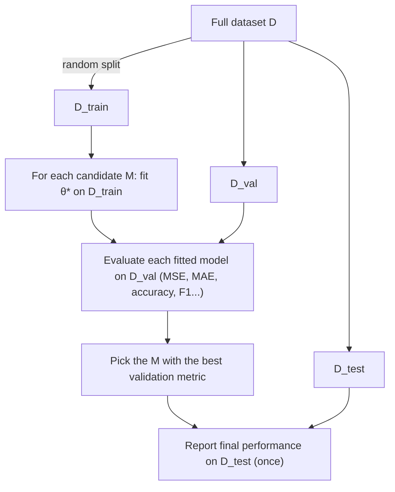
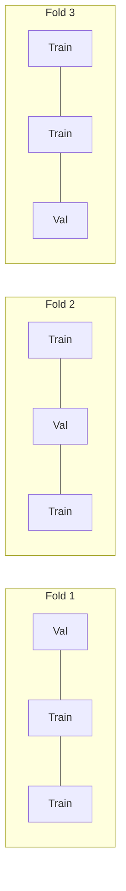

**Notes based off of:** DS 3000/9000 Lecture 5 — Generalization & Bias-Variance Tradeoff ([https://ds3000cs.pages.dev](https://ds3000cs.pages.dev/))

## Motivation

Up to now, the workflow has been: pick a model $f(\boldsymbol{x}; \boldsymbol{\theta})$, then use MLE (or equivalently, least squares under Gaussian noise) to find the parameters $\boldsymbol{\theta}$ that make the data most likely. But that skips an earlier question: **which model family should we use in the first place?** A straight line? A cubic? Something wildly flexible?

This lecture uses polynomial regression as a clean, controllable example, because a single integer (the degree $M$) dials model complexity up and down. The lessons, however, apply to every model you'll meet later (decision trees, k-NN, neural nets) — they all have some "complexity knob."

## Polynomial Regression

### Polynomials

A degree-$M$ polynomial is $$ f(x) = \theta_0 + \theta_1 x + \theta_2 x^2 + \dots + \theta_M x^M = \sum_{m=0}^{M} \theta_m x^m $$
- $M \in \mathbb{N}$ is the **degree**.
- $\theta_0, \dots, \theta_M \in \mathbb{R}$ are the **coefficients**.

| $M$ | Name      | Form                                                  |
| --- | --------- | ----------------------------------------------------- |
| 0   | Constant  | $\theta_0$                                            |
| 1   | Linear    | $\theta_0 + \theta_1 x$                               |
| 2   | Quadratic | $\theta_0 + \theta_1 x + \theta_2 x^2$                |
| 3   | Cubic     | $\theta_0 + \theta_1 x + \theta_2 x^2 + \theta_3 x^3$ |

Note a degree-$M$ polynomial has $M+1$ parameters — this count matters a lot later.

### Polynomial Basis Functions

The key trick: polynomial regression is **still linear regression**, just on transformed features. Define the feature map (basis function): $$ \phi(x) = \left[1, x, x^2, \dots, x^M\right]^\top $$ and weight vector $\boldsymbol{\theta} = [\theta_0, \theta_1, \dots, \theta_M]^\top$. Then the model is $$ f(x; \boldsymbol{\theta}, M) = \boldsymbol{\theta}^\top \phi(x) $$ The model is _nonlinear in $x$_ but _linear in $\boldsymbol{\theta}$_. That's why all the linear-regression machinery (normal equation, convexity of the loss, a unique closed-form solution) carries over unchanged. Each $\phi_m(x) = x^m$ is a "building block" curve, and $\boldsymbol{\theta}$ just says how much of each block to mix in.

Different $M$ gives a **different model** (a different hypothesis class). Choosing $M$ is therefore model selection.

### Learning

Given $\mathcal{D} = {(x_n, y_n)}_{n=1}^{N}$, minimize the mean squared error: $$ \mathcal{L}(\boldsymbol{\theta}; \mathcal{D}, M) = \frac{1}{N} \sum_{n=1}^{N} \left(y_n - f(x_n; \boldsymbol{\theta}, M)\right)^2 $$
This is equivalent to maximizing the Gaussian log-likelihood (from the previous lecture). Stacking features into the **design matrix** $$ \Phi = [\phi(x_1), \phi(x_2), \dots, \phi(x_N)]^\top \in \mathbb{R}^{N \times (M+1)} $$
and targets $\boldsymbol{y} = [y_1, \dots, y_N]^\top \in \mathbb{R}^N$, the **normal equation** gives the optimum: $$ \boldsymbol{\theta}^{*} = \left(\Phi^\top \Phi\right)^{-1} \Phi^\top \boldsymbol{y} $$ Important: for each fixed $M$ we get a best $\boldsymbol{\theta}^{*}$. Training **does not choose $M$ for us**. $M$ is a _hyperparameter_ — something set before training, not learned by it.

> [!note] When does the inverse exist? 
> $\Phi^\top\Phi$ is invertible only if $\Phi$ has full column rank, which needs at least $M+1$ distinct $x$ values. When $M$ is large relative to $N$, $\Phi^\top\Phi$ also becomes badly ill-conditioned (columns $x^{15}$ and $x^{16}$ look almost identical on $[0,1]$), so the solution becomes numerically unstable. In practice one uses `np.linalg.lstsq` or a pseudo-inverse instead of an explicit inverse.

### What happens as $M$ grows

The lecture fits 10 noisy points sampled from a sine wave $f^{*}(x) = \sin(2\pi x)$:

- **$M = 0$:** a flat horizontal line at roughly the mean of the $y$'s. Ignores the shape completely.
- **$M = 1$:** a downward-sloping line. Captures the overall trend but none of the curvature.
- **$M = 5$:** closely tracks the true sine wave. Doesn't hit every point, but it doesn't need to — the points are noisy.
- **$M = 9$:** passes **exactly through every training point**, but swings wildly between them (off the plot entirely between $x \approx 0.45$ and $0.65$).

Why does $M=9$ interpolate perfectly? With 10 points and $M+1 = 10$ parameters, there's exactly one polynomial through all 10 points. Training error is **zero** — and the model is useless. This is the central lesson: **low training error does not mean a good model.** The model has memorized the noise instead of learning the pattern.

## Bias-Variance Tradeoff

### Estimators

Assume data come from an unknown **true function**: $$ y = f^{*}(\boldsymbol{x}) $$ (More realistically, $y = f^{*}(\boldsymbol{x}) + \varepsilon$ where $\varepsilon$ is noise with variance $\sigma^2$.)

- An **estimator** is a procedure: dataset in, function out.
- The trained model $f_{\mathcal{D}}(\boldsymbol{x})$ is an **estimate** of $f^{*}(\boldsymbol{x})$.
- For polynomial regression, $f_{\mathcal{D}}(\boldsymbol{x}) = f(\boldsymbol{x}; \boldsymbol{\theta}(\mathcal{D}), M)$, where $\boldsymbol{\theta}(\mathcal{D})$ is the optimal parameter vector learned from $\mathcal{D}$.

The subscript $\mathcal{D}$ is the whole point: **the learned function depends on which dataset you happened to get.** Collect a different random sample and you get a different $f_{\mathcal{D}}$. So we can treat $f_{\mathcal{D}}(\boldsymbol{x})$ as a _random variable_ (randomness coming from the draw of $\mathcal{D}$) and ask about its mean and spread.

### Bias

Suppose datasets are drawn from some distribution $p(\mathcal{D})$. The **bias** at a point $\boldsymbol{x}$ is $$ \text{Bias}(\boldsymbol{x}) = \mathbb{E}_{\mathcal{D} \sim p(\mathcal{D})}\left[f_{\mathcal{D}}(\boldsymbol{x}) - f^{*}(\boldsymbol{x})\right] $$ Bias measures, **averaged over all possible datasets**, how far the estimate sits from the truth. It is a _systematic_ error — it doesn't go away no matter how many datasets you average over.

Intuition from the $M = 1$ plot: fit a line to many different sine-wave datasets. Every line looks roughly the same, and their average is still a straight line — which can never bend into a sine. That gap between "average fit" and "truth" is bias. It comes from the model being **too restrictive** to represent $f^{*}$.

### Variance

Let $\mu(\boldsymbol{x}) = \mathbb{E}_{\mathcal{D} \sim p(\mathcal{D})}[f_{\mathcal{D}}(\boldsymbol{x})]$ be the average prediction at $\boldsymbol{x}$. The **variance** is $$ \text{Var}(\boldsymbol{x}) = \mathbb{E}_{\mathcal{D} \sim p(\mathcal{D})}\left[\left(f_{\mathcal{D}}(\boldsymbol{x}) - \mu(\boldsymbol{x})\right)^2\right] $$ Variance measures how much the estimate **jumps around its own average** from dataset to dataset. It says nothing about the truth — only about instability.

Intuition from the $M = 11$ plot: the _average_ curve actually follows the sine fairly well in the middle (low bias), but the individual fits are all over the place, especially near the edges $x \approx 0$ and $x \approx 1$, where there are few points to pin the polynomial down. Change a few data points, get a wildly different curve. That's high variance — the model is **too sensitive** to the specific sample.

> [!tip] Dartboard analogy
>  Each dataset = one throw. **Bias** = how far the centre of your cluster of throws is from the bullseye. **Variance** = how spread out the cluster is. You can be tightly clustered but off-target (high bias, low variance), or centred on target but scattered (low bias, high variance).

### Bias-Variance Decomposition

The expected squared error of the estimate at $\boldsymbol{x}$ splits cleanly: $$ \mathbb{E}_{\mathcal{D} \sim p(\mathcal{D})}\left[\left(f^{*}(\boldsymbol{x}) - f_{\mathcal{D}}(\boldsymbol{x})\right)^2\right] = \text{Bias}(\boldsymbol{x})^2 + \text{Var}(\boldsymbol{x}) $$

#### Derivation (not on the slides, but short and worth knowing)

Write $f^{*}$, $f_{\mathcal{D}}$, $\mu$ for their values at $\boldsymbol{x}$, and add and subtract $\mu$: $$ \mathbb{E}\left[(f^{*} - f_{\mathcal{D}})^2\right] = \mathbb{E}\left[\left((f^{*} - \mu) + (\mu - f_{\mathcal{D}})\right)^2\right] $$ Expanding: $$ = (f^{*} - \mu)^2 + 2(f^{*} - \mu),\mathbb{E}[\mu - f_{\mathcal{D}}] + \mathbb{E}\left[(\mu - f_{\mathcal{D}})^2\right] $$

- $f^{*} - \mu$ is a constant (doesn't depend on $\mathcal{D}$), so it comes out of the expectation.
- The cross term vanishes because $\mathbb{E}[f_{\mathcal{D}}] = \mu$ by definition.
- The first term is $(\mu - f^{*})^2 = \text{Bias}^2$; the last is $\text{Var}$. $\blacksquare$

#### With noise: irreducible error

If observations are noisy, $y = f^{*}(\boldsymbol{x}) + \varepsilon$ with $\text{Var}(\varepsilon) = \sigma^2$, then the expected error against a _new observed_ $y$ picks up a third term: $$ \mathbb{E}\left[(y - f_{\mathcal{D}}(\boldsymbol{x}))^2\right] = \text{Bias}(\boldsymbol{x})^2 + \text{Var}(\boldsymbol{x}) + \sigma^2 $$ $\sigma^2$ is the **irreducible error** — no model, however good, can predict pure noise. This is why validation/test MSE on real data never reaches zero even for the "right" model (see the plateau at about 0.1 in the error curves below).

#### The tradeoff

For a given total MSE, it can be split many ways. For MSE $= 0.25$:

|Bias|Bias²|Var|Total|
|---|---|---|---|
|0.5|0.25|0|0.25|
|0.25|0.0625|0.1875|0.25|
|0|0|0.25|0.25|

(Remember bias gets **squared** — that's why bias $0.25$ only contributes $0.0625$.)

The practical meaning of "tradeoff": the knobs that reduce one tend to increase the other. Making a model more flexible (bigger $M$) lowers bias but raises variance; making it more rigid does the reverse. Total error as a function of complexity is therefore typically **U-shaped**, and the goal is to find the bottom of the U, not to drive either term to zero.

> [!note] Bias and variance are theoretical 
> You can't compute either one on real data — both require $f^{*}$ and access to many datasets from $p(\mathcal{D})$. They're a _conceptual lens_ for understanding failures. In practice, we estimate total error on held-out data, which is the next section.

## Model Selection

### Which $M$?

Comparing $M = 1, 3, 11$ across many datasets:

- $M = 1$: all fits agree with each other, but all are wrong. **High bias, low variance.**
- $M = 3$: fits hug the true sine and agree with each other. **The sweet spot.** (Makes sense: a cubic has one local max and one local min, just like one period of a sine.)
- $M = 11$: fits are right on average in the middle but scatter wildly. **Low bias, high variance.**

### Generalization

**Generalization** is how well the model performs on **unseen** data. Machine learning is fundamentally about generalization — fitting the training data is easy (just memorize it); the hard part is doing well on data you haven't seen.

- Self-driving car: does it handle roads it wasn't trained on?
- Medical diagnosis: is it accurate on new patients?

### Dataset Splitting

Two problems stop us from measuring bias/variance directly:

1. We don't have access to the true $f^{*}$.
2. We only have **one** dataset $\mathcal{D}$.

**Solution:** randomly split $\mathcal{D}$ into three disjoint parts:

- $\mathcal{D}_{\text{train}}$ — for fitting parameters (MLE / least squares) **only**.
- $\mathcal{D}_{\text{val}}$ — for model selection and hyperparameter tuning **only**.
- $\mathcal{D}_{\text{test}}$ — for the final evaluation **only**, touched once.

Typical splits: 80/10/10 or 70/15/15. Held-out data acts as a stand-in for "new data from the real world."

### General Recipe

1. For each model, **train** on $\mathcal{D}_{\text{train}}$ to get $\boldsymbol{\theta}^{*}$.
2. **Validate** each on $\mathcal{D}_{\text{val}}$ using a suitable metric:
    - Regression: MSE, MAE, etc.
    - Classification: accuracy, F1-score, etc.
3. **Test** only the chosen model on $\mathcal{D}_{\text{test}}$.

> [!warning] Don't leak data
> 
> 1. **Don't** train on $\mathcal{D}_{\text{val}}$.
> 2. **Don't** use $\mathcal{D}_{\text{test}}$ for training _or_ model selection.
> 
> Why: once you make _any_ decision based on a set, its score becomes optimistically biased. If you try 20 values of $M$ and pick the best validation score, that winning score is partly luck — you selected for it. The test set is the only unbiased estimate left, and only if you never peek at it while making choices. Violate this and your reported performance will overstate how well the model does on truly new data.

A common extra step (not on the slides): after choosing $M$ on the validation set, retrain on $\mathcal{D}_{\text{train}} \cup \mathcal{D}_{\text{val}}$ before testing, so the final model benefits from more data.

### The Example Plots ($M = 1, 3, 20$)

With a larger dataset split into train (●), val (+), test (★):

- **$M = 1$:** the line misses all three sets about equally badly → underfitting.
- **$M = 3$:** fits all three sets well, closely tracking $f^{*}$ → well-fit.
- **$M = 20$:** threads through the training dots but shoots off to $\pm\infty$ in gaps between training points, missing many val/test points → overfitting.

### Overfitting and Underfitting

||Complexity|Bias|Variance|Train error|Val/test error|
|---|---|---|---|---|---|
|**Underfitting**|Too simple|High|Low|High|High|
|**Overfitting**|Too complex (fits the noise)|Low|High|Low|High|
|**Well-fit**|Balanced|Balanced|Balanced|Low|Low|

**The diagnostic you'll actually use:** compare training error to validation error.

- Both high → underfitting. Try a more flexible model or better features.
- Train low, val much higher → overfitting. Try a simpler model, more data, or regularization (coming later in the course).
- Both low and close → good.

Reading the MSE vs. $M$ curve from the lecture:

- $M = 0$ to $2$: all errors high (~0.3–0.55). Underfitting.
- Sharp drop at $M = 3$: all errors fall to near their minimum. (Why not at $M = 2$? A quadratic has only one bend, while the sine needs two.)
- $M > 3$: **training error keeps falling** (more parameters can always fit the training set at least as well — the models are nested), but **validation and test error creep back up**. That widening gap is overfitting.
- Test error sits above validation error here; this is just sampling noise between two small sets, but it's a reminder that one held-out estimate is itself noisy.

The right choice is the $M$ at the **minimum of the validation curve**, here around $M = 3$ to $6$. When several are close, prefer the simpler model (Occam's razor) — it's less likely to have won by luck.

### K-Fold Cross-Validation

A single train/val split has two weaknesses:

1. **Wastes data** when $|\mathcal{D}|$ is small — every point in $\mathcal{D}_{\text{val}}$ is a point not used for training.
2. **High variance** — the validation score depends heavily on _which_ points happened to land in $\mathcal{D}_{\text{val}}$. A different random split could pick a different $M$.

**Algorithm: K-Fold Cross-Validation**

1. Set aside $\mathcal{D}_{\text{test}}$. Divide the rest, $\mathcal{D} \setminus \mathcal{D}_{\text{test}}$, into $K$ random, equally sized folds $\mathcal{D}_1, \dots, \mathcal{D}_K$.
2. For $k = 1, \dots, K$:
    - Train on all non-test data except fold $k$, i.e. $(\mathcal{D} \setminus \mathcal{D}_{\text{test}}) \setminus \mathcal{D}_k$. (The slide writes $\mathcal{D} \setminus \mathcal{D}_k$; the test set is meant to stay excluded.)
    - Compute the validation metric on $\mathcal{D}_k$.
3. Return the **average** validation metric over the $K$ folds.

Repeat this for every candidate model, and pick the one with the best average. Every point gets used for validation exactly once and for training $K-1$ times.

Practical notes:

- Common choices: $K = 5$ or $10$. $K = N$ is **leave-one-out CV** (each point is its own fold) — least wasteful, but $N$ training runs.
- Cost: $K$ times more training than a single split. Cheap for polynomial regression, expensive for big neural nets (which is why deep learning usually sticks with a single val split).
- The spread of the $K$ fold scores is itself useful: a large spread warns you the estimate is unreliable.

Reading the 3-fold CV plot: the faint lines are individual folds, the bold line is their average. For large $M$, individual folds blow up to enormous MSE (each fold trains on only $2/3$ of the data, so high-degree polynomials are even more under-constrained and ill-conditioned). This shows exactly why averaging matters — any single fold could have misled you — and again points to small $M$ (about 3–6) as the best choice.

## Summary

- **Bias** (on average): how far the estimator's average prediction is from the true function. Caused by too-rigid models.
- **Variance** (on average): how much the estimator's predictions fluctuate around their own average across datasets. Caused by too-flexible models.
- $\text{MSE} = \text{Bias}^2 + \text{Variance}$ (plus $\sigma^2$ irreducible noise when observations are noisy).
- **Generalization**: performance on unseen data — the real goal of ML.
- **Underfitting**: high bias, low variance. **Overfitting**: low bias, high variance.
- **Model selection**: train on $\mathcal{D}_{\text{train}}$, validate on $\mathcal{D}_{\text{val}}$, test on $\mathcal{D}_{\text{test}}$ — and never let the test set influence a decision.
- Use **K-fold cross-validation** when $|\mathcal{D}|$ is small.