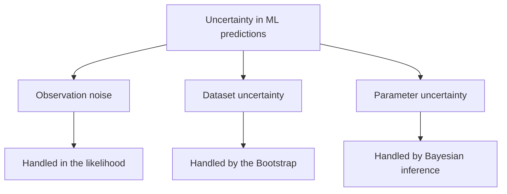

**Notes based off of:** DS 3000/9000 Lecture 8 — Uncertainty Quantification (Western University, [https://ds3000cs.pages.dev](https://ds3000cs.pages.dev/))

## Motivation

Up to now, every model has been built around two simplifying assumptions:

- **One label per input.** The dataset $\mathcal{D} = {(\mathbf{x}_n, y_n)}_{n=1}^{N}$ has exactly one $y_n$ for each $\mathbf{x}_n$, and we treat that $y_n$ as _the_ truth.
- **One best parameter.** Training finds a single $\boldsymbol{\theta}^{*}$ and we predict with $f(\mathbf{x}; \boldsymbol{\theta}^{*})$ as if it were exactly right.

Neither assumption holds in practice. Labels are measured with noise, and $\boldsymbol{\theta}^{*}$ was estimated from a finite sample, so a different sample would have given a different $\boldsymbol{\theta}^{*}$. A point prediction like "the temperature will be 21.3°C" hides all of this. **Uncertainty quantification (UQ)** is about attaching an honest "how sure are we?" to each prediction, usually as a distribution or an interval.

This matters whenever a decision depends on the prediction: a doctor needs to know if a diagnosis is 51% or 99% likely, and an engineer needs to know if a load estimate could be off by 1% or 50%.

### Three sources of uncertainty



In the wider literature these group into two families, terms worth knowing even though the slides don't use them:

- **Aleatoric uncertainty** (from Latin _alea_, dice): randomness inherent in the data. Observation noise is aleatoric. Collecting more data does **not** reduce it — a cheap sensor stays cheap.
- **Epistemic uncertainty** (from Greek _episteme_, knowledge): uncertainty from not knowing enough. Dataset and parameter uncertainty are epistemic. More data **does** reduce it.

## Learning with Noisy Observations

### Setup: linear regression revisited

The label $y_n \in \mathbb{R}$ can be **noisy**: measuring the same $\mathbf{x}_n$ twice can give two different $y_n$. We model this by assuming the observed value is the "true" function plus random noise: $$ y_n = f(\mathbf{x}_n; \boldsymbol{\theta}) + \varepsilon, \qquad \varepsilon \sim \mathcal{N}(0, \sigma^2) $$ **Example:** $\mathbf{x}_n$ is date, location, etc., and $y_n$ is a temperature reading from a sensor. Repeated readings at the same place and time differ because of electrical interference, sensor quality, rounding, and so on.

Why Gaussian? It's a convenient default: noise is often the sum of many small independent effects (which the Central Limit Theorem says tends toward Gaussian), and it makes the maths tractable. It is an _assumption_, though — heavy-tailed noise or outliers can break it.

### The likelihood with observation noise

A key property of Gaussians: if $z \sim \mathcal{N}(\mu, \sigma^2)$ and $a, b \in \mathbb{R}$ are constants, then $$ az + b \sim \mathcal{N}(a\mu + b,; a^2\sigma^2) $$ Applying this with $a = 1$ and $b = f(\mathbf{x}_n; \boldsymbol{\theta})$ (a constant once $\mathbf{x}_n$ and $\boldsymbol{\theta}$ are fixed) shifts the noise distribution so it is centred on the model's prediction: $$ p(y_n \mid \mathbf{x}_n; \boldsymbol{\theta}) = \mathcal{N}\big(f(\mathbf{x}_n; \boldsymbol{\theta}),; \sigma^2\big) $$ In words: the model no longer predicts a single number; it predicts a bell curve whose centre is $f(\mathbf{x}_n; \boldsymbol{\theta})$ and whose spread is $\sigma$.

Assuming the data points are independent, the likelihood of the whole dataset is a product, so the log-likelihood is a sum: $$ \log p(\mathcal{D} \mid \boldsymbol{\theta}) = \sum_{n=1}^{N} \log \mathcal{N}\big(y_n;, f(\mathbf{x}_n; \boldsymbol{\theta}),, \sigma^2\big) $$ The **goal** is now to learn both $\boldsymbol{\theta}^{*}$ _and_ $\sigma^2$ from $\mathcal{D}$.

### Homoscedastic noise

**Homoscedastic** ("same scatter") noise means $\sigma^2$ is the same for every $\mathbf{x}_n$.

Plugging in the Gaussian density $\mathcal{N}(y; \mu, \sigma^2) = \frac{1}{\sqrt{2\pi\sigma^2}} \exp!\left(-\frac{(y-\mu)^2}{2\sigma^2}\right)$ and taking logs (as in Lec. 3): $$ \log p(\mathcal{D} \mid \boldsymbol{\theta}) = -\frac{1}{2\sigma^2} \sum_{n=1}^{N} \big(f(\mathbf{x}_n; \boldsymbol{\theta}) - y_n\big)^2 - \frac{N}{2}\log \sigma^2 - \frac{N}{2}\log 2\pi $$ The last term doesn't depend on anything we learn, so it is usually written as "+ const". Maximum likelihood gives: $$ \boldsymbol{\theta}^{*} = \arg\max_{\boldsymbol{\theta}} \left[ -\frac{1}{2\sigma^2} \sum_{n=1}^{N} \big(f(\mathbf{x}_n; \boldsymbol{\theta}) - y_n\big)^2 - \frac{N}{2}\log \sigma^2 \right] $$ Two useful observations the slides leave implicit:

- **For $\boldsymbol{\theta}$ alone, nothing changes.** With $\sigma^2$ fixed, the $\boldsymbol{\theta}$ that maximises this is exactly the one that minimises the sum of squared errors. This is _why_ MSE is the standard regression loss: it is the Gaussian-noise MLE in disguise.
- **The best $\sigma^2$ has a closed form.** Setting the derivative with respect to $\sigma^2$ to zero gives $$ \sigma^{2}_{\text{MLE}} = \frac{1}{N}\sum_{n=1}^{N} \big(f(\mathbf{x}_n; \boldsymbol{\theta}^{*}) - y_n\big)^2 $$ i.e. the estimated noise variance is just the mean squared residual on the training data. (In practice it is better to compute this on held-out data, because training residuals are optimistically small, especially for flexible models.)

**Interpreting $\sigma^2$:** it scales how much each squared error is penalised.

- $\sigma^2 > 1$: the data is considered noisy, errors are down-weighted, and the overall log-likelihood is smaller. The model _cannot_ be confident about the $\mathbf{x}_n \to y_n$ relationship.
- $\sigma^2 < 1$: the data is considered clean, errors are heavily penalised, and a well-fitting model earns a larger log-likelihood. The model _can_ be confident.

(The threshold "1" isn't special in a deep sense; what matters is how $\sigma^2$ compares with the scale of the residuals.)

### Heteroscedastic noise

**Heteroscedastic** ("different scatter") noise means the variance depends on the input: $\sigma^2(\mathbf{x}_n)$. Now we learn **two** functions from $\mathcal{D}$: the mean $f(\mathbf{x}; \boldsymbol{\theta})$ and the variance $\sigma^2(\mathbf{x}; \boldsymbol{\theta})$. $$ \log p(\mathcal{D} \mid \boldsymbol{\theta}) = \sum_{n=1}^{N} \left[ -\frac{\big(f(\mathbf{x}_n; \boldsymbol{\theta}) - y_n\big)^2}{2\sigma^2(\mathbf{x}_n; \boldsymbol{\theta})} - \frac{1}{2}\log \sigma^2(\mathbf{x}_n; \boldsymbol{\theta}) \right] + \text{const} $$ **Intuition:** each point's squared error is divided by its own variance. If $\sigma^2(\mathbf{x}_n; \boldsymbol{\theta})$ is large, the point $(\mathbf{x}_n, y_n)$ contributes less — the model is "allowed" to miss it. The $\frac{1}{2}\log \sigma^2$ term stops the model from cheating by declaring every point infinitely noisy: large variances are penalised.

**Example:**

- _Homoscedastic:_ the same model of weather sensor is used at every location.
- _Heteroscedastic:_ different locations use different sensors, some more accurate than others. The model should put **higher weight** on data from locations with accurate sensors.

Other natural examples: house prices are more variable for expensive houses than cheap ones; a person's spending is more variable at higher incomes.

**In practice:** a common way to implement this is a model (e.g. a neural network) with two outputs, one for the mean and one for $\log \sigma^2$. Predicting the _log_ variance guarantees the variance stays positive and makes optimisation more stable. The negative of the expression above is then used directly as the training loss (the "Gaussian negative log-likelihood" loss, available in PyTorch as `GaussianNLLLoss`).

### Prediction with observation noise

After learning $\boldsymbol{\theta}^{*}$, the prediction for a new input is a full distribution: $$ y_{\text{new}} \sim \mathcal{N}\big(f(\mathbf{x}_{\text{new}}; \boldsymbol{\theta}^{*}),; \sigma^2(\mathbf{x}_{\text{new}}; \boldsymbol{\theta}^{*})\big) $$ From it we report:

- the **mean** $f(\mathbf{x}_{\text{new}}; \boldsymbol{\theta}^{*})$ — the "best guess", and
- the **95% prediction interval (PI)** or error bar: $$ \Big[f(\mathbf{x}_{\text{new}}; \boldsymbol{\theta}^{*}) - 1.96,\sigma(\mathbf{x}_{\text{new}}; \boldsymbol{\theta}^{*}),;; f(\mathbf{x}_{\text{new}}; \boldsymbol{\theta}^{*}) + 1.96,\sigma(\mathbf{x}_{\text{new}}; \boldsymbol{\theta}^{*})\Big] $$ also written $f(\mathbf{x}_{\text{new}}; \boldsymbol{\theta}^{*}) \pm 1.96,\sigma(\mathbf{x}_{\text{new}})$.

Where does 1.96 come from? For a standard normal, 95% of the probability mass lies within $\pm 1.96$ standard deviations of the mean (2.5% in each tail). Other common choices: $\pm 1.645\sigma$ for 90%, $\pm 2.576\sigma$ for 99%. Note that we multiply by $\sigma$, the **standard deviation**, not the variance $\sigma^2$.

**Prediction interval vs. confidence interval:** a _prediction_ interval is about where a new observation $y_{\text{new}}$ will land (includes noise). A _confidence_ interval is about where the true mean function lies. PIs are always at least as wide.

## Dataset Randomness

### Why the dataset itself is a source of uncertainty

So far $\mathcal{D}$ was treated as fixed and we learned a single $\boldsymbol{\theta}^{*}$. But $\mathcal{D}$ is a finite random sample from some larger population, and it may not represent that population well. Draw a different sample and you get a different $\boldsymbol{\theta}^{*}$ — and different predictions.

**Example:** predicting height from age using a sample of $N$ people. Does the sample reflect the whole population? That depends on $N$ (and on how the sample was collected), but probably not perfectly. So we are unsure about our predictions **even if there were no observation noise at all**. This is epistemic uncertainty: it shrinks as $N$ grows.

The ideal experiment would be to collect many independent datasets, train on each, and see how much predictions vary. We can't do that — we only have one dataset. The bootstrap is a clever way to approximate it.

### The Bootstrap: training

Given $\mathcal{D}$ of size $N$, create $B$ **bootstrap datasets** $\mathcal{D}^{(1)}, \dots, \mathcal{D}^{(B)}$, each made by sampling $N$ points from $\mathcal{D}$ **with replacement**, and train one model on each:

```
for b = 1, ..., B:
    D_b      = sample_with_replacement(D)    # N draws, with replacement
    theta_b  = train_model(D_b)
return theta_1, ..., theta_B
```

**Analogy:** a bowl with 5 numbered balls. Draw one with your eyes closed, write down the number, **put it back**, and repeat until you've written 5 numbers. Some numbers appear more than once, some not at all.

Why "with replacement"? Without replacement, every bootstrap dataset would just be a shuffled copy of $\mathcal{D}$ and all models would be identical. Replacement is what creates the variation. The core idea is to treat $\mathcal{D}$ as a stand-in for the population and resample from it, mimicking "drawing a fresh dataset".

Useful facts not on the slides:

- Each bootstrap dataset contains on average about **63.2%** of the unique original points (the probability a given point is never picked is $(1 - 1/N)^N \approx e^{-1} \approx 0.368$). The left-out ~36.8% are called **out-of-bag** points and can be used for validation for free.
- Typical values of $B$ range from tens (expensive models) to thousands (cheap models). Cost scales linearly with $B$, since you train $B$ models.
- This is the same idea behind **bagging** ("bootstrap aggregating") and random forests — there the goal is mainly to reduce variance, here it's to _measure_ it.

### The Bootstrap: prediction (regression)

Given $\mathbf{x}_{\text{new}}$ and the $B$ trained parameter sets, run every model and summarise the spread: $$ f_{\text{mean}} = \frac{1}{B}\sum_{b=1}^{B} f\big(\mathbf{x}_{\text{new}}; \boldsymbol{\theta}^{*(b)}\big) $$ $$ f_{\text{var}} = \frac{1}{B}\sum_{b=1}^{B} \Big(f\big(\mathbf{x}_{\text{new}}; \boldsymbol{\theta}^{*(b)}\big) - f_{\text{mean}}\Big)^2 $$ Return $f_{\text{mean}}$ as the prediction and $f_{\text{var}} + \sigma^2$ as the total predictive variance.

Why add $\sigma^2$? The two sources of uncertainty are independent and variances of independent quantities add:

- $f_{\text{var}}$ = disagreement **between models** → dataset (epistemic) uncertainty.
- $\sigma^2$ = noise **in the observations** → observation (aleatoric) uncertainty.

The 95% PI is then $f_{\text{mean}} \pm 1.96\sqrt{f_{\text{var}} + \sigma^2}$.

**Reading the slide's plot:** the grey curves are the individual bootstrap models. Where there's lots of data (the middle), they agree and the band is narrow. At the edges ($x \approx 0$ and $x \approx 1$), where data is sparse and a flexible polynomial is free to swing, they disagree wildly and the band balloons. This is exactly the behaviour we want: the model admits it doesn't know what happens where it hasn't seen much data, and this would be even more pronounced when extrapolating outside the data range.

### The Bootstrap: prediction (classification)

For binary classification, average the predicted **probabilities** of the $B$ models: $$ p(y = 1 \mid \mathbf{x}_{\text{new}}) = \frac{1}{B}\sum_{b=1}^{B} \sigma\Big(f\big(\mathbf{x}_{\text{new}}; \boldsymbol{\theta}^{*(b)}\big)\Big) $$ Here $\sigma(\cdot)$ is the **sigmoid** function — not the noise standard deviation (unfortunate notation clash). For multi-class problems replace the sigmoid with softmax and average the probability vectors.

**Analogy:** $B$ doctors each give a probability that a patient has a disease; the final diagnosis is the average of their probabilities.

Note the order: apply the sigmoid **first**, then average. Averaging the raw logits and then applying the sigmoid gives a different (and typically overconfident) answer. If the models disagree — some say 0.95, some say 0.1 — the average lands somewhere in the middle, correctly signalling uncertainty.

## Bayesian Uncertainty

### Bayesian modelling

**Bayesian inference** is a mathematical framework for representing _beliefs_ about unknown quantities as probability distributions and updating them with evidence. In ML, the unknown is $\boldsymbol{\theta}$:

- **Prior** $p(\boldsymbol{\theta})$: what we believe about $\boldsymbol{\theta}$ before seeing data.
- **Likelihood** $p(\mathcal{D} \mid \boldsymbol{\theta})$: how well a given $\boldsymbol{\theta}$ explains the data (the same object as before).
- **Posterior** $p(\boldsymbol{\theta} \mid \mathcal{D})$: our updated belief, from Bayes' rule: $$ p(\boldsymbol{\theta} \mid \mathcal{D}) = \frac{p(\mathcal{D} \mid \boldsymbol{\theta}), p(\boldsymbol{\theta})}{p(\mathcal{D})} $$ The posterior answers: _"How sure are we about the value of $\boldsymbol{\theta}$, given what we observed in $\mathcal{D}$?"_ The denominator $p(\mathcal{D})$ (the "evidence") just normalises the posterior to integrate to 1, and is usually the hard part to compute.

**Example:** $\boldsymbol{\theta}$ = will it rain tomorrow?

- Prior: 0.9 rain, 0.1 sun, based on past experience (say, it's the rainy season).
- Likelihood: you check today's sky.
- Posterior: maybe 0.4 rain, 0.6 sun, because today is so sunny.

**The key shift in viewpoint:** maximum likelihood picks _one_ $\boldsymbol{\theta}^{*}$. Bayesian inference keeps a whole _distribution_ over $\boldsymbol{\theta}$. A narrow posterior means the data pinned $\boldsymbol{\theta}$ down; a wide posterior means many parameter values are still plausible — that width is **parameter uncertainty**.

Connection to earlier lectures: if you just take the single most probable $\boldsymbol{\theta}$ under the posterior (the **MAP** estimate), a Gaussian prior on $\boldsymbol{\theta}$ turns out to be exactly L2 regularisation. So Ridge regression is "Bayesian with a Gaussian prior, but throwing away everything except the peak". Full Bayesian inference keeps the rest.

### Bayesian prediction

Instead of predicting with one $\boldsymbol{\theta}$, average predictions over all plausible $\boldsymbol{\theta}$, weighted by the posterior: $$ f(\mathbf{x}_{\text{new}}) = \mathbb{E}_{\boldsymbol{\theta} \sim p(\boldsymbol{\theta} \mid \mathcal{D})}\big[f(\mathbf{x}_{\text{new}}; \boldsymbol{\theta})\big] $$ This expectation is usually an intractable integral, so we use a **Monte Carlo (MC) approximation**: replace the expectation with an average over samples, $$ \mathbb{E}_{\mathbf{z} \sim p(\mathbf{z})}\big[g(\mathbf{z})\big] \approx \frac{1}{B}\sum_{b=1}^{B} g\big(\mathbf{z}^{(b)}\big), \qquad \mathbf{z}^{(b)} \sim p(\mathbf{z}) $$ So we need $f(\mathbf{x}_{\text{new}}; \boldsymbol{\theta}^{(1)}), \dots, f(\mathbf{x}_{\text{new}}; \boldsymbol{\theta}^{(B)})$ with each $\boldsymbol{\theta}^{(b)} \sim p(\boldsymbol{\theta} \mid \mathcal{D})$.

Notice this has the **same shape as the bootstrap**: a collection of $B$ parameter sets, run each, average. The difference is _where the $\boldsymbol{\theta}$'s come from_ — retraining on resampled data (bootstrap) vs. sampling from the posterior (Bayesian). Ways to get posterior samples (MCMC, variational inference, Laplace approximation, ...) are outside DS 3000's scope.

### Bayesian models in practice

Scikit-learn provides some Bayesian models with closed-form or built-in posteriors:

1. **Bayesian Ridge Regression** (`BayesianRidge`)
2. **Gaussian Process Regression / Classification** (`GaussianProcessRegressor`, `GaussianProcessClassifier`)

```python
from sklearn.linear_model import Ridge
from sklearn.linear_model import BayesianRidge

X_train, y_train = get_train()
X_test, y_test = get_test()

# Standard lin. reg. with L2
model = Ridge().fit(X_train, y_train)
y_pred = model.predict(X_test)

# Bayesian lin. reg. with L2
model = BayesianRidge().fit(X_train, y_train)
y_pred, y_std = model.predict(X_test, return_std=True)
```

The only practical difference is `return_std=True`, which also returns a per-point standard deviation (y_std). A 95% PI is then y_pred ± 1.96 · y_std. A bonus of BayesianRidge: it learns the regularisation strength and the noise level from the data, so there's no $\alpha$ to tune by cross-validation.

## Evaluating Uncertainty Quantification

### Which prediction interval is better?

The lecture compares three models with the **same mean** but different interval widths:

| Model  | Coverage | Mean width | Verdict                                    |
| ------ | -------- | ---------- | ------------------------------------------ |
| Left   | 100%     | 4.70       | Too wide — technically correct but useless |
| Middle | 60%      | 0.20       | Too narrow — overconfident                 |
| Right  | 100%     | 0.78       | Good                                       |

The lesson: accuracy of the mean says nothing about the quality of the uncertainty. We need separate metrics.

### Coverage and sharpness

Given a prediction interval $\text{PI}(\mathbf{x})$, we want two things.

**1. High coverage** — the interval should actually contain the observed values: $$ \text{Coverage} = \frac{1}{N}\sum_{n=1}^{N} \mathbb{1}\big[y_n \in \text{PI}(\mathbf{x}_n)\big] $$ where $\mathbb{1}[\cdot]$ is 1 if the condition is true and 0 otherwise.

**2. Sharpness** — the interval shouldn't be too wide: $$ \text{Width} = \frac{1}{N}\sum_{n=1}^{N} \big|\text{PI}(\mathbf{x}_n)\big| $$ These pull in opposite directions: you can always hit 100% coverage with an interval of $(-\infty, \infty)$, and you can always get zero width by reporting a point. A good PI is the **narrowest interval that still achieves the target coverage**.

A subtle point: for a 95% PI, the ideal coverage is **about 95%, not 100%**. If a nominal 95% interval covers 100% of test points, it's probably too wide; if it covers 60%, it's overconfident. Matching nominal and empirical coverage is called **calibration**. (With only ~15 points like in the slide example, 100% is entirely consistent with a well-calibrated 95% interval, so don't over-read small samples.) As always, compute these on **held-out test data** — training points will look better covered than new ones.

### Log-likelihood as a single metric

Rather than juggling two numbers, the Gaussian log-likelihood on test data balances both automatically. With $\boldsymbol{\theta}$ fixed: $$ \log p(\mathcal{D} \mid \boldsymbol{\theta}) = \underbrace{-\frac{1}{2\sigma^2}\sum_{n=1}^{N}\big(f(\mathbf{x}_n; \boldsymbol{\theta}) - y_n\big)^2}_{A} ;\underbrace{-;\frac{N}{2}\log \sigma^2}_{B} + \text{const} $$ To make the log-likelihood high, both penalty terms should be small in magnitude:

- **Term A** is small when $\frac{1}{2\sigma^2}$ is small, i.e. $\sigma^2$ is **large** relative to the errors → rewards **coverage**.
- **Term B** is small when $\log \sigma^2$ is small, i.e. $\sigma^2$ is **small** → rewards **sharpness**.

The two terms pull $\sigma^2$ in opposite directions, and the optimum sits exactly at the trade-off (in fact, at $\sigma^2$ = mean squared error, as derived above). This is why test log-likelihood — or its negative, **NLL** — is the standard single-number metric for probabilistic predictions.

**Worked example:** $N = 1$, squared error $(f - y)^2 = 0.01$ (so the prediction is off by 0.1).

- Interval with $\sigma^2 = 0.04$ ($\sigma = 0.2$): $$ \text{loglik} = -\frac{0.01}{2 \cdot 0.04} - \frac{1}{2}\log 0.04 = -0.125 + 1.609 = \mathbf{1.48} $$
- Interval with $\sigma^2 = 4$ ($\sigma = 2$): $$ \text{loglik} = -\frac{0.01}{2 \cdot 4} - \frac{1}{2}\log 4 = -0.00125 - 0.693 = \mathbf{-0.69} $$ Both intervals contain the observation, but the sharp one scores much higher. The wide one is "safe" yet uninformative, and the $\log \sigma^2$ term punishes that. Conversely, had the error been large (say 1.0) the sharp interval would score terribly: $-\frac{1}{0.08} + 1.609 \approx -10.9$, showing how overconfidence is punished. (Note: $\log$ here is the natural log, and log-likelihoods of continuous variables can be positive since densities can exceed 1.)

## Summary

- Observation noise can be **homoscedastic** (constant $\sigma^2$) or **heteroscedastic** ($\sigma^2$ depends on $\mathbf{x}$).
- Three types of uncertainty in ML: **observation** noise, **dataset** uncertainty, and **parameter** uncertainty.
    - Observation noise is handled in the **likelihood** (predict a distribution, not a point).
    - Dataset uncertainty is handled by **the Bootstrap** (resample, retrain, measure spread).
    - Parameter uncertainty is handled by **Bayesian inference** (posterior over $\boldsymbol{\theta}$, average predictions).
- Total predictive variance combines sources: e.g. $f_{\text{var}} + \sigma^2$.
- A **good prediction interval** covers the data well (calibrated coverage) while staying non-trivially narrow (sharp). Test log-likelihood captures both in one number.
- **Next:** lab on uncertainty, then neural networks.