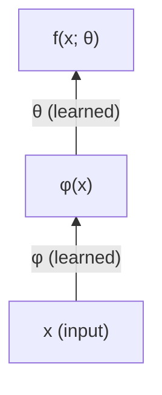
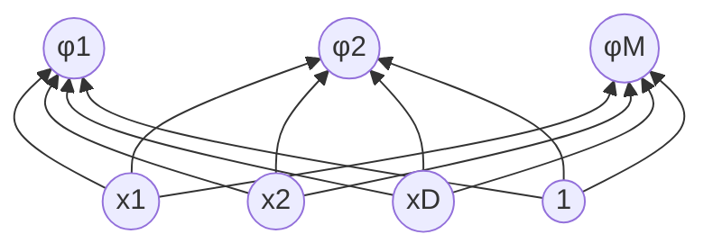
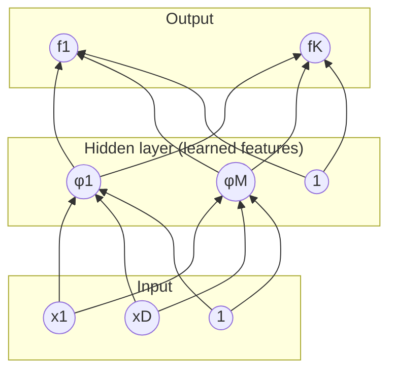
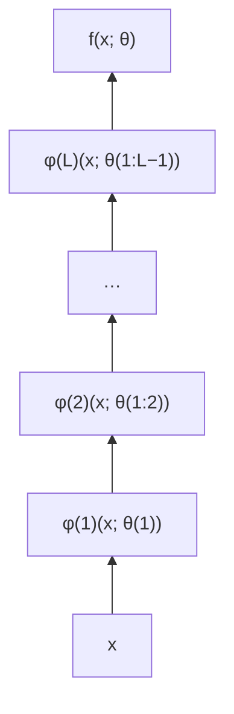
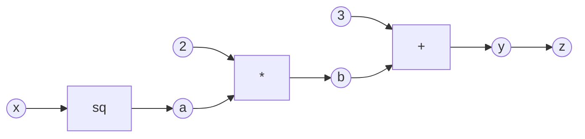
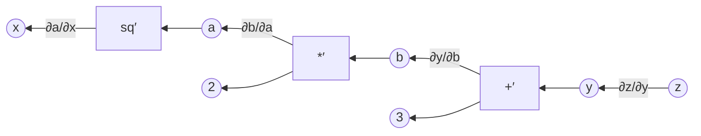
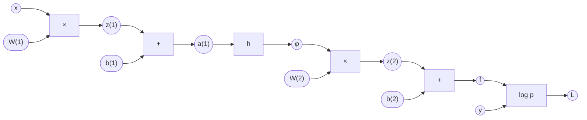

**Notes based off of:** DS 3000/9000 Lecture 9 — Neural Networks (Western University), [https://ds3000cs.pages.dev](https://ds3000cs.pages.dev/)

## Motivation: From Feature Engineering to Feature Learning

### Recap of the Setup So Far

We have a dataset $\mathcal{D} = {(\boldsymbol{x}_n, y_n)}_{n=1}^{N}$ and every model so far has had the form: $$ f(\boldsymbol{x}; \boldsymbol{\theta}) = \boldsymbol{\theta}^\top \phi(\boldsymbol{x}) $$ where $\phi$ is a **feature map** that turns a raw input vector into a feature vector. Only $\boldsymbol{\theta}$ was learned; $\phi$ was **fixed** and chosen by hand through **feature engineering** (e.g. adding polynomial terms, interaction terms, log transforms, one-hot encodings).

The weakness of this is that the model can only be as good as the features you thought of. If the "right" feature for a problem is something like "the ratio of $x_3$ to $x_7$, but only when $x_1$ is large", you have to guess it. For images, audio or text, nobody can realistically hand-design good features at all.

**The question of this lecture:** can we _learn_ $\phi$ from $\mathcal{D}$ as well, instead of designing it?

### Feature Learning

Let $\boldsymbol{x} \in \mathbb{R}^D$ and $y \in \mathbb{R}$. **Feature learning** means learning a nonlinear map $$ \phi : \mathbb{R}^D \to \mathbb{R}^M $$ by giving $\phi$ its own parameters and fitting them alongside $\boldsymbol{\theta}$.



#### Why must $\phi$ be nonlinear?

If $\phi$ were linear, say $\phi(\boldsymbol{x}) = \boldsymbol{W}\boldsymbol{x}$, then $$ f(\boldsymbol{x}) = \boldsymbol{\theta}^\top \boldsymbol{W}\boldsymbol{x} = (\boldsymbol{W}^\top\boldsymbol{\theta})^\top \boldsymbol{x} $$ which is still just a linear model in $\boldsymbol{x}$ with weight vector $\boldsymbol{W}^\top\boldsymbol{\theta}$. A composition of linear maps is linear, so adding linear "layers" adds parameters but **zero expressive power**. The nonlinearity is what lets stacked layers represent curved decision boundaries and complex functions.

#### The ML recipe still applies

Recall the recipe from Lecture 2. Neural networks don't change it, they just change step 1:

1. Choose a **form for the function** → now a neural network.
2. Define a measurement of **loss/likelihood** → same losses as before (MSE, cross-entropy, negative log-likelihood).
3. **Find a function** in the class that is least bad / most likely → gradient descent, with gradients from backpropagation.

## Neural Networks

### Parametrizing the Feature Map

In a neural network the feature map is defined as: $$ \phi(\boldsymbol{x}; \boldsymbol{\theta}^{(1)}) = h\left(\boldsymbol{W}^{(1)}\boldsymbol{x} + \boldsymbol{b}^{(1)}\right) $$

- $\boldsymbol{W}^{(1)} \in \mathbb{R}^{M \times D}$ is the **weight matrix** and $\boldsymbol{b}^{(1)} \in \mathbb{R}^M$ is the **bias vector**.
- $\boldsymbol{\theta}^{(1)} = {\boldsymbol{W}^{(1)}, \boldsymbol{b}^{(1)}}$.
- $h$ is a nonlinear function $\mathbb{R}^M \to \mathbb{R}^M$, called the **activation function**.
- The superscript $(1)$ means "first layer". More layers come later.

Concretely, for $D = 2$ inputs and $M = 3$ features: $$ h\left(\begin{bmatrix} w_{11} & w_{12} \\ w_{21} & w_{22} \\ w_{31} & w_{32} \end{bmatrix}\begin{bmatrix} x_1 \\ x_2 \end{bmatrix} + \begin{bmatrix} b_1 \\ b_2 \\ b_3 \end{bmatrix}\right) = \begin{bmatrix} \phi_1 \\ \phi_2 \\ \phi_3 \end{bmatrix} $$ **Intuition:** each row of $\boldsymbol{W}^{(1)}$ together with its bias defines one learned feature. Feature $\phi_i = h(\boldsymbol{w}_i^\top \boldsymbol{x} + b_i)$ is a little linear model of the input pushed through a nonlinearity, so each feature is like a "detector" that responds when the input points in a particular direction. Training decides which directions are worth detecting. Each $\phi_i$ is called a **hidden unit** (or neuron).

### Bias Trick

Exactly as in linear regression, the bias can be absorbed into the weight matrix by appending a constant $1$ to the input: $$ \phi(\boldsymbol{x}; \boldsymbol{\theta}^{(1)}) = h\left(\widehat{\boldsymbol{W}}^{(1)}\hat{\boldsymbol{x}}\right) $$
- $\hat{\boldsymbol{x}} = [\boldsymbol{x}^\top, 1]^\top \in \mathbb{R}^{D+1}$
- $\widehat{\boldsymbol{W}}^{(1)} = [\boldsymbol{W}^{(1)}, \boldsymbol{b}^{(1)}] \in \mathbb{R}^{M \times (D+1)}$

For the running example: $$ \begin{bmatrix} w_{11} & w_{12} \\ w_{21} & w_{22} \\ w_{31} & w_{32} \end{bmatrix}\begin{bmatrix} x_1 \\ x_2 \end{bmatrix} + \begin{bmatrix} b_1 \\ b_2 \\ b_3 \end{bmatrix} = \begin{bmatrix} w_{11} & w_{12} & b_1 \\ w_{21} & w_{22} & b_2 \\ w_{31} & w_{32} & b_3 \end{bmatrix}\begin{bmatrix} x_1 \\ x_2 \\ 1 \end{bmatrix} $$ This is purely a notational convenience: it lets us write each layer as one matrix multiply. In code (e.g. PyTorch's `nn.Linear`) the bias is usually kept as a separate vector.

### Nonlinearities $h$

$h$ is applied **component-wise**: if $\boldsymbol{a} \in \mathbb{R}^M$, then $$ h(\boldsymbol{a}) = [h(a_1), h(a_2), \dots, h(a_M)]^\top \in \mathbb{R}^M $$ The input $a_i$ to an activation is often called the **pre-activation**.

|Name|$h(a)$|Range|Derivative $h'(a)$|
|---|---|---|---|
|ReLU|$\max(0, a)$|$[0, \infty)$|$1$ if $a > 0$, else $0$|
|(Logistic) sigmoid $\sigma$|$\dfrac{1}{1 + \exp(-a)}$|$(0, 1)$|$\sigma(a)(1 - \sigma(a))$|
|tanh|$\dfrac{\exp(a) - \exp(-a)}{\exp(a) + \exp(-a)}$|$(-1, 1)$|$1 - \tanh^2(a)$|

(The derivative column is not on the slides but is exactly what backpropagation needs, see below.)

**Practical context:**

- **ReLU** is the default choice in modern networks. It is cheap to compute and its gradient is exactly $1$ for active units, so gradients don't shrink as they pass through many layers. Its downside: a unit whose pre-activation is always negative gets zero gradient forever (a "dead" ReLU). Technically ReLU is not differentiable at $0$; in practice libraries just pick $0$ or $1$ there and it doesn't matter.
- **Sigmoid** and **tanh** were historically popular. Both _saturate_: for large $|a|$ the curve is flat, the derivative is near $0$, and gradient signals flowing backward through many such layers get multiplied by tiny numbers (the **vanishing gradient** problem). Sigmoid is still used at the _output_ when you want a probability; tanh is common inside recurrent networks.

### Summary So Far: One Learned Layer

Every input (plus the constant $1$ for the bias) connects to every hidden unit. Each arrow is one learned weight.



This is called a **fully connected** (or dense / linear) layer.

### Adding an Output Layer: The Multilayer Perceptron (MLP)

Now put an ordinary linear model on top of the learned features: $$ f(\boldsymbol{x}; \boldsymbol{\theta}) = \boldsymbol{W}^{(2)},\phi(\boldsymbol{x}; \boldsymbol{\theta}^{(1)}) + \boldsymbol{b}^{(2)} $$

- $\boldsymbol{\theta}^{(2)} = {\boldsymbol{W}^{(2)}, \boldsymbol{b}^{(2)}}$ and $\boldsymbol{\theta} = {\boldsymbol{\theta}^{(1)}, \boldsymbol{\theta}^{(2)}}$ (the slide has a typo, $\boldsymbol{\theta}^{((2)}$).
- The bias trick can be used again (append a $1$ to $\phi$).
- This is a **2-layer multilayer perceptron (MLP)** with **one hidden layer** and $M$ **hidden units**. "Hidden" because these values are neither the input nor the output; we never observe or supervise them directly.



Both the feature map and the last layer are learned from data. Notice the last layer is _exactly_ a linear/logistic regression; the only new thing is that its input features are learned rather than fixed.

#### Output shapes for different tasks

|Task|$\boldsymbol{W}^{(2)}$|$\boldsymbol{b}^{(2)}$|What is done with $f$|
|---|---|---|---|
|Regression|$\mathbb{R}^{M}$ (i.e. $1 \times M$)|$\mathbb{R}$|$f$ is the prediction directly|
|Binary classification|$\mathbb{R}^{M}$|$\mathbb{R}$|$\sigma(f)$ gives $p(y = 1 \mid \boldsymbol{x})$, like logistic regression|
|Multiclass ($K$ classes)|$\mathbb{R}^{K \times M}$|$\mathbb{R}^{K}$|$\text{softmax}(f)$ gives class probabilities|

Regression and binary classification have the same output _shape_; they differ in how the single output number is interpreted and which loss is used. The $K$ raw outputs before softmax are often called **logits**.

### Deep Neural Networks

Nothing stops us from feeding learned features into _another_ learned feature layer. Just stack hidden layers: $$ \phi^{(L)}(\boldsymbol{x}; \boldsymbol{\theta}^{(1:L-1)}) = h^{(L-1)}\left(\widehat{\boldsymbol{W}}^{(L-1)} h^{(L-2)}\left(\widehat{\boldsymbol{W}}^{(L-2)} \cdots h^{(1)}\left(\widehat{\boldsymbol{W}}^{(1)}\hat{\boldsymbol{x}}\right)\cdots\right)\right) $$ with notation $\boldsymbol{\theta}^{(1:L-1)} = {\boldsymbol{\theta}^{(1)}, \dots, \boldsymbol{\theta}^{(L-1)}}$ and $\boldsymbol{\theta} = \boldsymbol{\theta}^{(1:L)}$. The last layer stays linear: $$ f(\boldsymbol{x}; \boldsymbol{\theta}) = \boldsymbol{W}^{(L)},\phi^{(L)}(\boldsymbol{x}; \boldsymbol{\theta}^{(1:L-1)}) + \boldsymbol{b}^{(L)} $$ This is a **deep MLP** (covered further in CS 4452B / 9553B).



**Why go deep?** The _universal approximation theorem_ says a single hidden layer with enough units can approximate any reasonable continuous function, so depth isn't strictly required for expressiveness. In practice, though, deep networks can represent many functions with far fewer total units, because later layers build on and reuse features from earlier ones. In image models, for example, early layers learn edges, middle layers combine edges into textures and parts, and late layers combine parts into objects. This hierarchical reuse is the main reason deep learning works so well on perceptual data.

## Training Neural Networks

### Loss Landscape

We have $f(\boldsymbol{x}; \boldsymbol{\theta})$ like before, so any loss / log-likelihood from earlier lectures can be used. But optimization is much harder now.

- **Logistic regression:** the loss is **convex** in $\boldsymbol{\theta}$; the landscape is a single bowl with one global minimum, so gradient descent reliably finds the best solution.
- **2-layer MLP:** the loss is **non-convex**; the landscape has multiple local minima, saddle points and flat regions. Where you end up depends on where you start (initialization) and how you move.

**Why is it non-convex?** (The slide asks this.)

1. **Composition with nonlinearities.** Parameters are multiplied by each other ($\boldsymbol{W}^{(2)}$ times $h(\boldsymbol{W}^{(1)}\cdots)$), and products/compositions of parameters generally break convexity even if the loss on $f$ is convex.
2. **Symmetry.** You can swap any two hidden units (swap their rows in $\boldsymbol{W}^{(1)}$, $\boldsymbol{b}^{(1)}$ and the matching columns of $\boldsymbol{W}^{(2)}$) and get the exact same function. So every good solution has many copies at different points in parameter space. A convex function's minimizers form a convex set, so the average of two minimizers would also be a minimizer, but averaging two permuted copies typically gives a bad network. Hence: not convex.

The good news is that, empirically, for large networks most local minima found by gradient methods are about as good as each other, so non-convexity is less catastrophic than it sounds.

### The Objective

For $\boldsymbol{\theta} = {\boldsymbol{\theta}^{(1)}, \dots, \boldsymbol{\theta}^{(L)}}$ with $\boldsymbol{\theta}^{(l)} = {\boldsymbol{W}^{(l)}, \boldsymbol{b}^{(l)}}$, we train as usual by maximizing the log-likelihood: $$ \log p(\mathcal{D} \mid \boldsymbol{\theta}) = \sum_{n=1}^{N} \log p(y_n \mid f(\boldsymbol{x}_n; \boldsymbol{\theta})) $$ Equivalently, minimize the negative log-likelihood (that's the "loss" view used later).

**Key observation:** if we froze $\boldsymbol{\theta}^{(1:L-1)}$, the features $\phi^{(L)}$ would be fixed and this would just be linear/logistic regression, which we already know how to solve. The hard part is training **all** of $\boldsymbol{\theta}^{(1:L)}$ at once.

**The problem:** how do we compute the gradient of the log-likelihood with respect to _every_ weight and bias, including those buried deep inside nested functions? Answer: computational graphs and backpropagation.

## Computational Graphs

### Representing a Function as a Graph

Any function built from simple operations can be drawn as a **computational graph**: oval nodes hold values, box nodes are operations, and arrows show what feeds into what.

Example: $f(x) = 2x^2 + 3$.



Here $a = x^2$, $b = 2a$, $y = b + 3$, $z = y$. Running the graph left to right to compute values is the **forward pass**.

### Chain Rule on the Graph

Each operation has a simple **local derivative**:

- $z = y \implies \dfrac{\partial z}{\partial y} = 1$
- $y = b + 3 \implies \dfrac{\partial y}{\partial b} = 1$
- $b = 2a \implies \dfrac{\partial b}{\partial a} = 2$
- $a = x^2 \implies \dfrac{\partial a}{\partial x} = 2x$

The chain rule multiplies them along the path: $$ \frac{\partial z}{\partial x} = \frac{\partial z}{\partial y}\frac{\partial y}{\partial b}\frac{\partial b}{\partial a}\frac{\partial a}{\partial x} = 1 \cdot 1 \cdot 2 \cdot 2x = 4x $$ which matches differentiating $2x^2 + 3$ directly.

### Local Computation

The crucial trick is to group the product from the output end: $$ \frac{\partial z}{\partial x} = \frac{\partial z}{\partial y}\frac{\partial y}{\partial b}\frac{\partial b}{\partial a}\frac{\partial a}{\partial x} = \frac{\partial z}{\partial b}\frac{\partial b}{\partial a}\frac{\partial a}{\partial x} = \frac{\partial z}{\partial a}\frac{\partial a}{\partial x} $$So once a node knows its **accumulated derivative** $\partial z / \partial(\text{node})$, the derivative for the node before it is:

> **accumulated derivative at the output node** $\times$ **local derivative of the operation w.r.t. the input node**

Every operation only needs to know its own local derivative. It doesn't need to know anything about the rest of the graph. This is what makes the method modular: libraries implement each primitive operation's forward and local-derivative rule once, and any function built from them can be differentiated automatically.

Worked numerically at $x = 3$: forward gives $a = 9$, $b = 18$, $y = 21$, $z = 21$. Backward: $\partial z/\partial y = 1$, $\partial z/\partial b = 1$, $\partial z/\partial a = 1 \cdot 2 = 2$, $\partial z/\partial x = 2 \cdot (2 \cdot 3) = 12 = 4 \cdot 3$. ✓

### Backward Computational Graph

Reverse all the arrows and replace each operation with its derivative operation ($\text{sq}'$, $*'$, $+'$). Starting from $z$ and flowing backward, each edge carries a local derivative, and the gradient is accumulated as it flows:



Note the backward pass needs the values from the forward pass (e.g. $\partial a/\partial x = 2x$ needs $x$). That's why frameworks store intermediate values during the forward pass, and why training uses more memory than just making predictions.

### Rules of Backward Computation

When a variable influences the output through more than one route, e.g. $x \to a \to z$ and $x \to b \to z$:

1. **Multiply** local derivatives along a path.
2. **Sum** across paths coming into a node. $$ \frac{\partial z}{\partial x} = \sum_{\text{path } p = z \to x}\left[\prod_{\text{edge } e \text{ in } p} \frac{\partial, \text{source}(e)}{\partial, \text{target}(e)}\right] $$ For the two-path example: $$ \frac{\partial z}{\partial x} = \frac{\partial z}{\partial a}\frac{\partial a}{\partial x} + \frac{\partial z}{\partial b}\frac{\partial b}{\partial x} $$ This is the multivariable chain rule. Intuition: nudging $x$ changes $z$ through both $a$ and $b$, and the total effect is the sum of the two effects.

In practice the sum is never computed path by path (the number of paths can grow exponentially). Instead, each node sums the incoming gradient contributions from all the nodes it feeds into, then passes the result back once. Each edge is visited once, so the backward pass costs about the same as the forward pass.

## Backpropagation

### Neural Network as a Computational Graph

For the 2-layer MLP, $f(\boldsymbol{x}; \boldsymbol{\theta}) = \boldsymbol{W}^{(2)}\phi(\boldsymbol{x}; \boldsymbol{\theta}^{(1)}) + \boldsymbol{b}^{(2)}$ with $\phi = h(\boldsymbol{W}^{(1)}\boldsymbol{x} + \boldsymbol{b}^{(1)})$ and $\boldsymbol{\theta} = {\boldsymbol{W}^{(1)}, \boldsymbol{W}^{(2)}, \boldsymbol{b}^{(1)}, \boldsymbol{b}^{(2)}}$. Let the per-example objective be $$ L(\boldsymbol{x}, y; \boldsymbol{\theta}) = \log p(y \mid f(\boldsymbol{x}; \boldsymbol{\theta})) $$ We want $\dfrac{\partial L}{\partial \boldsymbol{W}^{(1)}}, \dfrac{\partial L}{\partial \boldsymbol{W}^{(2)}}, \dfrac{\partial L}{\partial \boldsymbol{b}^{(1)}}, \dfrac{\partial L}{\partial \boldsymbol{b}^{(2)}}$.

Forward graph (parameters marked as leaf inputs):



So: $\boldsymbol{z}^{(1)} = \boldsymbol{W}^{(1)}\boldsymbol{x}$, $\boldsymbol{a}^{(1)} = \boldsymbol{z}^{(1)} + \boldsymbol{b}^{(1)}$, $\boldsymbol{\phi} = h(\boldsymbol{a}^{(1)})$, $\boldsymbol{z}^{(2)} = \boldsymbol{W}^{(2)}\boldsymbol{\phi}$, $\boldsymbol{f} = \boldsymbol{z}^{(2)} + \boldsymbol{b}^{(2)}$, $L = \log p(y \mid \boldsymbol{f})$.

### Backward Graph

The backward pass walks this graph in reverse, through $L'$, $+'$, $\times'$, $h'$, $+'$, $\times'$, collecting $\partial L / \partial \boldsymbol{f}$, then $\partial \boldsymbol{f}/\partial \boldsymbol{b}^{(2)}$ and $\partial \boldsymbol{f}/\partial \boldsymbol{z}^{(2)}$, then $\partial \boldsymbol{z}^{(2)}/\partial \boldsymbol{W}^{(2)}$ and $\partial \boldsymbol{z}^{(2)}/\partial \boldsymbol{\phi}$, and so on down to $\boldsymbol{W}^{(1)}$. Parameters near the output get their gradients first; the gradient signal is "propagated back" layer by layer, hence the name.

### Explicit Gradients for the 2-Layer MLP (filling in the math)

The slides stop at the graph; here is what it actually produces. Use the regression loss $\ell = \tfrac{1}{2}|\boldsymbol{y} - \boldsymbol{f}|^2$ (minimizing this is the same as maximizing a Gaussian log-likelihood). Write $\boldsymbol{\delta}$ for an accumulated gradient vector.

Output layer: $$ \boldsymbol{\delta}^{(2)} = \frac{\partial \ell}{\partial \boldsymbol{f}} = \boldsymbol{f} - \boldsymbol{y} $$ $$ \frac{\partial \ell}{\partial \boldsymbol{b}^{(2)}} = \boldsymbol{\delta}^{(2)}, \qquad \frac{\partial \ell}{\partial \boldsymbol{W}^{(2)}} = \boldsymbol{\delta}^{(2)}\boldsymbol{\phi}^\top $$ Pass back through the second linear layer and the activation ($\odot$ = element-wise product): $$ \frac{\partial \ell}{\partial \boldsymbol{\phi}} = \boldsymbol{W}^{(2)\top}\boldsymbol{\delta}^{(2)}, \qquad \boldsymbol{\delta}^{(1)} = \frac{\partial \ell}{\partial \boldsymbol{a}^{(1)}} = \left(\boldsymbol{W}^{(2)\top}\boldsymbol{\delta}^{(2)}\right) \odot h'(\boldsymbol{a}^{(1)}) $$ First layer: $$ \frac{\partial \ell}{\partial \boldsymbol{b}^{(1)}} = \boldsymbol{\delta}^{(1)}, \qquad \frac{\partial \ell}{\partial \boldsymbol{W}^{(1)}} = \boldsymbol{\delta}^{(1)}\boldsymbol{x}^\top $$ **Patterns worth remembering:**

- A **$+$** node just copies the incoming gradient to both inputs (local derivative is $1$). That's why the bias gradient equals $\boldsymbol{\delta}$.
- A **matrix multiply** $\boldsymbol{z} = \boldsymbol{W}\boldsymbol{v}$ sends back $\boldsymbol{\delta}\boldsymbol{v}^\top$ to $\boldsymbol{W}$ (an outer product, same shape as $\boldsymbol{W}$) and $\boldsymbol{W}^\top\boldsymbol{\delta}$ to $\boldsymbol{v}$.
- An **element-wise activation** multiplies the gradient by $h'$ element-wise. With ReLU this is a mask: gradients only flow through units that were active in the forward pass. With saturated sigmoids, $h' \approx 0$ and the gradient nearly vanishes.
- For a deeper network you just repeat the "linear layer + activation" backward step once per layer.

Strongly recommended reading from the lecture: [https://cs231n.github.io/optimization-2](https://cs231n.github.io/optimization-2)

### In Practice: Automatic Differentiation

Nobody derives these by hand for real models. **Automatic differentiation (autodiff)** libraries such as PyTorch and JAX build the computational graph as your code runs and perform backpropagation for you.

```python
import torch
import torch.nn.functional as F

W1, b1 = torch.randn(M, D, requires_grad=True), torch.randn(M, requires_grad=True)
W2, b2 = torch.randn(M, requires_grad=True), torch.randn(1, requires_grad=True)

def compute_loss(x, y, W1, b1, W2, b2):
    phi = torch.relu(W1 @ x + b1)
    fx = W2 @ phi + b2
    z = F.mse_loss(fx, y)
    return z

gradients = torch.autograd.grad(
    outputs=[compute_loss(x, y, W1, b1, W2, b2)],
    inputs=[W1, b1, W2, b2],
)
```

- `requires_grad=True` tells PyTorch to track operations on that tensor so it can differentiate with respect to it.
- The function body is literally the forward graph above: linear → ReLU → linear → loss.
- `torch.autograd.grad` runs the backward pass and returns one gradient tensor per input, each with the same shape as that parameter.
- This is a single-output regression network, so `W2` has shape $(M,)$ and `b2` has shape $(1,)$, matching the regression row of the output-shape table.

## Learning with Neural Networks

### Gradient Descent

With dataset $\mathcal{D}$ and network $f_{\boldsymbol{\theta}}$, the loss is the average per-example loss: $$ \mathcal{L}(\boldsymbol{\theta}; \mathcal{D}) = \frac{1}{N}\sum_{n=1}^{N}\ell(f(\boldsymbol{x}_n; \boldsymbol{\theta}), y_n) $$ Typical choices for $\ell$:

- $\tfrac{1}{2}|y_n - f(\boldsymbol{x}_n; \boldsymbol{\theta})|^2$ (regression)
- $-\log \text{softmax}(f(\boldsymbol{x}_n; \boldsymbol{\theta}))_{y_n}$ (multiclass cross-entropy: negative log of the probability assigned to the true class)
- $-\log p(y_n \mid f(\boldsymbol{x}_n; \boldsymbol{\theta}))$ (the general form; the other two are special cases)

Gradient descent update, with learning rate $\alpha$: $$ \boldsymbol{\theta}_{t+1} = \boldsymbol{\theta}_t - \alpha \nabla_{\boldsymbol{\theta}}\mathcal{L}(\boldsymbol{\theta}_t; \mathcal{D}) $$ where $$ \nabla_{\boldsymbol{\theta}}\mathcal{L}(\boldsymbol{\theta}; \mathcal{D}) = \frac{1}{N}\sum_{n=1}^{N}\nabla_{\boldsymbol{\theta}}\ell(f(\boldsymbol{x}_n; \boldsymbol{\theta}), y_n) $$ Each per-example gradient comes from one backward pass.

**What is the problem here?** Every single update requires a forward _and_ backward pass over **all $N$ examples**. For modern datasets $N$ is in the millions, and a large network might need many thousands of updates, so full-batch gradient descent is far too slow.

### Stochastic Gradient Descent (SGD)

Instead of the full dataset, subsample a small **mini-batch** $\mathcal{D}_M \subset \mathcal{D}$ of $M \ll N$ points and use: $$ \nabla_{\boldsymbol{\theta}}\mathcal{L}(\boldsymbol{\theta}; \mathcal{D}_M) = \frac{1}{M}\sum_{m=1}^{M}\nabla_{\boldsymbol{\theta}}\ell(f(\boldsymbol{x}_m; \boldsymbol{\theta}), y_m) $$ (Careful: this $M$ is the batch size, not the number of hidden units from earlier. The slides reuse the letter.)

- **Much cheaper:** $N$ can be millions while $M$ can be just $64$, so each step is thousands of times cheaper.
- **But noisy:** the mini-batch gradient is a random estimate of the true gradient. It is _unbiased_ (correct on average, when batches are sampled at random), but individual steps wobble. In the lecture's contour plot, GD follows a smooth path into the nearest minimum while SGD's path jitters around.

**Why this works so well in practice:**

- Many cheap noisy steps make far more progress per second than a few expensive exact ones.
- The noise can actually help on non-convex landscapes: it can knock the parameters out of poor local minima or saddle points, and there is evidence it tends to lead to solutions that generalize better.
- Mini-batches map well onto GPUs, which process a batch of examples in parallel nearly as fast as a single one.

**Vocabulary:** one **iteration/step** = one mini-batch update; one **epoch** = one full pass through the dataset (about $N/M$ steps). Training typically runs for many epochs, reshuffling the data each time. The batch size and learning rate are hyperparameters; smaller batches mean noisier steps, and a learning rate that is too large makes training diverge.

### Training Loop in PyTorch

```python
import torch
from torch import nn
from torch.utils.data import DataLoader
import torch.nn.functional as F

model = torch.nn.Sequential(
    nn.Linear(inp_dim, feat_dim), nn.ReLU(), nn.Linear(feat_dim, out_dim)
)
train_loader = DataLoader(train_dataset, batch_size=128, shuffle=True)
loss_fn = torch.nn.MSELoss()
optimizer = torch.optim.SGD(model.parameters(), lr=0.01)

for x, y in train_loader:
    optimizer.zero_grad()
    pred = model(x)
    loss = loss_fn(pred, y)
    loss.backward()
    optimizer.step()
```

Mapping each line to the theory:

- `nn.Sequential(Linear, ReLU, Linear)` is exactly the 2-layer MLP: $\boldsymbol{W}^{(1)}, \boldsymbol{b}^{(1)}$, then $h = $ ReLU, then $\boldsymbol{W}^{(2)}, \boldsymbol{b}^{(2)}$. Here `feat_dim` is $M$ (hidden units) and `out_dim` is $K$.
- `DataLoader(..., batch_size=128, shuffle=True)` produces random mini-batches, i.e. the $\mathcal{D}_M$ of SGD.
- `optimizer.zero_grad()` clears old gradients. PyTorch _accumulates_ (adds) gradients into each parameter's `.grad` by default, so without this every step would also include all previous gradients.
- `pred = model(x)` and `loss = loss_fn(pred, y)` are the forward pass; the computational graph is recorded here.
- `loss.backward()` is backpropagation; it fills in `.grad` for every parameter.
- `optimizer.step()` applies $\boldsymbol{\theta} \leftarrow \boldsymbol{\theta} - \alpha\nabla$ with $\alpha = 0.01$.
- This loop is **one epoch**; wrap it in an outer `for epoch in range(...)` loop to train for several.

PyTorch tutorial (read and try before the lab): [https://docs.pytorch.org/tutorials/beginner/deep_learning_60min_blitz.html](https://docs.pytorch.org/tutorials/beginner/deep_learning_60min_blitz.html)

## Summary

- **Neural networks** _automatically_ learn features from data, replacing hand-made feature engineering.
- They are compositions of linear maps and **nonlinear** activations; without the nonlinearity, stacking layers would collapse to a single linear model.
- They are trained via gradient descent, with gradients computed by **backpropagation**: the chain rule applied efficiently on a **computational graph** (multiply along paths, sum across paths, reuse accumulated derivatives).
- The loss is non-convex, so training finds a good local solution rather than a guaranteed global one.
- **SGD** is used in practice: mini-batch gradients are cheap, noisy, unbiased estimates of the full gradient.
- Next: PyTorch lab, Assignment 8, then tree-based models.