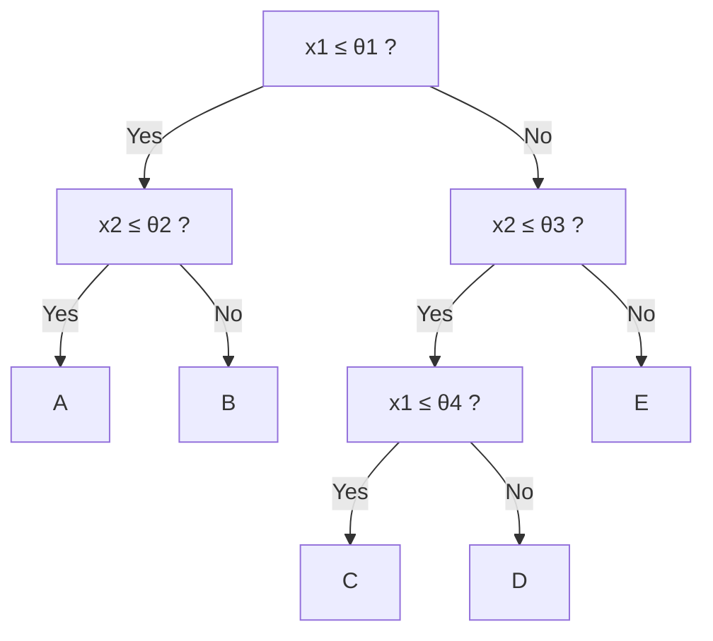
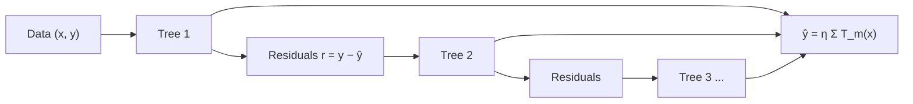
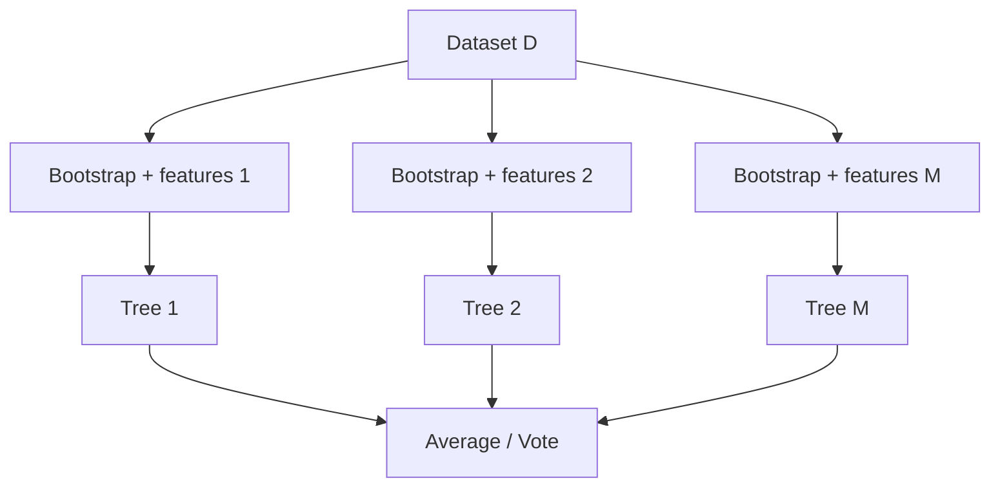

**Notes based off of:** DS 3000/9000 Lecture 10 - Tree-Based Models (https://ds3000cs.pages.dev)

## Motivation: Interpretability

Every model so far has had the form

$$f(\mathbf{x}; \boldsymbol{\theta}) = \boldsymbol{\theta}^\top \phi(\mathbf{x})$$

Such a model can be accurate, but it is hard to explain _why_ it predicted $y_{\text{new}}$ for $\mathbf{x}_{\text{new}}$. Linear regression on California Housing, for example, gives a vector of about 40 weights with mixed signs, and correlated features can even flip the signs. Reading those weights tells you very little.

Decision trees take a different approach. A prediction is a **sequence of yes/no questions about individual features**, and you can follow that path by hand. This is why trees are popular in medicine, credit and other regulated settings, where a model has to justify each decision.

> [!example] Bring an umbrella? 
> "Is it cloudy?" → if not, no umbrella. If it is, "Is the chance of rain > 50%?" → yes means umbrella, and so on. Each internal node asks one question, and each leaf gives an answer.

---

## Decision Trees

### Structure

- **Internal node:** a test on one feature, $x_i \le \theta$ (for a numeric feature) or $x_i = \theta$ (for a categorical one).
- **Branches:** the left branch is "yes" (the test is true) and the right branch is "no".
- **Leaf:** a stored prediction, either a class or a real value.



The same feature can be tested more than once along a path (here $x_1$ is used at the root and again deeper down), each time with a different threshold.

### Space Partitioning Interpretation

Each test $x_i \le \theta$ cuts the current region of input space in two with a line (or hyperplane) **perpendicular to axis $i$**. A tree therefore splits $\mathbb{R}^D$ into **axis-aligned rectangles (boxes)**, one per leaf. For the tree above, in $\mathbb{R}^2$:

|Leaf|Region|
|---|---|
|A|$x_1 \le \theta_1,; x_2 \le \theta_2$|
|B|$x_1 \le \theta_1,; x_2 > \theta_2$|
|C|$x_1 > \theta_1,; x_2 \le \theta_3,; x_1 \le \theta_4$|
|D|$x_1 > \theta_1,; x_2 \le \theta_3,; x_1 > \theta_4$|
|E|$x_1 > \theta_1,; x_2 > \theta_3$|

- **Classification:** each box is assigned a class. Several leaves can share a class, so one class region can be a union of boxes.
- **Regression:** each box is assigned a constant $\mu_k$, so in 1D the model is a **piecewise-constant step function** with steps at $\theta_1, \theta_2, \dots$

> [!note] Consequences of axis-aligned splits
> 
> - A diagonal decision boundary (e.g. $x_1 > x_2$) can only be approximated by a **staircase**, which needs many splits. A linear model handles it in one step.
> - On the other hand, trees capture **nonlinearity and feature interactions** automatically ("if income is high _and_ age < 30...") without hand-built features $\phi(\mathbf{x})$.
> - Splits only depend on the _order_ of feature values, so trees **don't need feature scaling or normalization**, and they are insensitive to monotone transforms such as $\log$.

---

## Learning a Decision Tree

### The Grow-Tree Algorithm

Finding the globally optimal tree is NP-hard, so trees are grown **greedily and top-down**: pick the best split for the current node, divide the data, then recurse on each half.

```
function Grow-Tree(D, d)            ▷ D: data at this node, d: current depth
1  if Stopping-Condition(D, d)
2      return Make-Leaf(Predict-Leaf(D))
3  i*, θ* = Find-Best-Split(D)
4  D_L = {(x, y) ∈ D : x_{i*} ≤ θ*}    ▷ categorical: x_{i*} = θ*
5  D_R = {(x, y) ∈ D : x_{i*} > θ*}    ▷ categorical: x_{i*} ≠ θ*
6  return Make-Node(i*, θ*, Grow-Tree(D_L, d+1), Grow-Tree(D_R, d+1))
```

Three pieces need to be filled in:

1. [[#1. Stopping Condition|A stopping condition]]
2. [[#2. Predicting at a Leaf|A way to predict at a leaf]]
3. [[#3. Finding the Best Split|A way to find the best split]]

> [!warning] Greedy is myopic 
> Each split is the best one _right now_, with no lookahead. XOR is the classic failure: no single split on $x_1$ or $x_2$ reduces the loss, yet two splits together separate the data perfectly. In practice greedy growth works well enough, and ensembles (below) cover much of what is lost.

### 1. Stopping Condition

Common choices, often combined:

- **Maximum depth** reached: $d \ge \texttt{max-depth}$
- **Too few points** in the node: $|\mathcal{D}| < \texttt{min-data}$
- **Pure node**: all labels are the same (classification)
- **Low variance** of the $y$'s in the node falls below a threshold (regression)

These are the main **regularization hyperparameters** of a tree (`max_depth`, `min_samples_split`, `min_samples_leaf` in scikit-learn), and you tune them with validation data. Stopping early like this is called _pre-pruning_. The alternative is _post-pruning_: grow a large tree and then cut back branches that don't improve validation performance (e.g. cost-complexity pruning).

### 2. Predicting at a Leaf

A leaf holds the training points that reached it, $\mathcal{D}_{\text{leaf}} \subseteq \mathcal{D}_{\text{train}}$.

**Classification:** predict the **majority class**. You can also return class proportions as probabilities.

$$\hat y = \arg\max_c \left|{(\mathbf{x}, y) \in \mathcal{D}_{\text{leaf}} : y = c}\right|, \qquad p(y = c \mid \mathbf{x}) = \frac{\#{y = c}}{|\mathcal{D}_{\text{leaf}}|}$$

> [!example] $\mathcal{D}_{\text{leaf}} = {(\mathbf{x}_1, A), (\mathbf{x}_2, A), (\mathbf{x}_3, B)}$ → $\hat y = A$, $p(y = A \mid \mathbf{x}_{\text{new}}) = \tfrac{2}{3}$.

**Regression:** predict the **mean** of the $y$'s, which is the constant that minimizes squared error. The variance of the $y$'s in the leaf gives a rough measure of uncertainty.

> [!example] $y$'s $= {3.0, 4.5, 5.3}$ → $\hat y = \frac{3.0 + 4.5 + 5.3}{3} \approx 4.27$, variance $\approx 0.91$.

> [!tip] Leaf probabilities from a small leaf are poorly calibrated: 
> a leaf with 1 point says $p = 1$. Keep that in mind before treating a deep tree's probabilities as confidence.

### 3. Finding the Best Split

#### Candidate Splits

- **Features:** every index $i \in {1, \dots, D}$.
- **Thresholds:** for feature $i$, sort the unique values of $x_i$ in $\mathcal{D}$ and take the **midpoints** between consecutive values, $\Theta_i$.

> [!example] $x_i = [2.0, 1.0, 3.0]$ → sorted $[1.0, 2.0, 3.0]$ → $\Theta_i = {1.5, 2.5}$. With $\theta = 1.5$: $\mathcal{D}_{\text{left}} = {(\mathbf{x}_2, y_2)}$, $\mathcal{D}_{\text{right}} = {(\mathbf{x}_1, y_1), (\mathbf{x}_3, y_3)}$.

Only midpoints are needed because any threshold between two consecutive values gives exactly the same partition. This keeps the search finite: at most $N - 1$ thresholds per feature.

#### Split Loss

For each candidate $(i, \theta)$, split the data, predict at each child with [[#2. Predicting at a Leaf|Predict-Leaf]], and add up the loss:

$$\mathcal{L}(\mathcal{D}, i, \theta) = \sum_{(\mathbf{x}, y) \in \mathcal{D}_{\text{left}}} \ell(y, \hat y_{\text{left}}) + \sum_{(\mathbf{x}, y) \in \mathcal{D}_{\text{right}}} \ell(y, \hat y_{\text{right}})$$

$$(i^{*}, \theta^{*}) = \arg\min_{(i, \theta)} \mathcal{L}(\mathcal{D}, i, \theta)$$

|Task|$\ell(y, \hat y)$|Meaning of $\mathcal{L}$|
|---|---|---|
|Regression|$(y - \hat y)^2$|Sum of within-child variance × size|
|Classification|$\mathbb{1}[y \ne \hat y]$|Number of misclassified points|

> [!example] Classification split $\mathcal{D} = {(\mathbf{x}_1, A), (\mathbf{x}_2, B), (\mathbf{x}_3, B), (\mathbf{x}_4, B)}$
> 
> - $\mathcal{D}_{\text{left}} = {A, B}$ → predict $A$ (tie), loss $= 1$
> - $\mathcal{D}_{\text{right}} = {B, B}$ → predict $B$, loss $= 0$
> - Total $\mathcal{L} = 1$. The best possible split would isolate $\mathbf{x}_1$ alone, giving $\mathcal{L} = 0$.

> [!note] Impurity and information gain 
> Libraries usually call this **impurity**, and the drop in impurity from parent to children is the **gain**. For classification, 0-1 loss is rarely used in practice because it is "flat": many splits that clearly make the children purer don't change the majority vote, so they get the same score. The usual replacements, with $p_c$ the class proportions in a node:
> 
> - **Gini impurity:** $G = 1 - \sum_c p_c^2$ (scikit-learn's default)
> - **Entropy:** $H = -\sum_c p_c \log p_c$ (its reduction is the _information gain_)
> 
> Both reward moving toward purity even when the majority class stays the same. Each child's impurity is weighted by its size, $\frac{|\mathcal{D}_{\text{left}}|}{|\mathcal{D}|} G_{\text{left}} + \frac{|\mathcal{D}_{\text{right}}|}{|\mathcal{D}|} G_{\text{right}}$, so a split can't win by peeling off one point.

**Cost:** Trying every feature and threshold naively costs $O(D \cdot N)$ splits × $O(N)$ to evaluate each. After sorting once per feature, you can sweep the thresholds while updating counts or sums incrementally, which brings each node down to roughly $O(D, N \log N)$.

### Making Predictions

Prediction is a walk from the root to a leaf, which takes $O(\text{depth})$ time:

```
function Predict-Tree(node, x)
1  if Is-Leaf(node): return node.value
2  if x[node.i*] ≤ node.θ*: return Predict-Tree(node.left, x)
3  else:                    return Predict-Tree(node.right, x)
```

The path followed is itself the explanation: "predicted class 2 because $x_1 > \theta_1$ and $x_2 \le \theta_3$ and $x_1 \le \theta_4$."

### Limitation: Bias vs. Variance

| |Shallow tree|Deep tree|
|---|---|---|
|Bias|High (too few boxes to fit the data)|Low|
|Variance|Low|High (small data changes produce a different tree)|
|Behaviour|**Weak learner**, underfits|Overfits|

At the extreme, a tree grown until every leaf holds one point has **zero training error**: it memorizes the data, including the noise. Trees are also **unstable**: moving a few points can change the root split, and with it everything below.

Pruning only lets you trade bias against variance along a single dial. The two ensemble methods below improve one side without paying much on the other:

- **Boosting** keeps trees shallow (low variance) and **reduces bias**.
- **Random forests** keep trees deep (low bias) and **reduce variance**.

---

## Boosting (Sequential Ensemble)

### Idea

Train shallow trees **one after another**, with each new tree fitting the **mistakes that remain** from the trees before it. One shallow tree is weak, but a sum of many, each fixing a little more of the error, can fit complex functions.

### Training

Residuals for example $n$, where $\hat y_n$ is the **current ensemble's** prediction:

$$r_n = y_n - \hat y_n$$

```
function Boosting-Train(D, M, d_max)
1  for m = 1, …, M
2      if m = 1:  D_m = D
3      else:      D_m = {(x_n, r_n)}_{n=1}^N   ▷ residuals of ensemble so far
4      T_m = Grow-Tree(D_m, d_max)
5  return T_1, …, T_M
```

For binary classification the residual is $r_n = y_n - \hat p_n$, with $\hat p_n$ the predicted probability that $y_n = 1$.

### Prediction

$$\hat y_{\text{new}} = \sum_{m=1}^{M} \eta \cdot \text{Predict-Tree}(T_m, \mathbf{x}_{\text{new}}), \qquad 0 < \eta < 1$$

The residuals are computed against this same shrunken sum, $\hat y_n^{(m-1)} = \eta \sum_{k < m} T_k(\mathbf{x}_n)$, so each tree fixes only a fraction $\eta$ of the remaining error.



The lecture plot shows this on 1D data: with $M = 1$ the fit is a crude step function, and by $M = 10$ to $50$ it closely follows the curve.

> [!info] Why is it called _gradient_ boosting? 
> For squared loss $\frac{1}{2}(y - \hat y)^2$, the negative gradient with respect to the prediction is exactly $y - \hat y$, the residual. Fitting a tree to residuals is therefore **gradient descent in function space**: each tree is a step in the direction that lowers the loss most, and $\eta$ is the **learning rate**. Replacing residuals with the negative gradient of any other differentiable loss (log-loss, absolute error, ...) gives the general **gradient boosting** algorithm.

### The Learning Rate $\eta$

- A small $\eta$ means each tree contributes a little, so you need more trees, but the model usually generalizes better. This is the same reason small step sizes help in gradient descent.
- Typical values are $\eta \in [0.01, 0.3]$, with $M$ in the hundreds to thousands and `max_depth` around 3–8.

> [!question] Boosting can still overfit. When? 
> Bias keeps going down as trees are added, so with **too many trees** (large $M$) the later trees start fitting **noise** in the residuals. The risk is higher with a **large $\eta$** or **deeper trees**. In practice, choose $M$ by **early stopping**: track validation loss and stop adding trees once it starts rising.

### In Practice

Gradient-boosted trees (**XGBoost, LightGBM, CatBoost**, scikit-learn's `HistGradientBoosting*`) are the usual first choice for **tabular data**, where they often beat neural networks. They handle mixed feature types and missing values, and they need little preprocessing.

---

## Random Forests (Parallel Ensemble)

### Idea

Train many **deep, independent** trees on **randomly perturbed** copies of the data, then **average** their predictions. Each tree overfits in its own way, and averaging cancels much of that out.

### Two Sources of Randomness

1. **Bootstrap sampling (bagging):** each tree gets a dataset of $N$ points drawn **with replacement** from $\mathcal{D}$. About 63% of the distinct points appear in each sample, some of them more than once.
2. **Feature subsampling:** each tree (or, in the standard algorithm and scikit-learn, **each split**) only considers a random subset of the features. Common defaults are $\sqrt{D}$ for classification and $D/3$ or all $D$ for regression.

```
function Random-Forest-Train(D, M, d_max)
1  for m = 1, …, M
2      D_m  = Bootstrap-Sample(D)
3      D̂_m  = Sample-Features(D_m)
4      T_m  = Grow-Tree(D̂_m, d_max)
5  return T_1, …, T_M
```

$$\hat y_{\text{new}} = \frac{1}{M} \sum_{m=1}^{M} \text{Predict-Tree}(T_m, \mathbf{x}_{\text{new}})$$

For classification, use a majority vote or average the class probabilities.



### Why Feature Subsampling Matters

If $M$ predictors each have variance $\sigma^2$ and pairwise correlation $\rho$, their average has variance

$$\text{Var}\left(\frac{1}{M}\sum_m T_m\right) = \rho,\sigma^2 + \frac{1 - \rho}{M}\sigma^2$$

Adding trees removes the second term, but the first term, $\rho\sigma^2$, stays no matter how large $M$ gets. Bootstrapping alone leaves the trees highly correlated: if one feature is very strong, every tree splits on it at the root and they all look alike. Restricting the features **decorrelates** the trees and lowers $\rho$. This is the main difference between a random forest and plain bagging.

### Properties

- **Lower variance with little increase in bias.** Each deep tree has low bias, and averaging doesn't add bias.
- **Adding trees doesn't overfit.** Larger $M$ only makes the average more stable, with diminishing returns, so $M$ is limited by compute rather than tuned for accuracy.
- **Embarrassingly parallel.** The trees are independent, so they can all be trained at once.
- **Out-of-bag (OOB) error:** each tree never saw about 37% of the points. Predicting each point using only the trees that didn't train on it gives a nearly free validation estimate.
- They work well with little tuning and are a strong default baseline.

---

## Comparison

|                  | Single tree | Boosting                         | Random forest        |
| ---------------- | ----------- | -------------------------------- | -------------------- |
| Combination      | n/a         | Sequential, weighted sum         | Parallel, average    |
| Base trees       | Any depth   | **Shallow** (weak learners)      | **Deep** (low bias)  |
| Main effect      | n/a         | **Reduces bias**                 | **Reduces variance** |
| More trees →     | n/a         | Can overfit (use early stopping) | Doesn't overfit      |
| Tuning effort    | Low         | Higher ($\eta$, $M$, depth)      | Low                  |
| Interpretability | High        | Low                              | Low                  |
|                  |             |                                  |                      |

> [!warning] The interpretability trade-off 
> Trees were introduced _because_ they are interpretable, but an ensemble of 500 trees is no easier to read than a weight vector. Ensembles give up the readable decision path for accuracy. Partial ways to explain them include **feature importance** (total impurity reduction from splits on each feature, or permutation importance) and SHAP values. These summarize the model's behaviour rather than show one clear rule path.

## Summary

- Decision trees split the input space into **axis-aligned boxes** and predict a constant (majority class or mean) in each.
- They are grown **greedily**: at each node, choose the feature/threshold pair that minimizes the children's loss (or impurity), and recurse until a stopping condition holds.
- Shallow trees underfit, and deep trees overfit and are unstable.
- **Boosting** is sequential: each shallow tree fits the current residuals, scaled by $\eta$, which **reduces bias**.
- **Random forests** are parallel: deep trees trained on bootstrap samples with random feature subsets are averaged, which **reduces variance**.