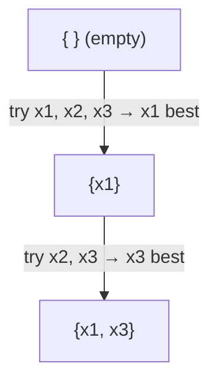
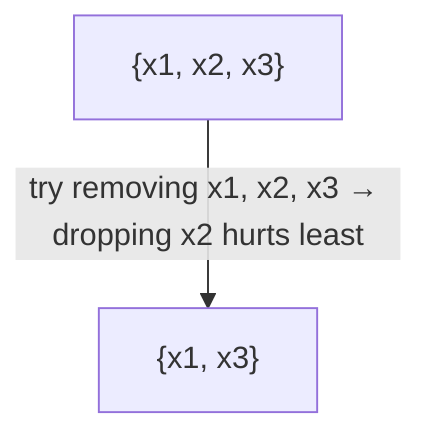

**Notes based off of:** DS 3000/9000 Lecture 6, _Regularization and Feature Engineering_ ([https://ds3000cs.pages.dev](https://ds3000cs.pages.dev/))

## Recap: Where We Left Off

The previous lecture set up the central tension of this one:

- **Bias**: how far, on average (over many possible training sets), the learned function is from the true function $f^{*}$.
- **Variance**: how much the learned function $f_{\mathcal{D}}$ jumps around between different training sets $\mathcal{D}$.
- These combine as: $$ \text{MSE} = \text{Bias}^2 + \text{Variance} ;(+\ \text{irreducible noise}) $$
- **Underfitting** = high bias, low variance (model too simple to capture the pattern).
- **Overfitting** = low bias, high variance (model is flexible enough to memorize the noise).
- **Model selection**: train on $\mathcal{D}_{\text{train}}$, tune on $\mathcal{D}_{\text{val}}$, report on $\mathcal{D}_{\text{test}}$. Use cross-validation when the dataset is small.

Up to now, the only "knob" we had for controlling complexity was a discrete choice like the polynomial degree $M$. This lecture introduces two more tools: **regularization** (a continuous knob on complexity) and **feature engineering** (choosing/shaping what the model sees in the first place).

## Polynomial Regression Revisited

### Setup in 1D

- Dataset: $\mathcal{D} = {(x_n, y_n)}_{n=1}^{N}$ with $x_n, y_n \in \mathbb{R}$.
- Feature map (turns a scalar into a vector of basis functions): $$ \phi(x) = [1, x, x^2, \dots, x^M]^\top $$
- Weights: $\boldsymbol{\theta} = [\theta_0, \theta_1, \dots, \theta_M]^\top$.
- Model: $f(x; \boldsymbol{\theta}, M) = \boldsymbol{\theta}^\top \phi(x)$.
- For any fixed $M$, the **normal equation** gives the optimal $\boldsymbol{\theta}^{*}$ in closed form.

The key point: the model is still _linear in the parameters_ $\boldsymbol{\theta}$, even though it's nonlinear in $x$. That's why all our linear regression machinery (normal equation, gradient ascent on the log-likelihood) still applies.

### What Happens as $M$ Grows

|$M$|Fitted function|Behaviour|
|---|---|---|
|0|$f(x) = 0.07$|A flat line. Underfits badly.|
|1|$f(x) = 0.86 - 1.73x$|A straight line. Still underfits a curved pattern.|
|3|$f(x) = 0.31 + 6.05x - 18.78x^2 + 11.81x^3$|Captures the shape nicely. A good fit.|
|9|$f(x) = 1.61 - 120.66x + 3228.82x^2 - 35580.51x^3 + 200329.62x^4 - \dots$|Passes through every training point but oscillates wildly between them. Overfits.|

### More Flexibility, More Trouble?

Look at the coefficients. At $M=3$ they are in the tens; at $M=9$ they are in the _hundreds of thousands to millions_, with alternating signs. This isn't a coincidence:

- To thread a high-degree polynomial exactly through noisy points, huge positive and negative terms must nearly cancel each other out at the data points. Between the data points, they don't cancel, and the function explodes.
- So **overfitting is often associated with large weight magnitudes.**

This gives a natural fix: rather than restricting $M$, keep the flexible model but **penalize large weights**. The model can still use high-degree terms, but only if they "pay for themselves" in terms of fitting the data.

## Regularization

### $L_2$ Regularization

#### Definition

Recall the $L_2$ (Euclidean) norm: $$ |\boldsymbol{\theta}|_2 = \sqrt{\boldsymbol{\theta}^\top \boldsymbol{\theta}} = \sqrt{\textstyle\sum_{m=0}^{M} \theta_m^2} $$ We add a penalty on its square to the log-likelihood objective: $$ \arg\max_{\boldsymbol{\theta}} ; \log p(\mathcal{D} \mid \boldsymbol{\theta}) - \frac{\lambda}{2} |\boldsymbol{\theta}|_2^2, \qquad \lambda \in \mathbb{R}_{>0} $$ Equivalently, if you prefer minimizing a loss: $$ \arg\min_{\boldsymbol{\theta}} ; \mathcal{L}(\boldsymbol{\theta}, \mathcal{D}) + \frac{\lambda}{2} |\boldsymbol{\theta}|_2^2 $$ **Intuition:** two competing goals. Fit the data well (first term) _and_ keep the weights small (second term). $\lambda$ sets the exchange rate between them.

- $\lambda \to 0$: no penalty, back to ordinary maximum likelihood (can overfit).
- $\lambda \to \infty$: the penalty dominates, all weights get crushed to $0$ (underfits).
- In between: the sweet spot, found by **validation / cross-validation**. $\lambda$ is a _hyperparameter_, just like $M$ was.

So regularization turns the bias–variance tradeoff into a smooth dial: increasing $\lambda$ increases bias and decreases variance.

**Norm examples:**

- $\boldsymbol{\theta} = [1, 2, 3]^\top$: $|\boldsymbol{\theta}|_2 = \sqrt{14} \approx 3.74$.
- $\boldsymbol{\theta} = [0.1, 0.2, 0.3]^\top$: $|\boldsymbol{\theta}|_2 \approx 0.37$.
- $\boldsymbol{\theta} = [0.1, 200, 0.2]^\top$: $|\boldsymbol{\theta}|_2 \approx 200$. A single large weight dominates the norm, and since we _square_ it in the penalty, the $L_2$ penalty is especially harsh on large individual weights.

> **Why the $\frac{1}{2}$?** Purely cosmetic: it cancels the 2 that comes down when differentiating $\theta^2$, giving a clean gradient $\lambda\boldsymbol{\theta}$.

> **Practical note (commonly glossed over):** the bias/intercept term $\theta_0$ is usually _not_ regularized. Penalizing it would just push predictions toward zero rather than reducing complexity. Libraries like scikit-learn leave the intercept out of the penalty by default.

#### Probabilistic Interpretation (Extra Context)

Adding $-\frac{\lambda}{2}|\boldsymbol{\theta}|_2^2$ to the log-likelihood is exactly what you get from **MAP estimation** with a Gaussian prior $\boldsymbol{\theta} \sim \mathcal{N}(\mathbf{0}, \frac{1}{\lambda}\mathbf{I})$: $$ \log p(\boldsymbol{\theta} \mid \mathcal{D}) = \log p(\mathcal{D} \mid \boldsymbol{\theta}) + \log p(\boldsymbol{\theta}) + \text{const} = \log p(\mathcal{D} \mid \boldsymbol{\theta}) - \frac{\lambda}{2}|\boldsymbol{\theta}|_2^2 + \text{const} $$ So regularization is "a prior belief that weights should be small." A larger $\lambda$ is a tighter prior around zero.

### Learning with $L_2$ Regularization

#### Gradients

Differentiating the regularized objective term by term: $$ \nabla_{\boldsymbol{\theta}} \left[\log p(\mathcal{D} \mid \boldsymbol{\theta}) - \frac{\lambda}{2}|\boldsymbol{\theta}|_2^2\right] = \nabla_{\boldsymbol{\theta}} \log p(\mathcal{D} \mid \boldsymbol{\theta}) - \frac{\lambda}{2}\nabla_{\boldsymbol{\theta}} \boldsymbol{\theta}^\top\boldsymbol{\theta} = \nabla_{\boldsymbol{\theta}} \log p(\mathcal{D} \mid \boldsymbol{\theta}) - \lambda\boldsymbol{\theta} $$ **Intuition:** the regularized gradient is the original gradient plus a "pull" back towards the origin, proportional to how far away you are. In the slide's plot, the unregularized gradient field points at the unregularized optimum $\boldsymbol{\theta}^{*}$; the regularized field is bent towards $\mathbf{0}$, so the new optimum lies somewhere between $\boldsymbol{\theta}^{*}$ and the origin.

#### Regularized Normal Equation (Ridge Regression)

For linear regression $f(\mathbf{x}; \boldsymbol{\theta}) = \boldsymbol{\theta}^\top \phi(\mathbf{x})$, setting the regularized gradient to zero gives: $$ \boldsymbol{\theta}^{*} = (\Phi^\top\Phi + \lambda\mathbf{I})^{-1}\Phi^\top\mathbf{y} $$ where

- $\Phi = [\phi(\mathbf{x}_1), \dots, \phi(\mathbf{x}_N)]^\top \in \mathbb{R}^{N \times (M+1)}$ is the design matrix (one row per data point),
- $\mathbf{y} = [y_1, \dots, y_N]^\top \in \mathbb{R}^N$.

Compare to the standard normal equation $\boldsymbol{\theta}^{*} = (\Phi^\top\Phi)^{-1}\Phi^\top\mathbf{y}$: the only change is adding $\lambda$ to the diagonal. This is called **ridge regression**.

Why this matters beyond overfitting: $\Phi^\top\Phi$ can be singular or nearly singular (e.g., more features than data points, or highly correlated features like $x^8$ and $x^9$ on $[0,1]$). Then the inverse doesn't exist or is numerically unstable. Adding $\lambda\mathbf{I}$ makes every eigenvalue at least $\lambda > 0$, so the matrix is always invertible. Ridge regression is _numerically_ better behaved as well as statistically.

#### Regularized Gradient Ascent (Weight Decay)

Plug the regularized gradient into the gradient ascent update: $$ \begin{aligned} \boldsymbol{\theta}^{(t+1)} &= \boldsymbol{\theta}^{(t)} + \alpha\left[\nabla_{\boldsymbol{\theta}}\log p(\mathcal{D}\mid\boldsymbol{\theta}^{(t)}) - \lambda\boldsymbol{\theta}^{(t)}\right] \ &= (\boldsymbol{\theta}^{(t)} - \alpha\lambda\boldsymbol{\theta}^{(t)}) + \alpha\nabla_{\boldsymbol{\theta}}\log p(\mathcal{D}\mid\boldsymbol{\theta}^{(t)}) \ &= (1 - \alpha\lambda),\boldsymbol{\theta}^{(t)} + \alpha\nabla_{\boldsymbol{\theta}}\log p(\mathcal{D}\mid\boldsymbol{\theta}^{(t)}) \end{aligned} $$ Read the last line as a two-step procedure:

1. **Decay**: shrink all weights by a factor of $(1 - \alpha\lambda)$ (slightly less than 1).
2. **Update**: take the usual unregularized gradient step.

This is why $L_2$ regularization is called **weight decay** in the literature, and it's the name you'll see as a parameter in deep learning optimizers (e.g., `weight_decay` in PyTorch's SGD/AdamW). Note we need $\alpha\lambda < 1$, otherwise the "decay" flips the sign of the weights.

### General Regularization

$L_2$ is just one choice of penalty. The family of $L_p$ norms:

- $L_1$: $|\boldsymbol{\theta}|_1 = \sum_{m=0}^{M}|\theta_m|$
- $L_3$: $|\boldsymbol{\theta}|_3 = \left(\sum_{m=0}^{M}|\theta_m|^3\right)^{1/3}$
- $L_\infty$: $|\boldsymbol{\theta}|_\infty = \max{|\theta_0|, \dots, |\theta_M|}$
- In general: $$ |\boldsymbol{\theta}|_p = \left(\sum_{m=0}^{M}|\theta_m|^p\right)^{1/p} $$ More broadly, **any function that penalizes model complexity** can be used as a regularizer. (Other examples you'll meet later: dropout and early stopping in neural networks, pruning in decision trees.)

#### Lasso ($L_1$ Regularization)

The gradient of the $L_1$ penalty is: $$ \nabla_{\boldsymbol{\theta}}, \lambda|\boldsymbol{\theta}|_1 = \lambda,\text{sign}(\boldsymbol{\theta}) = \lambda\begin{bmatrix}\text{sign}(\theta_0) \ \vdots \ \text{sign}(\theta_M)\end{bmatrix} $$ Regression with $L_1$ regularization is called **Lasso regression** (Least Absolute Shrinkage and Selection Operator — the "selection" part becomes important below).

> **Technicality:** $|\theta|$ isn't differentiable at $\theta = 0$. In practice we use a _subgradient_ (any value in $[-1, 1]$ at zero, usually just $0$), or specialised solvers (coordinate descent, proximal methods). Also, unlike ridge, Lasso has **no closed-form solution**.

## Feature Engineering

The model can only be as good as the representation it's given. Feature engineering is about getting that representation right, and in classical ML it's often where the biggest gains come from.

### Feature Extraction

- **Features**: a representation of the raw input that is
    - _more informative_ than the raw input, and
    - _numerical_, so a model can actually use it.
- **Feature extraction**: transforming raw input into features. Examples:
    - $\phi(x) = [1, x, x^2, \dots, x^M]^\top$ (the polynomial features from earlier are a feature extraction!)
    - Text $\to$ word counts ("bag of words").

**Examples by domain:**

- _Spam detection_: presence of certain keywords ("free", "winner"), email length, number of links, whether the sender is in your contacts.
- _Stock price prediction_: past prices, trading volume, last quarter's profit.

The design of $\phi$ is where domain knowledge enters. A linear model on well-chosen features can beat a complex model on raw inputs.

### Feature Preprocessing

Preprocessing doesn't add information but makes learning _easier_. Analogy: converting all lengths to metres so they're comparable.

Why it matters concretely:

- **Gradient descent**: if one feature ranges over $[0, 1000]$ and another over $[0, 1]$, the loss surface is a long, narrow valley. A single learning rate $\alpha$ is either too big for one direction or too small for the other, so convergence is slow and zig-zaggy.
- **Regularization**: the penalty $\lambda|\boldsymbol{\theta}|$ treats all weights equally, but a weight's size depends on its feature's units. A feature measured in km needs a weight 1000× larger than the same feature in m, and so gets penalized much more for no real reason. **Always scale features before regularizing.**

#### Min-Max Scaling

For each feature column $k$: $$ \phi_k(x) \leftarrow \frac{\phi_k(x) - \min_k}{\max_k - \min_k} $$ where $\min_k$ and $\max_k$ are that column's min and max. Result: every column lies in $[0, 1]$.

**Example:**

| $n$ | $\phi_1$ | $\phi_2$ | $\phi_1$ scaled | $\phi_2$ scaled |
| --- | -------- | -------- | --------------- | --------------- |
| 1   | 10       | 1000     | 1               | 1               |
| 2   | −10      | 0.01     | 0               | 0.02            |
| 3   | 5        | −20      | 0.75            | 0               |

(e.g. for $\phi_1$: min $=-10$, max $=10$, so $5 \mapsto \frac{5-(-10)}{20} = 0.75$.)

Weakness: sensitive to outliers. One extreme value (like the 1000 above) squashes all other values into a tiny range near 0.

#### Standardization

For each feature column $k$: $$ \phi_k(x_n) \leftarrow \frac{\phi_k(x_n) - \mu_k}{\sigma_k} $$ where $\mu_k$, $\sigma_k$ are the column's mean and standard deviation. The resulting column has **mean 0 and standard deviation 1** (a "z-score"). In the slide's plot, a cloud stretched from 0–80 in $\phi_1$ and 0–1.5 in $\phi_2$ becomes a round-ish cloud centred at the origin.

Standardization is usually the default choice (less outlier-sensitive than min-max, and doesn't impose a bounded range). Min-max is preferred when you need a bounded range, e.g. pixel intensities.

> **Important (data leakage):** compute $\min$, $\max$, $\mu$, $\sigma$ on the **training set only**, then apply those same numbers to the validation and test sets. Computing them on the full dataset lets information from the test set leak into training and gives optimistic evaluation results.

### Feature Selection

#### Definition

Suppose we have $M$ features ${\phi_1(\mathbf{x}), \dots, \phi_M(\mathbf{x})}$. Not all are useful, and some are actively harmful:

- Polynomial regression with $M = 9$: the high-degree terms mostly enable overfitting.
- Noisy sensors: a feature that's mostly noise gives the model something to (wrongly) fit.

**Feature selection** = choosing a subset of features to use. Benefits: less overfitting, cheaper models, and more _interpretable_ models (you can say which inputs matter).

The naive approach is to try every subset and pick the best by cross-validation, but with $M$ features there are $2^M$ subsets. For $M = 30$ that's over a billion models, each requiring cross-validation. So we use greedy approximations.

#### Forward Selection

1. Start with an empty set of features.
2. For each feature not yet in the set, try adding it and evaluate with cross-validation.
3. Add the one that improves performance the most.
4. Repeat until you have the desired number of features (or performance stops improving).

Example: 3 features, want to select 2.

#### Backward Elimination

1. Start with all features.
2. For each feature in the set, try removing it and evaluate with cross-validation.
3. Remove the one whose removal hurts performance the least.
4. Repeat until you reach the desired number.

Example: 3 features, want to select 2.

**Cost and caveats:** each greedy method needs roughly $O(M^2)$ model fits instead of $2^M$. But being greedy, neither is guaranteed to find the best subset — e.g., two features that are only useful _together_ might never get added by forward selection. Backward elimination handles such interactions better but is more expensive when $M$ is large and you want few features (and impossible to start when $M > N$ for some models).

#### Feature Selection via Regularization

Recall: $$ f(\mathbf{x}; \boldsymbol{\theta}) = \boldsymbol{\theta}^\top\phi(\mathbf{x}) = \sum_{m=1}^{M}\theta_m\phi_m(\mathbf{x}) $$ The magnitude $|\theta_m|$ tells us how much the $m$-th feature contributes to $f$ (assuming features are on comparable scales — another reason to standardize!). If $\theta_m = 0$, feature $m$ is effectively removed. So if we can get a regularizer to push unimportant weights _exactly_ to zero, we get feature selection for free as part of training.

#### $L_1$ Feature Selection

With the $L_1$ gradient $\lambda,\text{sign}(\boldsymbol{\theta})$, gradient ascent becomes: $$ \boldsymbol{\theta}^{(t+1)} = \boldsymbol{\theta}^{(t)} - \alpha\lambda,\text{sign}(\boldsymbol{\theta}^{(t)}) + \alpha\nabla_{\boldsymbol{\theta}}\log p(\mathcal{D}\mid\boldsymbol{\theta}^{(t)}) $$ Compare the shrinkage term per weight:

- $L_1$: $\alpha\lambda,\text{sign}(\theta_m)$ — **constant magnitude** $\alpha\lambda$, regardless of how big $\theta_m$ is.
- $L_2$: $\alpha\lambda,\theta_m$ — **proportional to $\theta_m$**, so it becomes tiny as the weight approaches zero.

**Example:** $\boldsymbol{\theta} = [-0.2, 3.0]^\top$, $\alpha\lambda = 0.1$.

- $L_1$ shrinkage step: $[-0.1, 0.1]^\top$. The small weight is shrunk by half its value in one step; it will hit zero soon.
- $L_2$ shrinkage step: $[-0.02, 0.3]^\top$. The small weight barely moves; the big weight gets shrunk the most.

So $L_2$ makes weights _small_ but almost never _exactly zero_ (the pull vanishes as you approach zero, like Zeno's paradox). $L_1$ keeps pushing with the same force all the way to zero, so weights that aren't strongly supported by the data get driven to (or near) zero. This **encourages sparsity**: many $\theta_m$'s end up zero, and the surviving features are the "selected" ones.

**Geometric intuition (extra context):** regularization is equivalent to constraining $\boldsymbol{\theta}$ to a region, $|\boldsymbol{\theta}|_p \le t$. The $L_2$ region is a circle (smooth), the $L_1$ region is a diamond with corners on the axes. The loss contours usually first touch the diamond at a corner, and corners are exactly where some coordinates are zero. The circle has no corners, so its touching point generally has all coordinates nonzero.

**$L_1$ vs $L_2$ in practice:**

| |$L_2$ (Ridge)|$L_1$ (Lasso)|
|---|---|---|
|Effect on weights|Shrinks all smoothly; rarely exactly 0|Drives many to exactly 0 (sparse)|
|Closed form|Yes|No|
|Correlated features|Spreads weight across them|Tends to pick one arbitrarily|
|Prior (MAP view)|Gaussian|Laplace|
|Use when|Most features matter a bit; want stability|You suspect few features matter; want interpretability|

(Combining both, $\lambda_1|\boldsymbol{\theta}|_1 + \lambda_2|\boldsymbol{\theta}|_2^2$, is called **Elastic Net**, a common compromise.)

## Summary

- **Regularization** penalizes large weights, giving a continuous knob ($\lambda$) on model complexity, tuned via validation.
    - $L_2$ = ridge regression = weight decay; closed form $(\Phi^\top\Phi + \lambda\mathbf{I})^{-1}\Phi^\top\mathbf{y}$.
    - $L_1$ = Lasso; encourages sparsity, so useful for feature selection.
- **Feature extraction**: transform raw input into informative numerical features.
- **Feature preprocessing**: scale features (min-max or standardization) to make learning easier; fit scaling on training data only.
- **Feature selection**: choose a subset of features — via forward selection, backward elimination, or $L_1$ regularization.